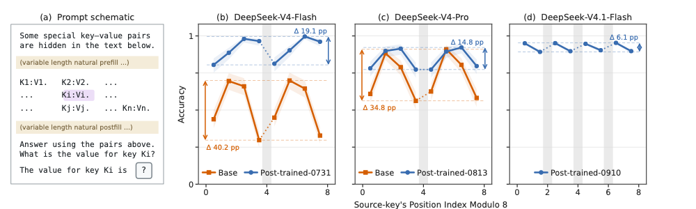
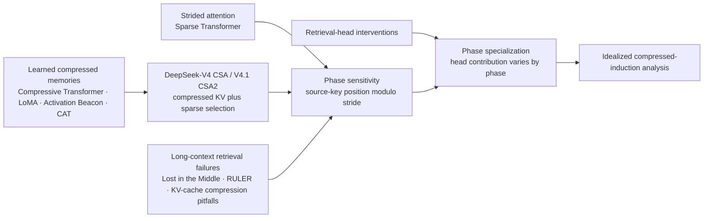
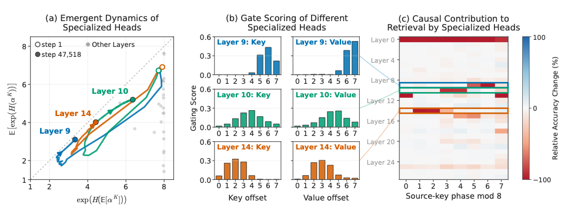

# Periodic Weak Spots: Phase Sensitivity from Chunked KV-Cache Compression

**Paper:** Periodic Weak Spots: Phase Sensitivity from Chunked KV-Cache Compression  
**Authors:** Xingyu Zhu, Pu (Luke) Yi, Ziheng Cheng, Ang Lv, Jing Liu, Lexing Ying, Yiyuan Ma, and Xin Dong  
**arXiv:** [2609.36322v1](https://arxiv.org/abs/2609.36322v1), 28 September 2026

**Related pages:** [Chunked KV-Cache Compression](../../../terms/chunked-kv-cache-compression.md), [KV Cache](../../../terms/kv-cache.md), [DeepSeek-V4](../../../training/model-families/deepseek/deepseek-v4/index.md), [DeepSeek-V4.1-Flash](../../../training/model-families/deepseek/deepseek-v4.1/index.md), [DeepSeek-V4.1 cache path](../../../frameworks/serving/model-kv-cache/deepseek-v4.1-flash.md)

**Extraction note:** MinerU precise extraction was unavailable because `MINERU_API_TOKEN` is not configured, so the supplied PDF was extracted locally with macOS PDFKit. No source was uploaded to MinerU. Text order is preserved, but equation and table layout can be lossy; the numerical claims and selected figures below were checked against the original PDF.

## TL;DR

**What:** The paper identifies **phase sensitivity**: retrieval of the same information can change periodically with its position inside [chunked KV-cache compression](../../../terms/chunked-kv-cache-compression.md)'s stride.

**How:** It compares phase-matched needle-in-a-haystack retrieval, controlled compressed and full-attention models, attention-head interventions, and an idealized compression theory.

**The number:** At 128K context, DeepSeek-V4-Flash-Base's best-to-worst phase gap is **40.2 percentage points**; post-training narrows but does not eliminate the measured gaps.

## The Big Picture

*Source: Figure 2 in [the paper](https://arxiv.org/abs/2609.36322v1). ① Keep the key-value bindings and question fixed. ② Move the target key among positions modulo eight. ③ Compare each checkpoint's best and worst residue; the arrows show the phase gap.*

The main result is not simply that retrieval gets worse in long prompts. **The same target can be easy or hard depending on which compression phase holds it.**

## Why This Exists

Imagine a long prompt containing the one-token pair `K_i:V_i`; the query asks for `K_i`'s value. Keep the pair, query, and total prompt length fixed, but vary filler so the key begins at a different residue of the compression stride. The model sees the same answer-bearing content, yet the compressor may place it at a different offset in its summary. A single average score can hide a residue where the answer is often lost.

The paper's 128K needle-in-a-haystack (NIAH) test controls for simple position effects: prompts use the same key-value bindings, prompt length, and query position, while the mean and variance of the source key's absolute position are matched across residue groups. The test therefore asks whether the *phase* itself predicts retrieval, rather than whether one group merely places the key closer to the query.

A separate code-completion example makes the shift tangible. DeepSeek-V4-Flash-Base sees the same [FP8](../../../terms/fp8.md) cast after a decorative docstring whose filler length changes. The preferred next token flips between the correct `"8"` and incorrect `"32"` with a four-token period, matching V4's CSA stride.

## The Landscape

The editable diagram is [phase-sensitivity-landscape.mmd](./assets/phase-sensitivity-landscape.mmd).

The paper connects two previously separate observations: compressed memories introduce chunk boundaries, while retrieval quality can vary with source position. Its contribution is to isolate the **periodic residue within the compression stride**, then test how attention components contribute to the pattern.

## The Core Idea

Compression gives a token a second address: not just its absolute location in the prompt, but its **phase relative to the compression windows**. Because summaries are formed before a future query is known, shifting a key-value pair by a few tokens can change which positions contribute to its compressed representation. The paper finds that this changes retrieval periodically, and that the effects cannot be reduced to pairs split across a window boundary alone.

## Symbol Map

The paper uses $W$ for how many source tokens a window summarizes and $S$ for how often a compressed entry is produced. They are equal in the non-overlapping reference model, but not in every ablation.

| Symbol | Human name | Shape or scope | Plain meaning |
|---|---|---|---|
| $t$ | source-key position | token index | Position where the target key begins. |
| $S$ | compression stride | tokens | Period between compression positions; it determines the phase cycle. |
| $W$ | window size | tokens | Number of source positions summarized by one compressed entry. |
| $\phi = t \bmod S$ | source phase | residue in $[0,S)$ | The target key's position relative to the compression stride. |
| $\alpha^K_{j,i}, \alpha^V_{j,i}$ | key/value gate weights | head, window $j$, offset $i$ | How strongly each position contributes to the compressed key or value. |
| $K_i, V_i$ | target key and answer value | one-token pair | The fixed retrieval needle used in the running example. |

## Deep Dive

### Phase is a second coordinate

**What it does:** Phase records a source key's position modulo the compression stride, $\phi = t \bmod S$.

**Why it matters:** Two prompts can preserve the same key-value relation and relative ordering while assigning that key different offsets in the compressor's periodic layout.

**How it works:** Every $S$ tokens the compressor advances its output position. Shifting the prefix by one token changes $\phi$ by one; after $S$ shifts, the phase repeats. With overlapping windows, $W$ can exceed $S$, but the paper's tested retrieval pattern still follows $S$.

**The intuition:** Chunking makes token position inside the compression cycle matter, even when the token's meaning does not change.

**A concrete example:** Keep `K_i:V_i` and its query fixed, then add one filler token before the pair. The key moves to the next phase, so a phase-conditioned evaluation can expose a change that an average over all filler lengths conceals.

**Remember:** Report retrieval against $\phi$, not only against absolute context length.

### The stride predicts the period; boundaries are not enough

**What it does:** Controlled pretraining tests whether chunked compression, rather than unrelated DeepSeek architecture choices, is sufficient to produce phase sensitivity.

**Why it matters:** If the only issue were a key and value being split across a window boundary, positions that keep the pair in one window should behave similarly.

**How it works:** The authors train Qwen3-derived models with compression as the main architectural change and compare them with matched full-attention baselines. They vary $W$ and $S$, overlap windows, remove rotary position embeddings, and replace learned gates with uniform averaging. Compressed variants remain periodic; the full-attention baselines do not show a comparable pattern. In the $W8/S8$ reference, phases 0 through 6 keep adjacent key and value tokens in the same window, yet their accuracies still differ by more than 50 percentage points.

**The intuition:** A boundary split can worsen retrieval, but it cannot explain all the weak phases inside an otherwise shared window.

**A concrete example:** In the running `K_i:V_i` test, compare two phases from 0 through 6 under $W8/S8$. Neither pair crosses a window edge, but the model can still retrieve them at different rates.

**Remember:** In the tested geometries, the period follows the stride, not just the window width or the presence of a boundary split.

### Phase specialization assigns retrieval work to different heads

**What it does:** Phase specialization names the observed asymmetry in which attention heads or layers contribute differently to retrieval at different source phases.

**Why it matters:** A model-wide score cannot tell whether one head reliably carries only a subset of the positions that a compressor produces.

**How it works:** The authors replace a KV head's prompt-specific output with its mean over other prompts, then measure the accuracy change by source phase. In full attention, important layers affect phases more uniformly. In compressed models, intervention effects vary across phases and often repeat at the compression stride. DeepSeek-V4-Flash-Base also shows phase-dependent layer effects; in this test, its heavily compressed HCA layers contribute little to retrieval.

**The intuition:** Different heads can become specialists for different positions inside the compressed summary.

**A concrete example:** Run the same `K_i:V_i` prompt at several phases, then knock out one head. If accuracy falls mainly for one phase group, that head's prompt-specific contribution is phase-dependent in this intervention.

**Remember:** The interventions support a causal role for different heads in the tested retrieval tasks; they do not establish one universal mechanism for every compressed model.

### Learned gates can align heads with phases

*Source: Figure 5 in [the paper](https://arxiv.org/abs/2609.36322v1). ① Some key gates become statically concentrated during training. ② Layers 9, 10, and 14 favor early, middle, and late key offsets, with value gates peaking one offset later. ③ Their intervention effects align with the phases they favor.*

**What it does:** A compression gate assigns a weight to each position in the window before its key or value payload is summarized.

**Why it matters:** A gate that repeatedly prefers the same offset can make the corresponding head especially useful for keys or values at that phase.

**How it works:** In one $W8/S8$ model, some heads develop static offset preferences across inputs. The key gates in Layers 14, 10, and 9 favor early, middle, and late offsets; their value gates peak one position later, matching an adjacent key-value pair. Cycling these gate parameters shifts within-window accuracy patterns in five models, but it does not restore the boundary phase. Uniform averaging also retains phase sensitivity, so learned gate preferences are one mechanism, not a complete explanation.

**The intuition:** If a head learns to keep one slot especially well, it can become a reliable reader for the phase that lands in that slot.

**A concrete example:** If `K_i` lands at an offset favored by a head's key gate and `V_i` lands at the next offset favored by its value gate, that head's intervention can matter more for this phase than for another.

**Remember:** Gate preferences align with phase-specific retrieval in the studied model, but they are not required for phase sensitivity to appear.

### The theory explains a possible training path, not every model

**What it does:** An idealized induction task studies why a query-agnostic compressor might learn to concentrate on selected positions.

**Why it matters:** The empirical gate preferences raise a question: why would training favor particular offsets when the future query is not yet known?

**How it works:** With fixed embeddings, a simplified bigram-retrieval objective, and stated geometry assumptions, the paper shows that an optimal compressor can put key weight on one position $r$ and value weight on its successor $r+1$. In a restricted linear-gate model, gradient flow from small random initialization drives each head toward a persistent key/value offset pair under the theorem's conditions.

**The intuition:** A head can specialize in preserving a key and its successor because that is enough to answer the modeled query.

**A concrete example:** The idealized task also stores `K_i:V_i`; it explains why a compressor could prefer the key slot and its next value slot, but it is not a proof that every large language model learns this way.

**Remember:** Treat the theory as a mechanism under explicit assumptions, not as a universal explanation of phase sensitivity.

## Putting It Together

| Step | Actor | Input state | Action | Output state |
|---:|---|---|---|---|
| 1 | Prompt builder | A long context containing `K_i:V_i` and a query for `K_i` | Choose filler so the source key lands at phase $\phi$ | Same target binding, with a recorded phase |
| 2 | Compressor | Tokens grouped into windows of width $W$ and stride $S$ | Form fewer key/value entries before the query is answered | A compressed memory whose representation depends on the target's offset |
| 3 | Query attention | Query for `K_i` and the compressed memory | Read the stored summaries through the model's attention heads | A prediction whose retrieval support can vary by phase |
| 4 | Evaluator | Prediction and known value `V_i` | Repeat across matched residue groups and score the answer | Phase-conditioned accuracy and its max-minus-min gap |

The diagnostic changes one thing—the source's phase—then observes whether compression, attention, and the final answer change with it.

## What This Buys You

### The headline claim

**Phase-conditioned evaluation is necessary for chunk-compressed KV models:** a good average can coexist with a weak residue.

### How we know: controlled retrieval

| Evidence | Conditions | Reported phase spread | What it establishes |
|---|---|---:|---|
| DeepSeek-V4 family NIAH | 128K prompts, 16K single-token pairs, matched query and position distributions | Up to 40.2 pp for V4-Flash-Base; 34.8 pp for V4-Pro-Base; post-trained gaps of 19.1 pp and 14.8 pp; 6.1 pp for tested V4.1-Flash | Post-training narrows the gap but all five evaluated checkpoints remain phase-sensitive. |
| Controlled Qwen3-derived models | 64 key-value pairs; multiple window and stride designs | Up to 78 pp with Prefix Padding; full-attention baselines at most 6.1 pp | The periodic pattern appears across the compressed kernel family and is absent at comparable scale in the full-attention controls. |
| Stride ablations | $W8$ with $S=4,6,8$; $W12/S12$; overlapping and uniform-average variants | Periods of about 4, 6, 8, and 12 tokens, following tested strides | Neither learned gates, RoPE, nor non-overlapping windows are required for the observed effect. |
| Matched summary metrics | $W8/S8$, eight KV heads | Worst residue 9.9% versus 58.4% for its full-attention baseline | Similar mean accuracy and validation loss can hide a much weaker worst phase. |

### The mechanism behind the numbers

The experiments separate **where the effect appears** from **one way it may arise**. Controlled compression variants establish that phase sensitivity is robust to several kernel choices; interventions show phase-dependent contributions from attention components; one gate study connects persistent offset preferences to those contributions. The theory makes a similar specialization plausible in an idealized setting, without claiming to settle the cause in large models.

### ⚠️ How to read these numbers

The reported gap is the best-minus-worst accuracy across source-position residue groups, not a drop against a baseline and not a universal model penalty. The 40.2 pp result belongs to a specific 128K NIAH setup and checkpoint; the smaller 6.1 pp V4.1-Flash gap still has a periodic pattern, with all even residue groups above all odd ones.

## Where It Breaks

| Failure mode | When it happens | Impact |
|---|---|---|
| Boundary-only diagnosis | A key-value pair straddles a compression window | The split may hurt, but it does not explain large differences among phases whose pairs stay in one window. |
| Average-only evaluation | A benchmark pools all source phases into one score | A severe weak residue can disappear behind a similar mean accuracy or validation loss. |
| Stride mismatch | The diagnostic groups positions by a modulus other than the model's compression stride | The periodic pattern can be blurred or missed. |
| Overgeneralizing the mechanism | Gate and head results from the tested models are treated as universal | The authors do not establish a single cause for large heterogeneous models; gate cycling also leaves the boundary phase unresolved. |
| Applying the theory directly to production models | The idealized induction result is read as a theorem about a trained LLM | Its conclusions rely on fixed embeddings, a simplified task, and explicit geometry and initialization assumptions. |
| Inferring deployment robustness | The NIAH and code-completion findings are generalized to arbitrary user requests | The paper leaves effects on real-world safety and robustness behavior for future study. |

## One Thing to Remember

The durable retrieval cue is **phase is a hidden coordinate**: compression can preserve the prompt's meaning while changing how a source token is summarized, so evaluate every stride residue rather than trusting only the average.

## Go Deeper

- **Read:** [Periodic Weak Spots on arXiv](https://arxiv.org/abs/2609.36322v1)
- **Build on:** [DeepSeek-V4](../../../training/model-families/deepseek/deepseek-v4/index.md) and [DeepSeek-V4.1-Flash](../../../training/model-families/deepseek/deepseek-v4.1/index.md)
- **Understand the concepts:** [Chunked KV-Cache Compression](../../../terms/chunked-kv-cache-compression.md) and [KV Cache](../../../terms/kv-cache.md)
- **Reproduce:** Appendix C describes the retrieval protocols and Appendix F extends the controlled-model analyses; the supplied paper does not cite a public implementation.
