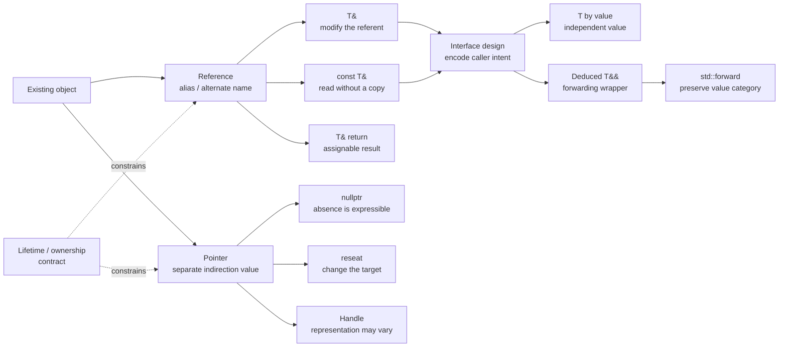

# C++ References: Aliases, Binding, Lifetime, and Interface Design

**Source:** [Standard C++ FAQ: References](https://isocpp.org/wiki/faq/references), captured on 2026-09-15.

**Evidence bundle:** [immutable HTML](../../../raw/frameworks/cpp-references-faq--web-2026-09-15-4aae33c31c6c.html) · [capture metadata](../../../raw/frameworks/cpp-references-faq--web-2026-09-15-4aae33c31c6c.metadata.json) · [derived Markdown](../../../derived/web-markdown/frameworks/cpp-references-faq--web-2026-09-15-4aae33c31c6c.md)

**Scope:** This page turns the FAQ's examples into a practical model for ordinary lvalue references: what they alias, why assignment does not reseat them, how returned references enable indexing and chaining, and when a pointer or value communicates a better contract.

**Related pages:** [C++](./index.md) · [C++ Universal References: Forwarding and Perfect Forwarding](./universal-references.md) · [Frameworks](../index.md)

> **Evidence:** The captured FAQ defines a reference as an alternate name for an object and uses `swap`, `Array::operator[]`, method chaining, pointer comparison, null-pointer invalidity, handle design, and call-by-value guidance to explain the consequences.
>
> **Important:** A reference is not a pointer with shorter syntax. It is a non-reseatable aliasing interface; the implementation may use an address, but that representation is not the programmer-facing meaning.

## TL;DR

**What:** `T&` gives an existing object another name. Reading or writing through the reference reads or writes the referent; it does not copy the object.

**How:** A reference binds when it is initialized and cannot later be made to name another object. `const T&` preserves aliasing while preventing mutation through that access path.

**The boundary:** A reference does not express absence or reseating. Use a pointer or another handle when `nullptr`, changing targets, or representation independence is part of the contract; use a value when the callee should receive an independent object.

## The Big Picture

The reader question is: **what should an interface type say about mutation, copying, absence, and ownership?**

| Need at the interface | A useful form | What the caller can express | Main contract |
|---|---|---|---|
| Mutate an existing object | `T&` | Must provide an object | The callee may change the caller's object; there is no null sentinel. |
| Inspect a large object without copying | `const T&` | Provides an object, including a temporary for the duration of a call | The callee cannot mutate through this reference; the access is non-owning. |
| Make absence or reseating explicit | `T*` or a deliberate handle type | Provides an object, `nullptr`, or a new target | The callee must define null handling and lifetime expectations. |
| Receive an independent value | `T` | Supplies a copy or move into the parameter | The callee works with its own parameter value; return-by-value may be clearer than an output mutation. |
| Preserve the caller's value category in a template | Deduced `T&&` plus `std::forward<T>` | Accepts lvalues and rvalues while retaining the distinction | The wrapper must forward the original deduced `T`; see the [forwarding-reference page](./universal-references.md). |

The FAQ's “big means more than a couple of words” rule is a useful historical heuristic, not a complete modern performance rule. Copy elision, move construction, ownership, and API readability still matter.

## Why This Exists

Consider a function that exchanges two caller-owned integers:

```cpp
void swap_ints(int& i, int& j)
{
    int tmp = i;
    i = j;
    j = tmp;
}

int x = 1;
int y = 2;
swap_ints(x, y);  // x becomes 2; y becomes 1
```

The function does not receive two integer copies and return two replacements. Its `i` and `j` names are aliases for `x` and `y`, so the writes happen directly to the caller's objects. The same mechanism makes a class's `operator[]` useful: returning `float&` makes `a[i]` an assignable expression.

The design trade-off is that aliasing is powerful but non-owning. A reference can make mutation concise and avoid copies, but it cannot represent “there is no object,” cannot be reseated, and does not by itself keep the referent alive. These are interface-contract questions, not merely spelling preferences.

## The Landscape

The evolutionary and conceptual map is saved as [references-landscape.mmd](assets/references-landscape.mmd).



*Synthesized landscape from the captured FAQ and the related forwarding-reference page. The key split is between an alias that must already designate an object and a pointer or handle that can encode indirection, absence, or target changes.*

## The Core Idea

Think of a reference as a second spelling for an existing object. Once `int& r = x;` has bound `r` to `x`, the language treats uses of `r` as uses of `x`. The reference does not become a third integer, and `&r` produces the address of `x`, not the address of a separate reference object.

That model explains four rules that are easy to mix up:

- Binding happens at initialization.
- Assignment through a reference changes the referent.
- A reference cannot be reseated.
- A reference is not a nullable sentinel.

The underlying machine may implement a reference with an address-sized value, but the FAQ explicitly warns against promoting that implementation detail into the programming model.

## Symbol Map

| Symbol | Meaning | What it communicates |
|---|---|---|
| `T&` | Lvalue reference | Alias an existing mutable object; mutation through this access path is possible. |
| `const T&` | Reference to a const `T` | Alias without permitting mutation through this name; often avoids copying a large read-only argument. |
| `T&&` | Rvalue reference | Bind to an rvalue expression; in a directly deduced template parameter it can form a forwarding reference. |
| `T*` | Pointer to `T` | Separate value with explicit indirection; can be null and can be reseated. |
| `T& f()` | Function returning a reference | Return an alias that can be used as an lvalue, provided the referent outlives the use. |
| `nullptr` | Null pointer value | Explicitly represents “no pointed-to object”; it is not a valid referent for `T&`. |
| `this` | Pointer to the current object | Historical C++ member-function syntax; member calls still provide reference-like access to the object. |

The `T&&` row is intentionally brief here. The source FAQ focuses on ordinary references; the [forwarding-reference insight](./universal-references.md) covers deduction, reference collapsing, named parameters, `std::forward`, and perfect forwarding.

## Deep Dive

### 1. A reference is an alias, not a second object

**What it does:** It gives a caller-owned object another name inside a function, class, or expression.

**Why it matters:** Code can express the operation directly. In the `swap_ints` example, `i` is `x` for the purpose of every read and write inside the function.

**How it works:** The parameter is initialized by binding to the argument:

```cpp
int value = 10;
int& alias = value;

alias += 5;
// value is now 15
// &alias == &value
```

The equality of addresses is a consequence of both names designating the same object. It does not mean that C++ exposes a reference object whose address can be manipulated independently.

**Remember:** If the operation should affect the original object, `T&` makes that relationship explicit in the callee's type.

### 2. Assignment changes the referent; it does not reseat the reference

**What it does:** The assignment operator acts on the object named through the reference.

**Why it matters:** This is the most common pointer/reference mental-model collision.

**How it works:**

```cpp
int x = 1;
int y = 2;

int& r = x;  // binding: r refers to x
r = y;       // assignment: write y's value into x

int* p = &x;
p = &y;      // reseating: p now points to y
```

After `r = y`, `x` is `2` and `r` still refers to `x`. After `p = &y`, `p` refers to `y`. A reference has no corresponding assignment operation that changes its target.

**The intuition:** A pointer is a small object that stores an address-like relationship. A reference is the language's aliasing relationship itself.

### 3. Returning a reference makes an expression assignable

**What it does:** A function can return an alias to an existing subobject or object.

**Why it matters:** This is why `a[i] = 7` works when `a[i]` is implemented by `Array::operator[]`.

```cpp
class Array {
public:
    float& operator[](int index);
};

Array a;
a[3] = 7;  // the call returns a float lvalue, so assignment is valid
```

The returned `float&` is not a new float. It is a usable name for the element selected by the index. The same idea supports method chaining: a mutating method can return `*this` by reference, allowing `object.method1().method2()`. The FAQ points to iostreams as the common example: `cout << x << y` works because the first insertion returns `cout` for the next operation.

**Boundary:** A reference return is safe only when the referent will remain alive for every use of the returned expression. Returning a reference to a local variable creates a dangling alias.

### 4. References and pointers answer different interface questions

**What it does:** It separates non-null aliasing from explicit indirection.

**Why it matters:** Choosing `T&` or `T*` tells callers whether absence and target changes are part of the valid state space.

**How it works:**

| Property | Reference | Pointer |
|---|---|---|
| Must designate an object in a valid use | Yes | No; it may be `nullptr`. |
| Can be reseated | No | Yes. |
| Requires explicit dereference at the call site | No | Usually yes. |
| Has its own identity as a separately assignable value | No | Yes. |
| Usually preferred for a required public argument | Often | When nullability or reseating matters. |

The FAQ's rule of thumb is “use references when you can, and pointers when you have to.” Read it as an interface heuristic, not a ban on pointers. A pointer is the clearer contract when the caller may legitimately pass “no object,” when a target must change, or when a low-level data structure needs explicit indirection.

The word *handle* can be broader still: it may mean a pointer, index, key, table entry, or wrapper whose representation can change. Keeping that representation behind a handle type can reduce the maintenance ripple when objects move, are serialized, or need a different lookup strategy.

### 5. const T& trades mutation for access without a copy

**What it does:** It binds an alias while making the referred-to `T` read-only through that alias.

**Why it matters:** A large input can be inspected without copying, while the signature makes the callee's non-mutation promise visible.

```cpp
void inspect(const std::string& text);
void mutate(std::string& text);
void consume(std::string text);
```

`inspect` can read the caller's string without taking an independent copy. `mutate` may change the caller's string. `consume` receives a value and therefore communicates that the function works with its own parameter object, even though construction may use a copy or move.

A `const T&` parameter can bind to a temporary, but that temporary is guaranteed to last only through the full expression containing the call. Do not save the reference for later unless another lifetime or ownership contract keeps the object alive. For small types, passing by value is often simpler; the FAQ's size heuristic should be balanced against modern move and copy-elision behavior.

### 6. A reference cannot be a null-pointer sentinel

**What it does:** The language's reference contract assumes that the binding designates a valid object.

**Why it matters:** A compiler may optimize under that assumption, so code that tries to manufacture a null reference cannot be made reliable by observing one compiler's output.

```cpp
int* p = nullptr;
int& r = *p;  // invalid: the reference does not designate a valid object
```

The captured FAQ says this remains illegal even if a particular compiler accepts it without a diagnostic or happens to generate code that appears to work. It also gives the example that a compiler may optimize away a later null test because a valid reference is assumed not to originate from a dereferenced null pointer.

The same reasoning applies to dangling aliases: a reference is not an ownership mechanism. A reference to a destroyed local, a destroyed heap object, or a temporary whose lifetime has ended is no safer because its spelling lacks `*`.

**Better boundary:** If “no object” is valid, use a pointer or a handle whose empty state is documented. If the callee must extend or own the lifetime, use an ownership-bearing value such as an owning smart pointer or a value object, according to the API's semantics.

### 7. Returning a value may be clearer than mutating through a reference

**What it does:** It compares an in-place mutation API with an explicit result API.

**Why it matters:** Reference semantics can hide a state change at the call site.

```cpp
void incr_in_place(int& x) { ++x; }
int  incr_value(int x)      { return x + 1; }

int v = 2;
incr_in_place(v);  // v becomes 3
v = incr_value(v); // the new value is explicit
```

The FAQ recommends preferring the returned-value form when creating and copying the result is inexpensive. This is a readability and error-avoidance guideline as much as a performance guideline. Use a reference when in-place mutation is the operation the interface really means; do not use one merely to avoid every possible copy.

### 8. this is historically a pointer

**What it does:** It explains why member functions use `this` instead of a reference to the current object.

**Why it matters:** A member call has reference-like access to the object, but the language's special name is still pointer-shaped.

The FAQ attributes the choice to history: `this` entered C++ before references and followed Simula's usage rather than Smalltalk's later `self`. That historical fact does not change the interface rules above; member functions still need a valid current object, and `this` can be used for explicit pointer operations where the language permits it.

## Putting It Together

The reader question is: **what exactly changes when `swap_ints(x, y)` runs?**

```cpp
void swap_ints(int& i, int& j)
{
    int tmp = i;
    i = j;
    j = tmp;
}

int x = 1;
int y = 2;
swap_ints(x, y);
```

| Step | State transition | Result |
|---|---|---|
| 1. Caller creates objects | `x` is `1`; `y` is `2` | Two live objects exist in the caller. |
| 2. Parameter binding | `i` aliases `x`; `j` aliases `y` | No integer copy is created for the reference parameters. |
| 3. Save the first value | `tmp = i` reads `x` | `tmp` is an independent value equal to `1`. |
| 4. First write | `i = j` writes `y`'s value through the alias | `x` becomes `2`; `y` remains `2`. |
| 5. Second write | `j = tmp` writes through the second alias | `y` becomes `1`; `x` remains `2`. |
| 6. Return | `i` and `j` stop being in scope | `x` and `y` remain alive with exchanged values. |

The reference parameters are temporary names for the duration of the call; they do not own or outlive `x` and `y`. The local `tmp` is deliberately a value because the algorithm needs an independent saved copy.

## What This Buys You

**The headline:** References let an interface say “this operation works on that existing object” without making callers write pointer syntax.

**How we know:** The FAQ's `swap` example demonstrates mutation through aliases; `Array::operator[]` demonstrates an assignable reference return; its pointer comparison demonstrates that `&reference` yields the referent's address; and its parameter guidance distinguishes mutation, read-only large inputs, values, and nullable pointers.

**The mechanism behind the benefit:** The type and expression syntax encode caller intent at the boundary:

- `T&` makes required aliasing and possible mutation concise.
- `const T&` makes required aliasing and read-only access concise.
- `T*` makes indirection, nullability, and reseating available.
- `T` makes an independent value the central object of the operation.
- A handle type can hide whether lookup uses a pointer, index, key, or table.

This is primarily a correctness and readability benefit. The captured FAQ does not provide benchmark data, so a reference spelling alone should not be treated as a universal performance guarantee.

## Where It Breaks

| Failure mode | Why it fails | Safer design |
|---|---|---|
| Treating `T&` as nullable | A reference has no valid empty state; dereferencing null to create one violates the language rules. | Use `T*`, an optional-like wrapper, or a documented handle. |
| Writing `r = other` to “rebind” | Assignment changes the object currently named by `r`. | Use a pointer or handle when the target must change. |
| Returning a reference to a local | The local is destroyed when the function returns, leaving a dangling alias. | Return by value or return a reference only to storage whose lifetime is guaranteed. |
| Saving a reference to a short-lived temporary | The temporary may die at the end of the full expression containing the call. | Copy/own the value or document and enforce a longer lifetime. |
| Using an output reference for a cheap result | The mutation is less visible and easier to misuse than an explicit returned value. | Prefer return-by-value when construction and copying are inexpensive. |
| Assuming address-like implementation means pointer semantics | The compiler representation does not grant nullability, reseating, or reference identity. | Program to the reference contract, not an imagined layout. |
| Leaving ownership implicit behind `T&` or `T*` | Neither raw form expresses who destroys or keeps the object alive. | Document ownership or use an ownership-bearing type. |

The first six rows follow directly from the FAQ's alias, assignment, return, pointer, null, and implementation-model explanations. The ownership row is a design inference from the same non-owning alias/indirection model.

## One Thing to Remember

**A reference is a required alias to an existing object: bind it once, use it as the object, and choose a pointer, handle, or value when absence, reseating, ownership, or independent state is part of the design.**

## Go Deeper

- [Standard C++ FAQ: References](https://isocpp.org/wiki/faq/references) — The captured source, including the original examples and historical notes.
- [C++ working draft: reference declarations](https://eel.is/c++draft/dcl.ref) — Standard-facing declaration rules for references.
- [C++ working draft: reference initialization](https://eel.is/c++draft/dcl.init.ref) — Binding rules and conversions for reference initialization.
- [C++ working draft: object lifetime](https://eel.is/c++draft/basic.life) — The lifetime boundary that determines whether a returned or stored reference remains usable.
- [C++ Universal References: Forwarding and Perfect Forwarding](./universal-references.md) — The related insight on deduced `T&&`, reference collapsing, `std::forward`, and value-category preservation.
- [references-landscape.mmd](assets/references-landscape.mmd) — Editable source for the synthesized landscape diagram.
