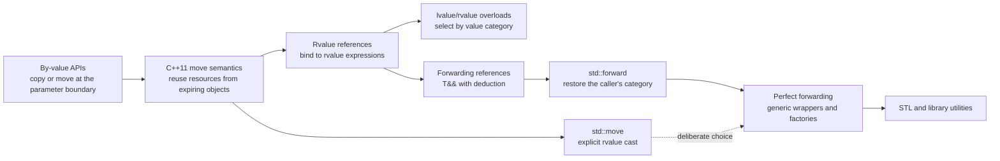

# C++ Universal References: Forwarding and Perfect Forwarding

**Source:** [Universal References in C++ Explained](https://iies.in/blog/universal-references-in-c-explained/), by IIES Bangalore, published 2026-04-03 and captured on 2026-09-15.

**Evidence bundle:** [immutable HTML](../../../raw/frameworks/universal-references-in-c--web-2026-09-15-243851bb3caf.html) · [capture metadata](../../../raw/frameworks/universal-references-in-c--web-2026-09-15-243851bb3caf.metadata.json) · [derived Markdown](../../../derived/web-markdown/frameworks/universal-references-in-c--web-2026-09-15-243851bb3caf.md)

**Scope:** This page turns the article's examples into a precise mental model for value categories, template deduction, reference collapsing, `std::forward`, `std::move`, and perfect-forwarding wrappers.

**Terminology:** The article uses “universal reference.” The standard-facing name is **forwarding reference**; this page uses the standard term while retaining the familiar alias.

**Related pages:** [C++](./index.md) · [C++ References: Aliases, Binding, Lifetime, and Interface Design](./references.md) · [Frameworks](../index.md)

> **Evidence:** The captured article directly supplies the lvalue/rvalue overload examples, the named-parameter pitfall, the `std::forward` fix, the copy-versus-move example, and the cases where `T&&` is not a forwarding reference.
>
> **Important:** A forwarding reference is not “any `T&&`.” In the direct function-template pattern, the `T` in `T&&` must be a deduced cv-unqualified template parameter. The C++ working draft calls this a forwarding reference.

## TL;DR

**What:** `template<class T> void wrapper(T&&)` can accept both lvalues and rvalues because deduction makes `T` either a reference type or an object type.

**How:** A named parameter is an lvalue expression inside the function, so `std::forward<T>(arg)` conditionally casts it back to the category with which the caller supplied it.

**The boundary:** Forwarding preserves overload selection and enables moves, but neither `std::forward` nor `std::move` performs a move by itself or guarantees that the callee will avoid every copy.

## The Big Picture

The reader question is: **what does the compiler change when the same wrapper receives an lvalue, a temporary, or an explicitly moved object?**

| Call | Deduced `T` | Parameter type after collapsing | Result of `std::forward<T>(arg)` | Selected overload |
|---|---|---|---|---|
| `wrapper(d)` where `d` is `Data` | `Data&` | `Data&` | `Data&` | `process(Data&)` |
| `wrapper(Data{})` | `Data` | `Data&&` | `Data&&` | `process(Data&&)` |
| `wrapper(std::move(d))` | `Data` | `Data&&` | `Data&&` | `process(Data&&)` |
| `wrapper(cd)` where `cd` is `const Data` | `const Data&` | `const Data&` | `const Data&` | a matching `const` overload |

This is a synthesized teaching table from the article's examples and the C++ deduction rules, not a source figure. **The object type can stay the same while the expression category changes.**

## Why This Exists

Suppose a library has separate overloads for reusable objects and expiring objects:

```cpp
void process(Data&);
void process(Data&&);

template<class T>
void wrapper(T&& arg) {
    process(arg); // looks generic, but loses the caller's category
}
```

`wrapper(d)` selects the lvalue overload as expected. But `wrapper(Data{})` also selects `process(Data&)`, because the expression `arg` has a name and therefore is an lvalue expression inside the function body. The wrapper has accepted an rvalue but erased the information needed by overload resolution.

The practical pain is not limited to printing different messages. A by-value call may copy a large buffer, while an rvalue overload could transfer its resources. **Generic code needs a way to accept many value categories without silently converting every argument into an lvalue.**

## The Landscape

The evolutionary and conceptual map is saved as [universal-references-landscape.mmd](assets/universal-references-landscape.mmd).



*Synthesized landscape from the captured article and the C++ working draft. Move semantics and rvalue references provide the vocabulary; deduction plus reference collapsing creates the forwarding-reference pattern; `std::forward` turns that pattern into perfect forwarding.*

## The Core Idea

Think of an argument as carrying two pieces of information: its type and how the current expression offers it. A forwarding reference records that offering in `T`. Naming the parameter does not destroy the object, but the name is always an lvalue expression. `std::forward<T>(arg)` uses the recorded `T` to recreate the original offering at the next call. **Forwarding is category preservation across a wrapper, not a second kind of reference.**

## Symbol Map

The key naming convention is that `T` is the type deduced from the call, while `&` and `&&` describe how a reference binds. The same parameter declaration can therefore instantiate as different reference types.

| Symbol | Human name | Scope | Plain meaning |
|---|---|---|---|
| `T` | deduced template parameter | one function-template call | The type information captured from the argument, including a reference when the argument is an lvalue. |
| `T&&` | forwarding-reference pattern | function parameter | An rvalue-reference syntax that becomes a forwarding reference when `T` is directly deduced and cv-unqualified. |
| `arg` | named parameter | wrapper body | The local name bound to the argument; the expression `arg` is an lvalue even when its declared type is `T&&`. |
| `&` | lvalue reference | reference type | Binds to an lvalue and preserves access to the existing object. |
| `&&` | rvalue reference | reference type | Binds to an rvalue expression and permits rvalue overloads or move construction. |
| `std::forward<T>(arg)` | conditional forwarding cast | forwarding call site | Produces an lvalue when `T` is an lvalue reference and an rvalue otherwise. |
| `std::move(x)` | unconditional rvalue cast | explicit ownership handoff | Treats `x` as an expiring object; it does not itself invoke a move constructor. |

## Deep Dive

### 1. Value categories belong to expressions

**What it does:** C++ uses value categories to describe how an expression can be used, not simply whether an object has a name.

**Why it matters:** Overload resolution chooses between `Data&` and `Data&&` from the category of the expression at the call site.

**How it works:** In the common two-way shorthand, an lvalue identifies an object that can be addressed persistently, while an rvalue is the umbrella category containing prvalues and xvalues. A temporary such as `Data{}` is a prvalue. `std::move(d)` produces an xvalue referring to the existing object `d`, so “rvalue” does not always mean “a brand-new object with no storage.”

```cpp
Data d;

d;             // lvalue expression
Data{};        // prvalue, therefore an rvalue
std::move(d);  // xvalue, therefore an rvalue
```

**The intuition:** The category describes the expression's handoff intent: keep using this object, or allow the next operation to treat it as expiring.

**A concrete example:** In `wrapper(d)`, the expression `d` is an lvalue. In `wrapper(Data{})`, the temporary expression is an rvalue. In both calls, the wrapper's parameter gets a name later, and that name is an lvalue expression.

**Remember:** A named variable is an lvalue expression even when its declared type is `Data&&`.

### 2. Deduction and reference collapsing adapt `T&&`

**What it does:** Template argument deduction turns one parameter spelling into an lvalue-reference or rvalue-reference specialization.

**Why it matters:** This is why one wrapper can accept both reusable objects and temporaries without writing two overloads.

**How it works:** For the direct pattern `template<class T> void accept(T&& arg)`, an lvalue argument causes `T` to be deduced as an lvalue reference. An rvalue argument causes `T` to be deduced as the plain object type. The resulting `T&&` is then simplified by reference collapsing.

| Argument expression | Deduced `T` | Intermediate parameter type | Collapsed parameter type |
|---|---|---|---|
| `d` (`Data` lvalue) | `Data&` | `Data& &&` | `Data&` |
| `Data{}` (temporary) | `Data` | `Data&&` | `Data&&` |
| `cd` (`const Data` lvalue) | `const Data&` | `const Data& &&` | `const Data&` |

The collapse rule is compact: if either reference is `&`, the result is `&`; only `&&` combined with `&&` remains `&&`.

**The intuition:** An lvalue argument adds `&` to `T`, and that `&` wins when the parameter's `&&` is simplified.

**A concrete example:** `accept(d)` becomes `accept<Data&>(Data&)`; `accept(Data{})` becomes `accept<Data>(Data&&)`. The function body is the same source template, but the instantiated parameter types differ.

**Remember:** Reference collapsing is the rule that makes `T&&` adaptable; it is not an implicit conversion of the object itself.

### 3. A named parameter is an lvalue expression

**What it does:** It explains why a wrapper can accept an rvalue and still call an lvalue overload internally.

**Why it matters:** This is the exact failure shown in the source article: both `wrapper(x)` and `wrapper(20)` print the lvalue version when the wrapper calls `process(arg)` directly.

**How it works:** The declared type of `arg` records how it was initialized, but the expression `arg` is an id-expression naming a local object. Named variables are lvalues when used as expressions, so overload resolution sees `Data&` at `process(arg)` even when the parameter's declared type is `Data&&`.

```cpp
void process(int&);
void process(int&&);

template<class T>
void wrapper(T&& arg) {
    process(arg); // always presents arg as an lvalue expression
}
```

**The intuition:** Passing an object into a room may preserve its arrival ticket, but giving it a local name makes the next receptionist treat it as a stable resident unless you show the ticket again.

**A concrete example:** `wrapper(20)` deduces `T` as `int`, so `arg` has type `int&&`; nevertheless, `process(arg)` calls `process(int&)` because the expression `arg` is an lvalue.

**Remember:** Do not infer an expression's value category from the parameter's declared type alone.

### 4. `std::forward<T>` restores the caller's category

**What it does:** `std::forward<T>(arg)` conditionally casts a named forwarding parameter back to the category encoded in `T`.

**Why it matters:** It lets a wrapper preserve the lvalue/rvalue overload decision instead of forcing every call down the lvalue path.

**How it works:** Include `<utility>` and forward with the same template argument deduced for the function parameter:

```cpp
#include <utility>

template<class T>
void wrapper(T&& arg) {
    process(std::forward<T>(arg));
}
```

Conceptually, the standard specifies the result as `static_cast<T&&>(arg)`. Reference collapsing makes the cast conditional:

| `T` from the call | `T&&` inside `std::forward` | Forwarded expression |
|---|---|---|
| `Data&` | `Data& &&` → `Data&` | lvalue |
| `Data` | `Data&&` | rvalue |
| `const Data&` | `const Data& &&` → `const Data&` | const lvalue |

**The intuition:** `std::forward` does not guess; it replays the type evidence that deduction already recorded.

**A concrete example:** The corrected wrapper calls `process(int&)` for `wrapper(x)` and `process(int&&)` for `wrapper(20)`, matching the source article's output.

**Remember:** Forward the original `T`; do not replace it with `std::move` when the wrapper's job is to preserve the caller's choice.

### 5. `std::forward` and `std::move` make opposite promises

**What it does:** It separates conditional preservation from an explicit request to treat an object as expiring.

**Why it matters:** Using `std::move` in a generic wrapper can turn an lvalue call into an unexpected move and leave the caller's object moved from.

| Aspect | `std::forward<T>(arg)` | `std::move(x)` |
|---|---|---|
| Decision | Conditional: follows `T` | Unconditional: casts to an rvalue |
| Typical location | A forwarding wrapper or factory | A deliberate ownership/resource handoff |
| `Data d` input | Keeps `d` an lvalue when called as `wrapper(d)` | Makes `std::move(d)` an xvalue |
| Does the helper move? | No; it only forms a cast | No; the selected operation may then move |
| Main risk | Forwarding an object after changing or consuming it | Moving from an object that the caller still expects to use unchanged |

```cpp
Data d;

process(d);            // lvalue overload
process(std::move(d)); // rvalue overload; d may be moved from
```

After a successful move, the source object is still a valid object, but its value is generally unspecified unless its type documents a stronger post-move state. **The cast expresses permission; the called constructor or overload performs the actual resource transfer.**

**The intuition:** `std::forward` preserves the caller's instruction, while `std::move` writes a new instruction: “this object may be consumed now.”

**A concrete example:** A wrapper should use `std::forward<T>(arg)` for both `wrapper(d)` and `wrapper(Data{})`; a function that intentionally drains `d` can use `std::move(d)` directly.

**Remember:** `std::move` is not a faster version of `std::forward`; it deliberately changes an lvalue into an rvalue expression.

### 6. Not every `T&&` is a forwarding reference

**What it does:** It marks the boundary of the pattern so the syntax is not applied mechanically.

**Why it matters:** A non-deduced `T&&` either rejects lvalues or has a different deduction shape, so calling it “universal” hides a real API constraint.

**How it works:** These declarations are rvalue-reference parameters, not the direct forwarding-reference pattern:

```cpp
void take(Data&& value); // T is not present or deduced

template<class T>
void take(std::vector<T>&& value); // the referenced type is vector<T>

template<class T>
void take(const T&& value); // cv-qualified T&& is not forwarding
```

The first accepts rvalues but cannot bind to an ordinary lvalue. The second can deduce the element type `T`, but the parameter itself is an rvalue reference to `std::vector<T>`, not an rvalue reference directly to the cv-unqualified `T`. The third requires an rvalue and does not get the lvalue-to-reference deduction behavior.

**The intuition:** The flexible behavior comes from a precise combination of syntax and deduction, not from the two ampersands alone.

**A concrete example:** `take(std::vector<int>{})` may match the vector rvalue-reference overload, but `take(existing_vector)` cannot use it merely because `int` is a deducible template parameter.

**Remember:** Ask “is this exact `T` the directly deduced, cv-unqualified type of the referred-to object?” before calling `T&&` a forwarding reference.

### 7. Perfect forwarding is a wrapper contract

**What it does:** It forwards each argument of a generic wrapper with the type and category it had at the wrapper boundary.

**Why it matters:** Factories and library utilities often need to construct a target object without inventing copies or rejecting callers that have different reference categories.

**How it works:** A parameter pack gives each argument its own deduced type, and each one is forwarded separately:

```cpp
#include <memory>
#include <utility>

template<class T, class... Args>
std::unique_ptr<T> make_object(Args&&... args) {
    return std::unique_ptr<T>(new T(std::forward<Args>(args)...));
}
```

This is “perfect” in the narrow sense that the wrapper preserves the argument types and value categories at the next call. It does not promise zero copies, a move constructor, or a particular allocation strategy in `T`.

**The intuition:** A forwarding wrapper should be transparent at the call boundary: it adds an abstraction layer without changing what the callee sees.

**A concrete example:** If `T` has one constructor for `Buffer&` and another for `Buffer&&`, `make_object<T>(buffer)` and `make_object<T>(Buffer{})` can select those paths independently.

**Remember:** Perfect forwarding preserves the handoff; the callee still decides whether to copy, move, borrow, or reject the argument.

## Putting It Together

This trace follows one concrete object, `Data d`, through two calls to the same forwarding wrapper. The second call deliberately uses `std::move(d)` to show the rvalue path; it may leave `d` moved from if the rvalue overload consumes it.

```cpp
#include <utility>

struct Data {};

void process(Data&);
void process(Data&&);

template<class T>
void wrapper(T&& arg) {
    process(std::forward<T>(arg));
}

Data d;
wrapper(d);
wrapper(std::move(d));
```

| Step | Actor | Input state | Action | Output state |
|---:|---|---|---|---|
| 1 | Caller | `d` is a live `Data` object | Uses the expression `d` as an lvalue in `wrapper(d)`. | The call carries `Data` plus lvalue category. |
| 2 | Deduction | `T&&` parameter and lvalue argument | Deduces `T = Data&`; `T&&` collapses to `Data&`. | `arg` is a `Data&` parameter. |
| 3 | Wrapper body | Named `arg` | The expression `arg` is an lvalue, then `std::forward<Data&>(arg)` collapses back to `Data&`. | `process(Data&)` is selected; `d` remains an lvalue. |
| 4 | Caller | The same live `d` | Applies `std::move(d)` and calls `wrapper(...)`. | The argument expression is an xvalue. |
| 5 | Deduction | `T&&` parameter and xvalue argument | Deduces `T = Data`; the parameter is `Data&&`. | `arg` has declared type `Data&&`, but its name is still an lvalue expression. |
| 6 | Wrapper body | Named `arg` plus `T = Data` | `std::forward<Data>(arg)` produces a `Data&&` expression. | `process(Data&&)` is selected; the callee may move from `d`. |

The key state transition is not “reference becomes object.” It is **lvalue argument → `T = Data&` → lvalue forward**, or **rvalue argument → `T = Data` → rvalue forward**.

## What This Buys You

### The headline claim

The source's strongest claim is behavioral: **a correctly forwarded wrapper preserves the overload and copy/move path chosen by the caller's value category.**

### How we know: source examples

| Source example | Without forwarding | With forwarding | What it demonstrates |
|---|---|---|---|
| `wrapper(x)` and `wrapper(20)` with `int&`/`int&&` overloads | Both call the lvalue overload | `x` calls lvalue; `20` calls rvalue | A named parameter otherwise erases the category. |
| `Data d` and `Data()` passed to `process(Data)` | The lvalue path invokes the copy constructor; the temporary can use the move constructor | `std::forward<T>` preserves those paths | The wrapper can avoid an unnecessary copy when the callee offers a move path. |

### The mechanism behind the behavior

The source gives teaching examples rather than a controlled performance benchmark. The improvement comes from the language sequence: deduction preserves category information in `T`, reference collapsing forms the right parameter type, the parameter name temporarily presents an lvalue, and `std::forward<T>` restores the original category at the nested call.

### How to read these examples

The copy-versus-move output is not a universal speedup claim. The actual benefit depends on the callee's overloads, whether a move constructor exists and is cheap, copy elision, object size, allocation behavior, and how long the caller needs the source object. The captured article is an explanatory tutorial, not a cross-compiler or workload benchmark.

> **Evidence:** The derived Markdown loses angle-bracket text in several HTML code blocks (for example, `template<class T>` and `std::forward<T>`). The code samples on this page restore those standard spellings from the captured HTML and the language rules; the immutable source files remain unchanged.

## Where It Breaks

| Failure mode | When it happens | Impact |
|---|---|---|
| Calling every `T&&` universal | A parameter is `Data&&`, `const T&&`, or `std::vector<T>&&` rather than directly deduced cv-unqualified `T&&` | Lvalues may be rejected or the intended deduction behavior may not occur. |
| Forwarding omitted | A wrapper calls `process(arg)` directly | An rvalue argument is presented as an lvalue and may select a copy-oriented overload. |
| `std::move` used as a generic forwarder | The wrapper calls `std::move(arg)` for both lvalue and rvalue callers | An lvalue can be moved from unexpectedly, and the caller may observe a moved-from object. |
| Forwarding after consumption | The same `arg` is forwarded to a consuming operation and then forwarded again | The second use may observe a moved-from state; forwarding does not make reuse safe. |
| Callee still takes by value | The forwarded expression reaches `void process(Data)` or another copy-producing API | Forwarding preserves the category, but the final API can still copy or move into its parameter. |
| Temporary stored beyond the call | A forwarding reference or `auto&&` is saved and used after the temporary's lifetime ends | The stored reference can dangle; forwarding does not extend arbitrary object lifetimes. |
| Braced initializer passed directly | `f({1, 2, 3})` is called for a template that has only `template<class T> f(T&&)` | `T` generally cannot be deduced; provide an initializer-list or other matching overload. |

## One Thing to Remember

**A forwarding reference records how the caller offered an object.** The parameter's name makes the expression an lvalue, and `std::forward<T>` replays the recorded category at the next call. Use `std::move` only when changing an lvalue into an explicit resource handoff is intentional; neither helper moves anything until the selected operation chooses to do so.

## Go Deeper

- **Read the source:** [Universal References in C++ Explained](https://iies.in/blog/universal-references-in-c-explained/), with the immutable HTML, metadata, and extracted Markdown listed above.
- **Check the language rule:** [C++ working draft: template argument deduction](https://eel.is/c%2B%2Bdraft/temp.deduct.call) defines forwarding-reference deduction, and [references](https://eel.is/c%2B%2Bdraft/dcl.ref) defines reference collapsing.
- **Check the library helper:** [C++ working draft: forward/move helpers](https://eel.is/c%2B%2Bdraft/forward) specifies `std::forward` as returning `static_cast<T&&>(t)` and describes its factory use.
- **Reproduce:** Compile the examples with a C++11-or-newer compiler and add visible `Data&`/`Data&&` overloads or copy/move constructors to inspect the selected path; the source supplies no repository benchmark or codebase.
- **Navigate:** [C++](./index.md) is the subcategory hub, and [Frameworks](../index.md) is the parent category.
