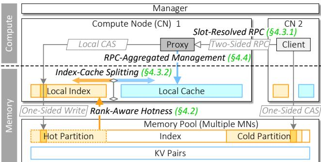
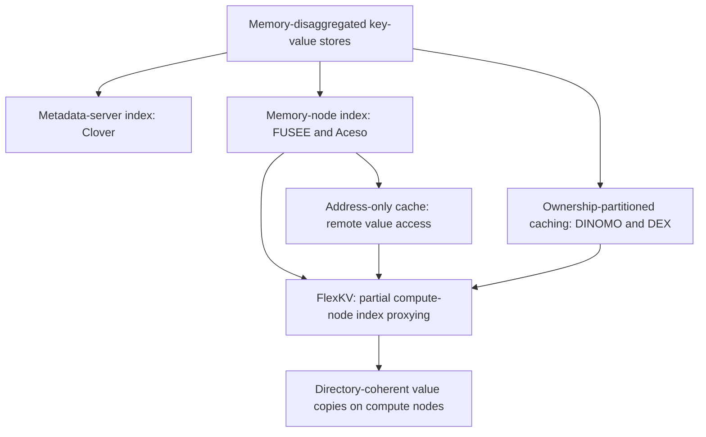
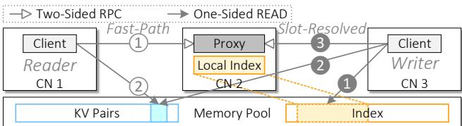
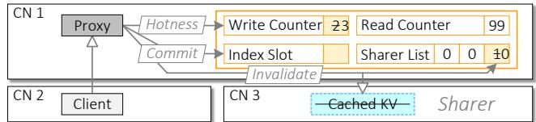

# FlexKV: Flexible Index Offloading

**Paper:** FlexKV: Flexible Index Offloading for Memory-Disaggregated Key-Value Store  
**Authors:** Zhisheng Hu, Jiacheng Shen, Ming-Chang Yang  
**arXiv:** [2512.16148v1](https://arxiv.org/abs/2512.16148v1), 18 December 2025

**Related pages:** [Runtime Infrastructure](../index.md), [Remote Direct Memory Access](../../../terms/remote-direct-memory-access.md), [SGLang HiCache with Mooncake](../../serving/sglang/hicache-mooncake.md).

This is a **database key-value store**, not a Transformer [KV cache](../../../terms/kv-cache.md): its keys identify arbitrary records, and its values are stored records rather than attention tensors. The [local PDF](../../../../raw/frameworks/infrastructure/flexkv/flexkv--arxiv-2512.16148v1.pdf) and complete [MinerU extraction](../../../../derived/pdf-markdown/frameworks/infrastructure/flexkv/flexkv/flexkv.md) are the evidence for this reading. Results and correctness claims below are the paper's; they were not independently reproduced.

## TL;DR

**What:** FlexKV reduces index and remote-access bottlenecks in a memory-disaggregated key-value database.  
**How:** It moves selected index partitions to compute-node proxies, balances their placement and memory budget, and uses those proxies to coordinate coherent local value caches.  
**The number:** On the paper's 54 Twitter traces, throughput ranges from 1.03× to 2.94× the second-best baseline; separately, YCSB A's 99th-percentile latency falls by 85.2% versus its second-best baseline.

## The Big Picture

*Source: [FlexKV paper](../../../../raw/frameworks/infrastructure/flexkv/flexkv--arxiv-2512.16148v1.pdf), Figure 5. ① A manager assigns hot index partitions to compute-node proxies. ② Clients send index RPCs to a proxy for offloaded partitions, but access cold partitions directly in the memory pool. ③ Local cache space competes with the offloaded index for limited compute-node memory.*

The **data and control paths are different**: the memory nodes retain the index and records, while compute nodes can process a subset of index operations locally. The design replaces many remote atomic index updates, not every remote access; value misses and writes still access memory nodes (§4.1).

## Why This Exists

Imagine a store in which many clients read and occasionally update a popular product record `K`. With an address-only cache, a read still fetches the value from remote memory. With a remote index, concurrent writers perform compare-and-swap at the memory node's network interface, which can become a bottleneck. If a single compute node owns the whole record, other clients instead pay to forward requests to that owner.

FlexKV lets a client cache `K` locally while a proxy coordinates its **index partition** and cached copies. The example is illustrative, not one of the paper's measured records. It will recur below as readers on CN 1 and CN 3 and a proxy on CN 2 interact.

## The Landscape

*Synthesized from the paper's §§2 and 6. Arrows group design choices and contrasts; they do not assert direct historical descent. Editable source: [landscape.mmd](assets/landscape.mmd).*

## The Core Idea

**Move the coordinating work to CPUs that are already available, but only where it pays.** A proxy manages a hot part of the index and becomes the natural place to track cached copies. Clients can then read useful records locally, while the system keeps the rest of the index in remote memory and continuously adjusts the tradeoff between local index space and cache space.

## Symbol Map

The paper uses node roles and a few tunable quantities. An index *partition* groups slots; a slot points to one record and is not the record itself.

| Name | Scope | Meaning |
|---|---|---|
| CN / MN | Cluster | Compute node with limited local memory / memory node holding remote data |
| RDMA / RPC | Network operation | [Remote direct memory access](../../../terms/remote-direct-memory-access.md) / remote procedure call; a two-sided RPC uses CPU participation at both ends |
| CAS | One index slot | Compare-and-swap; local CAS commits a proxied update |
| $P$, $C$, $R$ | Manager | Number of partitions, compute nodes, and ranks; the paper describes $R=P/C$ |
| $D$, $B$ | Reassignment | Observed sum of rank changes and the expected displacement for a random reshuffle |
| $i$ | Local memory policy | Fraction of each CN's hot-to-cold assigned partition list offloaded into its local index |

## Deep Dive

### Proxy hot index partitions, not all records

**What it does:** A CN proxy exclusively manages each offloaded partition; other partitions remain accessible directly on MNs (§§3.1, 4.1).

**Why it matters:** Remote one-sided CAS can saturate MN network interfaces, even when compute-side CPUs are available.

**How it works:** A client sends an index RPC to the partition's proxy, which uses CPU-local CAS instead of a remote CAS for that index update. The proxy also writes the index update to MNs for recovery. The client still uses one-sided RDMA to access remote records; offloading an index does not transfer ownership of every record or make every read local.

**The intuition:** Replace a congested remote atomic engine with distributed CPU work, without requiring the whole database to fit in compute memory.

**A concrete example:** CN 2 manages `K`'s hot index partition, but a reader on CN 1 can use a cached value itself; it need not forward the entire request to CN 2.

**Remember:** A proxy owns **index processing**, whereas cached values can be shared across CNs.

### Resolve writes at the client and reads at the proxy

*Source: [FlexKV paper](../../../../raw/frameworks/infrastructure/flexkv/flexkv--arxiv-2512.16148v1.pdf), Figure 7. The writer's numbered steps resolve the slot before its RPC; the reader's fast path asks the proxy for candidate slots and then checks the remote records.*

**What it does:** Slot-resolved RPCs avoid keeping a large key-to-slot mapping at each proxy (§4.3.1).

**Why it matters:** A fingerprint in an index slot can identify candidates without proving which variable-length key is the desired one; retaining all full keys at CNs would consume scarce local memory.

**How it works:** For a write miss, the client reads candidate slots from the MN index, checks the referenced records to find the matching key, and sends the slot address with its RPC. A cached entry already contains the slot address and can avoid that resolution. For a read miss, the client instead asks the proxy for candidate slots and reads the referenced records to verify the key.

**The intuition:** Let the party that already needs the key comparison locate the slot, rather than duplicate a full-key directory at the proxy.

**A concrete example:** Before updating `K`, CN 1 can use `K`'s cached slot address; without it, CN 1 resolves the address on the MN and supplies it to CN 2. On a read miss, CN 2 returns candidates, and CN 1 checks the actual key.

**Remember:** The read fast path avoids **remote index lookup**, not necessarily the remote value read.

### Balance hotness, then tune the memory split

**What it does:** A manager balances partition assignments and adjusts how much CN memory holds the local index versus the cache (§§4.2–4.3.2).

**Why it matters:** A static partition assignment may put several popular partitions on one proxy; allocating more index space can also evict useful cached values.

**How it works:** Every second, clients' partition counters are aggregated. The manager sorts partitions by access count into ranks of approximately $C$ partitions and assigns one per rank to each CN, creating a hot-to-cold list. It measures rank displacement $D$ and reassigns only when $D \geq 0.25B$, where $B=C(R^2-1)/3$ is the paper's random-reshuffle baseline. A pause-and-resume protocol quiesces changed partitions and clears local caches before switching maps.

Each CN uses the same offload ratio $i$ for its list. A throughput-guided hill climber samples one-second intervals in 0.1 steps; it starts another search after a partition reassignment or a read/write mix change of at least 10 percentage points. The policy optimizes measured throughput, not a latency SLO. The paper describes $P=2^{13}$ and $R=P/C$, but its default $C=20$ does not divide 8,192; it does not explain the final incomplete rank.

**The intuition:** Spread similarly hot work first, and only then search the one shared memory-allocation knob.

**A concrete example:** If `K` becomes hot, its partition can move toward the front of a balanced list and be offloaded. If updates then dominate, the knob may allocate more space to indexes and less to cached values.

**Remember:** A change in *rank*, not every tiny change in access count, is what contributes to reassignment.

### Coherence rides on index RPCs

*Source: [FlexKV paper](../../../../raw/frameworks/infrastructure/flexkv/flexkv--arxiv-2512.16148v1.pdf), Figure 9. The proxy combines per-key hotness and directory updates with index processing; a write invalidates recorded cached copies before committing.*

**What it does:** The proxy maintains a per-key directory and selectively permits value caching (§4.4).

**Why it matters:** Independently cached copies make reads cheap but require a writer to prevent stale values from being returned.

**How it works:** An index RPC updates a 32-bit sharer bitmap and 16-bit read and write counters. The proxy marks a value cache-worthy when its observed write/read ratio is below 0.25. For UPDATE or DELETE it sends invalidation RPCs to recorded sharers; those nodes also guard against in-flight responses reintroducing stale values. Read hits that bypass the proxy accumulate local counter increments, which are later piggybacked or flushed by a dedicated RPC. Each local cache entry holds either an address or a value, under a shared FIFO eviction policy.

**The intuition:** Do routine directory bookkeeping on a trip already needed for index work, and avoid caching values that writes will immediately invalidate.

**A concrete example:** If `K`'s write/read counter ratio is 23/99, the proxy can authorize a value copy at CN 1. When CN 3 updates `K`, CN 2 uses the sharer list to invalidate that copy before committing.

**Remember:** Piggybacking avoids extra *routine metadata round trips*; actual write invalidations still cost messages.

### Make the local commit and recovery boundary explicit

**What it does:** The paper identifies the proxy's local CAS as the linearization point for a proxied write and uses the MN index for recovery (§4.5).

**Why it matters:** Remote index persistence, cache invalidation, and a concurrent read must not expose incompatible versions of `K`.

**How it works:** For an update, the client writes a new record out of place and sends the resolved slot to the proxy. The proxy invalidates old cached addresses by clearing the old record's valid bit and invalidates cached values through the directory; in parallel, it writes the new slot to the MN index. After those prerequisites, local CAS switches the proxy's committed index and the proxy replies. Before the CAS, proxy reads use the old committed slot even if the MN slot has already been written. The paper argues that a proxy failure in this interval can expose the new MN slot as a redo of an incomplete operation.

On CN failure, surviving CNs clear local caches and redirect affected partitions to the MN index; MN data is protected using primary-backup replication. For slot reuse after DELETE, the paper uses a 200 ms lease and a bounded-clock-drift margin before allowing an invalid slot to be reused.

**The intuition:** Persist enough to recover, but make one local atomic action the normal-operation visibility switch.

**A concrete example:** CN 2 must finish `K`'s cache invalidations and MN index write before committing the new slot; if CN 2 fails, readers fall back to the MN rather than trusting its lost directory.

**Remember:** The correctness argument depends on the invalidation ordering, recovery assumptions, and the distinction between the MN's persisted slot and the proxy's committed slot.

## Putting It Together

Follow one hypothetical update to `K`, initially cached on CN 1, with its index partition proxied by CN 2 (§§4.3–4.5).

| Step | Actor | Input state and action | Resulting state |
|---:|---|---|---|
| 1 | CN 3 client | Receives UPDATE; writes the new record to an MN and resolves `K`'s slot, using a cached slot address if available. | The new record exists; the old slot remains the proxy's committed view. |
| 2 | CN 3 → CN 2 | Sends the slot and proposed update in an index RPC. | CN 2 serializes the write for `K` and updates its hotness metadata. |
| 3 | CN 2 and sharers | Invalidates the old address and value copies, including CN 1's; writes the new slot to the MN in parallel. | Old cached paths are disabled and the recoverable MN index has the new slot. |
| 4 | CN 2 proxy | Performs local CAS after the prerequisites and replies to CN 3. | The new slot is committed for proxy reads; the update completes. |
| 5 | CN 1 client | A later SEARCH misses the invalidated value, asks the proxy for candidates, and reads and checks the matching record on the MN. | CN 1 gets the new value and may cache it if the proxy's policy allows. |

This is the proxied UPDATE path; cold partitions use the existing one-sided path, and a value-cache hit avoids the proxy and MN altogether.

## What This Buys You

### The headline claim

**The gain depends on workload and baseline.** The paper reports higher throughput in its experiments, with the largest benefit on a favorable Twitter trace rather than a universal 2.94× improvement.

### How we know: measured comparisons

| Scenario | Comparison | Paper-reported result |
|---|---|---:|
| 54 Twitter traces, varying skew, read/write mix and record size | FlexKV vs. the second-best of Clover, FUSEE and Aceso | 1.03–2.94× throughput |
| YCSB A, 50% UPDATE / 50% SEARCH, skewed keys | FlexKV vs. second-best baseline | 2.31× peak throughput; 85.2% lower P99 latency at 200 clients |
| YCSB C, 100% SEARCH, skewed keys | FlexKV vs. second-best baseline | 1.37× peak throughput; 4.1% lower P99 latency at 200 clients |

*Source: paper §5.2, Figures 11, 12 and 15. The peak throughput comparison and latency comparison are distinct measurements; the table does not imply the same baseline wins each comparison.*

The default testbed uses **20 CNs and 3 MNs**, ConnectX-3 56 Gbps InfiniBand, 200 clients with eight coroutines each, 64 MB of usable memory per CN, three-way replication or equivalent fault tolerance, and 10 million 128-byte YCSB records. The YCSB distribution is Zipfian with $\alpha=0.99$ unless otherwise specified (§5.1).

### The mechanism behind the numbers

Writes benefit from avoiding remote index CAS; read-heavy skew can additionally yield local value hits. In Table 1, YCSB A has a 0.1% value-cache hit ratio and a 60% offload ratio, while YCSB C has an 18.9% value-cache hit ratio and an 80% offload ratio. These are workload-specific observed operating points, not recommended fixed settings. Under uniform keys or larger records, locality falls or network bandwidth dominates, narrowing the benefit (§§5.2–5.4).

### How to read these numbers

The **85.2%** result is a P99 reduction for YCSB A, not the Twitter maximum-throughput result. Clover has the lowest P50 in the reported 200-client YCSB latency comparison, despite FlexKV's lower P99; comparing latency at a fixed client count also reflects the systems' differing achieved throughput and congestion. The experiments use an RDMA testbed, not CXL, and the paper does not establish a general production speedup or cost-per-request improvement.

## Where It Breaks

| Failure mode | When it happens | Impact |
|---|---|---|
| Little useful locality | Keys are nearly uniform or values are too large for the CN budget | Fewer useful local hits and weaker benefit from selecting hot partitions; bandwidth can dominate. |
| Frequent writes to cached keys | Many CNs share a value that is updated often | Directory invalidations add messages and latency; the write/read threshold reduces, but does not eliminate, this cost. |
| Rapid or noisy workload shifts | Hotness or read/write mix changes faster than one-second measurements and multi-probe tuning | Inference: the hill climber can operate on stale or noisy throughput, and reassignment pauses may become more consequential. |
| More than 32 CNs | The fixed per-key 32-bit sharer bitmap cannot represent every node | The paper suggests another directory representation; it does not evaluate that extension. |
| CN failure, delayed detection, or clock violations | A proxy and its directory disappear, or lease timing assumptions do not hold | Cache clearing and fallback disrupt service; correctness relies on the stated membership, reliable-network and bounded-clock assumptions. |
| Different interconnect or latency objective | CXL deployment or a strict tail-latency target replaces the measured RDMA throughput objective | CXL is discussed but not tested; the throughput knob does not directly optimize P99 or an SLO. |
| Rank grouping detail | The default 8,192 partitions and 20 CNs do not divide evenly | The paper does not specify how its equal-size-rank formula handles the remainder. |

## One Thing to Remember

**Offload coordination, not necessarily the data.** FlexKV puts selected index partitions and their cache directories on compute CPUs, then balances proxy load, local memory and coherence so that remote memory remains authoritative for recovery without forcing every read through it.

## Go Deeper

- **Read:** [Original PDF](../../../../raw/frameworks/infrastructure/flexkv/flexkv--arxiv-2512.16148v1.pdf), especially §§4–5; [MinerU extraction](../../../../derived/pdf-markdown/frameworks/infrastructure/flexkv/flexkv/flexkv.md).
- **Build on:** The paper compares Clover, FUSEE, Aceso and a FlexKV ownership-partitioned variant; see §§5–6 for the exact baselines and references.
- **Understand the context:** [RDMA](../../../terms/remote-direct-memory-access.md), [URMA](../../../terms/urma.md), and [SGLang HiCache with Mooncake](../../serving/sglang/hicache-mooncake.md). The last concerns attention-state pages and does not establish FlexKV's applicability to LLM serving.
- **Reproduce:** The paper specifies its hardware and workloads but does not provide a code repository or release URL in this version; its results were not rerun here.
