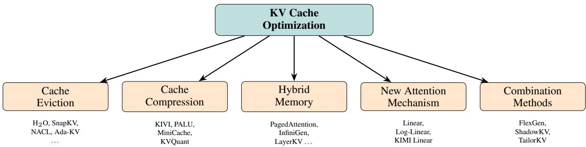
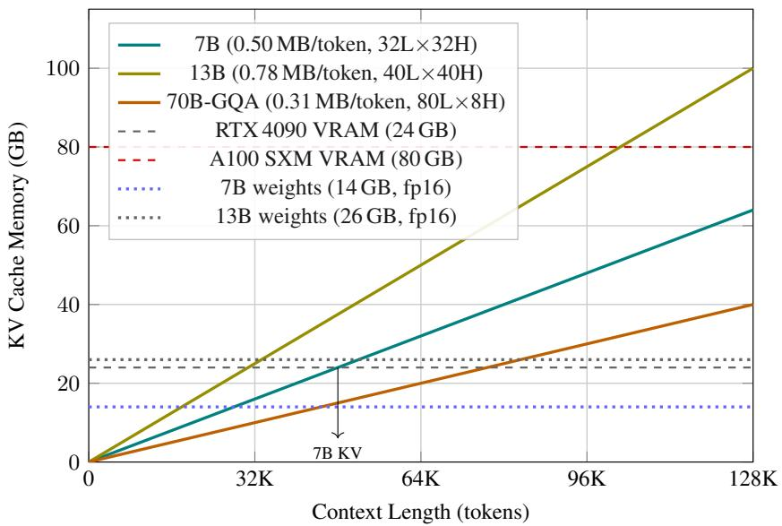
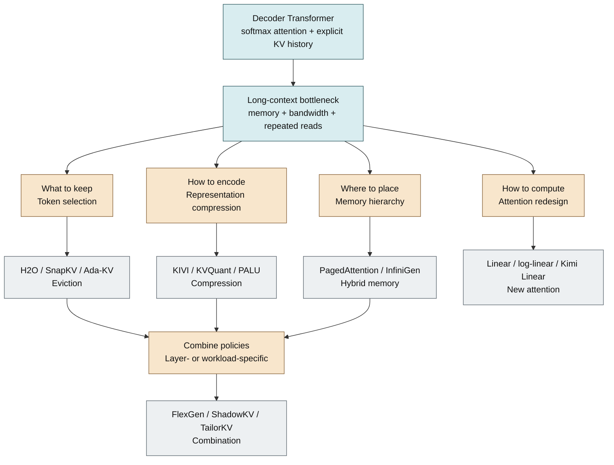
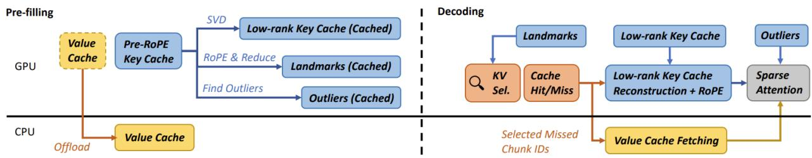

# KV Cache Optimization Strategies for Scalable and Efficient LLM Inference

**Paper:** [KV Cache Optimization Strategies for Scalable and Efficient LLM Inference](https://arxiv.org/abs/2603.20397)
**Authors:** Yichun Xu, Navjot K. Khaira, and Tejinder Singh
**arXiv:** 2603.20397v1 (March 24, 2026)

**Related pages:** [KV Cache](../../terms/kv-cache.md), [PagedAttention](../../terms/pagedattention.md), [Linear Attention](../../terms/linear-attention.md), [vLLM: PagedAttention Serving Framework](../vllm/vllm-framework.md), [Kimi Linear](../../training/kimi/kimi-linear/index.md)

## TL;DR

**What:** This survey organizes KV-cache optimization into eviction, compression, hybrid memory, new attention calculations, and combination strategies.
**How:** The five families reduce different costs: the amount retained, the bits per entry, the memory tier used, the attention rule, or a coordinated mix of these choices.
**The number:** The survey reports examples ranging from 2.6x peak-memory reduction for KIVI and 2-4x throughput for PagedAttention to 75% cache-memory reduction and 6.3x decoding speed for Kimi Linear at million-token context, but these figures come from different papers and workloads.

## The Big Picture

_Source: Fig. 5 of the survey. ① Eviction keeps a smaller token subset. ② Compression keeps more history in fewer bits or dimensions. ③ Hybrid memory changes where cache state resides. ④ New attention replaces explicit token-by-token history with a different state update. ⑤ Combination methods apply more than one compromise._

## Why This Exists

Consider a 128K-token request on a LLaMA-2 7B model. The survey estimates about 64 GB of fp16 KV cache for that context, while the model weights use about 14 GB. The cache alone approaches an 80 GB A100, leaving little room for activations or a second request. A 13B model reaches roughly 100 GB of cache at the same length. The serving choice is therefore not simply "add a longer context window": without an optimization, one request consumes the memory that should support batching.

_Source: Fig. 3 of the survey. The lines are source-reported calculations under fp16; the dashed and dotted lines mark example GPU VRAM and model-weight limits._

There are two bad extremes. Recomputing the prefix at every generated token wastes attention projections and increases latency. Keeping every key and value preserves exact access but makes memory and memory-bandwidth demand grow with context. The survey asks which part of that trade can be relaxed for a particular workload.

## The Landscape

The editable Mermaid source for this cross-paper synthesis is [kv-cache-optimization-landscape.mmd](./assets/kv-cache-optimization-landscape.mmd).

_Synthesized landscape from the survey and its cited method papers. ① Standard decoder attention creates an explicit growing history. ② The bottleneck opens four primary design directions. ③ Combination methods sit downstream because they coordinate several directions rather than replacing one of them._

## The Core Idea

KV optimization is a choice about **which information must remain directly reachable, how much precision it needs, and where the system can afford to keep it**. Eviction and compression preserve the original attention rule while making its state smaller; hybrid memory preserves the state but moves it across a memory hierarchy; linear or gated attention changes the state representation itself. There is no universally best method because memory capacity, interconnect bandwidth, context length, query reuse, and accuracy requirements differ by deployment.

## Symbol Map

The survey uses standard Transformer notation. In this page, $T$ is context length, $L$ is the number of layers, $H_{kv}$ is the number of stored key/value heads, $d_h$ is the head dimension, and $B$ is bytes per stored element. $Q$, $K$, and $V$ are the current query, cached keys, and cached values; $S_t$ denotes a recurrent linear-attention state rather than an explicit token-level cache.

| Symbol     | Human name                | Shape or scope                | Plain meaning                                                                           |
| ---------- | ------------------------- | ----------------------------- | --------------------------------------------------------------------------------------- |
| $T$        | context length            | tokens in one request         | Number of positions whose history may be needed.                                        |
| $L$        | layer count               | model-wide                    | Each attention layer owns its own cache or state.                                       |
| $H_{kv}$   | KV-head count             | per layer                     | Number of key/value heads actually stored; GQA reduces this below the query-head count. |
| $d_h$      | head dimension            | per head                      | Width of each key or value vector.                                                      |
| $B$        | bytes per element         | cache format                  | Storage cost per scalar, such as 2 bytes for fp16.                                      |
| $K_t, V_t$ | token key and value       | per token, layer, and KV head | Address and payload used by conventional attention.                                     |
| $S_t$      | recurrent attention state | fixed-size or bounded matrix  | Accumulated key/value information used by linear or gated attention.                    |

For conventional attention, the survey's memory estimate is proportional to

$$
\mathrm{KV\ bytes} = 2 \times L \times H_{kv} \times d_h \times B \times T.
$$

The factor 2 is for keys and values. Every strategy in the survey changes at least one term in this operational picture, or changes the attention rule so that $T$ no longer determines the stored state in the same way.

## Deep Dive

### 1. Cache eviction: keep only likely-useful tokens

**What it does:** Eviction replaces the full token history with a selected subset, usually retaining recent tokens plus tokens estimated to matter most.

**Why it matters:** A 128K prompt can be semantically sparse even when its raw cache is huge, so removing low-value entries can preserve useful retrieval while freeing capacity for more requests.

**How it works:**

- **H2O** accumulates attention scores and retains heavy-hitter tokens alongside a recent window, evicting the lowest-scoring entry when the budget is full.
- **SnapKV** looks at an observation window during prefill, votes for important prefix positions, pools nearby positions, and retains the selected prefix plus the recent window.
- **Ada-KV** notices that attention heads need different budgets: concentrated heads can keep fewer tokens, while diffuse heads receive more.
- **NACL, InfiniPot, HASHEVICT, MorphKV, RocketKV, and KVzip** vary the signal or timing, from single-shot proxy scoring and continual distillation to hash-based ranking, recent-pattern fusion, hierarchical selection, and context reconstruction.

**The intuition:** Do not spend memory on every historical token when the next query is likely to use only a small, changing subset.

**A concrete example:** For the 128K request, SnapKV can inspect the prompt's final observation window, select the prefix spans that explain the likely question, and keep the newest tokens exactly while discarding less useful prefix positions.

**Remember:** Eviction changes _which_ history is reachable, so query shifts and future conversation turns can expose discarded information.

### 2. Cache compression: store the same history more cheaply

**What it does:** Compression keeps more token history but uses fewer bits, fewer dimensions, or fewer layer copies per entry.

**Why it matters:** When the workload is bandwidth-bound or exact token access is valuable, reducing representation size can be safer than discarding tokens outright.

**How it works:**

- **KIVI** uses asymmetric granularity: per-channel quantization for keys, per-token quantization for values, and a short full-precision residual window before groups are merged.
- **KVQuant** adds pre-RoPE key quantization, non-uniform levels, sparse outlier storage, and a full-precision first-token treatment for attention-sink behavior.
- **PALU** stores low-rank latent projections and reconstructs keys or values when needed; **MiniCache** merges similar adjacent-layer states using spherical interpolation.
- The cost moves from memory to metadata, reconstruction, dequantization, or occasional precision exceptions.

**The intuition:** Keep the addressable history, but pack predictable structure more tightly and protect the values that quantization handles badly.

**A concrete example:** For the same 128K request, KIVI can quantize older cache groups to 2 bits while leaving the newest residual tokens in higher precision, reducing storage without changing which positions attention can address.

**Remember:** The bit width alone is not the method; granularity, outlier handling, positional encoding order, and reconstruction cost determine whether low-bit cache is usable.

### 3. Hybrid memory: move state instead of changing semantics

**What it does:** Hybrid-memory systems keep cache state across GPU memory, CPU memory, storage, or near-storage accelerators and retrieve only what the next attention step needs.

**Why it matters:** A lossless placement policy can exceed GPU capacity without changing model weights or attention semantics, which is attractive for high-throughput and accuracy-critical serving.

**How it works:**

- **PagedAttention** divides cache storage into non-contiguous blocks and maps logical sequence positions to physical blocks, reducing fragmentation and enabling prefix sharing with copy-on-write.
- **InfiniGen** predicts the next layer's useful KV pairs and prefetches them from CPU while the current layer computes; **LayerKV** overlaps layer-wise transfers with prefill work and uses an SLO-aware scheduler.
- **KVPR** overlaps partial recomputation with transfer, **Oneiros** remaps parameter memory under KV pressure, and **CLO** reuses recently loaded data when adjacent queries are similar.
- **INF2** pushes attention closer to storage with computational storage devices, trading generality for specialized hardware.

**The intuition:** If the cache is too large for one tier, keep the exact state but make movement, prediction, and overlap hide the slower tier.

**A concrete example:** For a 128K request that must remain lossless, PagedAttention can allocate blocks on demand and share repeated prefixes; an offload system can keep less frequently used blocks in CPU memory and fetch them as the request advances.

**Remember:** Paging solves allocation and sharing; offloading solves capacity; neither automatically removes the bandwidth cost of reading the cache.

### 4. New attention calculation: replace growing explicit history

**What it does:** Alternative attention rules replace token-by-token softmax access with a bounded or slowly growing state.

**Why it matters:** Eviction, compression, and offloading still manage a history whose logical length is $T$; changing the recurrence can make decoding state independent of $T$.

**How it works:**

- **Linear attention** uses a feature map $\phi$ and associative reordering so past keys and values accumulate in $S_t = \sum_{j \leq t} \phi(K_j)V_j^T$, with a normalization state alongside it.
- **Log-linear attention** maintains a logarithmic hierarchy of summaries, trading exact token access for multiple time scales.
- **Local Linear Attention** fits a query-specific local approximation, while **Kimi Linear** combines gated KDA layers with periodic full-attention layers in a 3:1 ratio to recover global retrieval capacity.

**The intuition:** Replace a long shelf of individual records with an online summary, then add selective full-attention checkpoints where summaries are not enough.

**A concrete example:** A million-token request on Kimi Linear stores recurrent KDA states in most layers and uses full-attention layers to refresh global token access, rather than retaining a conventional full KV cache in every layer.

**Remember:** Better asymptotic memory is an architectural trade: these methods usually require training or adaptation and can lose exact, arbitrary-token retrieval.

### 5. Combination methods: spend each compromise where it hurts least

**What it does:** Combination systems assign different layers, tokens, or memory tiers different policies so eviction, compression, and movement complement one another.

**Why it matters:** A single global policy wastes precision on some layers and bandwidth on others; workload-aware composition can target the actual bottleneck.

**How it works:**

- **FlexGen** jointly places weights, activations, and KV cache across GPU, CPU, and disk using a cost model and linear program, then uses 4-bit compression and layer-oriented scheduling.
- **Q-Hitter** scores tokens by both attention importance and quantization robustness before keeping a sparse quantized cache.
- **ShadowKV** keeps low-rank keys and landmarks on GPU, offloads values to CPU, and fetches only selected chunks during decoding.
- **TailorKV** classifies layers as quantization-friendly or sparsity-friendly, then uses double buffering to overlap transfer and attention.

_Source: Fig. 13 of the survey. ① Prefill compresses key structure and places values in CPU memory. ② Landmarks and outliers stay available on GPU. ③ Decode retrieves only the value chunks selected by the current query._

**The intuition:** Spend accuracy budget, compute, and bandwidth only on the parts of the model that actually need them.

**A concrete example:** The 128K request can keep shallow, broadly attending layers quantized on GPU while using sparse CPU fetches for deeper, concentrated layers, instead of forcing every layer into the same policy.

**Remember:** Combination methods are powerful because their policies are complementary, but their control plane and tuning surface are correspondingly more complex.

## Putting It Together

The following trace uses ShadowKV as a concrete example of the survey's broader design pattern. The request is one 128K-token prompt followed by autoregressive decoding.

| Step | Actor                            | Input state                                 | Action                                                                                                           | Output state                                                               |
| ---: | -------------------------------- | ------------------------------------------- | ---------------------------------------------------------------------------------------------------------------- | -------------------------------------------------------------------------- |
|    1 | Prefill runner                   | 128K prompt and empty cache                 | Compute the prompt's attention projections and identify low-rank key structure, landmarks, and outliers.         | Compressed key representation and retrieval metadata are ready.            |
|    2 | Cache manager                    | Full value history plus compressed keys     | Keep compressed keys, landmarks, and outlier keys on GPU; offload the value cache to CPU memory.                 | GPU footprint is bounded while the full value history remains recoverable. |
|    3 | Decode attention                 | Current query and GPU landmarks             | Rank chunks by approximate relevance instead of transferring every value.                                        | A small set of candidate chunks is selected.                               |
|    4 | Transfer and reconstruction path | Selected CPU values and compressed GPU keys | Fetch selected values, reconstruct the needed keys, and overlap movement with GPU work where possible.           | Exact attention inputs for the selected sparse region are assembled.       |
|    5 | Model and cache update           | Query, selected K/V, and newest token       | Run attention, produce the next hidden state, and append the newest cache entry under the same placement policy. | One token is emitted and the bounded GPU/CPU cache state advances.         |

This trace makes the division of labor explicit: compression reduces representation size, hybrid memory changes residency, sparse selection reduces transfer volume, and the final attention calculation can remain conventional over the retrieved region.

## What This Buys You

### The headline claim

The survey's main empirical takeaway is a deployment rule: eviction and compression are strongest when memory footprint dominates, hybrid memory is strongest when serving scale and lossless semantics matter, and new attention mechanisms are strongest when the model can be redesigned for ultra-long context.

### How we know: cross-paper reported results

| Family        | Representative reported result                                                                                    | What it demonstrates                                                               |
| ------------- | ----------------------------------------------------------------------------------------------------------------- | ---------------------------------------------------------------------------------- |
| Eviction      | H2O: up to 5-10x memory reduction; SnapKV: 8.2x memory efficiency                                                 | Importance-aware token selection can preserve useful context under a fixed budget. |
| Compression   | KIVI: 2.6x peak-memory reduction, 2.35-3.47x throughput, and less than 2% accuracy drop for most evaluated models | Asymmetric low-bit storage can reduce both footprint and bandwidth.                |
| Hybrid memory | PagedAttention: 2-4x higher throughput at the same latency, with lossless semantics                               | Better allocation, sharing, and batching can matter more than smaller tensors.     |
| New attention | Kimi Linear: 75% lower KV-cache use and up to 6.3x decoding speed at 1M context                                   | A trained hybrid attention architecture can change the asymptotic scaling point.   |
| Combination   | TailorKV: about 73.8% GPU-memory reduction and 8-18x over standard offloading, near lossless                      | Layer-specific policy composition can reduce both residency and transfer waste.    |

### The mechanism behind the numbers

The gains come from different bottlenecks. Eviction reduces the number of rows read. Compression reduces bytes per row. Hybrid memory increases usable capacity and can overlap transfer with compute. New attention reduces the need to revisit a growing explicit row set at all. Combination methods win when the workload has more than one bottleneck, but they also inherit the overhead of coordinating several policies.

### Caution: how to read these numbers

These are reported headline values collected from different original papers, model families, hardware platforms, cache budgets, and quality metrics. They are useful for choosing what to investigate, not for ranking methods directly. A fair comparison must hold the model, context length, batch shape, precision, interconnect, latency target, and accuracy metric constant.

## Where It Breaks

| Failure mode                 | When it happens                                                                                             | Impact                                                                                   |
| ---------------------------- | ----------------------------------------------------------------------------------------------------------- | ---------------------------------------------------------------------------------------- |
| Importance miss              | A discarded token becomes relevant to a later query or conversation turn.                                   | Eviction causes silent quality loss; multi-turn reuse is especially risky.               |
| Outlier damage               | Keys or values contain channels, tokens, or first-token effects that a uniform quantizer represents poorly. | Low-bit cache loses measured quality or task accuracy, or requires expensive exceptions. |
| Bandwidth exposure           | CPU, SSD, or accelerator links cannot deliver selected KV data before the next layer needs it.              | Offloading replaces an OOM with stalls and lower TPOT.                                   |
| Architectural mismatch       | A linear or log-linear state cannot perform exact arbitrary-token retrieval required by the task.           | Better asymptotic scaling comes with quality loss or a need for full-attention layers.   |
| Control-plane complexity     | A combined policy must classify layers, allocate budgets, schedule transfers, and handle cache updates.     | Tuning and debugging become harder than the headline memory ratio suggests.              |
| Cross-paper comparison error | A reported "up to" speedup comes from a different workload or baseline.                                     | Directly transplanting the number leads to a poor deployment decision.                   |

## One Thing to Remember

**KV optimization is a three-way systems decision: keep less, encode more compactly, or place exact state farther from the compute.** Change the attention rule only when the model can be trained for that new memory behavior; otherwise choose eviction, compression, paging, or offload according to whether the real constraint is capacity, bandwidth, latency, or accuracy.

## Go Deeper

- **Read:** [The paper on arXiv](https://arxiv.org/abs/2603.20397)
- **Understand the cache:** [KV Cache](../../terms/kv-cache.md) and [PagedAttention](../../terms/pagedattention.md)
- **Build on the serving path:** [vLLM: PagedAttention Serving Framework](../vllm/vllm-framework.md) and [vLLM Block Table Management](../vllm/vllm-block-management/index.md)
- **Build on alternative attention:** [Transformers Are RNNs: Linear Attention](../../algorithms/linear-attention/index.md), [DeepSeek-V2 Multi-Head Latent Attention](../../algorithms/attention-variants/deepseek-v2-mla.md), and [Kimi Linear](../../training/kimi/kimi-linear/index.md)
- **Reproduce:** The survey does not provide a single implementation or unified benchmark; reproduce a chosen method from its original paper under a fixed model, hardware, cache budget, and quality protocol.
