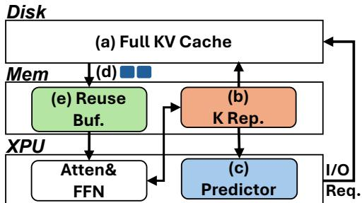
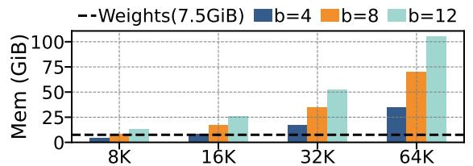
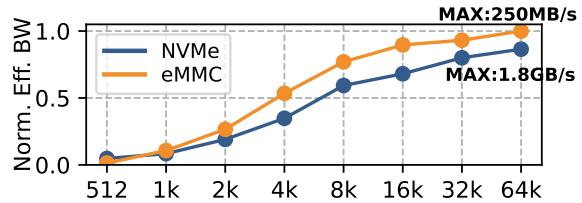
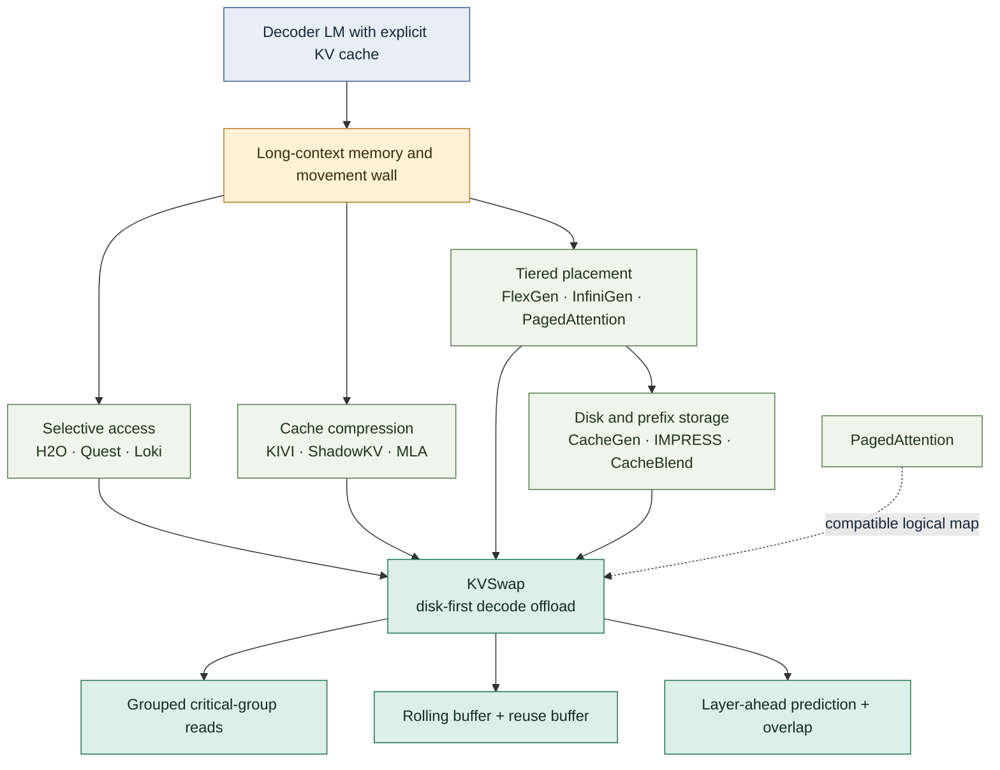
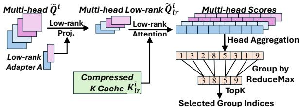
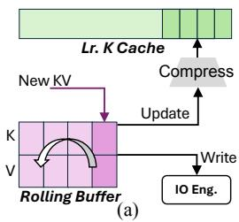
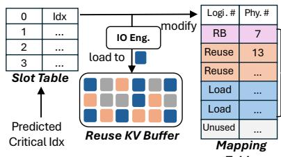
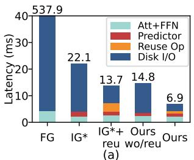
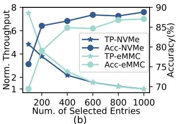
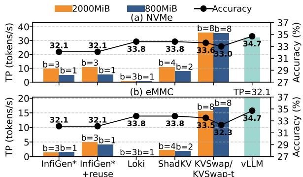

# KVSwap: Disk-Aware KV Cache Offloading for Long-Context On-Device Inference

**Paper:** [KVSwap: Disk-aware KV Cache Offloading for Long-Context On-device Inference](https://arxiv.org/abs/2511.11907v2)
**Authors:** Huawei Zhang, Chunwei Xia, Zheng Wang
**arXiv:** [2511.11907v2](https://arxiv.org/abs/2511.11907v2) — revised 11 December 2025

**Related pages:** [KV Cache](../../terms/kv-cache.md), [KV Cache Optimization Strategies](../kv-cache-optimization/index.md), [PagedAttention](../../terms/pagedattention.md), [Grouped-Query Attention](../../terms/grouped-query-attention.md)

> **Evidence:** This page synthesizes the complete precise MinerU extraction at `derived/pdf-markdown/frameworks/kvswap-disk-aware-kv-cache-offloading-on-device-inference/kvswap-disk-aware-kv-cache-offloading-on-device-inference.md` from the local PDF. The extraction has minor OCR and symbol artifacts; obvious equation and table notation was normalized against the paper, while the performance numbers remain source-reported.

## TL;DR

**What:** KVSwap is a disk-based [KV cache offloading](../../terms/kv-cache-offloading.md) framework for long-context decoding on devices where CPU and accelerator share a small memory pool.
**How:** It keeps the complete cache on disk, retains a compact key summary in memory, predicts critical groups for the next layer, overlaps grouped reads with compute, and reuses recently loaded groups.
**The number:** On a Jetson Orin AGX, the authors report up to 1.8× NVMe and 4.1× eMMC throughput gains over the strongest offloading baseline at 32K context under the same tight memory budget, with comparable or higher throughput than an idealized vLLM reference using 11.0× more KV-cache memory.

## The Big Picture

*Source: [KVSwap paper, Figure 5](https://arxiv.org/abs/2511.11907v2). ① The full request cache is authoritative on disk. ② A compact key representation and reuse buffer occupy the scarce memory tier. ③ The predictor chooses groups to load, while attention and feed-forward computation overlap the next layer's I/O.*

**The architectural bet is to make disk the backing store and memory a working set.** KVSwap does not attempt to keep every historical K/V tensor resident; it predicts which groups matter next, fetches them in storage-friendly units, and presents the attention kernel with a logical cache assembled from reuse hits, disk loads, and recent entries.

## Why This Exists

*Source: [KVSwap paper, Figure 1](https://arxiv.org/abs/2511.11907v2). The chart answers why a cache that grows with both context and batch quickly dominates a device's memory budget.*

The paper's concrete memory-wall example is Qwen3-4B in W16A16: the weights occupy 7.5 GiB, but a 16K context at batch size 4 needs 9 GiB of KV cache; at 32K and batch size 12, the cache reaches 54 GiB. On a mobile or embedded device with a strict per-application quota, the cache can therefore fail before the model weights do. Our running example below is a 32K-context, batch-8 decode under one of the paper's constrained budgets.

*Source: [KVSwap paper, Figure 2](https://arxiv.org/abs/2511.11907v2). Small transfers use only a small fraction of the storage device's peak bandwidth; larger blocks amortize the fixed cost of a read.*

The obvious escape route is [KV cache offloading](../../terms/kv-cache-offloading.md), but the usual server assumption is unavailable here: CPU and accelerator often share unified RAM rather than having a large, separate CPU tier. The remaining disk tier is much slower than memory: the paper measures up to 1.8 GB/s for NVMe and about 250 MB/s for eMMC, while a typical 512-byte KV entry uses less than 6% of the devices' peak bandwidth when read alone. **The problem is therefore not only capacity; it is the shape and timing of every disk read.**

## The Landscape

The editable Mermaid source for this cross-paper synthesis is [kvswap-landscape.mmd](./assets/kvswap-landscape.mmd).

*Synthesized landscape from KVSwap and the paper's related-work framing. The parent branches are not interchangeable: selection reduces what is read, compression reduces representation size, placement changes where state lives, and KVSwap combines all three around disk-first iterative decoding.*

## The Core Idea

KVSwap treats the full request-specific [KV cache](../../terms/kv-cache.md) as a durable backing store and the device memory as a small, changing working set. A compact summary of the keys guesses which older groups will be useful in the next layer; the runtime reads those groups together, reuses hits from recent steps, and keeps newly generated entries in a short rolling buffer until they can be written as a complete group. **The model still has a full cache available on disk, but each decode step pays only for a predicted, storage-friendly working set.**

## Symbol Map

The paper uses $i$ for a Transformer layer, $h$ for a query head, and $g(h)$ for the shared key head used by that query under [grouped-query attention](../../terms/grouped-query-attention.md) (GQA). Superscripts such as $K^i$ identify a layer; `lr` means the low-rank summary. The paper uses $H_k$ in the compression discussion and $H_{kv}$ for the stored KV-head count in the runtime discussion, so the table keeps both names visible.

| Symbol | Human name | Shape / scope | Plain meaning |
|---|---|---|---|
| $N$ | token count | one context | Number of cached positions. |
| $H_k$ | K-head count | per layer | Number of key heads used when forming the compressed representation. |
| $H_{kv}$ | stored KV-head count | per layer | Number of key/value heads whose groups are moved into the preload buffer. |
| $d$ | head dimension | per head | Width of one query or key vector. |
| $r$ | summary rank | $r \ll H_k d$ | Width retained by the compact key representation. |
| $A_{g(h)}$ | low-rank adapter | $d \times r$ for a shared K head | Projection that maps a query head into the summary space. |
| $K_{lr}$ | low-rank K cache | approximately $N \times r$ | In-memory key summary used only to predict important positions. |
| $\sigma$ | compression ratio | $(H_k d)/r$ | How much the K representation is reduced in the paper's joint-head construction. |
| $G$ | group size | consecutive token entries | Number of adjacent KV entries packed into one storage-aligned group. |
| $M$ | selected-group count | per layer and decode step | Number of groups selected for preloading. |
| $C$ | reuse-buffer capacity | number of memory slots | Number of KV groups that can survive for reuse across prediction steps. |
| $X_i$ | layer input | hidden state at layer $i$ | State used to approximate the next layer's query during overlap. |
| $B_{max}, S_{max}, b_{max}$ | tuning constraints | memory, context, batch | User limits supplied to offline parameter tuning. |

## Deep Dive

### 1. A compact key summary frees the memory budget

**What it does:** KVSwap compresses only the K cache used for prediction, leaving the full K/V cache on disk for later retrieval.

**Why it matters:** A full in-memory K cache would consume the same scarce memory that the system is trying to save, while the predictor needs enough information to distinguish useful from unhelpful positions.

**How it works:** The central representation is a [low-rank approximation](../../terms/low-rank-approximation.md) learned offline from calibration K caches.

1. The tuner flattens each layer's K cache from tokens × heads × head-dimension into a matrix of shape $N \times (H_k d)$.
2. It applies SVD to calibration samples and uses the top $r$ right singular vectors as a projection adapter $A$.
3. At runtime it stores $K_{lr}=\operatorname{Flatten}(K)A$ in memory instead of every K coordinate.
4. The summary estimates attention scores; the actual attention computation still consumes full K/V groups loaded from disk.

The paper's compression relation is:

$$
K_{lr}=\operatorname{Flatten}(K)A,\qquad \sigma=\frac{H_k d}{r},\qquad r\ll H_k d.
$$

For a query head $h$, the predictor uses the shared-K-head mapping $g(h)$ to avoid reconstructing the full K cache:

$$
Q_hK_{g(h)}^{\top}\approx Q_h\left(K_{lr}A_{g(h)}^{\top}\right)^{\top}=\left(Q_hA_{g(h)}\right)K_{lr}^{\top}.
$$

This is the important contrast with ShadowKV: ShadowKV must reconstruct a usable K cache for attention, so aggressive compression directly harms the computation. KVSwap uses its summary only for ranking, so the paper can allow a maximum compression ratio of 32 in its tuning space without asking the approximation to become the model's final attention input.

**The intuition:** Keep a cheap map of where the useful history probably is, then fetch the expensive exact entries only after ranking them.

**A concrete example:** For the running 32K request, the compact summary stays in the 120–310 MiB-per-batch KV budget while the complete K/V history remains on disk; the predictor can still rank old groups without first bringing the whole history into memory.

**Remember:** The low-rank cache is an index, not a replacement for the full K/V values used by the runtime.

### 2. Group first, then select

*Source: [KVSwap paper, Figure 6](https://arxiv.org/abs/2511.11907v2). The figure answers how KVSwap converts fine-grained importance scores into storage-friendly reads.*

**What it does:** It converts token-level importance scores into a small set of consecutive KV groups that match disk block-read behavior.

**Why it matters:** Reading individually important tokens creates many tiny random reads, exactly where the paper measures the worst bandwidth utilization.

**How it works:**

| Stage | Operation | Result |
|---|---|---|
| 1 | While computing layer $i-1$, approximate the next layer's input as $X_i \approx X_{i-1}$. | The next layer's selection can start before its compute turn. |
| 2 | Use the low-rank query and $K_{lr}$ to score each token, summing scores across query heads. | One importance score per cached position. |
| 3 | Partition consecutive positions into groups of $G$ and apply `ReduceMax` within each group. | One representative score per disk-friendly group. |
| 4 | Apply `TopK` to choose $M$ groups. | A bounded preload request for layer $i$. |
| 5 | Issue the group reads asynchronously. | Storage movement overlaps the current layer's attention and FFN work. |

**The intuition:** A slightly wider read that contains one useful token can be cheaper than many perfect but tiny reads.

**A concrete example:** In the running 32K request, a group of four adjacent entries is favored on the faster NVMe path, while the paper finds a group of eight better balances accuracy and I/O on eMMC. The selected entries are not fixed prompt positions; the predictor recomputes the likely groups as the generated query changes.

**Remember:** $G$ is a hardware-and-quality knob: larger groups use the disk more efficiently but make each selection less precise.

### 3. A rolling buffer keeps new cache entries complete

*Source: [KVSwap paper, Figure 7(a)](https://arxiv.org/abs/2511.11907v2). The rolling buffer protects the newest, not-yet-grouped entries from being omitted by the selector.*

**What it does:** The rolling buffer (RB) holds newly generated K/V entries until they fill one prediction group.

**Why it matters:** A token arriving at the end of a decode step cannot be judged as part of a complete group yet; immediately forcing it through the selector would leave recent context unavailable or create inefficient partial writes.

**How it works:**

| State | Runtime action | Invariant preserved |
|---|---|---|
| New token arrives | Append its K/V entry to RB. | Recent context is directly available. |
| RB has fewer than $G$ entries | Keep accumulating; do not select or offload a partial group. | The newest positions are not lost between steps. |
| RB reaches $G$ entries | Write the complete K/V group to disk and update the compact K representation. | The disk copy and predictor summary advance together. |

**The intuition:** The newest tokens are a small exception to the group policy because waiting for a complete group is safer than pretending a partial group is representative.

**A concrete example:** In the running 32K decode, the eighth newly generated token can complete a group when $G=8$ on eMMC; the group then joins the disk-backed history while the next token starts a fresh RB.

**Remember:** The RB is a write-side staging area for new entries, not the cache of previously read critical groups.

### 4. A reuse buffer turns locality into saved disk reads

*Source: [KVSwap paper, Figure 7(b)](https://arxiv.org/abs/2511.11907v2). The slot table lets a later prediction use a prior disk load without reading the same group again.*

*Source: [KVSwap paper, Figure 13(a)](https://arxiv.org/abs/2511.11907v2). With reuse enabled, the paper reports 6.9 ms total latency and only 1.0 ms reuse-management overhead for the measured block.*

**What it does:** The reuse buffer retains recently loaded critical groups and maps their logical group IDs to fixed memory slots.

**Why it matters:** Adjacent prediction steps overlap even though fewer than 22% of groups account for 80% of occurrences; retaining those repeated groups avoids paying disk latency again.

**How it works:**

1. The predictor emits the next set of group IDs.
2. The slot table checks whether each ID is already resident in the reuse buffer.
3. A hit passes its slot directly to attention; a miss triggers a disk read into a free or FIFO-replaced slot.
4. Before attention runs, the KV cache manager updates a logical-to-physical mapping over reuse hits, disk-loaded groups, and the RB. This mapping is compatible with [PagedAttention](../../terms/pagedattention.md), whose kernels consume a logical cache view rather than requiring one physically contiguous allocation.

**The intuition:** The reuse buffer is a small software cache for the disk tier, and the mapping table hides its moving physical locations from attention.

**A concrete example:** In the running 32K request, a group selected for layer $i$ and selected again at the next nearby step is a slot hit; on QMSum and MuSiQue samples, the paper reports 75.3–81.2% reuse and 3.8–4.0× eMMC throughput improvement over no reuse.

**Remember:** RB protects recent writes; the reuse buffer saves reads of already loaded groups.

### 5. Offline tuning chooses a device-specific compromise

*Source: [KVSwap paper, Figure 13(b)](https://arxiv.org/abs/2511.11907v2). The curve answers why the default selected-entry budget is a compromise rather than a universal maximum.*

**What it does:** An offline solver chooses $G$, $\sigma$, $M$, and $C$ for the target model, context limit, batch limit, memory budget, and storage device.

**Why it matters:** A configuration that hides I/O on NVMe can over-fetch on eMMC, while a configuration that fits memory can lose quality if it selects too few or too coarse groups.

**How it works:** The tuner first respects the memory limit, then profiles model delay and I/O delay over sampled batch/context points. It uses lookup tables for reuse capacity and compression adapters, profiles a representative Transformer block, and greedily searches for a local configuration that hides as much I/O as possible without exceeding compression or group-size limits. In the evaluation, tuning completes in under 30 minutes; the shared setting fixes $MG=400$, $\sigma_{max}=32$, $S_{max}=32$K, and $b_{max}=16$.

**The intuition:** KVSwap is a co-design, so the storage device is part of the model-serving configuration rather than an interchangeable afterthought.

**A concrete example:** For the running request, the paper's relaxed LLaMA3-8B budget is 310 MiB per batch and its tight budget is 120 MiB per batch at 32K. The reported best group size is $G=4$ for NVMe and $G=8$ for eMMC, reflecting their different read granularities.

**Remember:** The solver spends the memory budget among summary rank, selected groups, and reuse capacity; no single knob is independently optimal.

## Putting It Together

Consider one 32K-context, batch-8 LLaMA3-8B decode under the paper's fixed per-batch budget. Follow the request's full KV cache as it moves through one decode iteration:

| Step | Actor | Input state | Action | Output state |
|---:|---|---|---|---|
| 1 | Prefill writer | Prompt tokens and newly computed full K/V | Compute the prompt once, write each layer's full K/V cache to disk, and build the compact K summary in memory. | Full history is on disk; memory holds metadata, summary, and buffers. |
| 2 | Current Transformer layer | Layer $i-1$ hidden state and its attention inputs | Run attention and FFN for the current layer while the runtime prepares the next layer's cache request. | Current hidden state advances; disk work can overlap compute. |
| 3 | KV predictor | Approximate next input $X_i \approx X_{i-1}$ plus compact $K_{lr}$ | Form low-rank query scores, sum across heads, group consecutive positions, `ReduceMax`, and select the top $M$ groups. | A bounded set of logical group IDs for layer $i$. |
| 4 | Reuse and I/O path | Group IDs plus reuse slot table | Use resident slots on hits; issue grouped disk reads for misses; place new K/V entries in the RB. | Critical groups and recent entries occupy heterogeneous memory regions. |
| 5 | KV cache manager and attention | Reuse slots, disk-load slots, RB entries | Rewrite the mapping table so the attention kernel sees one logical cache view, then compute attention for layer $i$. | The layer receives the selected history plus recent entries without a full in-memory cache. |
| 6 | Cache updater | Newly generated token and completed RB group | Append the token to the RB; when a group completes, write full K/V to disk and update the compact K summary. | The disk backing store, summary, and next-step working set stay synchronized. |

The point of the trace is that **selection changes the movement schedule, not the logical ownership of the full cache**. The quality approximation comes from using predicted groups for each attention step; the throughput comes from making those groups large enough to read efficiently, reusing them, and overlapping their movement with compute.

## What This Buys You

### The headline claim

*Source: [KVSwap paper, Figure 11](https://arxiv.org/abs/2511.11907v2). The source compares each method at its best configuration under relaxed and tight total-memory budgets; the bar pairs expose the throughput/quality trade-off.*

**The authors show that disk-based decoding can be competitive when the system treats I/O granularity, prediction, and reuse as one problem.** KVSwap maintains useful generation quality under memory budgets where the adapted CPU/GPU offloading baselines collapse, and it can approach or exceed the idealized in-memory vLLM throughput at larger contexts or batches.

### How we know: cross-device quality and throughput

The following compact slice reports the paper's LLaMA3-8B results; quality is relative loss from Full-KV, and throughput is tokens per second at 32K context and batch size 8 unless noted.

| Scenario | Offload baseline | vLLM ideal reference | KVSwap | Interpretation |
|---|---:|---:|---:|---|
| Relaxed quality, RULER / LongBench | ShadowKV: 52.3% / 5.0% loss | — | NVMe: 2.6% / 0.6%; eMMC: 4.4% / 1.1% | The full on-disk cache plus selective reads preserves far more quality than the compressed baseline. |
| Tight quality, RULER / LongBench | ShadowKV-t: 61.9% / 8.7% loss | — | NVMe: 5.6% / 2.4%; eMMC: 22.9% / 2.7% | NVMe remains usable; slower eMMC pays a larger quality cost under the same tiny budget. |
| 32K, NVMe throughput | ShadowKV: 21.5 tok/s | 20.8 tok/s | 35.6 tok/s | Grouped reads and reuse beat both the strongest offload baseline and the idealized reference at this batch size. |
| 32K, eMMC throughput | ShadowKV: 3.8 tok/s | 20.8 tok/s | 15.7 tok/s | KVSwap makes slow storage usable, although it does not erase the eMMC bandwidth ceiling. |
| 16K, batch 16, NVMe | ShadowKV: 26.7 tok/s | 39.5 tok/s | 46.1 tok/s | At a larger batch, KVSwap reports 1.2× vLLM throughput while using 11.0× less KV memory. |

The paper's best-case comparison reports a broader range: against vLLM, NVMe KVSwap reduces KV-cache memory by 15.9×–39.7× while retaining 1.1× higher throughput and at most a 2.4% accuracy drop in that comparison. Against ShadowKV, the reported throughput gains reach 7.1× and 8.6× on eMMC and 3.3× and 4.5× on NVMe across the tested best-case points, with accuracy drops no larger than 1.5%.

### The mechanism behind the numbers

Throughput stays comparatively stable from 16K to 32K in the fixed-budget table because the number of selected KV entries is held constant; KVSwap does not read the entire growing history on every generated token. Grouping converts tiny random reads into larger transfers, layer-ahead prediction gives those transfers time to complete, and reuse removes repeated reads. The slower eMMC path saturates sooner, which is why its throughput stops scaling at large batches even though its memory footprint remains small.

The quality numbers are not a claim that selective attention is mathematically identical to Full-KV attention. They measure how much the generated task score changes when the predictor supplies only the selected groups plus recent entries, while the unselected exact cache remains available on disk. The important result is that the paper's compact index is accurate enough for its tested tasks and budgets; its usefulness depends on the workload and device configuration.

### How we know: evaluation boundary

| Dimension | Paper setup |
|---|---|
| Device | NVIDIA Jetson Orin AGX: 12-core Cortex-A78 at 1.3 GHz, Ampere GPU with 2,048 CUDA cores, 64 GB unified RAM. |
| Storage | NVMe measured at 1.8 GB/s and eMMC at 250 MB/s. |
| Models | LLaMA3 3B/8B, Qwen3 4B/8B/14B, Qwen2.5-VL 3B/7B, and InternVL3-14B. |
| Workloads | LongBench, NIAH, eight RULER tasks, Qwen3 thinking-mode reasoning, and MLVU video tasks. |
| Measurement | Average decoding rate over 1,000 generated tokens and five randomly selected inputs. |
| Budgets | Setting A: 1/13 relaxed and 1/34 tight of full KV per batch; setting B: 2,000 MiB relaxed and 800 MiB tight total KV memory. |

> **Warning:** vLLM is an idealized reference in these experiments: it dedicates the remaining device memory to an in-memory KV cache, while KVSwap and the offloading baselines are evaluated under explicit low-memory budgets. The vLLM comparisons therefore establish an interesting upper-bound reference, not an apples-to-apples deployment match.

## Where It Breaks

| Failure mode | When it happens | Impact |
|---|---|---|
| Groups are too coarse or too few | $G$ is increased, $M$ is reduced, or $MG$ is pushed below the workload's useful coverage. | Disk utilization improves, but the selector misses important positions and quality drops. |
| The compact predictor is inaccurate | The model, calibration distribution, layer behavior, or query pattern differs from the tuning profile. | Wrong groups are prefetched; the full cache is still on disk, but this step's approximate attention loses useful evidence. |
| Compression is too aggressive | The memory budget forces $\sigma$ near its maximum and leaves too little rank for the model's key geometry. | Importance ranking becomes noisy and generation quality degrades. |
| Reuse locality is weak | Consecutive layers or decode steps select mostly disjoint groups, or the reuse capacity $C$ is too small. | The slot table produces few hits, so disk traffic and latency approach the no-reuse path. |
| Storage is slow or reads are too small | eMMC-like bandwidth, filesystem/device read amplification, or a configuration that still issues fine-grained random reads. | I/O dominates compute; the paper's eMMC results show that grouping helps but cannot remove the storage ceiling. |
| The workload is prefill- or TTFT-dominated | The application cares mostly about producing the first token or has little iterative decoding. | KVSwap's main advantage—overlapping repeated decode-time reads—has less opportunity to appear; the paper targets iterative decoding. |
| The platform differs materially | A non-Jetson memory hierarchy, different storage controller, or an unsupported storage type such as UFS is used without retuning. | The reported $G$, $\sigma$, $M$, and $C$ no longer describe the best operating point. |
| Disk becomes a production state store | Long-running workloads raise endurance, crash-recovery, privacy, encryption, and multi-application coordination requirements. | The paper's throughput prototype does not by itself establish storage lifetime, durability, or isolation guarantees. This is an operational inference beyond the reported evaluation. |

## One Thing to Remember

**KVSwap makes disk-based long-context decoding a working-set problem:** keep the exact full cache on disk, keep only a compact key map and a few buffers in memory, predict the next useful groups, and use storage-aware reads plus reuse to make that approximation fast enough to serve.

## Go Deeper

- **Read:** [KVSwap: Disk-aware KV Cache Offloading for Long-Context On-device Inference](https://arxiv.org/abs/2511.11907v2).
- **Understand the context:** [KV Cache](../../terms/kv-cache.md), [KV Cache Offloading](../../terms/kv-cache-offloading.md), and [KV Cache Optimization Strategies](../kv-cache-optimization/index.md).
- **Build on:** [PagedAttention](../../terms/pagedattention.md), [Grouped-Query Attention](../../terms/grouped-query-attention.md), and [Low-Rank Approximation](../../terms/low-rank-approximation.md).
- **Compare:** The paper's adapted [InfiniGen](https://www.usenix.org/conference/osdi24/presentation/lee), [ShadowKV](https://arxiv.org/abs/2410.21465), [FlexGen](https://arxiv.org/abs/2303.06865), and idealized [vLLM](https://arxiv.org/abs/2309.06180) baselines.
- **Reproduce:** The paper reports a Python/PyTorch implementation evaluated on Jetson Orin AGX, NVMe, and eMMC; no implementation checkout is included in this repository's source set at the time of writing.
