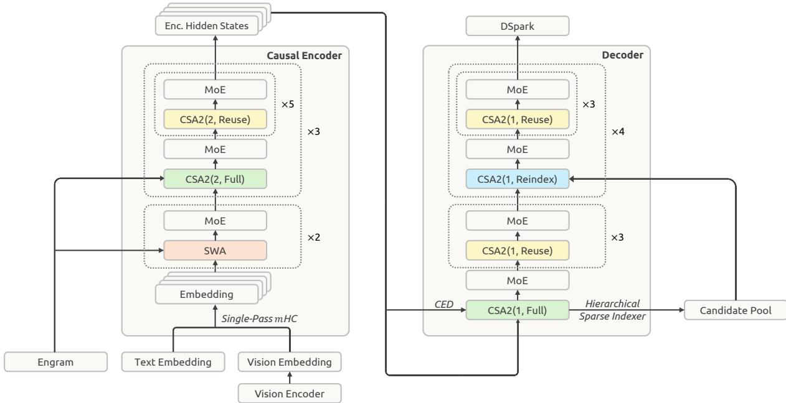
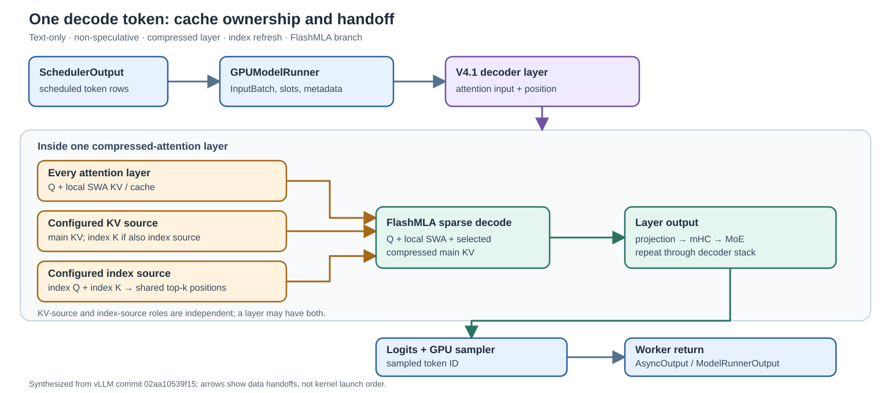
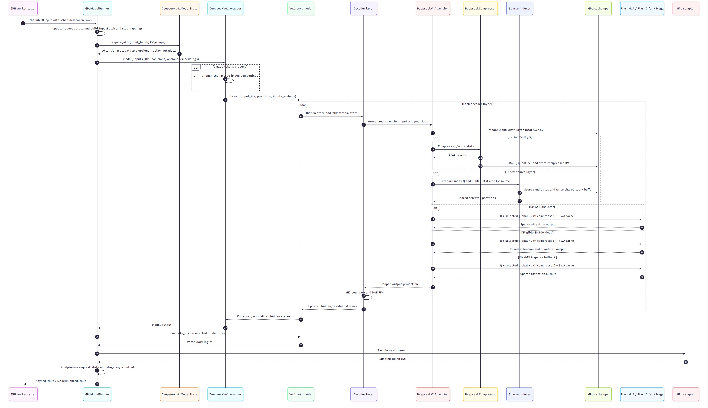
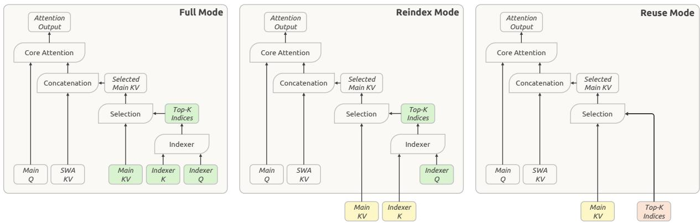

# DeepSeek-V4.1-Flash on NVIDIA vLLM: GPU Inference Path

**Repository:** `vllm-project/vllm` at commit
`02aa10539f15c8c73aa7fd4a5ee0f691cbf88dcb` (GitHub origin, detached clean
checkout; pin date 2026-10-10).  
**Inspection:** 2026-10-17; static code reading only.  
**Scope:** the NVIDIA GPU worker path from receiving a `SchedulerOutput` to
returning sampled token IDs in `AsyncOutput` / `ModelRunnerOutput`. The OpenAI
request renderer, detokenizer, and HTTP response layer are outside this map.

**Related pages:** [DeepSeek-V4.1-Flash report](../../../../training/model-families/deepseek/deepseek-v4.1/index.md),
[DeepSeek V4 attention code map](../v4-attention-code-reading.md),
[vLLM hub](../../vllm/index.md).

## TL;DR

The checkpoint architecture resolves to the V4.1-specific model package, but
the text stack reuses V4-named implementation classes. The runner supplies
token rows, paged-cache slots, and model-specific attention metadata; the
checkpoint config decides which layers publish compressed key/value (KV) or
sparse-index state; the selected GPU backend reads that global state together
with each layer's [sliding-window attention](../../../../terms/sliding-window-attention.md)
(SWA). This split exists because sparse attention pays off only when choosing
*where* to attend is cheaper than attending everywhere: scoring a query against
every past token at full resolution would cost as much memory bandwidth as
dense attention, so V4.1 keeps a small compressed cache as a coarse index,
scores it to pick top-k positions, and spends exact attention only on those
positions plus the recent window. Manifold-constrained
hyper-connections
([mHC](../../../../terms/hyper-connections.md)) carry the multi-stream
residual state, and
[mixture-of-experts (MoE)](../../../../terms/mixture-of-experts.md) layers
process the feed-forward network (FFN) path. The worker returns sampled token
IDs, not detokenized text.

“Flash” is part of the checkpoint name, not a fixed attention-kernel choice.
Backend selection is separate: the SM120 and SM100 automatic paths have
different kernels and different behavior when a required kernel is unavailable.
The [GPU branch comparison](#sm100-and-sm120-gpu-branches) makes that split
explicit. Both implement sparse
[Multi-head Latent Attention (MLA)](../../../../terms/kv-cache.md).

> **Evidence boundary:** all paths below are inferred from the pinned source.
> The checkpoint's exact layer arrays and runtime backend were not loaded, and
> no NVIDIA GPU execution was performed.

**Report boundary:** The [technical report](../../../../training/model-families/deepseek/deepseek-v4.1/index.md)
draws a causal text encoder and decoder. This scoped vLLM code reading finds
one text-model decoder-layer stack and an image encoder, but no separate
causal text-encoder stage. The report figure is a model-design reference,
not a verified call graph for this worker path. See the
[implementation boundary](#implementation-boundary-report-versus-vllm).

## Mental Model

The scheduled batch determines which token rows advance and where new cache
entries may be written. The model config determines which layers own compressed
KV and indexer state. The sparse indexer selects old global positions; the
attention backend combines them with recent SWA state. The layer returns
through grouped output projection, mHC, and MoE before the runner samples a
token.

The three attention caches form a precision-and-resolution hierarchy. Local SWA
KV is exact but covers only the recent window. The compressed main KV covers
the whole context at one state per `compress_ratio` tokens. The index-K cache
is a tiny FP8/MXFP4 scoring copy used only to choose positions. Selection
indices live in **compressed-state units**, not token positions: index *i*
covers tokens *i·r* through *(i+1)·r − 1* for `compress_ratio = r`. The backend
expands the selected states, unions them with the always-on SWA window, and
only then reads the main KV.

The report's architecture gives the high-level model-design view. Read its
left panel as the proposed causal encoder and its right panel as the decoder;
the CSA2 groups, local SWA, MoE, and mHC labels provide context for the code
trace below. This pinned vLLM inspection follows the decoder stack but does
not verify a separate causal text-encoder stage in the GPU worker path.



*Source: Figure 3 of the [DeepSeek-V4.1-Flash technical report](../../../../../raw/training/model-families/deepseek/deepseek-v4.1-technical-report--paper.pdf),
also explained in the [report synthesis](../../../../training/model-families/deepseek/deepseek-v4.1/index.md#the-big-picture).
This is the report's model-design figure, not a verified vLLM worker call graph.*

This is a worker-level trace, not a complete chat-server trace. Its boundary is
the `SchedulerOutput` received by `GPUModelRunner.execute_model`; its return
boundary is the asynchronous worker output sent back to the caller.

## SM100 and SM120 GPU Branches

At model construction, the
<a class="code-link" href="../../../../../external-repos/vllm-02aa10539f15/vllm/models/deepseek_v41/nvidia/model.py#L197" data-code-repo="vllm-02aa10539f15" data-code-path="vllm/models/deepseek_v41/nvidia/model.py" data-code-line="197"><code>V4.1 attention selector</code></a>
checks an explicit backend choice before applying these automatic defaults:

| GPU path in this pin | Automatic attention class | If the preferred path is unavailable |
|---|---|---|
| SM120 (the selector tests compute-capability major 12) | FlashInfer SM120 sparse MLA | A missing V4 sparse-MLA specialization raises during initialization; the automatic path does not retry FlashMLA. |
| SM100 family | FlashMLA Mega when its kernel and local-head / tensor-parallel topology are eligible | The selector uses FlashMLA sparse MLA when Mega is ineligible. |

An explicit supported backend can select another class; the selector rejects
the generic FlashInfer sparse-MLA enums for this model. The detailed
[backend table and code links](#5-the-selected-cuda-backend-consumes-global-top-k-plus-swa)
show the implementation and gates. The single-token walkthrough below chooses
the FlashMLA branch as a concrete example; it is not a claim that either GPU
automatically selects FlashMLA in every configuration.

### KV cache layout by backend

Every attention layer owns local SWA KV. Only a configured KV-source layer owns
compressed main KV; consumers read that source's cache. Index K is a separate
cache for scoring, and the shared top-k buffer holds selected positions rather
than KV records
(<a class="code-link" href="../../../../../external-repos/vllm-02aa10539f15/vllm/models/deepseek_v41/attention.py#L1138" data-code-repo="vllm-02aa10539f15" data-code-path="vllm/models/deepseek_v41/attention.py" data-code-line="1138"><code>main-KV ownership</code></a>,
<a class="code-link" href="../../../../../external-repos/vllm-02aa10539f15/vllm/models/deepseek_v41/attention.py#L428" data-code-repo="vllm-02aa10539f15" data-code-path="vllm/models/deepseek_v41/attention.py" data-code-line="428"><code>index-K ownership</code></a>).

With generic `--kv-cache-dtype auto` or `fp8`, the
<a class="code-link" href="../../../../../external-repos/vllm-02aa10539f15/vllm/models/deepseek_v41/attention.py#L132" data-code-repo="vllm-02aa10539f15" data-code-path="vllm/models/deepseek_v41/attention.py" data-code-line="132"><code>dtype resolver</code></a>
uses each backend's preferred packed format. These are **record widths**, not
the model's total KV bytes per input token:

| Automatic backend branch | Resolved packed dtype | Local SWA record, per token | Compressed main-KV record, per stored state |
|---|---|---|---|
| SM100 FlashMLA Mega | `nvfp4_ds_mla` | 528 B V4.1 block-scaled FP8 | 288 B NVFP4 |
| SM100 FlashMLA fallback | `fp8_ds_mla` | 528 B V4.1 block-scaled FP8 | 528 B V4.1 block-scaled FP8 |
| SM120 FlashInfer | `fp8_ds_mla` | 584 B V4 mixed FP8 NoPE / BF16 RoPE | 584 B V4 mixed FP8 NoPE / BF16 RoPE |

The same `fp8_ds_mla` dtype string therefore does **not** mean the same record
bytes on SM100 and SM120. The
<a class="code-link" href="../../../../../external-repos/vllm-02aa10539f15/vllm/models/deepseek_v41/attention.py#L128" data-code-repo="vllm-02aa10539f15" data-code-path="vllm/models/deepseek_v41/attention.py" data-code-line="128"><code>GPU-family record switch</code></a>
and <a class="code-link" href="../../../../../external-repos/vllm-02aa10539f15/vllm/models/deepseek_v41/attention.py#L512" data-code-repo="vllm-02aa10539f15" data-code-path="vllm/models/deepseek_v41/attention.py" data-code-line="512"><code>record-size calculation</code></a>
set those widths. Mega prefers NVFP4 only for compressed main KV; its SWA
record stays FP8
(<a class="code-link" href="../../../../../external-repos/vllm-02aa10539f15/vllm/models/deepseek_v41/nvidia/flash_mla_mega_attn.py#L202" data-code-repo="vllm-02aa10539f15" data-code-path="vllm/models/deepseek_v41/nvidia/flash_mla_mega_attn.py" data-code-line="202"><code>Mega cache dtype</code></a>).
For `compress_ratio = 2`, one compressed state represents two tokens; page
padding, source-layer count, and index K also affect total memory.
The index-K cache is a third, smaller store with one key per compressed
position, kept in FP8 or MXFP4 depending on
`attention_config.indexer_kv_dtype`
(<a class="code-link" href="../../../../../external-repos/vllm-02aa10539f15/vllm/models/deepseek_v41/attention.py#L1307" data-code-repo="vllm-02aa10539f15" data-code-path="vllm/models/deepseek_v41/attention.py" data-code-line="1307"><code>indexer cache dtype</code></a>).

The decode calls consume these caches differently: Mega passes paged byte
records and slot indices to its fused kernel
(<a class="code-link" href="../../../../../external-repos/vllm-02aa10539f15/vllm/models/deepseek_v41/nvidia/flash_mla_mega_attn.py#L334" data-code-repo="vllm-02aa10539f15" data-code-path="vllm/models/deepseek_v41/nvidia/flash_mla_mega_attn.py" data-code-line="334"><code>Mega decode</code></a>);
FlashMLA passes separate SWA and compressed cache tensors with their own
indices
(<a class="code-link" href="../../../../../external-repos/vllm-02aa10539f15/vllm/models/deepseek_v41/nvidia/flashmla.py#L230" data-code-repo="vllm-02aa10539f15" data-code-path="vllm/models/deepseek_v41/nvidia/flashmla.py" data-code-line="230"><code>FlashMLA decode</code></a>);
SM120 FlashInfer presents both paged caches as `NHD` sparse views and passes
local SWA and global sparse indices separately
(<a class="code-link" href="../../../../../external-repos/vllm-02aa10539f15/vllm/models/deepseek_v41/nvidia/flashinfer_sparse.py#L809" data-code-repo="vllm-02aa10539f15" data-code-path="vllm/models/deepseek_v41/nvidia/flashinfer_sparse.py" data-code-line="809"><code>FlashInfer decode</code></a>).
Explicitly selecting FlashInfer on SM100 uses a different, plain BF16 or
per-tensor FP8 row layout, not the SM120 packed layout
(<a class="code-link" href="../../../../../external-repos/vllm-02aa10539f15/vllm/models/deepseek_v41/nvidia/flashinfer_sparse.py#L235" data-code-repo="vllm-02aa10539f15" data-code-path="vllm/models/deepseek_v41/nvidia/flashinfer_sparse.py" data-code-line="235"><code>SM100 FlashInfer class</code></a>).

## Follow One Decode Token

Consider a text-only, non-speculative decode step on the last pipeline rank.
For the attention detail, follow a layer with `compress_ratio > 0`, a configured
index-source layer that refreshes selection, a context long enough to score
candidates, the standard CUDA indexer (`indexer_sparse_logits` disabled), and
the FlashMLA backend. These conditions select one code branch for reading; the
checkpoint's actual layer
assignments and the runtime backend were not verified. A Reuse layer skips the
indexer call and reads the most recent selection instead. (Shorter contexts
take a select-all fallback: when the compressed-candidate count fits in the
top-k budget, a small kernel marks every candidate selected without running
the scoring kernel —
<a class="code-link" href="../../../../../external-repos/vllm-02aa10539f15/vllm/models/deepseek_v41/attention.py#L104" data-code-repo="vllm-02aa10539f15" data-code-path="vllm/models/deepseek_v41/attention.py" data-code-line="104"><code>select-all fill</code></a>.)

The diagram answers one state question before the code trace: which layer
publishes each cache input, and where do those inputs meet? The three cache
lanes are roles, not necessarily three different layers. KV-source and
index-source roles can coincide in one layer.



*Synthesized explanation of the pinned vLLM FlashMLA decode branch. Arrows
show state handoffs, not kernel launch order. The checkpoint's source-layer
assignments and actual runtime backend were not verified. Follow the
revision-aware code links in the trace below for each handoff.
[Editable Draw.io source](assets/decode-token-path.drawio).*

Read the top row from `SchedulerOutput` to the decoder, then the three amber
lanes: each attention layer has local SWA state, configured KV sources publish
compressed KV, and configured index sources refresh shared top-k
positions. Those positions select cache entries for FlashMLA; they are not the
sampled token. Follow the right side through layer output, logits, and the GPU
sampler to the worker return.

| Step | Input → state change → output | Where to read |
|---:|---|---|
| 1 | `SchedulerOutput` → scheduled rows, block tables, and slot mappings → `InputBatch` | <a class="code-link" href="../../../../../external-repos/vllm-02aa10539f15/vllm/v1/worker/gpu/model_runner.py#L1711" data-code-repo="vllm-02aa10539f15" data-code-path="vllm/v1/worker/gpu/model_runner.py" data-code-line="1711"><code>execute_model</code></a> |
| 2 | `InputBatch` and cache groups → attention metadata and model inputs → wrapper call | <a class="code-link" href="../../../../../external-repos/vllm-02aa10539f15/vllm/v1/worker/gpu/model_runner.py#L1905" data-code-repo="vllm-02aa10539f15" data-code-path="vllm/v1/worker/gpu/model_runner.py" data-code-line="1905"><code>prepare_attn</code></a>, <a class="code-link" href="../../../../../external-repos/vllm-02aa10539f15/vllm/v1/worker/gpu/model_runner.py#L1949" data-code-repo="vllm-02aa10539f15" data-code-path="vllm/v1/worker/gpu/model_runner.py" data-code-line="1949"><code>model_inputs</code></a> |
| 3 | Layer hidden state and position → Q and local SWA KV; a KV source publishes compressed main KV, and an index source that also owns KV publishes index K → cache entries for this step | <a class="code-link" href="../../../../../external-repos/vllm-02aa10539f15/vllm/models/deepseek_v41/attention.py#L868" data-code-repo="vllm-02aa10539f15" data-code-path="vllm/models/deepseek_v41/attention.py" data-code-line="868"><code>prepare and insert</code></a> |
| 4 | Index query and index-K cache → sparse scores and selection → shared top-k buffer holding **compressed-state** positions (index *i* covers tokens *i·r* … *(i+1)·r − 1* for `compress_ratio = r`); only an index-source layer refreshes it | <a class="code-link" href="../../../../../external-repos/vllm-02aa10539f15/vllm/models/deepseek_v41/attention.py#L997" data-code-repo="vllm-02aa10539f15" data-code-path="vllm/models/deepseek_v41/attention.py" data-code-line="997"><code>indexer handoff</code></a>, <a class="code-link" href="../../../../../external-repos/vllm-02aa10539f15/vllm/model_executor/layers/sparse_attn_indexer.py#L769" data-code-repo="vllm-02aa10539f15" data-code-path="vllm/model_executor/layers/sparse_attn_indexer.py" data-code-line="769" data-code-end-line="780"><code>CUDA top-k write</code></a> |
| 5 | Q, shared top-k, compressed KV, and local SWA KV → FlashMLA decode → attention output buffer | <a class="code-link" href="../../../../../external-repos/vllm-02aa10539f15/vllm/models/deepseek_v41/nvidia/flashmla.py#L179" data-code-repo="vllm-02aa10539f15" data-code-path="vllm/models/deepseek_v41/nvidia/flashmla.py" data-code-line="179"><code>map indices</code></a>, <a class="code-link" href="../../../../../external-repos/vllm-02aa10539f15/vllm/models/deepseek_v41/nvidia/flashmla.py#L230" data-code-repo="vllm-02aa10539f15" data-code-path="vllm/models/deepseek_v41/nvidia/flashmla.py" data-code-line="230"><code>attention call</code></a> |
| 6 | Attention output → grouped projection, mHC, MoE, final collapse and norm → model hidden states | <a class="code-link" href="../../../../../external-repos/vllm-02aa10539f15/vllm/models/deepseek_v41/nvidia/model.py#L455" data-code-repo="vllm-02aa10539f15" data-code-path="vllm/models/deepseek_v41/nvidia/model.py" data-code-line="455"><code>decoder layer</code></a>, <a class="code-link" href="../../../../../external-repos/vllm-02aa10539f15/vllm/models/deepseek_v41/nvidia/model.py#L1070" data-code-repo="vllm-02aa10539f15" data-code-path="vllm/models/deepseek_v41/nvidia/model.py" data-code-line="1070"><code>collapse</code></a> |
| 7 | Selected hidden row → logits → sampled token ID; request state and connector output are updated before `AsyncOutput` returns | <a class="code-link" href="../../../../../external-repos/vllm-02aa10539f15/vllm/v1/worker/gpu/model_runner.py#L1605" data-code-repo="vllm-02aa10539f15" data-code-path="vllm/v1/worker/gpu/model_runner.py" data-code-line="1605"><code>logits</code></a>, <a class="code-link" href="../../../../../external-repos/vllm-02aa10539f15/vllm/v1/worker/gpu/model_runner.py#L2127" data-code-repo="vllm-02aa10539f15" data-code-path="vllm/v1/worker/gpu/model_runner.py" data-code-line="2127"><code>sample_tokens</code></a>, <a class="code-link" href="../../../../../external-repos/vllm-02aa10539f15/vllm/v1/worker/gpu/model_runner.py#L2270" data-code-repo="vllm-02aa10539f15" data-code-path="vllm/v1/worker/gpu/model_runner.py" data-code-line="2270"><code>worker return</code></a> |

## Request Round Trip

[](assets/request-round-trip.jpg)

*Rendered from the [editable Mermaid source](assets/request-round-trip.mmd).
Open the JPG at full size to follow the numbered handoffs; optional branches
show paths outside the single-token FlashMLA walkthrough above.*

The detailed diagram includes optional image processing and hardware branches.
Use the single-token trace above for the main state changes; the links below
provide revision-aware evidence for each handoff.

### 1. Resolve the checkpoint at load time

The HF `deepseek_v41` model type maps to `DeepseekV41Config`
(<a class="code-link" href="../../../../../external-repos/vllm-02aa10539f15/vllm/transformers_utils/config.py#L129" data-code-repo="vllm-02aa10539f15" data-code-path="vllm/transformers_utils/config.py" data-code-line="129"><code>config mapping</code></a>,
<a class="code-link" href="../../../../../external-repos/vllm-02aa10539f15/vllm/transformers_utils/configs/deepseek_v41.py#L8" data-code-repo="vllm-02aa10539f15" data-code-path="vllm/transformers_utils/configs/deepseek_v41.py" data-code-line="8"><code>config adapter</code></a>).
The model registry maps the checkpoint architecture to the V4.1 package
(<a class="code-link" href="../../../../../external-repos/vllm-02aa10539f15/vllm/model_executor/models/registry.py#L370" data-code-repo="vllm-02aa10539f15" data-code-path="vllm/model_executor/models/registry.py" data-code-line="370"><code>architecture registry</code></a>).
For NVIDIA, the package imports the V4.1 wrapper from its `nvidia` branch
(<a class="code-link" href="../../../../../external-repos/vllm-02aa10539f15/vllm/models/deepseek_v41/__init__.py#L9" data-code-repo="vllm-02aa10539f15" data-code-path="vllm/models/deepseek_v41/__init__.py" data-code-line="9"><code>platform entry point</code></a>).
vLLM's model test registry also associates this architecture with
`deepseek-ai/DeepSeek-V4.1-Flash`; that registration is not evidence that this
inspection ran the model.

The NVIDIA
<a class="code-link" href="../../../../../external-repos/vllm-02aa10539f15/vllm/models/deepseek_v41/nvidia/vl_model.py#L117" data-code-repo="vllm-02aa10539f15" data-code-path="vllm/models/deepseek_v41/nvidia/vl_model.py" data-code-line="117"><code>DeepseekV41ForCausalLM</code></a>
is a multimodal wrapper. Text-only requests use the language model's token
embeddings. For images, the vision transformer (ViT) and aligner produce
embeddings that replace
the image spans
(<a class="code-link" href="../../../../../external-repos/vllm-02aa10539f15/vllm/models/deepseek_v41/nvidia/vl_model.py#L207" data-code-repo="vllm-02aa10539f15" data-code-path="vllm/models/deepseek_v41/nvidia/vl_model.py" data-code-line="207"><code>image processing</code></a>).
The wrapper preserves raw token IDs because V4.1's MoE router uses image-token
identity.

### 2. The GPU runner builds the scheduled batch and model state

`GPUModelRunner.execute_model` receives `SchedulerOutput`, updates request
state, selects the scheduled token rows, and prepares block tables and slot
mappings
(<a class="code-link" href="../../../../../external-repos/vllm-02aa10539f15/vllm/v1/worker/gpu/model_runner.py#L1711" data-code-repo="vllm-02aa10539f15" data-code-path="vllm/v1/worker/gpu/model_runner.py" data-code-line="1711"><code>worker entry</code></a>).
The runner resolves model-specific state before falling back to the generic
state
(<a class="code-link" href="../../../../../external-repos/vllm-02aa10539f15/vllm/v1/worker/gpu/model_states/__init__.py#L28" data-code-repo="vllm-02aa10539f15" data-code-path="vllm/v1/worker/gpu/model_states/__init__.py" data-code-line="28"><code>state resolver</code></a>).
V4.1's custom state prepares attention metadata, gathers Engram lookback token
IDs when configured, and carries optional replay boundaries for SWA
(<a class="code-link" href="../../../../../external-repos/vllm-02aa10539f15/vllm/models/deepseek_v41/nvidia/model_state.py#L308" data-code-repo="vllm-02aa10539f15" data-code-path="vllm/models/deepseek_v41/nvidia/model_state.py" data-code-line="308"><code>V4.1 attention-state preparation</code></a>).

The runner assembles `input_ids`, positions, optional `inputs_embeds`, and
model-state inputs; it invokes the model through the eager or graph path
(<a class="code-link" href="../../../../../external-repos/vllm-02aa10539f15/vllm/v1/worker/gpu/model_runner.py#L2034" data-code-repo="vllm-02aa10539f15" data-code-path="vllm/v1/worker/gpu/model_runner.py" data-code-line="2034"><code>model invocation</code></a>).

The handoff is concrete: scheduled positions and model-specific inputs join
the token IDs before the runner calls the model. This excerpt is from
<a class="code-link" href="../../../../../external-repos/vllm-02aa10539f15/vllm/v1/worker/gpu/model_runner.py#L1949" data-code-repo="vllm-02aa10539f15" data-code-path="vllm/v1/worker/gpu/model_runner.py" data-code-line="1949" data-code-end-line="1957"><code>GPUModelRunner.execute_model, lines 1949–1957</code></a>.

```python
        model_inputs = {
            "input_ids": input_ids,
            "positions": input_batch.positions,
            "inputs_embeds": inputs_embeds,
            "intermediate_tensors": None,
            # NOTE: Values returned by `prepare_inputs` will override the default
            # values above.
            **self.model_state.prepare_inputs(input_batch, self.req_states),
        }
```

This map begins at that GPU-worker boundary; it does not trace HTTP rendering,
tokenization, or detokenized response emission.

### 3. The text model runs its decoder stack

The multimodal wrapper forwards to
<a class="code-link" href="../../../../../external-repos/vllm-02aa10539f15/vllm/models/deepseek_v41/nvidia/model.py#L1537" data-code-repo="vllm-02aa10539f15" data-code-path="vllm/models/deepseek_v41/nvidia/model.py" data-code-line="1537"><code>DeepseekV41LLMForCausalLM</code></a>,
whose `model_cls` is `DeepseekV4Model`. The model creates
`config.num_hidden_layers` instances of `DeepseekV4DecoderLayer`
(<a class="code-link" href="../../../../../external-repos/vllm-02aa10539f15/vllm/models/deepseek_v41/nvidia/model.py#L765" data-code-repo="vllm-02aa10539f15" data-code-path="vllm/models/deepseek_v41/nvidia/model.py" data-code-line="765"><code>layer-stack construction</code></a>).
Each layer carries the manifold-constrained hyper-connection (mHC) residual
state through attention and then the routed/shared MoE FFN
(<a class="code-link" href="../../../../../external-repos/vllm-02aa10539f15/vllm/models/deepseek_v41/nvidia/model.py#L455" data-code-repo="vllm-02aa10539f15" data-code-path="vllm/models/deepseek_v41/nvidia/model.py" data-code-line="455"><code>decoder-layer forward</code></a>).

### 4. Each attention layer projects, writes state, selects, and reads

`compress_ratios` accepts 0 (SWA only), 1 (one compressed entry per token),
or 2 (pool token pairs). `kv_source_layer_ids` and `index_source_layer_ids`
are independent ownership sets; consumers resolve the most recent source
below their layer
(<a class="code-link" href="../../../../../external-repos/vllm-02aa10539f15/vllm/models/deepseek_v41/attention.py#L304" data-code-repo="vllm-02aa10539f15" data-code-path="vllm/models/deepseek_v41/attention.py" data-code-line="304"><code>V4.1 layer topology</code></a>).
The code implements these roles rather than switching on a literal
`Full`/`Reindex`/`Reuse` mode enum. The exact layer pattern depends on the
checkpoint config, which was not loaded here.

The source-layer choice is made when each attention layer is constructed. The
two `max` calls bind a consumer to its latest eligible KV and index sources
(<a class="code-link" href="../../../../../external-repos/vllm-02aa10539f15/vllm/models/deepseek_v41/attention.py#L332" data-code-repo="vllm-02aa10539f15" data-code-path="vllm/models/deepseek_v41/attention.py" data-code-line="332"><code>DeepseekV4Attention, lines 332–348</code></a>):

```python
        is_backbone = layer_id < config.num_hidden_layers
        self.is_kv_source = is_backbone and layer_id in self.kv_source_layers
        self.is_index_source = is_backbone and layer_id in self.index_source_layers
        if self.compress_ratio > 0:
            if not self.kv_source_layers or not self.index_source_layers:
                raise ValueError(
                    "DeepSeek V4.1 requires kv_source_layer_ids / "
                    "index_source_layer_ids in the config for compressed "
                    f"layers (layer {layer_id} has "
                    f"compress_ratio={self.compress_ratio})."
                )
            self.kv_source_layer_id = max(
                s for s in self.kv_source_layers if s <= layer_id
            )
            self.index_source_layer_id = max(
                s for s in self.index_source_layers if s <= layer_id
            )
```



*Source: Figure 4 of the [DeepSeek-V4.1-Flash technical report](../../../../../raw/training/model-families/deepseek/deepseek-v4.1-technical-report--paper.pdf), also explained in the [report synthesis](../../../../training/model-families/deepseek/deepseek-v4.1/index.md#csa2-share-cache-refresh-selection-only-when-needed). Read it as the model's conceptual ownership map: the vLLM code below represents the roles with `kv_source_layer_ids` and `index_source_layer_ids`, and the checkpoint's actual layer assignments were not inspected.*

In the figure, follow the green state first: a Full layer publishes main KV
and indexer K and selects top-k positions. Reindex keeps the shared cache but
selects new positions; Reuse reads both the cache and the latest selection.
Each mode still forms its own query and local SWA KV. The code path below shows
where those writes and reads occur on the GPU.

The heavy Q/KV projection runs on the default stream while compressor score
and indexer-weight projections may run on auxiliary streams
(<a class="code-link" href="../../../../../external-repos/vllm-02aa10539f15/vllm/models/deepseek_v41/attention.py#L932" data-code-repo="vllm-02aa10539f15" data-code-path="vllm/models/deepseek_v41/attention.py" data-code-line="932"><code>parallel input projections</code></a>).
The attention preparation overlaps query/SWA preparation with compression,
then compressed-cache insertion with indexer preparation; only the sparse
indexer and MLA section is in the eager graph break
(<a class="code-link" href="../../../../../external-repos/vllm-02aa10539f15/vllm/models/deepseek_v41/attention.py#L832" data-code-repo="vllm-02aa10539f15" data-code-path="vllm/models/deepseek_v41/attention.py" data-code-line="832"><code>attention overlap</code></a>).
This overlap is not cosmetic: compression and candidate selection add work to
every layer, so they must hide under the Q/KV projection and cache writes, or
sparse attention loses its latency advantage over dense MLA.

The second overlap is the write-before-read boundary: indexer preparation
runs alongside compressed-cache insertion, and
<a class="code-link" href="../../../../../external-repos/vllm-02aa10539f15/vllm/models/deepseek_v41/attention.py#L905" data-code-repo="vllm-02aa10539f15" data-code-path="vllm/models/deepseek_v41/attention.py" data-code-line="905"><code>sparse attention starts</code></a>
after both finish.

For a KV-source layer, `DeepseekCompressor.forward` emits a normalized
bfloat16 (BF16) latent; ratio-2 compression also keeps 32-bit floating-point
(FP32) open-group state
(<a class="code-link" href="../../../../../external-repos/vllm-02aa10539f15/vllm/models/deepseek_v41/compressor.py#L250" data-code-repo="vllm-02aa10539f15" data-code-path="vllm/models/deepseek_v41/compressor.py" data-code-line="250"><code>compressor forward</code></a>).
The fused Triton path saves partial state, pools, and normalizes through
<a class="code-link" href="../../../../../external-repos/vllm-02aa10539f15/vllm/models/deepseek_v41/common/ops/fused_compress_quant_cache.py#L22" data-code-repo="vllm-02aa10539f15" data-code-path="vllm/models/deepseek_v41/common/ops/fused_compress_quant_cache.py" data-code-line="22"><code>fused_save_compress_norm</code></a>;
the latent is then RoPE'd, quantized, and published to the compressed cache
(<a class="code-link" href="../../../../../external-repos/vllm-02aa10539f15/vllm/models/deepseek_v41/common/ops/fused_compress_quant_cache.py#L224" data-code-repo="vllm-02aa10539f15" data-code-path="vllm/models/deepseek_v41/common/ops/fused_compress_quant_cache.py" data-code-line="224"><code>compressed KV insert</code></a>).

On index-source layers, the source latent produces index K through projection,
RMSNorm, RoPE, and FP8/MXFP4 paged store
(<a class="code-link" href="../../../../../external-repos/vllm-02aa10539f15/vllm/models/deepseek_v41/common/ops/indexer_k_store.py#L29" data-code-repo="vllm-02aa10539f15" data-code-path="vllm/models/deepseek_v41/common/ops/indexer_k_store.py" data-code-line="29"><code>indexer K store</code></a>).
The V4.1 indexer builds Q and scores candidates into a shared top-k buffer;
short contexts can select all candidates without running the scoring kernel
(<a class="code-link" href="../../../../../external-repos/vllm-02aa10539f15/vllm/models/deepseek_v41/attention.py#L1470" data-code-repo="vllm-02aa10539f15" data-code-path="vllm/models/deepseek_v41/attention.py" data-code-line="1470"><code>indexer forward/top-k</code></a>).

Selection itself can be two-level. The
[lightning indexer](../../../../terms/lightning-indexer.md) at
`candidate_source_layer_id`
additionally publishes the top `candidate_topk_blocks` blocks of
`candidate_block_size` compressed positions; later indexers that opt in score
only inside those candidate blocks before their own top-k, while the candidate
source and earlier indexers stay dense
(<a class="code-link" href="../../../../../external-repos/vllm-02aa10539f15/vllm/models/deepseek_v41/attention.py#L1265" data-code-repo="vllm-02aa10539f15" data-code-path="vllm/models/deepseek_v41/attention.py" data-code-line="1265"><code>two-level filtering contract</code></a>).
The opt-in (`attention_config.indexer_sparse_logits`) requires the MXFP4
index cache
(<a class="code-link" href="../../../../../external-repos/vllm-02aa10539f15/vllm/models/deepseek_v41/attention.py#L1359" data-code-repo="vllm-02aa10539f15" data-code-path="vllm/models/deepseek_v41/attention.py" data-code-line="1359"><code>sparse-logits gate</code></a>).

Here is the decisive order in
<a class="code-link" href="../../../../../external-repos/vllm-02aa10539f15/vllm/models/deepseek_v41/attention.py#L986" data-code-repo="vllm-02aa10539f15" data-code-path="vllm/models/deepseek_v41/attention.py" data-code-line="986" data-code-end-line="1009"><code>_sparse_indexer_and_attn</code></a>
(excerpt: lines 997–1009):
an index-source layer invokes its indexer operation, then every layer invokes
its selected attention backend. The indexer operation uses the shared top-k
buffer configured at construction
(<a class="code-link" href="../../../../../external-repos/vllm-02aa10539f15/vllm/models/deepseek_v41/attention.py#L1391" data-code-repo="vllm-02aa10539f15" data-code-path="vllm/models/deepseek_v41/attention.py" data-code-line="1391"><code>buffer handoff</code></a>).

```python
        if self.indexer is not None and index_q is not None:
            assert index_weights is not None
            q_quant = (index_q, index_q_scale) if index_q_scale is not None else index_q
            self.indexer.indexer_op(
                hidden_states,
                q_quant,
                None,
                index_weights,
            )

        # MLA attention writes into the pre-allocated `out` buffer
        # ([num_tokens, padded_heads, head_dim]).
        self.forward_mqa(q, kv, positions, out)
```

Cache allocation preserves separate ownership: only KV-source layers return
a compressed `MLAAttentionSpec`, while each layer has an SWA cache
(<a class="code-link" href="../../../../../external-repos/vllm-02aa10539f15/vllm/models/deepseek_v41/attention.py#L1138" data-code-repo="vllm-02aa10539f15" data-code-path="vllm/models/deepseek_v41/attention.py" data-code-line="1138"><code>main-KV cache spec</code></a>,
<a class="code-link" href="../../../../../external-repos/vllm-02aa10539f15/vllm/v1/attention/backends/mla/sparse_swa.py#L116" data-code-repo="vllm-02aa10539f15" data-code-path="vllm/v1/attention/backends/mla/sparse_swa.py" data-code-line="116"><code>SWA cache spec</code></a>).
The code documents 528-byte SWA records on SM100, 584-byte packed records
otherwise, and 288-byte NVFP4 compressed records; these are record widths,
not a total per-token cache budget
(<a class="code-link" href="../../../../../external-repos/vllm-02aa10539f15/vllm/models/deepseek_v41/attention.py#L512" data-code-repo="vllm-02aa10539f15" data-code-path="vllm/models/deepseek_v41/attention.py" data-code-line="512"><code>record sizing</code></a>).

### 5. The selected CUDA backend consumes global top-k plus SWA

The selector considers explicit backend configuration, device capability, and
Mega-attention eligibility
(<a class="code-link" href="../../../../../external-repos/vllm-02aa10539f15/vllm/models/deepseek_v41/nvidia/model.py#L197" data-code-repo="vllm-02aa10539f15" data-code-path="vllm/models/deepseek_v41/nvidia/model.py" data-code-line="197"><code>attention backend selection</code></a>).

| Branch in this pin | Implementation path | Key constraint |
|---|---|---|
| SM120 auto path | <a class="code-link" href="../../../../../external-repos/vllm-02aa10539f15/vllm/models/deepseek_v41/nvidia/flashinfer_sparse.py#L590" data-code-repo="vllm-02aa10539f15" data-code-path="vllm/models/deepseek_v41/nvidia/flashinfer_sparse.py" data-code-line="590"><code>FlashInfer SM120</code></a> | Requires a FlashInfer build with the V4 sparse-MLA specialization; initialization raises if absent. |
| Eligible SM100 | <a class="code-link" href="../../../../../external-repos/vllm-02aa10539f15/vllm/models/deepseek_v41/nvidia/flash_mla_mega_attn.py#L240" data-code-repo="vllm-02aa10539f15" data-code-path="vllm/models/deepseek_v41/nvidia/flash_mla_mega_attn.py" data-code-line="240"><code>FlashMLA Mega</code></a> | Requires the SM100 extension ops and a compatible local-head / tensor-parallel (TP) topology. |
| Fallback or explicit selection | <a class="code-link" href="../../../../../external-repos/vllm-02aa10539f15/vllm/models/deepseek_v41/nvidia/flashmla.py#L248" data-code-repo="vllm-02aa10539f15" data-code-path="vllm/models/deepseek_v41/nvidia/flashmla.py" data-code-line="248"><code>FlashMLA prefill</code></a> and <a class="code-link" href="../../../../../external-repos/vllm-02aa10539f15/vllm/models/deepseek_v41/nvidia/flashmla.py#L167" data-code-repo="vllm-02aa10539f15" data-code-path="vllm/models/deepseek_v41/nvidia/flashmla.py" data-code-line="167"><code>FlashMLA decode</code></a> | Prefill gathers/dequantizes and merges top-k with SWA; decode maps selected entries to paged-cache offsets. |

For the decode branch followed above, FlashMLA maps the shared local top-k
positions through the request's block table to cache offsets
(<a class="code-link" href="../../../../../external-repos/vllm-02aa10539f15/vllm/models/deepseek_v41/nvidia/flashmla.py#L188" data-code-repo="vllm-02aa10539f15" data-code-path="vllm/models/deepseek_v41/nvidia/flashmla.py" data-code-line="188"><code>global top-k remap</code></a>).
Because the indices are in compressed-state units, the compressed cache's block
table is walked at `block_size // compress_ratio` entries per block, so a
selected state maps directly to its paged slot without a per-token expansion.
The local SWA indices come from separate metadata. The
<a class="code-link" href="../../../../../external-repos/vllm-02aa10539f15/vllm/models/deepseek_v41/nvidia/flashmla.py#L230" data-code-repo="vllm-02aa10539f15" data-code-path="vllm/models/deepseek_v41/nvidia/flashmla.py" data-code-line="230" data-code-end-line="246"><code>FlashMLA decode call, lines 230–246</code></a>
passes both cache regions and both index sets to one attention kernel. Its
`out` argument is the attention output buffer, which the model later projects
and feeds through the rest of the decoder layer.

```python
        out, _ = flash_mla_with_kvcache(
            q=q,
            k_cache=swa_cache,
            block_table=None,
            head_dim_v=512,
            tile_scheduler_metadata=tile_metadata,
            cache_seqlens=None,
            is_fp8_kvcache=True,
            indices=swa_indices,
            topk_length=swa_lens,
            softmax_scale=self.scale,
            attn_sink=self.attn_sink,
            extra_k_cache=kv_cache if not swa_only else None,
            extra_indices_in_kvcache=topk_indices,
            extra_topk_length=topk_lens,
            out=output.unsqueeze(1),
        )
```

The packed CUDA Q/KV insertion path is a compiled operator that combines query
preparation with local KV RoPE/quantization/store
(<a class="code-link" href="../../../../../external-repos/vllm-02aa10539f15/vllm/models/deepseek_v41/attention.py#L1072" data-code-repo="vllm-02aa10539f15" data-code-path="vllm/models/deepseek_v41/attention.py" data-code-line="1072"><code>Python call site</code></a>,
<a class="code-link" href="../../../../../external-repos/vllm-02aa10539f15/csrc/libtorch_stable/fused_deepseek_v4_qnorm_rope_kv_insert_kernel.cu#L1134" data-code-repo="vllm-02aa10539f15" data-code-path="csrc/libtorch_stable/fused_deepseek_v4_qnorm_rope_kv_insert_kernel.cu" data-code-line="1134"><code>CUDA implementation</code></a>).
That operator requires SM80+; the Mega-attention path handles query RoPE and
output quantization inside its own kernels.

### 6. Hidden states return through logits, sampling, and worker postprocess

After the final layer, the model collapses the mHC streams and normalizes the
hidden states
(<a class="code-link" href="../../../../../external-repos/vllm-02aa10539f15/vllm/models/deepseek_v41/nvidia/model.py#L1070" data-code-repo="vllm-02aa10539f15" data-code-path="vllm/models/deepseek_v41/nvidia/model.py" data-code-line="1070"><code>mHC collapse</code></a>).
The language model's logits processor applies the parallel LM head
(<a class="code-link" href="../../../../../external-repos/vllm-02aa10539f15/vllm/models/deepseek_v41/nvidia/model.py#L1609" data-code-repo="vllm-02aa10539f15" data-code-path="vllm/models/deepseek_v41/nvidia/model.py" data-code-line="1609"><code>compute_logits</code></a>),
and the runner samples token IDs
(<a class="code-link" href="../../../../../external-repos/vllm-02aa10539f15/vllm/v1/worker/gpu/model_runner.py#L1607" data-code-repo="vllm-02aa10539f15" data-code-path="vllm/v1/worker/gpu/model_runner.py" data-code-line="1607"><code>runner logits/sampling</code></a>).
In this non-speculative branch, the runner selects the hidden row at
`input_batch.logits_indices`, computes logits, then calls the sampler
(<a class="code-link" href="../../../../../external-repos/vllm-02aa10539f15/vllm/v1/worker/gpu/model_runner.py#L1605" data-code-repo="vllm-02aa10539f15" data-code-path="vllm/v1/worker/gpu/model_runner.py" data-code-line="1605"><code>selected logits row</code></a>,
<a class="code-link" href="../../../../../external-repos/vllm-02aa10539f15/vllm/v1/worker/gpu/model_runner.py#L1632" data-code-repo="vllm-02aa10539f15" data-code-path="vllm/v1/worker/gpu/model_runner.py" data-code-line="1632"><code>sampler call</code></a>).
The last pipeline rank wraps the sampler result in
<a class="code-link" href="../../../../../external-repos/vllm-02aa10539f15/vllm/v1/worker/gpu/model_runner.py#L2174" data-code-repo="vllm-02aa10539f15" data-code-path="vllm/v1/worker/gpu/model_runner.py" data-code-line="2174" data-code-end-line="2182"><code>AsyncOutput, lines 2174–2182</code></a>:

```python
        async_output = AsyncOutput(
            model_runner_output=model_runner_output,
            sampler_output=sampler_output,
            num_sampled_tokens=num_sampled,
            main_stream=self.main_stream,
            copy_stream=self.output_copy_stream,
            check_ep_fault=self.check_ep_fault,
            pending_aux_output=pending_aux_output,
        )
```

It then updates request state and KV-connector output before returning
`AsyncOutput`
(<a class="code-link" href="../../../../../external-repos/vllm-02aa10539f15/vllm/v1/worker/gpu/model_runner.py#L2207" data-code-repo="vllm-02aa10539f15" data-code-path="vllm/v1/worker/gpu/model_runner.py" data-code-line="2207"><code>sampled-token postprocess</code></a>,
<a class="code-link" href="../../../../../external-repos/vllm-02aa10539f15/vllm/v1/worker/gpu/model_runner.py#L2266" data-code-repo="vllm-02aa10539f15" data-code-path="vllm/v1/worker/gpu/model_runner.py" data-code-line="2266"><code>KV-connector post-forward</code></a>,
<a class="code-link" href="../../../../../external-repos/vllm-02aa10539f15/vllm/v1/worker/gpu/model_runner.py#L2270" data-code-repo="vllm-02aa10539f15" data-code-path="vllm/v1/worker/gpu/model_runner.py" data-code-line="2270"><code>worker return</code></a>).
The detokenizer and API response are downstream of this page's scope.

## Prefix Reuse and Bounded SWA Replay

Prefix caching lets a new request skip recomputing a shared prefix, but SWA KV
cannot participate: a sliding-window cache retains only the last `window`
tokens, and the window a continuation needs — the `window` tokens just before
its first new token — is exactly what a previous request's cache no longer
holds. With bounded replay enabled, `SlidingWindowMLASpec` therefore reports
itself as non-prefix-cacheable and advertises the window as the replay length
every prefix hit must recompute
(<a class="code-link" href="../../../../../external-repos/vllm-02aa10539f15/vllm/v1/kv_cache_interface.py#L969" data-code-repo="vllm-02aa10539f15" data-code-path="vllm/v1/kv_cache_interface.py" data-code-line="969"><code>prefix_cacheable</code></a>,
<a class="code-link" href="../../../../../external-repos/vllm-02aa10539f15/vllm/v1/kv_cache_interface.py#L973" data-code-repo="vllm-02aa10539f15" data-code-path="vllm/v1/kv_cache_interface.py" data-code-line="973"><code>prefix_replay_tokens</code></a>).
V4.1 disables the option without model runner V2 or under prefill context
parallelism
(<a class="code-link" href="../../../../../external-repos/vllm-02aa10539f15/vllm/models/deepseek_v41/attention.py#L529" data-code-repo="vllm-02aa10539f15" data-code-path="vllm/models/deepseek_v41/attention.py" data-code-line="529"><code>replay configuration gates</code></a>).

The mechanism is *bounded* because the extra compute is capped at `window`
tokens per hit instead of the whole prefix. When the scheduler grants a hit of
`H` tokens, it records `replay_start = H − min(window, H)` on the request and
rewinds the computed count so the hit's last window tokens are scheduled again
(<a class="code-link" href="../../../../../external-repos/vllm-02aa10539f15/vllm/v1/core/sched/scheduler.py#L3113" data-code-repo="vllm-02aa10539f15" data-code-path="vllm/v1/core/sched/scheduler.py" data-code-line="3113"><code>_mark_prefix_replay</code></a>);
the value travels to the worker in `NewRequestData.replay_start`
(<a class="code-link" href="../../../../../external-repos/vllm-02aa10539f15/vllm/v1/core/sched/output.py#L55" data-code-repo="vllm-02aa10539f15" data-code-path="vllm/v1/core/sched/output.py" data-code-line="55"><code>scheduler output field</code></a>).
A KV-connector load that already carries the window — a P/D transfer of the
request's own blocks — replays nothing
(<a class="code-link" href="../../../../../external-repos/vllm-02aa10539f15/vllm/v1/core/sched/scheduler.py#L3104" data-code-repo="vllm-02aa10539f15" data-code-path="vllm/v1/core/sched/scheduler.py" data-code-line="3104"><code>load-restores-window check</code></a>).

On the worker,
<a class="code-link" href="../../../../../external-repos/vllm-02aa10539f15/vllm/models/deepseek_v41/nvidia/model_state.py#L308" data-code-repo="vllm-02aa10539f15" data-code-path="vllm/models/deepseek_v41/nvidia/model_state.py" data-code-line="308"><code>DeepseekV41ModelState.prepare_attn</code></a>
gathers the batch's replay starts — prefilling requests only; decode rows
rebuilt their window while generating, and dummy batches (captures, profiling)
carry none. The replayed tokens are recomputed only to rebuild window KV, so
the state pads their slot mappings with `PAD_SLOT_ID` in the prefix-cacheable
groups: the recomputation must not overwrite the main KV that other requests
may be sharing. The starts reach the SWA metadata builder through
`ReplayAttnMetadata`, whose kernels treat context below `replay_start` as
having no window KV at all
(<a class="code-link" href="../../../../../external-repos/vllm-02aa10539f15/vllm/v1/attention/backends/mla/sparse_swa.py#L369" data-code-repo="vllm-02aa10539f15" data-code-path="vllm/v1/attention/backends/mla/sparse_swa.py" data-code-line="369"><code>replay lower bound in the SWA kernel</code></a>).

When the model carries decoder replay layers, `prepare_attn` additionally calls
`_prepare_replay_batch`: each prefill's last `window` rows are trimmed into a
separate sub-batch with its own attention metadata and forward context, like a
microbatch
(<a class="code-link" href="../../../../../external-repos/vllm-02aa10539f15/vllm/models/deepseek_v41/nvidia/model_state.py#L438" data-code-repo="vllm-02aa10539f15" data-code-path="vllm/models/deepseek_v41/nvidia/model_state.py" data-code-line="438"><code>replay batch preparation</code></a>).
The model starts this decoder-side replay after the last KV-source layer; under
data parallelism every rank replays if any does, keeping collectives in
lockstep. This is a local-state recovery path, not the CED text-encoder path.

## Implementation Boundary: Report Versus vLLM

The [V4.1 report synthesis](../../../../training/model-families/deepseek/deepseek-v4.1/index.md)
describes a causal encoder-decoder (CED) path and a causal-text encoder. In
this pinned vLLM path, the visible
text model constructs one `config.num_hidden_layers` stack of V4-named decoder
layers; the explicit encoder in the multimodal wrapper is the image ViT. I
found no separate CED text-encoder stage in the scoped V4.1 package. This is a
scoped static negative finding, not proof that CED is unsupported: it may be
implicit in checkpoint/config behavior or implemented outside this path.

The code reads `compress_ratios`, `kv_source_layer_ids`, and
`index_source_layer_ids` from the checkpoint config. Those actual values were
not fetched, so this page explains the ownership contract but does not label
individual checkpoint layers as Full, Reindex, or Reuse.

## Verification Limits

- The code links resolve to the registered commit
  `02aa10539f15c8c73aa7fd4a5ee0f691cbf88dcb`; they do not claim the current
  upstream main implementation.
- The scoped refresh found upstream implementation changes but deferred a new
  immutable revision until 2026-10-24. The changed candidate code was not read.
- No checkpoint config, NVIDIA GPU, FlashMLA/FlashInfer build, logits, or
  performance result was executed. Backend and cache statements are static
  branches in the pinned implementation.
- Speculative draft execution is optional and not traced here; this round trip
  ends at the GPU worker's sampled-token output.
