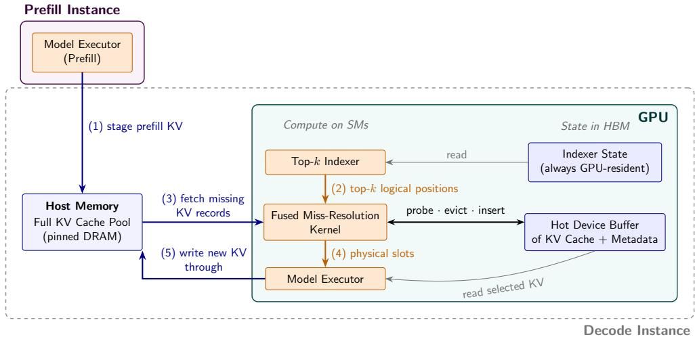
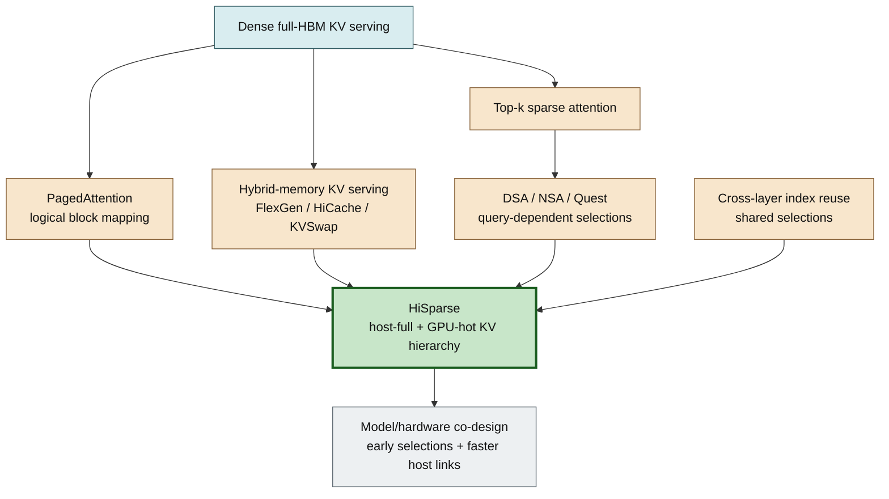
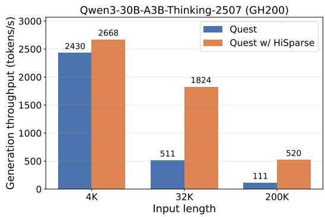
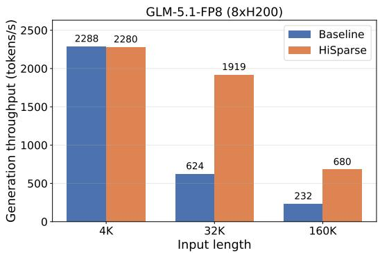

# HiSparse: Hierarchical KV Caching for Sparse-Attention Decoding

**Paper:** [HiSparse: Scaling Sparse-Attention Decoding with Hierarchical KV Cache Management](https://arxiv.org/abs/2608.07009)  
**Authors:** Zhiqiang Xie, Zhangheng Huang, Tingwei Huang, Ziyi Xu, Ruiyang Ma, Christos Kozyrakis  
**arXiv:** 2608.07009v1 (August 2026)

**Related pages:** [KV Cache Optimization](../kv-cache-optimization/index.md), [KVSwap](../kvswap/index.md), [SGLang](../sglang/index.md), [IndexCache](../../../training/efficient-attention/indexcache/index.md)

## TL;DR

**What:** HiSparse is an exact serving layer for top-k sparse attention that separates logical [KV-cache](../../../terms/kv-cache.md) availability from GPU residency.  
**How:** It keeps the authoritative full history in pinned host memory, bounds each request-layer HBM footprint with an LRU GPU cache, and resolves misses inside a fused CUDA kernel with exact prefetch where models share selections.  
**The number:** Across DSA, NSA, and Quest workloads, the paper reports up to 4.7x peak long-context throughput while keeping per-token latency comparable at overlapping operating points.

## The Big Picture

*Source: Figure 2 of the HiSparse paper. ① Prefill writes the complete KV history to pinned host memory while compact indexer state stays on the GPU. ② A sparse indexer emits the logical top-k positions for one layer. ③ The fused `RESOLVE` kernel probes the GPU cache, evicts cold slots, and fetches misses from the host pool. ④ The attention backend receives physical device slots aligned with the selected logical positions. ⑤ New KV records are written through to the host copy.*

The figure answers the central architectural question: **how can sparse attention keep every historical position available without keeping every position in HBM?** HiSparse keeps the bulky attention KV records in a host-authoritative pool and turns each sparse layer's emitted selection into the GPU working set needed for that layer.

## Why This Exists

Consider a 128K-token GLM-5.1 request. The paper estimates that the full BF16 KV history occupies 13.09 GB. A sparse decoder may read only the selected top-2048 positions on each layer, yet an ordinary serving stack still reserves memory for all 128K logical positions because a later token could select any skipped entry.

That mismatch creates a **capacity wall**:

1. A few dozen long-context requests can fill HBM even though the sparse-attention kernels have compute headroom.
2. Additional decode work cannot be admitted, so generation throughput plateaus.
3. In prefill/decode-colocated serving, the stalled decode batch crowds prefill work and drives TTFT sharply upward.

HiSparse changes the admission arithmetic. With a 4096-slot cache per request and layer, the paper reports about 0.4 GB of decode-side KV residency per GLM-5.1 request at 128K, rather than 13.09 GB. The full history still exists, but most of it waits in host memory until the sparse indexer asks for it.

## The Landscape

The editable Mermaid source is [hisparse-landscape.mmd](assets/hisparse-landscape.mmd).

*Synthesized landscape from the paper and existing wiki pages. ① Paged systems provide logical-to-physical addressing. ② Hybrid-memory systems move exact cache state across tiers. ③ Sparse attention supplies a precise per-step demand signal. ④ HiSparse combines those ideas with shared-indexer prefetch rather than inventing a new attention rule.*

## The Core Idea

Sparse attention already tells the runtime exactly which KV records one layer will read next. HiSparse uses that selection as a cache access trace: **pay HBM for the recently useful subset, keep the complete history elsewhere, and make the selected records device-resident before attention runs.**

## Symbol Map

Subscripts identify a decode step $t$, and superscripts identify an attention layer $\ell$. Cache capacity $B$ counts KV-record slots per request and layer, not tokens across the model.

| Symbol | Human name | Scope | Plain meaning |
| --- | --- | --- | --- |
| $L_{\text{ctx}}$ | context length | tokens per request | Full logical KV history available to selection. |
| $k$ | top-k selection | selected records per layer | Number of positions the current sparse query reads. |
| $S_t^{(\ell)}$ | selected set | logical positions for layer $\ell$ | Exact input to the HiSparse resolver. |
| $B$ | GPU-cache capacity | records per request-layer | Bounded on-device working-set size, with $B \ge k$. |
| $N_{\text{batch}}$ | batch size | concurrent requests | Number of request-local hierarchies active at once. |
| $N_\ell$ | sparse-layer count | model | Number of per-request per-layer caches. |
| $W_{\text{KV}}$ | KV record width | elements per token-layer | Representation-dependent size of one logical KV record. |
| $s$ | element size | bytes | Bytes per stored KV element. |

The decode-side budget changes from

$$
N_{\text{batch}}N_\ell L_{\text{ctx}}W_{\text{KV}}s
$$

to approximately

$$
N_{\text{batch}}N_\ell B W_{\text{KV}}s,
$$

plus compact page-table, LRU, and indexer metadata.

## Deep Dive

### 1. A host-authoritative hierarchy turns residency into a cache problem

**What it does:** HiSparse stores the complete KV history in pinned host DRAM and reserves a fixed-size GPU cache for each request and sparse-attention layer.

**Why it matters:** The 128K-token example no longer consumes 13.09 GB per request in HBM; the scheduler reserves only the hot working set and can admit more long-context requests.

**How it works:** Each GPU-cache slot stores one layer-local KV record. A page table maps a logical token or compressed-KV position to a physical cache slot or marks it host-only. Compact selector state remains device-resident: DSA indexer keys, NSA block keys, Quest page summaries, page tables, and LRU metadata do not move. The cache keeps more than the current top-k set because adjacent decode steps overlap.

Each request-layer cache uses LRU with one refinement: records that hit in the current step are promoted above newly fetched misses. The policy therefore favors demonstrated multi-step reuse instead of allowing one-off newly selected records to displace hot entries.

**The intuition:** The current selected set is the required working set, but a little recently useful history acts as an insurance policy against the next step's selection drift.

**A concrete example:** At $k=2048$, keeping only the current top-k records caused a 30% average miss rate on the paper's LongBenchV2 trace. LRU with $B=4096$ reduced the miss rate to 13.4%, beating FIFO and random replacement; $B=8192$ reduced it again to 6.7%.

**Remember:** HiSparse's GPU cache is a locality-preserving hot cache, not a temporary copy of the current top-k.

### 2. `RESOLVE` turns logical selections into device addresses

**What it does:** One fused CUDA kernel performs hit detection, victim selection, LRU updates, host fetches, page-table updates, and output-slot publication for a request-layer.

**Why it matters:** These operations run on every sparse layer. Splitting them into multiple launches would repeatedly materialize metadata and add fixed launch latency to each decode step.

**How it works:**

| Phase | Kernel work | Output state |
| ---: | --- | --- |
| 1 | Load selected logical positions into a shared-memory hash table. | Fast membership tests for the whole selected set. |
| 2 | Mark every resident slot as a hit or eviction candidate. | Parallel hit/miss and victim candidates. |
| 3 | Scan marks, choose victims, and update LRU order. | Misses claim reusable slots; hits retain priority. |
| 4 | Load scattered misses from pinned host memory using GPU-assisted non-coherent loads. | Selected KV records become device-resident. |
| 5 | Update the page table and emit a dense physical-location vector. | Sparse attention can gather the exact selected records. |

The kernel is captured inside SGLang's steady-state decode CUDA graph. The paper's no-I/O oracle reports no measurable resolver overhead from hashing, scanning, LRU updates, and slot publication; exposed host-memory traffic accounts for the difference.

**The intuition:** `RESOLVE` behaves like a request-local software TLB that translates "which logical KV records matter now?" into "which GPU-cache slots contain them?"

**A concrete example:** For the 128K request, the indexer may select token 93,117 in layer 41. The kernel either finds that logical position in a resident slot or assigns an evictable slot, copies the record from pinned host memory, and publishes the slot to the sparse-attention gather.

**Remember:** The resolver is exact with respect to the sparse model's selected set: placement changes, while the selected positions and downstream sparse-attention inputs do not.

### 3. Shared selections make prefetch exact

**What it does:** When a group of layers reuses one anchor layer's sparse selection, HiSparse prefetches those records into later layer-local caches before those layers run.

**Why it matters:** A miss copy is otherwise synchronous. Exact [cross-layer index reuse](../../../terms/cross-layer-index-reuse.md) provides advance knowledge early enough to overlap transfers with intervening computation.

**How it works:** The anchor layer's resolver records which host KV entries move into which cache slots. A copy-only kernel on a side stream replays that miss plan for the following shared layers. Each shared layer waits on the completion event, reuses the anchor's slot layout, and skips its own probing and resolution.

For models without shared selections, HiSparse also tested speculative hints from layer $\ell$ to $\ell+1$. The paper reports little benefit: the hinted records are usually already resident, while the misses that remain are precisely the positions the hint fails to predict.

**The intuition:** Prediction can add traffic without knowing when it is right; shared selection state turns prefetch into a scheduled data dependency.

**A concrete example:** GLM-5.2 has 21 anchor layers and 57 shared layers in its 78-layer sparse stack. Once an anchor emits its selection, HiSparse can prepare later shared-layer caches while the intervening layers compute.

**Remember:** Exact prefetch is a model-co-design opportunity, not a replacement for host-link bandwidth.

## Putting It Together

This trace follows one generated token through a request at long context.

| Step | Actor | Input state | Action | Output state |
| ---: | --- | --- | --- | --- |
| 1 | Prefill engine | Prompt and empty host pool | Compute ordinary layer KV state and write it to pinned host memory. | Full logical history is available outside HBM. |
| 2 | Scheduler | Host history ready | Admit the request after reserving fixed $B$-slot GPU caches plus compact metadata. | Decode capacity depends on $B$, not full context length. |
| 3 | Sparse indexer | Query and GPU-resident compact selector state | Emit logical top-k positions for the current layer. | A precise per-layer KV access set exists. |
| 4 | `RESOLVE` kernel | Selected positions plus page table and LRU state | Keep hits, choose victims, fetch host misses, and publish physical slots. | Every selected record is device-resident before attention. |
| 5 | Sparse-attention backend | Physical slots aligned with the selected set | Gather selected keys and values and run the model's ordinary sparse attention. | Model output is unchanged by placement. |
| 6 | Backup stream | New token's KV record | Write the device-produced record through to the host pool. | Future steps can recover the newest position after eviction. |
| 7 | Shared-selection path | Anchor-layer selection and miss plan | Prefetch future shared-layer records concurrently with intervening computation. | Some later misses leave the critical path. |

## What This Buys You

### The headline claim

HiSparse's throughput gain is primarily a **batch-size and admission gain**, not a faster individual sparse-attention kernel.

### How we know: long-context serving experiments

| Workload | Baseline | HiSparse | Interpretation |
| --- | ---: | ---: | --- |
| Qwen3-30B-A3B + Quest, 32K input, GH200 | 511 tokens/s | 1,824 tokens/s | 3.6x peak generation throughput |
| Qwen3-30B-A3B + Quest, 200K input, GH200 | 111 tokens/s | 520 tokens/s | 4.7x peak generation throughput |
| GLM-5.1 + DSA, 32K input, 8x H200 | 624 tokens/s | 1,919 tokens/s | 3.1x peak generation throughput |
| GLM-5.1 + DSA, 160K input, 8x H200 | 232 tokens/s | 680 tokens/s | 2.9x peak generation throughput |
| DeepSeek-V4-Flash + NSA, 32K/8K, 2x B200, concurrency 64 | 600 tokens/s | 1,257 tokens/s | 2.1x colocated generation throughput |
| GLM-5.2 exact prefetch, 8x H200 | 1,515 tokens/s without prefetch | 1,727 tokens/s | 14-17% gain from exact prefetch within the throughput sweep |

*Source: Figure 5 of the HiSparse paper. The same $k=2048$ selection budget is used while the input length grows. Both charts show the source-reported peak generation throughput; the benefit is small at 4K, where full-HBM batches still fit, and grows as the baseline becomes capacity-bound.*

### The mechanism behind the numbers

At long context, full-HBM serving cannot admit the next request even when the GPU has spare compute. HiSparse's bounded residency converts HBM capacity into concurrency, so aggregate throughput rises. At shorter contexts, the baseline already admits a useful batch and HiSparse's host traffic has little capacity pressure to compensate for it.

Exact prefetch improves a different part of the curve: at matched concurrency, it lowers mean TPOT by 13-15% in the GLM-5.2 experiment and closes roughly half of the synchronous-resolution gap. The no-I/O oracle reaches 2,034 tokens/s in the colocated experiment; exact prefetch reaches 1,727 tokens/s, or 85% of that ceiling.

### Warning: how to read these numbers

> **Warning:** The decode-only curves are a proxy for a prefill/decode-disaggregated decode pool; the paper did not run a physically disaggregated deployment. The strongest generalization is that bounded decode residency raises the admission ceiling, while the exact throughput ratio depends on the colocated-versus-disaggregated workload mix.

> **Evidence:** The no-I/O oracle serves stale KV on misses, so its outputs are invalid. The paper uses it only as a timing upper bound to isolate resolver overhead from unavoidable host traffic.

## Where It Breaks

| Failure mode | Condition | Impact |
| --- | --- | --- |
| No capacity dividend | Short contexts or low concurrency already fit in HBM. | Exposed host-I/O overhead provides no throughput benefit; HiSparse should be disabled. |
| PCIe contention | High batch size creates many concurrent misses on a slower host link. | Resolver I/O can dominate and TPOT rises. |
| Second-tier capacity is not larger | Host DRAM is comparable to or smaller than aggregate HBM, as the paper discusses for Grace-class systems. | The usable capacity multiplier shrinks even if transfer bandwidth is adequate. |
| Anchor selections are unknown early | Sparse layers do not share indexer selections. | Their misses remain synchronous; speculative adjacent-layer hints add little measured benefit. |
| Cache budget is mistuned | $B$ is too small or too large for locality and link bandwidth. | Small $B$ raises misses; large $B$ consumes the HBM saved and lengthens metadata scans. |
| Sparse rule is the real approximation boundary | The model's selector omits useful dense-attention entries. | HiSparse preserves the sparse model exactly, but cannot repair accuracy loss introduced by the selector. |

The paper argues that faster links shift the useful range toward $B=2k$, while 2k-4k is the practical range across the studied models. Dynamic resizing is mechanically possible but remains future work.

## One Thing to Remember

**HiSparse turns sparse attention's selected positions into a cache access trace:** the complete exact history lives in a slower tier, only the repeatedly selected working set occupies HBM, and model/hardware co-design determines how much remaining miss traffic can be hidden.

## Go Deeper

- **Read:** [HiSparse on arXiv](https://arxiv.org/abs/2608.07009)
- **Deploy:** [HiSparse in SGLang](https://docs.sglang.io/docs/advanced_features/hisparse_guide)
- **Build on:** [KV Cache Optimization](../kv-cache-optimization/index.md) for eviction, compression, hybrid-memory, and alternative-state families, and [KVSwap](../kvswap/index.md) for a disk-first offload design.
- **Understand selection reuse:** [IndexCache](../../../training/efficient-attention/indexcache/index.md) and [Cross-Layer Index Reuse](../../../terms/cross-layer-index-reuse.md).
- **Understand the placement trade:** [KV Cache Offloading](../../../terms/kv-cache-offloading.md) and [KV Cache](../../../terms/kv-cache.md).
