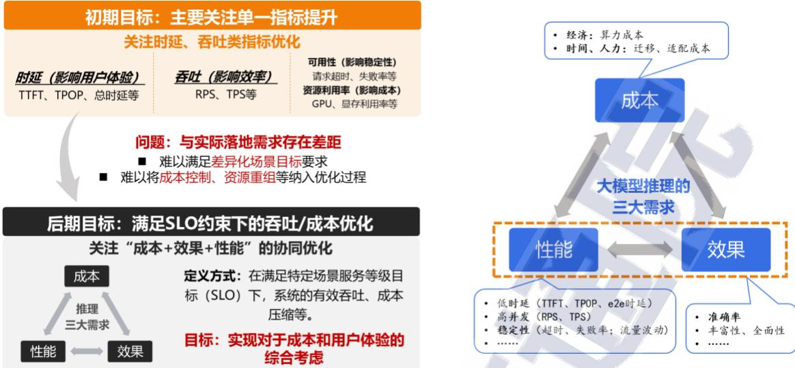
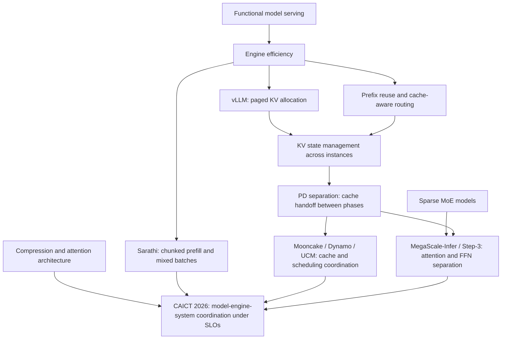
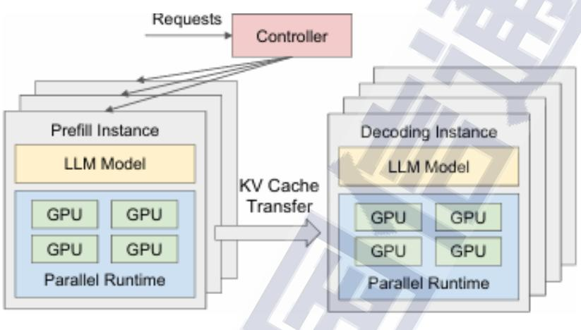
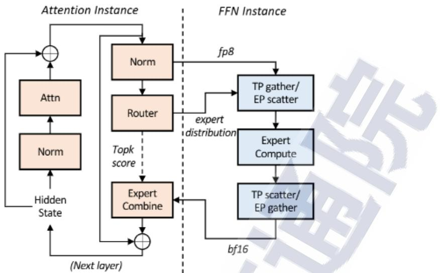

# CAICT 2026: Inference Optimization as a System

**Report:** 大模型推理优化关键技术及应用实践研究报告（2026年）  
**Authors:** 中国信息通信研究院人工智能研究所; 中国人工智能产业发展联盟 (CAICT / AIIA)  
**Published:** March 2026; industry research report, not an arXiv paper  
**Source:** [Local PDF](../../../../../raw/frameworks/serving/inference-optimization/llm-inference-optimization-practices-2026--caict.pdf)

**Related pages:** [vLLM](../../vllm/index.md), [Sarathi](../../sarathi/index.md), [KV-cache optimization survey](../../kv-cache-optimization/index.md), [SGLang](../../sglang/index.md).

Attribution: 来源：中国信息通信研究院、中国人工智能产业发展联盟。This page synthesizes the report rather than reproducing its text. MinerU precise extraction completed for the 65-page PDF; the [derived Markdown](../../../../../derived/pdf-markdown/frameworks/serving/inference-optimization/llm-inference-optimization-practices-2026/llm-inference-optimization-practices-2026.md) is the primary reading source. Section references below identify the report's chapters; page references use its printed pagination. Results are report-attributed and were not reproduced here.

## TL;DR

**What:** The report organizes inference optimization into model, engine, and system layers, treating deployment as a joint quality, performance, and cost problem.

**How:** Reduce model work, improve execution and batching, then coordinate cache placement and independently provisioned compute stages against service objectives.

**The number:** In its Mooncake summary, the report cites 75% higher effective throughput on real workloads and 100% compliance with the between-token-time constraint versus 57% for its vLLM baseline; this is a workload-specific comparison, not a general engine ranking (§IV.3, pp. 32–34).

## The Big Picture

*Source: [CAICT/AIIA report](../../../../../raw/frameworks/serving/inference-optimization/llm-inference-optimization-practices-2026--caict.pdf), Fig. 2, p. 6. ① Early optimization measures isolated latency and throughput. ② Deployment adds reliability, resource use, and adaptation cost. ③ The resulting objective is useful throughput and cost under service constraints.*

The report's strongest contribution is **a decision framework across layers**, rather than a new inference algorithm. Its three layers answer different questions:

| Layer | Question | Representative levers | What still needs checking |
|---|---|---|---|
| Model | How much work and state must each request require? | Compression, sparse experts, attention architecture, multi-token proposals | Task quality and executable hardware support |
| Engine | How efficiently can one runtime execute that work? | Paged allocation, cache reuse, fused kernels, batching, parallelism | Memory capacity, scheduling interference, communication |
| System | Where should work and state live across instances? | Phase/module separation, cache pools, routing, elasticity | Transfer cost, queueing, failure recovery, total cost |

*Synthesis of §III. The layers are decision boundaries; production systems can span several of them.*

## Why This Exists

Consider a document assistant handling a long meeting transcript while several users are already receiving streaming answers. Processing the entire transcript at once can stall those users' next tokens. Increasing batch size might improve aggregate throughput while making the first answer arrive too late. Compressing the transcript might improve speed while removing an important decision from the meeting.

The report's financial case describes both long inputs exceeding a 32K model window and more than 30 seconds to the first token at 30 concurrent requests (§V.1, pp. 43–46). These are **different failure modes requiring different fixes**: memory allocation cannot alone extend a model's learned context capability, and faster kernels cannot alone eliminate queueing or protect streaming requests from a large prefill.

The example used below is hypothetical: a 32K-token request contains a reusable 24K-token prefix and an 8K-token new suffix, and asks for a 256-token answer. These round numbers teach the boundaries; they are not a reported experiment.

## The Landscape

*Synthesized relationship map from §§III–IV and the related wiki pages. Arrows represent conceptual dependencies and complementary directions, not a claim of direct historical descent. Chunked prefill remains useful with colocated execution; it does not require PD separation.*

Editable source: [landscape.mmd](assets/landscape.mmd).

This places [vLLM's paged cache](../../vllm/vllm-framework.md) and [Sarathi's scheduling](../../sarathi/index.md) beneath a broader system objective. The [KV-cache survey](../../kv-cache-optimization/index.md) supplies a deeper account of what state to retain, compress, or move; this report adds cross-instance organization and deployment context.

## The Core Idea

**Optimize the completed service, including how work and memory move.** Making a model smaller, a kernel faster, or one server busier helps only if the resulting request still meets the user's deadline and quality requirement at an acceptable cost. Model design determines what must be computed, the engine determines how it runs, and the system determines where it runs and whether useful state can be reused. Each improvement can move the limiting cost into another layer.

## Symbol Map

The report uses phase names, module names, and service metrics. They describe different scopes and should remain separate.

| Name | Scope | Meaning here |
|---|---|---|
| SLO | Service | Service-level objective, such as a latency threshold and required compliance rate |
| TTFT | One request | Time to first token; includes queueing and setup as well as prompt processing |
| TPOT / TBT / ITL | Generated stream | Time per output token, time between tokens, or inter-token latency; averaging and percentile definitions must be checked |
| P / D | Request phases | Prefill processes prompt tokens; decode incrementally extends the output |
| A / F | Layer modules | Attention accesses sequence state; feedforward transforms token representations, potentially through experts |
| KV cache | Model state | Saved attention keys and values associated with a particular token history and compatible model execution |
| HBM / DRAM / SSD | Storage tiers | Accelerator memory, host memory, and lower-cost persistent storage with different latency and bandwidth |

**Metric definitions are part of the result.** Effective throughput must specify which requests qualify under which objectives; raw tokens per second alone cannot establish service quality.

## Deep Dive

### Model choices change the workload before execution

**What it does:** Model-level optimization reduces parameter traffic, activated computation, or attention state (§III.1).

**Why it matters:** The document assistant can exhaust memory before a scheduler has an opportunity to improve utilization.

**How it works:** [Post-training quantization](../../../../terms/post-training-quantization.md) reduces numerical precision; [mixture of experts](../../../../terms/mixture-of-experts.md) activates a subset of experts; [grouped-query attention](../../../../terms/grouped-query-attention.md) and [MLA](../../../../algorithms/attention/variants/deepseek-v2-mla.md) reduce stored attention state through architectural choices. [Speculative decoding](../../../../terms/speculative-decoding.md) introduces candidate tokens and verification to amortize sequential generation. These mechanisms change different costs and are not interchangeable compression settings.

**The intuition:** Reduce the expensive resource that actually limits this request, while preserving the information the answer needs.

**A concrete example:** For the 32K request, lower-precision weights may free memory for more concurrent requests, but do not remove the 8K suffix's prompt-processing work. Changing the model's attention structure generally requires a compatible checkpoint, rather than an engine flag.

**Remember:** Sparse activation reduces active compute; it does not make all inactive expert weights disappear from deployment memory.

### Engine scheduling controls interference within a runtime

**What it does:** The engine allocates state and assembles iterations that keep useful work running without unnecessary stalls (§III.2).

**Why it matters:** A long new prompt competes with streams that already owe users their next token.

**How it works:** [PagedAttention](../../../../terms/pagedattention.md) reduces allocation waste; [continuous batching](../../../../terms/continuous-batching.md) admits and retires requests between iterations; [chunked prefill](../../../../terms/chunked-prefill.md) divides prompt work into schedulable pieces. [Prefix caching](../../../../terms/prefix-caching.md) reuses compatible [KV cache](../../../../terms/kv-cache.md), avoiding recomputation of an exact reusable prefix. Kernel fusion reduces intermediate memory traffic. [Tensor parallelism](../../../../terms/tensor-parallelism.md) and [pipeline parallelism](../../../../terms/pipeline-parallelism.md) distribute execution with their own communication and utilization costs.

**The intuition:** Smaller scheduling units give other requests opportunities to make progress; reused state removes work entirely.

**A concrete example:** A valid 24K prefix hit leaves 8K new tokens to prefill. Splitting that suffix into four illustrative 2K chunks creates scheduling boundaries for existing decodes. The best chunk size depends on hardware and service targets; the example does not predict lower TTFT for the long request itself.

**Remember:** Chunking changes scheduling granularity; physical phase separation changes deployment topology.

### PD separation moves cache state between independently provisioned phases

*Source: report Fig. 10, p. 21, attributed there to arXiv:2401.09670v3; preserved from the [local report](../../../../../raw/frameworks/serving/inference-optimization/llm-inference-optimization-practices-2026--caict.pdf). ① The controller chooses instances. ② Prefill produces attention state. ③ Decode consumes transferred state and continues generation.*

**What it does:** [Prefill-decode disaggregation](../../../../terms/prefill-decode-disaggregation.md) separates prompt processing and incremental generation into independent execution resources (§III.3.1).

**Why it matters:** Prompt processing and streaming decode can require different batch sizes, parallel strategies, and resource provisioning.

**How it works:** A prefill worker computes missing state; the system makes that state accessible to the selected decode worker; the decode worker continues the sequence. Routing combines cache locality, queue load, and expected decode capacity. [KV-cache offloading](../../../../terms/kv-cache-offloading.md) adds storage tiers, but data must still reach an execution-compatible location in time. The report illustrates these concerns through Mooncake, Dynamo, and UCM (§IV.3).

**The intuition:** Specializing workers removes interference only if moving state costs less than the interference it removes.

**A concrete example:** After processing the 8K suffix, the destination needs usable state for the full 32K prompt. An exact 24K prefix hit saves computation; it does not guarantee that the destination already holds those bytes. Transferring or loading the remaining state can dominate the handoff.

**Remember:** Cache reuse, cache location, and phase separation are three separate decisions.

### AF separation introduces a boundary inside each layer

*Source: report Fig. 11, p. 23, attributed there to “Step-3 is Large yet Affordable”; preserved from the [local report](../../../../../raw/frameworks/serving/inference-optimization/llm-inference-optimization-practices-2026--caict.pdf). ① Attention and its cache stay on the A side. ② Token representations and routing information reach the F side. ③ Expert results return before the next dependent computation.*

**What it does:** [Attention-FFN disaggregation](../../../../terms/attention-ffn-disaggregation.md) places attention and feedforward computation on separately provisioned resources (§III.3.2; §IV.4).

**Why it matters:** In large expert models, the best attention batch and placement can differ from the best expert-compute batch and placement.

**How it works:** Attention-side workers retain sequence state; feedforward workers process routed representations and return results. The report discusses MegaScale-Infer's batching, overlapping execution, and communication design, and Step-3's model-system co-design. These exchanges recur across layers and generated tokens. The figure shows a dependency chain: separating modules does not make one token's dependent attention and feedforward operations independent.

**The intuition:** Give each kind of computation its preferred resources, then keep the connecting network from becoming the slowest component.

**A concrete example:** During the assistant's 256-token answer, an AF design would repeatedly send representations between attention and feedforward workers. This is a different traffic pattern from sending prompt KV state at the P-to-D handoff. PD and AF separation may coexist; neither requires the other in every deployment.

**Remember:** A finer split creates more opportunities for specialization and more frequent communication boundaries.

## Putting It Together

This **illustrative trace** follows the same 32K request through a PD system. It combines mechanisms explained in the report; it is not a claim that all named systems implement this exact policy.

1. **Gateway:** Receives the 24K-prefix + 8K-suffix prompt and a 256-token output budget. It attaches service objectives and a model/cache compatibility identity. No worker has yet been promised capacity.
2. **Router:** Looks up a valid 24K prefix and evaluates cache location against queue load and available decode capacity. The request becomes a placement decision with 8K tokens of new prefill work, rather than 32K tokens of recomputation.
3. **Prefill engine:** Loads or accesses the reusable prefix state and processes the suffix. If chunking is enabled, each completed chunk extends valid KV state until the full prompt is covered.
4. **Transfer/cache layer:** Publishes or transfers the required prompt state. The decode worker can proceed only after its needed state is available and compatible; a cache identifier alone is insufficient.
5. **Decode engine:** Admits the request into ongoing iterations and grows its KV state as output tokens are generated. If AF separation is enabled, each applicable layer sends representations to F workers and receives results before continuing.
6. **Service controller:** Streams tokens, records TTFT and between-token timings, and accounts for resource and transfer cost. On completion it releases request-owned resources and retains only cache state allowed by its reuse policy.

Admission and placement should account for downstream capacity before spending substantial prefill work. The report's Mooncake discussion makes this explicit through prediction-based early rejection under overload (§IV.3.1).

## What This Buys You

### The headline claim: coordinated optimization can improve useful throughput

The report's evidence supports **matching architecture to workload**, with gains reported for several particular systems. It does not provide a controlled experiment comparing all architectures on one model, cluster, and traffic distribution.

### How we know: reported systems and deployment cases

| Example | Reported result | Conditions and interpretation |
|---|---|---|
| Mooncake (§IV.3.1) | Effective throughput +75%; TBT constraint compliance 100% versus 57% for vLLM | Real workload cited by the report; its long-context simulated result, up to +525%, is a separate experiment |
| Step-3 (§IV.4.3) | 4,039 versus 2,324 tokens/GPU/s, reported as 1.73× | Hopper cluster under a reported 50 ms SLA; compares different models/system designs and cannot isolate AF separation |
| Financial assistant (§V.1) | TTFT 9 s at 30 concurrent requests on eight cards; throughput +43% | Model, card type, prompt distribution, and detailed baseline are not supplied; the stated 66% TTFT reduction conflicts with the earlier baseline of over 30 s |
| Judicial deployment (§V.4) | TTFT −40%; throughput 5× | Combined storage/compute deployment case; no matched workload protocol or isolated component ablation |

*All values above are quoted as claims of the report, not independently verified measurements. See the [PDF](../../../../../raw/frameworks/serving/inference-optimization/llm-inference-optimization-practices-2026--caict.pdf), §§IV–V, for the source context.*

### The mechanism behind the numbers

Prefix reuse removes repeated prompt processing. Phase separation reduces scheduling interference and allows independent provisioning. Module separation improves specialized batching and placement when communication can be amortized. These effects may combine, but their speedups cannot simply be multiplied: removing one bottleneck changes the next limiting resource.

For the document assistant, the useful comparison is completed answers meeting the same latency and quality objectives at a measured total cost. A larger cache hit rate is beneficial only if fetching the state beats recomputation and does not congest the decode path.

### How to read these numbers

**Preserve workload and denominator.** Input tokens including cache hits, newly computed tokens, generated tokens, per-GPU rates, and whole-cluster rates measure different things. The report's DeepSeek example explicitly includes cache hits in its prefill rate; it should not be treated as newly computed-token throughput.

The report also contains an unusable financial-case sentence describing latency changing from over 15 minutes to “nearly 90%.” Its UCM discussion gives a separate 10-minute-to-10-second example. These cannot be reconciled into one measurement, so this page does not use them as evidence of a specific speedup.

## Where It Breaks

Rows marked “interpretation” are this page's engineering synthesis; the remaining boundaries are directly discussed in the report or exposed by its stated evidence.

| Failure mode | When it happens | Impact |
|---|---|---|
| Transfer overwhelms specialization | Large prompt state crosses a slow or congested link | PD handoff can erase the execution gain (§III.3.1) |
| Cache locality defeats load balancing | The best prefix hit sits behind a long queue | Fewer computed tokens can still mean worse TTFT; interpretation of the report's cache-aware and load-aware routing requirements |
| Storage capacity is mistaken for execution bandwidth | Active attention state must be repeatedly fetched from a slow tier | More retained history does not guarantee acceptable decode latency (§III.3.4) |
| AF exchange cannot be amortized | Small batches or slow links expose repeated layer-level communication | Finer separation can increase token latency; interpretation of §IV.4's overlap and communication mechanisms |
| A model change is treated as a runtime switch | A deployment attempts to add architectural compression without a compatible model | Quality or correctness can fail; interpretation of the model/engine boundary |
| Sparse history is treated as exact long-context support | Context is pruned/compressed without testing information retention | A previously executable request can still omit decisive evidence; the financial case's 80K-to-16K compression is not a proof of losslessness |
| Decode work is assumed constant | Context grows under ordinary full attention | Report Table 1's O(1)/token label is misleading: one new query still reads growing history; see the [KV-cache survey](../../kv-cache-optimization/index.md) |
| Chunking is equated with disaggregation | Chunked prefill runs on the same workers as decode | Report §III.2.4's wording obscures the topology distinction; [Sarathi](../../sarathi/index.md) explains colocated mixed batches |
| Case-study gains become universal promises | Baseline, model, hardware, and latency distribution are missing | The reported percentages cannot size a new production deployment |

The report's categorical claim that retrieval eliminates hallucination in the judicial case also exceeds the evidence provided. Retrieval may improve grounding; no evaluation here establishes zero hallucinations. More generally, architecture labels such as “compute-bound prefill” and “memory-bound decode” describe common regimes rather than fixed laws across every batch size and model.

## One Thing to Remember

**Every optimization moves work, state, or a dependency boundary.** Ask what was removed, what now has to travel, and which request-level constraint must still hold. That connects compression, engine tuning, cache reuse, and disaggregation into one testable service design.

## Go Deeper

- **Read:** [Original report](../../../../../raw/frameworks/serving/inference-optimization/llm-inference-optimization-practices-2026--caict.pdf), §III for mechanisms, §IV for system families, and §V for deployment cases.
- **Inspect the extraction:** [MinerU Markdown and figure references](../../../../../derived/pdf-markdown/frameworks/serving/inference-optimization/llm-inference-optimization-practices-2026/llm-inference-optimization-practices-2026.md).
- **Understand execution:** [vLLM](../../vllm/index.md), [Sarathi](../../sarathi/index.md), and [SGLang](../../sglang/index.md).
- **Understand state trade-offs:** [KV-cache optimization survey](../../kv-cache-optimization/index.md).
- **Reproduce:** This report supplies architecture summaries and deployment outcomes rather than one unified benchmark artifact. A reproduction must fix model, hardware, input/output distributions, arrival process, cache state, quality tests, and SLO definitions before comparing configurations.
