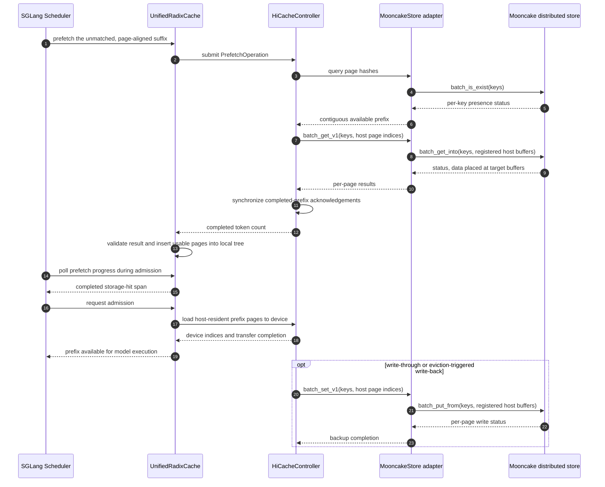

# SGLang HiCache with Mooncake

**Repository:** [sgl-project/sglang](https://github.com/sgl-project/sglang)
**Inspected commit:** `08fc290f48a865f2cd0b9cf7a90f5a1c44dc0bd1` (`main`, 2026-10-09)
**Checkout state:** clean; static code reading only.

**Related pages:** [SGLang: Structured Language Model Programs](index.md), [KV Cache Optimization Strategies](../kv-cache-optimization/index.md), [KV Cache Offloading](../../../terms/kv-cache-offloading.md)

## The Core Idea

HiCache extends SGLang's prefix [KV cache](../../../terms/kv-cache.md) beyond GPU memory: local host memory is a second tier, and a configured L3 backend can retain pages for reuse by other SGLang instances. Choosing Mooncake makes that distributed store the L3 implementation; it does not replace the radix-tree lookup or make one instance's local host memory visible to another.

The cache is useful when later requests repeat a long prefix. Instead of recomputing every prefix token after a local miss, SGLang can [offload](../../../terms/kv-cache-offloading.md) host-resident pages to Mooncake and prefetch a matching prefix back. This adds a storage/network path, so reuse helps only when the saved prefill work outweighs lookup and transfer costs.

## Cache Tiers

| Tier | Where it lives | Sharing scope | Role in the Mooncake setup |
|---|---|---|---|
| L1 | GPU memory | Private to one inference instance | Fastest prefix match; the model reads these pages directly. |
| L2 | Host memory | Private to one SGLang instance, including on a shared node | Holds local pages and stages L3 reads before device load-back. |
| L3 | Configured storage backend | Shared only as far as that backend and its namespace are configured to span | Mooncake provides the external page store used after a local miss. |

The <a class="code-link" href="../../../../external-repos/sglang/docs/docs/advanced_features/hicache_design.mdx#L27" data-code-repo="sglang-08fc290f48a8" data-code-path="docs/docs/advanced_features/hicache_design.mdx" data-code-line="27" data-code-end-line="29"><code>HiCache L1/L2/L3 tier-sharing table</code></a> makes an important distinction: SGLang's L2 is not a cluster-wide CPU pool. Cross-instance reuse happens through L3, and requires the instances to use compatible Mooncake storage and key namespaces.

> **Inference:** Enabling the Mooncake backend alone does not guarantee a cross-instance hit. The producer must have written the page to L3, and the consumer must query the same effective namespace.

## Request Read Path

The trace follows an input prefix whose first part is already local and whose next pages may exist in Mooncake. The editable source for the sequence is [hicache-mooncake-prefetch.mmd](assets/hicache-mooncake-prefetch.mmd).



*Synthesized sequence from the pinned SGLang implementation. Mooncake's internal control plane and transport are shown as one external store boundary; this trace does not establish their runtime behavior.*

| Step | Actor and state transition |
|---:|---|
| 1 | <a class="code-link" href="../../../../external-repos/sglang/python/sglang/srt/managers/scheduler.py#L3139" data-code-repo="sglang-08fc290f48a8" data-code-path="python/sglang/srt/managers/scheduler.py" data-code-line="3139"><code>Scheduler._prefetch_kvcache()</code></a> starts from the request's local match and selects only the unmatched token suffix. |
| 2 | <a class="code-link" href="../../../../external-repos/sglang/python/sglang/srt/mem_cache/unified_radix_cache.py#L2011" data-code-repo="sglang-08fc290f48a8" data-code-path="python/sglang/srt/mem_cache/unified_radix_cache.py" data-code-line="2011"><code>UnifiedRadixCache.prefetch_from_storage()</code></a> page-aligns that suffix, applies the prefetch threshold, and submits it through <a class="code-link" href="../../../../external-repos/sglang/python/sglang/srt/mem_cache/hybrid_cache/hybrid_cache_controller.py#L1035" data-code-repo="sglang-08fc290f48a8" data-code-path="python/sglang/srt/mem_cache/hybrid_cache/hybrid_cache_controller.py" data-code-line="1035"><code>HybridCacheController.submit_prefetch()</code></a>. |
| 3 | <a class="code-link" href="../../../../external-repos/sglang/python/sglang/srt/mem_cache/hybrid_cache/hybrid_cache_controller.py#L1349" data-code-repo="sglang-08fc290f48a8" data-code-path="python/sglang/srt/mem_cache/hybrid_cache/hybrid_cache_controller.py" data-code-line="1349"><code>HybridCacheController._storage_hit_query()</code></a> hashes the pages and asks the backend for the longest usable prefix; the ordinary KV path uses <a class="code-link" href="../../../../external-repos/sglang/python/sglang/srt/mem_cache/storage/mooncake_store/mooncake_store.py#L1302" data-code-repo="sglang-08fc290f48a8" data-code-path="python/sglang/srt/mem_cache/storage/mooncake_store/mooncake_store.py" data-code-line="1302"><code>MooncakeStore.batch_exists()</code></a>. |
| 4 | The background path in <a class="code-link" href="../../../../external-repos/sglang/python/sglang/srt/managers/cache_controller.py#L1274" data-code-repo="sglang-08fc290f48a8" data-code-path="python/sglang/srt/managers/cache_controller.py" data-code-line="1274"><code>HiCacheController.prefetch_thread_func()</code></a> queries storage; <a class="code-link" href="../../../../external-repos/sglang/python/sglang/srt/managers/cache_controller.py#L1095" data-code-repo="sglang-08fc290f48a8" data-code-path="python/sglang/srt/managers/cache_controller.py" data-code-line="1095"><code>HiCacheController._page_transfer()</code></a> reads pages into host-pool indices and counts only the completed prefix. |
| 5 | For Mooncake, <a class="code-link" href="../../../../external-repos/sglang/python/sglang/srt/managers/cache_controller.py#L532" data-code-repo="sglang-08fc290f48a8" data-code-path="python/sglang/srt/managers/cache_controller.py" data-code-line="532"><code>HiCacheController.attach_storage_backend()</code></a> selects the pointer-based page-I/O path. <a class="code-link" href="../../../../external-repos/sglang/python/sglang/srt/mem_cache/storage/mooncake_store/mooncake_store.py#L703" data-code-repo="sglang-08fc290f48a8" data-code-path="python/sglang/srt/mem_cache/storage/mooncake_store/mooncake_store.py" data-code-line="703"><code>MooncakeStore.register_mem_pool_host()</code></a> registers the host buffers; <a class="code-link" href="../../../../external-repos/sglang/python/sglang/srt/mem_cache/storage/mooncake_store/mooncake_store.py#L1092" data-code-repo="sglang-08fc290f48a8" data-code-path="python/sglang/srt/mem_cache/storage/mooncake_store/mooncake_store.py" data-code-line="1092"><code>MooncakeStore.batch_get_v1()</code></a> routes reads through <a class="code-link" href="../../../../external-repos/sglang/python/sglang/srt/mem_cache/storage/mooncake_store/mooncake_store.py#L1368" data-code-repo="sglang-08fc290f48a8" data-code-path="python/sglang/srt/mem_cache/storage/mooncake_store/mooncake_store.py" data-code-line="1368"><code>_get_batch_zero_copy_impl()</code></a> to Mooncake's `batch_get_into` API. |
| 6 | <a class="code-link" href="../../../../external-repos/sglang/python/sglang/srt/managers/cache_controller.py#L1394" data-code-repo="sglang-08fc290f48a8" data-code-path="python/sglang/srt/managers/cache_controller.py" data-code-line="1394"><code>HiCacheController.prefetch_sync_thread_func()</code></a> synchronizes completion. <a class="code-link" href="../../../../external-repos/sglang/python/sglang/srt/mem_cache/unified_radix_cache.py#L2289" data-code-repo="sglang-08fc290f48a8" data-code-path="python/sglang/srt/mem_cache/unified_radix_cache.py" data-code-line="2289"><code>UnifiedRadixCache._handle_prefetch_result()</code></a> validates and inserts usable host pages into the local tree. |
| 7 | The <a class="code-link" href="../../../../external-repos/sglang/python/sglang/srt/managers/scheduler.py#L4007" data-code-repo="sglang-08fc290f48a8" data-code-path="python/sglang/srt/managers/scheduler.py" data-code-line="4007"><code>scheduler admission loop</code></a> waits for prefetch progress, then <a class="code-link" href="../../../../external-repos/sglang/python/sglang/srt/mem_cache/unified_radix_cache.py#L1787" data-code-repo="sglang-08fc290f48a8" data-code-path="python/sglang/srt/mem_cache/unified_radix_cache.py" data-code-line="1787"><code>UnifiedRadixCache._load_back_transfers()</code></a> moves a host hit back to device memory when needed. |

The sequence describes the normal cached-host-memory path. `buffer_only` changes host-pool ownership and stages data for admission; its path is not expanded here.

## Write-Back and Duplication

Reading an L3 entry is only half of the sharing story: a page must first be backed up. HiCache exposes `write_through`, `write_through_selective`, and `write_back` policies, so the time at which a prefix becomes visible in L3 depends on configuration. In particular, an instance-local L2 hit is not yet a cross-instance hit.

The controller batches host-page backups in <a class="code-link" href="../../../../external-repos/sglang/python/sglang/srt/managers/cache_controller.py#L1355" data-code-repo="sglang-08fc290f48a8" data-code-path="python/sglang/srt/managers/cache_controller.py" data-code-line="1355"><code>HiCacheController._page_backup()</code></a>. The Mooncake adapter's <a class="code-link" href="../../../../external-repos/sglang/python/sglang/srt/mem_cache/storage/mooncake_store/mooncake_store.py#L1121" data-code-repo="sglang-08fc290f48a8" data-code-path="python/sglang/srt/mem_cache/storage/mooncake_store/mooncake_store.py" data-code-line="1121"><code>MooncakeStore.batch_set_v1()</code></a> uses <a class="code-link" href="../../../../external-repos/sglang/python/sglang/srt/mem_cache/storage/mooncake_store/mooncake_store.py#L1339" data-code-repo="sglang-08fc290f48a8" data-code-path="python/sglang/srt/mem_cache/storage/mooncake_store/mooncake_store.py" data-code-line="1339"><code>_put_batch_zero_copy_impl()</code></a>, which calls Mooncake's `batch_put_from` interface with host-buffer addresses and sizes.

> **Evidence:** The pinned SGLang adapter registers host buffers and passes their addresses to Mooncake's get/put APIs. That proves the interface SGLang invokes; it does not prove end-to-end zero-copy over a particular NIC, protocol, or deployment.

## Configuration and Scope

The required SGLang switches are:

```text
--enable-hierarchical-cache
--hicache-storage-backend mooncake
```

Mooncake connection details can be supplied through SGLang's backend extra-config, a Mooncake config file, or environment variables. The pinned <a class="code-link" href="../../../../external-repos/sglang/python/sglang/srt/mem_cache/storage/mooncake_store/README.md#L1" data-code-repo="sglang-08fc290f48a8" data-code-path="python/sglang/srt/mem_cache/storage/mooncake_store/README.md" data-code-line="1"><code>SGLang Mooncake integration guide</code></a> contains the deployment examples; the upstream [HiCache design guide](https://docs.sglang.io/advanced_features/hicache_design.html) documents tier sizing, prefetch policy, page layout, and write policy.

Use Mooncake when shared-prefix reuse is common enough to justify external reads and writes. Long prompts or repeated multi-turn prefixes are natural candidates; short or unique prompts may pay lookup and transfer costs without recovering much prefill work. SGLang also has a registered <a class="code-link" href="../../../../external-repos/sglang/test/registered/hicache/test_hicache_storage_mooncake_backend.py#L1" data-code-repo="sglang-08fc290f48a8" data-code-path="test/registered/hicache/test_hicache_storage_mooncake_backend.py" data-code-line="1"><code>Mooncake backend integration test</code></a>, but this reading did not run it.

## Where It Breaks

| Condition | Consequence |
|---|---|
| The page exists only in another instance's private L2 | Mooncake cannot return it until a configured write policy has backed it up to L3. |
| Instances use different L3 storage or key namespaces | A page written by one instance is not a hit for the other. |
| The unmatched suffix is below the configured prefetch threshold | SGLang skips the L3 prefetch and handles the remaining input through the ordinary path. |
| A page read fails or prefetch stops early | Only a completed prefix can be inserted and reused; the unread tail remains a miss. |
| A required hybrid sidecar is incomplete | The current <a class="code-link" href="../../../../external-repos/sglang/python/sglang/srt/mem_cache/unified_radix_cache.py#L2403" data-code-repo="sglang-08fc290f48a8" data-code-path="python/sglang/srt/mem_cache/unified_radix_cache.py" data-code-line="2403"><code>hybrid prefetch validation</code></a> can discard the result rather than publish a mismatched prefix. |
| The storage/network read is slower than recomputing the missing prefix | HiCache may increase prefill latency; this snapshot contains no benchmark proving a speedup for a given deployment. |

The hybrid storage interface also has a per-pool availability check: <a class="code-link" href="../../../../external-repos/sglang/python/sglang/srt/mem_cache/storage/mooncake_store/mooncake_store.py#L857" data-code-repo="sglang-08fc290f48a8" data-code-path="python/sglang/srt/mem_cache/storage/mooncake_store/mooncake_store.py" data-code-line="857"><code>MooncakeStore.batch_exists_v2()</code></a> intersects the KV prefix with required sidecar availability. This matters for hybrid model state, but is not needed to understand the ordinary KV-only trace above.

## Verification Boundary

This page is a static reading of the pinned SGLang commit. The registered backend test starts Mooncake services and is hardware-dependent; neither that test nor a SGLang model request was executed. The source establishes how SGLang configures and calls its Mooncake adapter, not Mooncake's internal control plane, RDMA behavior, service fault tolerance, or achieved cache hit rate.

## Go Deeper

- **Understand the parent design:** [SGLang: Structured Language Model Programs](index.md) and [KV Cache Optimization Strategies](../kv-cache-optimization/index.md).
- **Understand the trade:** [KV Cache](../../../terms/kv-cache.md) and [KV Cache Offloading](../../../terms/kv-cache-offloading.md).
- **Read the implementation guide:** <a class="code-link" href="../../../../external-repos/sglang/python/sglang/srt/mem_cache/storage/mooncake_store/README.md#L1" data-code-repo="sglang-08fc290f48a8" data-code-path="python/sglang/srt/mem_cache/storage/mooncake_store/README.md" data-code-line="1"><code>Mooncake as L3 KV Cache</code></a> and the [Mooncake documentation](https://kvcache-ai.github.io/Mooncake/).
- **Inspect the evidence map:** [Pinned SGLang findings](../../../../derived/repo-analysis/frameworks/serving/sglang/sglang/08fc290f48a865f2cd0b9cf7a90f5a1c44dc0bd1/important-files.md).
