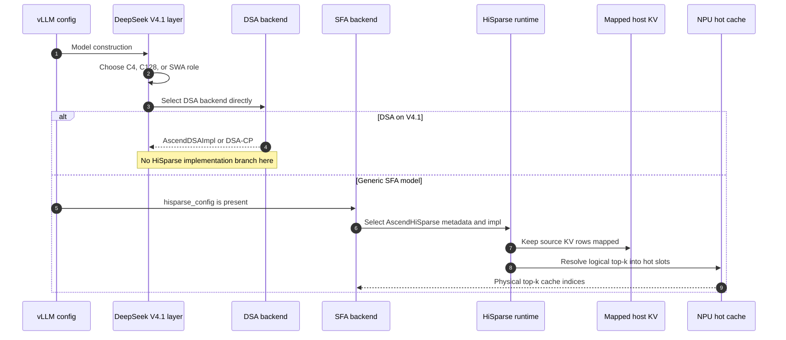

# DeepSeek-V4.1-Flash and HiSparse on vLLM-Ascend

**Repositories:** `vllm-project/vllm-ascend` at commit
`cc10dddf5b5bba8b81a5c80d657ca388c2fd9de2` and `vllm-project/vllm` at commit
`9e8b3fb83ed4f3da1ed5376083027b14994939fc`, both clean pinned checkouts
inspected on 2026-11-25.  
**Boundary:** Ascend model construction through one sparse-attention decode
branch. Request admission, scheduler output construction, and final token
sampling are outside this page.  
**Runtime validation:** none. This is a static compatibility and code-path
reading; no DeepSeek-V4.1 checkpoint or Ascend NPU run was exercised.

**Related pages:** [HiSparse paper insight](../hisparse/index.md),
[DeepSeek-V4.1 model report](../../../training/model-families/deepseek/deepseek-v4.1/index.md),
[DeepSeek-V4.1 NVIDIA vLLM path](../vllm/deepseek/v4.1-gpu-inference-path/index.md),
[vLLM-Ascend](index.md).

## Bottom Line

**There was no vLLM-Ascend HiSparse implementation for the October 17, 2026
DeepSeek-V4.1-Flash path.**

DeepSeek V4.1 support landed earlier, but the Ascend HiSparse backend foundation
was added on 2026-11-15. More importantly, the current November implementation
is attached to the generic Ascend SFA backend. DeepSeek V4.1 chooses dedicated
DSA C4, DSA C128, or DSA SWA backend classes directly and never reaches that
SFA-only HiSparse switch.

Enabling `attention_config.hisparse_config` therefore does not make the pinned
DeepSeek-V4.1 DSA layer become HiSparse-backed. The V4.1 model continues to use
its ordinary compressed-KV and SWA path.

> **Evidence boundary:** “No V4.1 HiSparse path” is the finding supported by
> the current pinned selectors and the V4.1 test fixture. It is not a claim that
> future work cannot connect the DSA backend to HiSparse.

## Mental Model: Similar Cache Goals, Different Implementation Branches

The paper-level [HiSparse](../hisparse/index.md) idea and DeepSeek-V4.1 both
reduce cache pressure, but they solve different layers of the serving problem:

| System | Main cache decision | Sparse-selection role | GPU/host residency |
| --- | --- | --- | --- |
| DeepSeek-V4.1 DSA | C4/C128 compressed global KV plus layer-local SWA | CSA2-style shared or refreshed index selections choose global compressed states | The inspected V4.1 path allocates ordinary Ascend device cache groups |
| Ascend SFA HiSparse | Resident plus bounded hot device cache backed by host source rows | Generic sparse MLA index group resolves each top-k row before attention | Host-authoritative source, GPU resident cache, and GPU hot working set |

The name “DeepSeek sparse attention” is not enough to infer backend compatibility.
The implementation dispatch is the contract: V4.1 bypasses
`AscendSFABackend`, where the current HiSparse switch exists.

## Why the “1017” Snapshot Does Not Contain This Path

The repository history for the HiSparse files identifies
`4b3bd7ebe51094f3afa5288bb7a3316d12d3154e` on 2026-11-15 as the first Ascend
backend foundation commit. A2/A3 KV-offload support followed on 2026-11-19.
By contrast, the repository's existing DeepSeek-V4.1 support and bounded-replay
work already existed around 2026-10-15–10-19.

The current V4.1 cache unit test makes the boundary explicit:
<a class="code-link"
   href="../../../../external-repos/vllm-ascend-cc10dddf5b5b/tests/ut/models/test_deepseek_v41_cache.py#L150"
   data-code-repo="vllm-ascend-cc10dddf5b5b"
   data-code-path="tests/ut/models/test_deepseek_v41_cache.py"
   data-code-line="150"
   data-code-end-line="158"><code>the V4.1 fixture sets hisparse_config=None</code></a>.

The fixture comment says Ascend does not enable HiSparse for this model. That is
stronger evidence than merely observing that the model tests do not mention
HiSparse: the cache configuration deliberately removes the option from the
V4.1 construction path.

## The Actual Backend Split

The editable sequence diagram is
[deepseek-v4.1-hisparse-boundary.mmd](assets/deepseek-v4.1-hisparse-boundary.mmd).



*Synthesized from the pinned selectors. ① The V4.1 layer selects its DSA
backend from `compress_ratio`. ② The DSA backend returns ordinary DSA or DSA-CP.
③ A different generic SFA backend owns the current HiSparse switch. ④ The SFA
branch can allocate the mapped-host/hot-cache hierarchy; V4.1 does not enter that
branch.*

### Step 1: DeepSeek V4.1 selects a dedicated DSA backend

The V4.1
<a class="code-link"
   href="../../../../external-repos/vllm-ascend-cc10dddf5b5b/vllm_ascend/models/layer/attention/layer.py#L120"
   data-code-repo="vllm-ascend-cc10dddf5b5b"
   data-code-path="vllm_ascend/models/layer/attention/layer.py"
   data-code-line="120"
   data-code-end-line="163"><code>DSAAttention constructor</code></a>
assigns:

- `compress_ratio == 4` to `AscendDSAC4Backend`;
- `compress_ratio == 128` to `AscendDSAC128Backend`;
- otherwise to `AscendDSASWABackend`;

It then instantiates `self.attn_backend.get_impl_cls()` immediately. This code
does not ask the generic platform attention selector whether HiSparse is
configured.

### Step 2: the DSA backend has no HiSparse implementation selector

The
<a class="code-link"
   href="../../../../external-repos/vllm-ascend-cc10dddf5b5b/vllm_ascend/attention/dsa_v1.py#L351"
   data-code-repo="vllm-ascend-cc10dddf5b5b"
   data-code-path="vllm_ascend/attention/dsa_v1.py"
   data-code-line="351"
   data-code-end-line="357"><code>AscendDSABackend.get_impl_cls()</code></a>
returns `AscendDSAPCPImpl` when prefill context parallelism is active and
`AscendDSAImpl` otherwise. Neither branch reads `hisparse_config`.

### Step 3: HiSparse is selected by the generic SFA backend

The current switch exists in
<a class="code-link"
   href="../../../../external-repos/vllm-ascend-cc10dddf5b5b/vllm_ascend/attention/sfa_v1.py#L378"
   data-code-repo="vllm-ascend-cc10dddf5b5b"
   data-code-path="vllm_ascend/attention/sfa_v1.py"
   data-code-line="378"
   data-code-end-line="382"><code>AscendSFABackend.get_builder_cls()</code></a>.
When HiSparse is configured, it imports
`AscendHiSparseMetadataBuilder`. The matching implementation switch is in
<a class="code-link"
   href="../../../../external-repos/vllm-ascend-cc10dddf5b5b/vllm_ascend/attention/sfa_v1.py#L444"
   data-code-repo="vllm-ascend-cc10dddf5b5b"
   data-code-path="vllm_ascend/attention/sfa_v1.py"
   data-code-line="444"
   data-code-end-line="448"><code>AscendSFABackend.get_impl_cls()</code></a>.

This branch is real, but it belongs to `AscendSFA*`, not V4.1's
`AscendDSA*` backend classes.

## What the Current Ascend HiSparse Path Implements

For an SFA-compatible sparse MLA model, upstream vLLM turns HiSparse on when a
`HiSparseConnector` is configured or `hisparse_config` is set explicitly. The
<a class="code-link"
   href="../../../../external-repos/vllm-9e8b3fb83ed4/vllm/config/attention.py#L21"
   data-code-repo="vllm-9e8b3fb83ed4"
   data-code-path="vllm/config/attention.py"
   data-code-line="21"
   data-code-end-line="35"><code>HiSparseConfig</code></a>
defines the hot-buffer size and eager host mirroring, and the
<a class="code-link"
   href="../../../../external-repos/vllm-9e8b3fb83ed4/vllm/config/vllm.py#L1998"
   data-code-repo="vllm-9e8b3fb83ed4"
   data-code-path="vllm/config/vllm.py"
   data-code-line="1998"
   data-code-end-line="2022"><code>VllmConfig validation</code></a>
infers defaults from the connector, rejects unsupported platforms, and rejects
pipeline parallelism, decode context parallelism, and full-graph capture.

### 1. Allocation: separate host source, device resident, and device hot state

Upstream
<a class="code-link"
   href="../../../../external-repos/vllm-9e8b3fb83ed4/vllm/v1/hisparse/layout.py#L443"
   data-code-repo="vllm-9e8b3fb83ed4"
   data-code-path="vllm/v1/hisparse/layout.py"
   data-code-line="443"
   data-code-end-line="495"><code>get_hisparse_kv_cache_config()</code></a>
builds source, resident, and hot cache groups. It keeps the host source in a
host-layout allocation and places the compact device pool in the scheduler's
device-memory budget.

### 2. Index-group ownership: one cache handle per sparse layer

The
<a class="code-link"
   href="../../../../external-repos/vllm-9e8b3fb83ed4/vllm/v1/attention/backends/mla/index_group.py#L165"
   data-code-repo="vllm-9e8b3fb83ed4"
   data-code-path="vllm/v1/attention/backends/mla/index_group.py"
   data-code-line="165"
   data-code-end-line="240"><code>HiSparseMLAIndexGroup.register_layer()</code></a>
creates a `HiSparseCacheHandle` for each sparse layer in a shared index group.
The group leader owns the selection-resolution state; followers reuse the
group's top-k event and cache coordination.

### 3. Resolve then prefetch: logical top-k becomes hot physical slots

The core runtime's
<a class="code-link"
   href="../../../../external-repos/vllm-9e8b3fb83ed4/vllm/v1/hisparse/runtime.py#L1016"
   data-code-repo="vllm-9e8b3fb83ed4"
   data-code-path="vllm/v1/hisparse/runtime.py"
   data-code-line="1016"
   data-code-end-line="1057"><code>HiSparseRuntime.swap_in()</code></a>
lets the leader resolve the group and stages each layer's copy on the
configured stream. Followers wait for their layer-ready event, then consume the
shared physical top-k indices.

On Ascend, the
<a class="code-link"
   href="../../../../external-repos/vllm-ascend-cc10dddf5b5b/vllm_ascend/attention/sfa_hisparse.py#L212"
   data-code-repo="vllm-ascend-cc10dddf5b5b"
   data-code-path="vllm_ascend/attention/sfa_hisparse.py"
   data-code-line="212"
   data-code-end-line="254"><code>AscendHiSparseImpl</code></a>
registers the layer with a `HiSparseMLAIndexGroup`, rejects unsupported
TurboQuant and decode-context-parallel combinations, requires C8 shape
constraints, and prepares cache handles and hot-buffer capacities.

During decode,
<a class="code-link"
   href="../../../../external-repos/vllm-ascend-cc10dddf5b5b/vllm_ascend/attention/sfa_hisparse.py#L701"
   data-code-repo="vllm-ascend-cc10dddf5b5b"
   data-code-path="vllm_ascend/attention/sfa_hisparse.py"
   data-code-line="701"
   data-code-end-line="760"><code>the SFA execution path</code></a>
calls `cache.swap_in()` on the decode rows and gives the resulting physical
indices to the physical sparse-attention kernel. Prefill either uses the
resident paged fast path or stages selected host rows before attention.

### 4. NPU backend: mapped host plus a native resolver

The Ascend platform exposes
<a class="code-link"
   href="../../../../external-repos/vllm-ascend-cc10dddf5b5b/vllm_ascend/platform.py#L305"
   data-code-repo="vllm-ascend-cc10dddf5b5b"
   data-code-path="vllm_ascend/platform.py"
   data-code-line="305"
   data-code-end-line="307"><code>AscendHiSparseBackend</code></a>
to the upstream runtime.

The
<a class="code-link"
   href="../../../../external-repos/vllm-ascend-cc10dddf5b5b/vllm_ascend/hisparse/backend.py#L109"
   data-code-repo="vllm-ascend-cc10dddf5b5b"
   data-code-path="vllm_ascend/hisparse/backend.py"
   data-code-line="109"
   data-code-end-line="215"><code>backend adapter</code></a>
loads the native AscendC residency resolver and swap operators, creates fixed
resolver workspaces before graph capture, binds indexer views, and publishes
host-to-device refill operations.

The
<a class="code-link"
   href="../../../../external-repos/vllm-ascend-cc10dddf5b5b/vllm_ascend/hisparse/host_pool.py#L29"
   data-code-repo="vllm-ascend-cc10dddf5b5b"
   data-code-path="vllm_ascend/hisparse/host_pool.py"
   data-code-line="29"
   data-code-end-line="89"><code>MappedHostTensor</code></a>
registers a pinned CPU range into an NPU-visible address. Newer HDK versions use
ACL AIV host mapping; MemFabric is the fallback path for the qualified older
runtime. Mapping is retained until asynchronous streams and graphs are drained.

## State Handoff for the SFA Path

| Step | Actor | Input state | Action | Output state |
| ---: | --- | --- | --- | --- |
| 1 | vLLM config | Connector or explicit HiSparse options | Infer `HiSparseConfig`; reject unsupported global modes. | HiSparse-enabled cache planning. |
| 2 | SFA layer | Sparse MLA group and cache shape | Register one `HiSparseCacheHandle` in the shared index group. | Per-layer host/resident/hot cache ownership. |
| 3 | Sparse indexer | Query and resident indexer K cache | Emit logical top-k compressed positions. | Logical selection rows. |
| 4 | Group leader | Logical selection, source block table, and request states | Resolve hits, misses, LRU victims, and shared physical top-k. | Per-layer refill plans and physical selections. |
| 5 | Ascend copy path | Mapped host rows and hot-cache destinations | Copy compact misses on the ordered side stream. | Selected rows device-resident. |
| 6 | SFA kernel | Physical hot-cache indices | Run exact attention over the selected compact cache view. | Layer attention output. |

This trace describes an SFA-capable model. It is deliberately not labeled as
the DeepSeek-V4.1 path.

## Compatibility Matrix

| Feature | Current pinned behavior |
| --- | --- |
| DeepSeek-V4.1 on 2026-10-17 | V4.1 DSA C4/C128/SWA implemented; HiSparse not yet landed |
| DeepSeek-V4.1 on 2026-11-25 | Still routed through `AscendDSAImpl` or DSA-CP, not `AscendHiSparseImpl` |
| Generic Ascend SFA + HiSparse | Implemented at the latest pin |
| Full CUDA/ACL graph mode | Rejected for HiSparse; use the supported full-and-piecewise mode |
| Decode context parallelism | Rejected by both upstream validation and the Ascend implementation |
| Pipeline parallelism | Rejected upstream |
| TurboQuant | Rejected by `AscendHiSparseImpl` |
| HiSparse C8 | Supported only for the implementation's native 512 NoPE + 64 RoPE, block/top-k-compatible geometry |

## Where This Insight Can Mislead

| Failure mode | Why it happens | Correct reading |
| --- | --- | --- |
| Treating all DeepSeek sparse attention as SFA | The model family, generic SFA backend, and V4.1 DSA backend share vocabulary but use different Python classes. | Follow the backend selector, not the product label. |
| Calling the 10/17 V4.1 path “HiSparse” | HiSparse source files appear in November history. | Use “compressed DSA with C4/C128/SWA caches” for the 10/17 V4.1 path. |
| Enabling a connector and assuming every layer uses it | HiSparse cache planning can be global, but each attention implementation still needs a compatible adapter. | Verify that the model's backend selects `AscendHiSparseImpl`. |
| Treating native operator tests as a checkpoint benchmark | Current focused tests cover mapped-host, resolver, graph replay, and cache primitives. | No end-to-end V4.1 quality, latency, or capacity run is established here. |
| Extending the host-mapping result to every Ascend device generation | The pinned adapter combines native ACL AIV mapping with a MemFabric fallback and focused Ascend-950 tests. | Treat device-generation support as a separate runtime qualification. |

## One Thing to Remember

**HiSparse is a backend capability, not a model-family tag:** in the current
vLLM-Ascend pin, SFA models can select `AscendHiSparseImpl`, but
DeepSeek-V4.1 selects its own DSA backends and therefore does not implement the
HiSparse host/hot path.

## Reproduction Notes

The revision and date boundary was established with read-only Git history:

```bash
git log --all --reverse --format='%H %cI %s' -- \
  vllm_ascend/hisparse \
  vllm_ascend/attention/sfa_hisparse.py
```

The backend mismatch was checked with:

```bash
rg 'hisparse_config|AscendHiSparse|get_impl_cls' \
  vllm_ascend/attention/sfa_v1.py \
  vllm_ascend/attention/dsa_v1.py \
  vllm_ascend/models/layer/attention/layer.py
```

## Go Deeper

- **Understand the serving idea:** [HiSparse: Hierarchical KV Caching for Sparse-Attention Decoding](../hisparse/index.md).
- **Compare the model architecture:** [DeepSeek-V4.1-Flash technical report](../../../training/model-families/deepseek/deepseek-v4.1/index.md).
- **Compare the NVIDIA path:** [DeepSeek-V4.1-Flash on NVIDIA vLLM](../vllm/deepseek/v4.1-gpu-inference-path/index.md).
- **Understand SFA hosting on Ascend:** [vLLM-Ascend](index.md).
