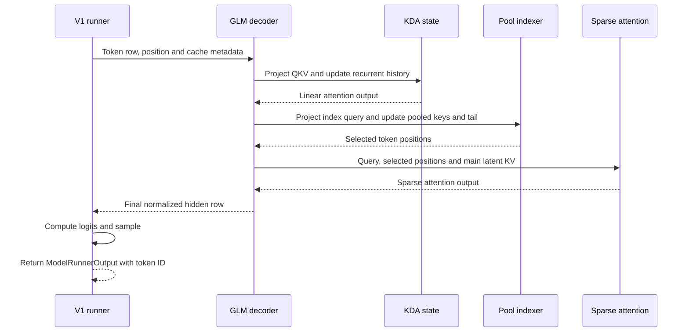

# GLM-5.3-Flash on Ascend A3 and A5: Inference Path

**Mental model:** Each decode token passes through a hybrid decoder. Linear
attention layers update a recurrent summary; sparse multi-head latent attention
(MLA) layers update a separate per-token latent cache and use a compressed
index to choose which cached tokens to read. A mixture-of-experts (MoE)
feed-forward layer follows where configured. The final hidden row becomes
logits and then a sampled token.

**Evidence:** vLLM Ascend commit
`8405ff749d05aee320923d7d1dd9ad24c9246d4c`, clean detached checkout,
inspected 2026-10-27. A scoped freshness check found changed upstream code but
deferred a new evidence revision until 2026-11-10 under the 14-day policy.
This is static code analysis: no checkpoint, A3/A5 device, CANN operator, or
serving run was exercised. The Ascend source imports upstream vLLM interfaces;
an exact compatible vLLM/CANN package combination was not validated here.

**Selected branch:** text-only, one post-prefill decode row, V1 runner,
pipeline parallelism 1, no context parallelism, no speculative decoding, and
NoPE sparse MLA with quantized C8 main KV. A3 uses INT8 and A5 uses FP8 in the
documented deployment examples. The walk uses native sparse preprocessing as
an explicit code branch; fused prolog and graph execution are alternatives,
not excluded for actual deployments. Boundary: `SchedulerOutput` at the runner
through synchronous `ModelRunnerOutput`; HTTP emission and detokenization are
outside scope. The pinned
<a class="code-link" href="../../../../../external-repos/vllm-ascend-8405ff749d05/docs/source/tutorials/models/GLM5.3-Flash.md#L21" data-code-repo="vllm-ascend-8405ff749d05" data-code-path="docs/source/tutorials/models/GLM5.3-Flash.md" data-code-line="21"><code>deployment guide</code></a>
states V1-only support and distinguishes A3 from 950DT checkpoints.

## A3 and A5 at a Glance

| Choice | A3 example | A5 / 950DT example |
|---|---|---|
| Guide checkpoint and parallelism | W8A8, tensor parallelism (TP) 16, expert parallelism (EP) | W8A8-MXFP8, TP 8, EP |
| Main sparse KV C8 | `--kv-cache-dtype int8` | `--kv-cache-dtype fp8` |
| NoPE C8 attention read | Quantized sparse attention custom op | Same NoPE quantized sparse attention custom-op entry; dtype and weights differ |
| NoPE floating KV, C8 disabled | `npu_sparse_flash_attention` | `sparse_flash_mla`, with generated metadata and sinks |
| MoE communication | Fused MC2 when eligible, otherwise capacity selects MC2 or all-to-all | Fused MC2 when eligible, otherwise capacity and world size select MC2, all-gather, or all-to-all |

These are conditional paths, not throughput claims. Hardware profiles distinguish
the standard A3 adapter from the FP8-optimized A5 adapter
(<a class="code-link" href="../../../../../external-repos/vllm-ascend-8405ff749d05/vllm_ascend/device/hardware_profile.py#L296" data-code-repo="vllm-ascend-8405ff749d05" data-code-path="vllm_ascend/device/hardware_profile.py" data-code-line="296"><code>hardware profiles</code></a>).
The guide's single-node commands also enable multi-token prediction (MTP):
five speculative tokens on A3 and three on 950DT. The ordinary decode trace
below deliberately disables MTP to keep the state transition identifiable.

## Load-Time Decisions

The Ascend plugin registers both `Glm5NextForCausalLM` and the multimodal
`Glm5NextForConditionalGeneration`, overriding the architecture route
(<a class="code-link" href="../../../../../external-repos/vllm-ascend-8405ff749d05/vllm_ascend/models/__init__.py#L89" data-code-repo="vllm-ascend-8405ff749d05" data-code-path="vllm_ascend/models/__init__.py" data-code-line="89"><code>model registration</code></a>).
The checkpoint's `layer_types`, `mlp_layer_types`, and mHC configuration
determine which layers exist; a layer is not simultaneously KDA and MLA
(<a class="code-link" href="../../../../../external-repos/vllm-ascend-8405ff749d05/vllm_ascend/models/glm5next/model.py#L300" data-code-repo="vllm-ascend-8405ff749d05" data-code-path="vllm_ascend/models/glm5next/model.py" data-code-line="300"><code>layer construction</code></a>).
For a concrete arithmetic example only, the repository's
<a class="code-link" href="../../../../../external-repos/vllm-ascend-8405ff749d05/tests/e2e/pull_request/four_card/glm53flash_assets/config.json#L17" data-code-repo="vllm-ascend-8405ff749d05" data-code-path="tests/e2e/pull_request/four_card/glm53flash_assets/config.json" data-code-line="17"><code>nine-layer synthetic fixture</code></a>
specifies seven linear layers, two sparse layers, pool size 4, top-k 2048,
index width 128, and latent width 512. Its test is a skipped synthetic smoke
test, not a loaded production checkpoint or an accuracy result.

With sparse MLA selected, the Ascend platform maps MLA plus sparse attention to
`AscendSFABackend`
(<a class="code-link" href="../../../../../external-repos/vllm-ascend-8405ff749d05/vllm_ascend/platform.py#L299" data-code-repo="vllm-ascend-8405ff749d05" data-code-path="vllm_ascend/platform.py" data-code-line="299"><code>backend lookup</code></a>).
The kpool indexer rejects nonzero indexer RoPE dimensions, decode context
parallelism greater than one, and compatibility-family hardware
(<a class="code-link" href="../../../../../external-repos/vllm-ascend-8405ff749d05/vllm_ascend/attention/indexer_kpool.py#L574" data-code-repo="vllm-ascend-8405ff749d05" data-code-path="vllm_ascend/attention/indexer_kpool.py" data-code-line="574"><code>indexer eligibility</code></a>).
It requires the CANN `key_pool` and `pool_key_indexer` operators and their
adapters; missing imports or operators raise an initialization error, not a
silent fallback
(<a class="code-link" href="../../../../../external-repos/vllm-ascend-8405ff749d05/vllm_ascend/attention/indexer_kpool.py#L709" data-code-repo="vllm-ascend-8405ff749d05" data-code-path="vllm_ascend/attention/indexer_kpool.py" data-code-line="709"><code>CANN operator initialization</code></a>).

## What State Is Kept?

| State | Owner and reader | Selected format and scope |
|---|---|---|
| KDA convolution and recurrent state | Each linear layer updates and reuses its request state. | Separate convolution and recurrent tensors; actual dtypes and shapes depend on model/cache configuration. |
| Main MLA latent KV | Each sparse layer writes token slots; sparse attention reads selected slots. | C8 packed latent record, plus per-tile scales; logical token resolution, not pooled. |
| Pooled index keys | The sparse layer's indexer writes completed pools and scores them. | BF16, one 128-element vector per four tokens in the fixture. |
| Incomplete pool tail | Indexer preserves raw key and gate state until the pool completes. | Request-owned FP32 ring with two 128-element fields per entry; MTP can increase capacity. |
| Top-k positions | Indexer produces a transient `int32` buffer consumed by sparse attention. | Token-position selections, not KV values, attention output, or sampled token IDs. |

The indexer explicitly constructs the separate BF16 pooled cache and FP32 tail
(<a class="code-link" href="../../../../../external-repos/vllm-ascend-8405ff749d05/vllm_ascend/models/glm5next/attention.py#L104" data-code-repo="vllm-ascend-8405ff749d05" data-code-path="vllm_ascend/models/glm5next/attention.py" data-code-line="104"><code>cache owners</code></a>).
The main KV cache remains full token-resolution: compressing the *index* does
not mean compressing away nonselected main KV records.

For the fixture, a completed index record is `128 × 2 = 256` bytes, or
64 bytes per input token averaged over completed pools. The non-MTP tail's
payload is `4 × 2 × 128 × 4 = 4096` bytes per request per sparse layer.
With latent width 512, no RoPE dimensions, and 128-element scale tiles, the
C8 main record is `512 + 4 × 4 = 528` bytes: 512 quantized values and four
FP32 scales
(<a class="code-link" href="../../../../../external-repos/vllm-ascend-8405ff749d05/vllm_ascend/attention/utils.py#L184" data-code-repo="vllm-ascend-8405ff749d05" data-code-path="vllm_ascend/attention/utils.py" data-code-line="184"><code>packed-width calculation</code></a>).
These are payload calculations for one owning sparse layer, not total
per-token device memory: page padding, allocator grouping, KDA states, layer
count, replication, parallelism, and workspace are excluded.

## One Decode Row: Down and Back

Read the sequence from the runner on the left through the two different
attention layers, then back to the sampled-token output. The pooled indexer
selects positions; the sparse attention backend reads the independently
stored main KV. The diagram is a synthesized explanation of the selected
static branch, not an observed device trace.
[Editable Mermaid source](assets/decode-sequence.mmd).



1. **Prepare the row.** The V1 runner commits request block tables and derives
   each token's position from already-computed tokens and the scheduled
   offsets
   (<a class="code-link" href="../../../../../external-repos/vllm-ascend-8405ff749d05/vllm_ascend/worker/v1/model_runner.py#L1399" data-code-repo="vllm-ascend-8405ff749d05" data-code-path="vllm_ascend/worker/v1/model_runner.py" data-code-line="1399"><code>batch preparation</code></a>).
   It computes a physical cache slot mapping from block tables and positions
   (<a class="code-link" href="../../../../../external-repos/vllm-ascend-8405ff749d05/vllm_ascend/worker/v1/model_runner.py#L1721" data-code-repo="vllm-ascend-8405ff749d05" data-code-path="vllm_ascend/worker/v1/model_runner.py" data-code-line="1721"><code>slot mapping</code></a>),
   then installs per-layer attention metadata in the forward context and calls
   the model
   (<a class="code-link" href="../../../../../external-repos/vllm-ascend-8405ff749d05/vllm_ascend/worker/v1/model_runner.py#L2662" data-code-repo="vllm-ascend-8405ff749d05" data-code-path="vllm_ascend/worker/v1/model_runner.py" data-code-line="2662"><code>forward handoff</code></a>).

   The
   <a class="code-link" href="../../../../../external-repos/vllm-ascend-8405ff749d05/vllm_ascend/worker/v1/model_runner.py#L1721" data-code-repo="vllm-ascend-8405ff749d05" data-code-path="vllm_ascend/worker/v1/model_runner.py" data-code-line="1721" data-code-end-line="1725"><code>slot-mapping call</code></a>
   combines request boundaries with absolute token positions:

   ```python
   self.input_batch.block_table.compute_slot_mapping(
       num_reqs,
       self.query_start_loc.gpu[: num_reqs + 1],
       self.positions[:total_num_scheduled_tokens],
   )
   ```

   A position is a logical token coordinate; the resulting slot is where a
   layer can write its paged state, not the sampled output token.

2. **Enter decoder layers.** Input IDs become embeddings, and active decoder
   layers run in order; the final stage normalizes the hidden state
   (<a class="code-link" href="../../../../../external-repos/vllm-ascend-8405ff749d05/vllm_ascend/models/glm5next/model.py#L680" data-code-repo="vllm-ascend-8405ff749d05" data-code-path="vllm_ascend/models/glm5next/model.py" data-code-line="680"><code>model forward</code></a>).
   With manifold-constrained hyper-connections (mHC) enabled, the layer mixes
   residual streams before attention and again before the feed-forward path
   (<a class="code-link" href="../../../../../external-repos/vllm-ascend-8405ff749d05/vllm_ascend/models/glm5next/model.py#L435" data-code-repo="vllm-ascend-8405ff749d05" data-code-path="vllm_ascend/models/glm5next/model.py" data-code-line="435"><code>mHC and attention handoff</code></a>).

   The
   <a class="code-link" href="../../../../../external-repos/vllm-ascend-8405ff749d05/vllm_ascend/models/glm5next/model.py#L701" data-code-repo="vllm-ascend-8405ff749d05" data-code-path="vllm_ascend/models/glm5next/model.py" data-code-line="701" data-code-end-line="702"><code>decoder loop</code></a>
   carries both hidden states and deferred mHC state between layers:

   ```python
   for layer in self._active_layers:
       hidden_states, residual, post, comb = layer(positions, hidden_states, residual, post, comb)
   ```

3. **Advance a KDA layer.** A merged projection makes Q/K/V and gating inputs;
   the layer's output buffer is normalized and output-projected
   (<a class="code-link" href="../../../../../external-repos/vllm-ascend-8405ff749d05/vllm_ascend/models/glm5next/kda.py#L397" data-code-repo="vllm-ascend-8405ff749d05" data-code-path="vllm_ascend/models/glm5next/kda.py" data-code-line="397"><code>KDA forward</code></a>).
   Ordinary decode advances the short convolution and calls recurrent KDA with
   request state indices
   (<a class="code-link" href="../../../../../external-repos/vllm-ascend-8405ff749d05/vllm_ascend/models/glm5next/kda.py#L584" data-code-repo="vllm-ascend-8405ff749d05" data-code-path="vllm_ascend/models/glm5next/kda.py" data-code-line="584"><code>decode dispatch</code></a>).
   The actual FLA NPU recurrent call uses in-place final-state update
   (<a class="code-link" href="../../../../../external-repos/vllm-ascend-8405ff749d05/vllm_ascend/ops/kda.py#L16" data-code-repo="vllm-ascend-8405ff749d05" data-code-path="vllm_ascend/ops/kda.py" data-code-line="16"><code>recurrent kernel wrapper</code></a>).
   Prefill is different: it gathers initial state, invokes chunk KDA, and
   scatters final state
   (<a class="code-link" href="../../../../../external-repos/vllm-ascend-8405ff749d05/vllm_ascend/models/glm5next/ops/kda.py#L56" data-code-repo="vllm-ascend-8405ff749d05" data-code-path="vllm_ascend/models/glm5next/ops/kda.py" data-code-line="56"><code>chunked prefill</code></a>).

   In the
   <a class="code-link" href="../../../../../external-repos/vllm-ascend-8405ff749d05/vllm_ascend/ops/kda.py#L33" data-code-repo="vllm-ascend-8405ff749d05" data-code-path="vllm_ascend/ops/kda.py" data-code-line="33" data-code-end-line="56"><code>recurrent operator call</code></a>,
   `state_indices` selects the request state and `inplace_final_state=True`
   makes the updated history available to the next decode step:

   ```python
   output, _ = recurrent_kda(
       q,
       k,
       v,
       raw_gate.contiguous(),
       beta.contiguous(),
       state,
       cu_seqlens=cu_seqlens,
       ssm_state_indices=state_indices,
       A_log=a_log.reshape(-1).contiguous(),
       dt_bias=dt_bias.contiguous(),
       num_accepted_tokens=num_accepted_tokens,
       layout="BSND",
       scale=q.shape[-1] ** -0.5,
       output_final_state=False,
       inplace_final_state=True,
       state_v_first=True,
       use_qk_l2norm_in_kernel=True,
       use_gate_in_kernel=True,
       use_beta_sigmoid_in_kernel=not beta_is_preprocessed,
       allow_neg_eigval=False,
       safe_gate=lower_bound is not None,
       lower_bound=lower_bound if lower_bound is not None else -5.0,
   )
   ```

4. **Update main KV and the index.** Native preprocessing projects and
   normalizes MLA KV; the C8 path packs the quantized latent values and scales
   and scatters them into the mapped main slot
   (<a class="code-link" href="../../../../../external-repos/vllm-ascend-8405ff749d05/vllm_ascend/attention/sfa_v1.py#L1715" data-code-repo="vllm-ascend-8405ff749d05" data-code-path="vllm_ascend/attention/sfa_v1.py" data-code-line="1715"><code>main KV write</code></a>).
   In parallel conceptually, not necessarily on a separate stream, the indexer
   uses `key_pool` to form completed pooled keys and writes pooled and tail
   state
   (<a class="code-link" href="../../../../../external-repos/vllm-ascend-8405ff749d05/vllm_ascend/attention/indexer_kpool.py#L785" data-code-repo="vllm-ascend-8405ff749d05" data-code-path="vllm_ascend/attention/indexer_kpool.py" data-code-line="785"><code>pool update</code></a>).
   A completed pool is mapped from token slots into compressed slots only when
   `(position + 1)` is divisible by the pool size
   (<a class="code-link" href="../../../../../external-repos/vllm-ascend-8405ff749d05/vllm_ascend/models/glm5next/kv_cache.py#L45" data-code-repo="vllm-ascend-8405ff749d05" data-code-path="vllm_ascend/models/glm5next/kv_cache.py" data-code-line="45"><code>compressed slot mapping</code></a>).

   After packing the latent values and their scales, the
   <a class="code-link" href="../../../../../external-repos/vllm-ascend-8405ff749d05/vllm_ascend/attention/sfa_v1.py#L1744" data-code-repo="vllm-ascend-8405ff749d05" data-code-path="vllm_ascend/attention/sfa_v1.py" data-code-line="1744" data-code-end-line="1752"><code>native C8 cache write</code></a>
   scatters each packed record to its main-cache slot:

   ```python
   packed_head_dim = self.sfa_qsfa_packed_kv_head_dim
   assert packed_kv.shape[-1] == packed_head_dim
   assert kv_cache is not None
   packed_kv = packed_kv.view(-1, packed_head_dim)
   DeviceOperator.scatter_cache(
       kv_cache[0].view(-1, packed_head_dim),
       slot_mapping_sfa[: packed_kv.shape[0]].view(-1, 1),
       packed_kv,
   )
   ```

   This is the main attention cache write; it is distinct from the indexer's
   pooled-key and tail writes.

5. **Select, then read.** CANN's pool indexer scores the BF16 pool history and
   returns selections; packing includes the incomplete tail's token positions
   (<a class="code-link" href="../../../../../external-repos/vllm-ascend-8405ff749d05/vllm_ascend/attention/indexer_kpool.py#L839" data-code-repo="vllm-ascend-8405ff749d05" data-code-path="vllm_ascend/attention/indexer_kpool.py" data-code-line="839"><code>score and pack</code></a>,
   <a class="code-link" href="../../../../../external-repos/vllm-ascend-8405ff749d05/vllm_ascend/ops/triton/glm5_next_cann_keypool.py#L110" data-code-repo="vllm-ascend-8405ff749d05" data-code-path="vllm_ascend/ops/triton/glm5_next_cann_keypool.py" data-code-line="110"><code>tail positions</code></a>).
   For pool size 4 and top-k 2048, the output reserves up to 2051 token
   positions: 2048 history positions plus at most three tail positions.
   The SFA caller passes these positions with the **main** KV cache into
   attention, then applies the value up-projection and output projection
   (<a class="code-link" href="../../../../../external-repos/vllm-ascend-8405ff749d05/vllm_ascend/attention/sfa_v1.py#L2059" data-code-repo="vllm-ascend-8405ff749d05" data-code-path="vllm_ascend/attention/sfa_v1.py" data-code-line="2059"><code>selection-to-attention handoff</code></a>).
   For C8 and zero RoPE dimensions, the actual call is
   `npu_kv_quant_sparse_flash_attention_vllm`, with the main cache as key and
   value, selected positions, block table, and tile size
   (<a class="code-link" href="../../../../../external-repos/vllm-ascend-8405ff749d05/vllm_ascend/device/device_op.py#L594" data-code-repo="vllm-ascend-8405ff749d05" data-code-path="vllm_ascend/device/device_op.py" data-code-line="594"><code>quantized sparse kernel</code></a>).

   The
   <a class="code-link" href="../../../../../external-repos/vllm-ascend-8405ff749d05/vllm_ascend/attention/indexer_kpool.py#L839" data-code-repo="vllm-ascend-8405ff749d05" data-code-path="vllm_ascend/attention/indexer_kpool.py" data-code-line="839" data-code-end-line="857"><code>pool-indexer call and pack</code></a>
   scores the indexer cache and then packs the resulting positions:

   ```python
   assert q_values is not None and weights is not None
   query = q_values.to(indexer_cache.dtype)
   indices, _ = self._pool_key_indexer(
       query,
       indexer_cache,
       weights.to(torch.bfloat16),
       query_metadata.pool_tail,
       actual_seq_q=query_metadata.cum_query_lens,
       actual_seq_k=query_metadata.seq_lens,
       block_table=indexer_metadata.block_table,
       layout_q="TND",
       layout_k="PA_BBND",
       topk=self.topk_tokens,
       pool_size=self.index_kpool,
       mask_mode=3,
   )
   return self._pack_keypool_indices(
       indices, query_metadata, self.topk_tokens, self.index_kpool, self.topk_indices_buffer
   )
   ```

   The subsequent
   <a class="code-link" href="../../../../../external-repos/vllm-ascend-8405ff749d05/vllm_ascend/device/device_op.py#L611" data-code-repo="vllm-ascend-8405ff749d05" data-code-path="vllm_ascend/device/device_op.py" data-code-line="611" data-code-end-line="632"><code>C8 kernel call</code></a>
   reads the *main* cache as both key and value; the indexer's output is only
   the selection argument:

   ```python
   if return_lse or qk_rope_head_dim == 0:
       return torch.ops._C_ascend.npu_kv_quant_sparse_flash_attention_vllm(
           query=query,
           key=kv,
           value=kv,
           sparse_indices=topk_indices,
           scale_value=sfa_impl.scale,
           sparse_block_size=1,
           block_table=block_table,
           actual_seq_lengths_query=actual_seq_lengths_query,
           actual_seq_lengths_kv=actual_seq_lengths_key,
           layout_query="TND",
           layout_kv="PA_BSND",
           sparse_mode=sparse_mode,
           attention_mode=2,
           quant_scale_repo_mode=1,
           tile_size=getattr(sfa_impl, "sfa_qsfa_tile_size", 128),
           key_quant_mode=2,
           value_quant_mode=2,
           rope_head_dim=getattr(sfa_impl, "qk_rope_head_dim", q_pe.shape[-1]),
           return_softmax_lse=return_lse,
       )
   ```

6. **Run feed-forward work.** For an MoE layer, the gate produces router logits
   unless routing is internal to the fused experts; the expert path computes
   and combines the routed result
   (<a class="code-link" href="../../../../../external-repos/vllm-ascend-8405ff749d05/vllm_ascend/models/glm5next/model.py#L242" data-code-repo="vllm-ascend-8405ff749d05" data-code-path="vllm_ascend/models/glm5next/model.py" data-code-line="242"><code>MoE forward</code></a>).
   A3 and A5 choose their communication method using different eligibility,
   batch-capacity and world-size conditions, rather than a single mandatory
   kernel for each device
   (<a class="code-link" href="../../../../../external-repos/vllm-ascend-8405ff749d05/vllm_ascend/ascend_forward_context.py#L333" data-code-repo="vllm-ascend-8405ff749d05" data-code-path="vllm_ascend/ascend_forward_context.py" data-code-line="333"><code>communication policy</code></a>).

   The
   <a class="code-link" href="../../../../../external-repos/vllm-ascend-8405ff749d05/vllm_ascend/models/glm5next/model.py#L254" data-code-repo="vllm-ascend-8405ff749d05" data-code-path="vllm_ascend/models/glm5next/model.py" data-code-line="254" data-code-end-line="267"><code>router handoff</code></a>
   shows why the internal-router branch passes hidden states in the
   `router_logits` argument rather than computing the gate twice:

   ```python
   if self.experts.is_internal_router:
       # The Ascend MoE runner owns the gate in this mode. Pass hidden
       # states through the router_logits slot so it can compute routing
       # exactly once inside the fused path.
       final_hidden_states = self.experts(
           hidden_states=hidden_states,
           router_logits=hidden_states,
       )
   else:
       router_logits, _ = self.gate(hidden_states)
       final_hidden_states = self.experts(
           hidden_states=hidden_states,
           router_logits=router_logits,
       )
   ```

7. **Return a token.** The runner selects the output row for each request and
   computes logits
   (<a class="code-link" href="../../../../../external-repos/vllm-ascend-8405ff749d05/vllm_ascend/worker/v1/model_runner.py#L2744" data-code-repo="vllm-ascend-8405ff749d05" data-code-path="vllm_ascend/worker/v1/model_runner.py" data-code-line="2744"><code>logits</code></a>).
   The separate `sample_tokens` phase samples the logits
   (<a class="code-link" href="../../../../../external-repos/vllm-ascend-8405ff749d05/vllm_ascend/worker/v1/model_runner.py#L2874" data-code-repo="vllm-ascend-8405ff749d05" data-code-path="vllm_ascend/worker/v1/model_runner.py" data-code-line="2874"><code>sampling phase</code></a>)
   and returns request IDs and sampled token IDs in `ModelRunnerOutput` when
   asynchronous scheduling is off
   (<a class="code-link" href="../../../../../external-repos/vllm-ascend-8405ff749d05/vllm_ascend/worker/v1/model_runner.py#L3019" data-code-repo="vllm-ascend-8405ff749d05" data-code-path="vllm_ascend/worker/v1/model_runner.py" data-code-line="3019"><code>worker output</code></a>).

   The
   <a class="code-link" href="../../../../../external-repos/vllm-ascend-8405ff749d05/vllm_ascend/worker/v1/model_runner.py#L2922" data-code-repo="vllm-ascend-8405ff749d05" data-code-path="vllm_ascend/worker/v1/model_runner.py" data-code-line="2922" data-code-end-line="2923"><code>sampler call</code></a>
   consumes logits, not top-k cache indices:

   ```python
   with record_function_or_nullcontext("sample_token"):
       sampler_output = self._sample(logits, spec_decode_metadata)
   ```

   After bookkeeping, the
   <a class="code-link" href="../../../../../external-repos/vllm-ascend-8405ff749d05/vllm_ascend/worker/v1/model_runner.py#L3019" data-code-repo="vllm-ascend-8405ff749d05" data-code-path="vllm_ascend/worker/v1/model_runner.py" data-code-line="3019" data-code-end-line="3030"><code>output assembly</code></a>
   puts valid sampled token IDs alongside their request mapping:

   ```python
   model_runner_output = ModelRunnerOutput(
       req_ids=req_ids_output_copy,
       req_id_to_index=req_id_to_index_output_copy,
       sampled_token_ids=valid_sampled_token_ids,
       logprobs=logprobs_lists,
       prompt_logprobs_dict=prompt_logprobs_dict,
       kv_connector_output=kv_connector_output,
       pooler_output=[],
       ec_connector_output=ec_connector_output if self.supports_mm_inputs else None,
       num_nans_in_logits=num_nans_in_logits,
       cudagraph_stats=cudagraph_stats,
   )
   ```

## Floating Cache and Other Branches

For NoPE floating main KV, the sparse metadata state enables the specialized
`sparse_flash_mla` plan only for the FP8-optimized adapter when C8 and
TurboQuant are off
(<a class="code-link" href="../../../../../external-repos/vllm-ascend-8405ff749d05/vllm_ascend/attention/sfa_v1.py#L254" data-code-repo="vllm-ascend-8405ff749d05" data-code-path="vllm_ascend/attention/sfa_v1.py" data-code-line="254"><code>floating-path gate</code></a>).
The resulting A5 path sorts valid selected positions and supplies a persistent
per-head sink tensor; otherwise the floating NoPE path calls
`npu_sparse_flash_attention`
(<a class="code-link" href="../../../../../external-repos/vllm-ascend-8405ff749d05/vllm_ascend/attention/sfa_v1.py#L170" data-code-repo="vllm-ascend-8405ff749d05" data-code-path="vllm_ascend/attention/sfa_v1.py" data-code-line="170"><code>floating kernel branches</code></a>).
The source itself flags whether the placeholder sink value is the correct
no-sink value as an open question; this reading does not establish numerical
equivalence.

The
<a class="code-link" href="../../../../../external-repos/vllm-ascend-8405ff749d05/vllm_ascend/attention/sfa_v1.py#L259" data-code-repo="vllm-ascend-8405ff749d05" data-code-path="vllm_ascend/attention/sfa_v1.py" data-code-line="259" data-code-end-line="262"><code>metadata gate</code></a>
makes this distinction explicit: A5's FP8-optimized adapter alone is not
enough to select the floating sparse-MLA plan when C8 or TurboQuant is active.

```python
self.use_smla = get_current_hardware_profile().device_adaptor_family == DeviceAdaptorFamily.FP8_OPTIMIZED
if self.use_smla:
    config = get_ascend_config()
    self.use_smla = not (config.enable_sparse_sfa_c8 or config.enable_sparse_sfa_turboquant)
```

MTP introduces draft/verify and state rollback concerns; prefill can use
different kernels; multimodal inputs, pipeline parallelism, graph capture,
context parallelism and different quantization change the path. Do not infer
their runtime behavior or measured performance from this one-row trace.

## Related Reading

- [GLM-5.3-Flash on NVIDIA vLLM](../../vllm/glm-5.3-flash-gpu-inference-path/index.md) — a separate pinned GPU path with different operators and evidence.
- [GLM-5.2 on vLLM Ascend](../glm-5.2-inference-path.md) — a different GLM architecture and sparse-indexer path.
- [vLLM Ascend hub](../index.md).
