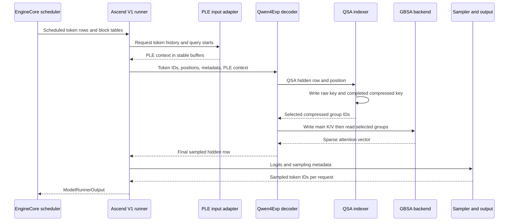

# Qwen3.8-Flash-Next on Atlas A3: vLLM-Ascend Inference Path

**Repository pins.** This reading uses the *open*, unmerged [vLLM-Ascend Qwen3.8 PR #16981](https://github.com/vllm-project/vllm-ascend/pull/16981) at `adc05909ea0125d058c2c9eb3131e761929f2551` and its stated upstream vLLM dependency `a98247ab4db686ee03c66d5feb3c761e52a2f8ab`. Both are clean, detached, local read-only checkouts inspected on 2026-10-26. The earlier Ascend pin `51b0242c0d3be1d3bd59e763a7d78b8553cd45e1` had no Qwen4Exp registration; its <a class="code-link" href="../../../../external-repos/vllm-ascend-51b0242c0d3b/vllm_ascend/models/__init__.py#L4" data-code-repo="vllm-ascend-51b0242c0d3b" data-code-path="vllm_ascend/models/__init__.py" data-code-line="4"><code>model registry</code></a> is included only to explain that history. The [deployment tutorial](https://docs.vllm.ai/projects/ascend/en/main/tutorials/models/Qwen3.8-Flash-Next.html) reports A3 W8A8 with a `v0.26.0rc` image; it does not prove that this later PR head was run end to end.

**Boundary and branch.** The main walkthrough follows one scheduled **text decode row** on Atlas 800 A3, from `SchedulerOutput` entering Ascend V1 `execute_model()` to a sampled token ID in `ModelRunnerOutput` returned by `sample_tokens()`. It assumes the ModelSlim `Qwen3.8-Flash-Next-w8a8-mtp` checkpoint, tensor parallelism, `--quantization ascend`, BF16 QSA KV, and speculative decoding disabled for this row. The tutorial's three-token multi-token prediction (MTP), prefix hits, multimodal prefill, and ACL Graph are separate branches. HTTP request parsing and detokenized response streaming are outside this worker boundary. This follows the depth and worker-level boundary of the [DeepSeek-V4.1 GPU code reading](../vllm/deepseek/v4.1-gpu-inference-path/index.md); it does not transfer that model's cache format or CUDA backend to Ascend.

## Mental model

The upstream Qwen4Exp model owns the decoder and weight names. The Ascend plugin replaces the QSA implementation and selected hyper-connection and PLE operations. A scheduled token enters a hybrid decoder: some layers update Gated DeltaNet (GDN) recurrent state, while QSA layers keep main K/V plus two side caches. In a QSA layer, the side indexer chooses compressed groups, then Generic Block Sparse Attention (GBSA) reads the corresponding main K/V and returns an attention vector. The decoder's final hidden state becomes logits, which the runner samples into a token ID.

QSA exists to avoid reading every historical K/V token for every decode query. The compressed index is cheaper to score than the full history; GBSA spends full-resolution attention only on selected groups. Selection changes **what is read for this query**, not what main K/V is retained. GDN has a different cost shape: it updates recurrent state instead of keeping a K/V record for every old token. The <a class="code-link" href="../../../../external-repos/vllm-qwen38-upstream/vllm/models/qwen4_exp/amd/model.py#L209" data-code-repo="vllm-a98247ab4db6" data-code-path="vllm/models/qwen4_exp/amd/model.py" data-code-line="209" data-code-end-line="235"><code>decoder branch</code></a> chooses these paths from the checkpoint's `layer_types`.

| Stage | Input and state | Output |
| --- | --- | --- |
| Load | Model architecture and ModelSlim description | Ascend wrapper and per-layer W8A8 methods |
| Prepare | Scheduled token IDs, positions, request boundaries | Model inputs, PLE history, attention metadata |
| Hybrid layer | Multi-stream hidden state, GDN/PLE state, QSA caches | Delayed hyper-connection output and MoE result |
| QSA | Query, compressed-key groups, main K/V | Sparse attention vector |
| Return | Final hidden state | Logits and a sampled token ID in the runner's per-request output |

> **Evidence:** This is a static path through the pinned PR and upstream commit. The PR reports earlier A3 runs, but its description says full NPU end-to-end validation was not rerun after the latest rebase. The worker trace below is therefore a code-level reconstruction of the selected branch.

## Resolution and state map

The cache hierarchy matters because a "selected index" and a "cache slot" are different objects. The indexer scores compressed groups, while GBSA consumes group IDs against the full-resolution main K/V pages. The <a class="code-link" href="../../../../external-repos/vllm-qwen38-upstream/vllm/models/qwen4_exp/common/qsa_cache.py#L599" data-code-repo="vllm-a98247ab4db6" data-code-path="vllm/models/qwen4_exp/common/qsa_cache.py" data-code-line="599" data-code-end-line="725"><code>side-cache metadata builder</code></a> supplies request ownership, logical positions, and per-owner block tables.

| State or address | Scope and lifetime | Record or unit | Owner and consumer |
| --- | --- | --- | --- |
| GDN state | Per linear-attention layer, retained across steps | Convolution state and FP32 recurrent SSM state | GDN reads and updates both. |
| PLE state | Configured PLE layer, retained across steps | Short-convolution state; PLE also receives recent token IDs for this forward | PLE reads the token context and updates its convolution state. |
| QSA raw key | Per QSA source and request, bounded circular ring | BF16 index key per recent token; optional stored M-RoPE positions | Compressor reads the open four-token group. |
| QSA compressed key | Per QSA source, retained over the context | BF16 key per completed four-token group | Lightning Indexer scores groups. |
| QSA main K/V | Per QSA source, retained over the context | BF16 K and V for every token, in paged blocks | GBSA reads selected groups from it. |
| Top-k buffer | Current forward only | `int32` group IDs, padded with `-1` | Lightning Indexer writes; GBSA consumes. |

The <a class="code-link" href="../../../../external-repos/vllm-qwen38-upstream/vllm/models/qwen4_exp/common/qsa_cache.py#L844" data-code-repo="vllm-a98247ab4db6" data-code-path="vllm/models/qwen4_exp/common/qsa_cache.py" data-code-line="844" data-code-end-line="862"><code>raw ring specification</code></a> reserves enough recent keys for an open compression group and speculative rows. The <a class="code-link" href="../../../../external-repos/vllm-qwen38-upstream/vllm/models/qwen4_exp/common/qsa_cache.py#L865" data-code-repo="vllm-a98247ab4db6" data-code-path="vllm/models/qwen4_exp/common/qsa_cache.py" data-code-line="865" data-code-end-line="876"><code>compressed-key specification</code></a> stores one state per four tokens. The <a class="code-link" href="../../../../external-repos/vllm-qwen38-upstream/vllm/models/qwen4_exp/amd/qsa.py#L323" data-code-repo="vllm-a98247ab4db6" data-code-path="vllm/models/qwen4_exp/amd/qsa.py" data-code-line="323" data-code-end-line="331"><code>main QSA specification</code></a> keeps ordinary full-resolution K/V.

| Coordinate | Example when the query is token position 11 and ratio is 4 | Conversion |
| --- | --- | --- |
| Logical token position | `t = 11` | Scheduler position for one request. |
| Completed compressed groups visible | `floor((t + 1) / 4) = 3` | The Lightning adapter caps this by the request's sequence length before scoring. |
| Selected group ID | For example `g = 2` | Addresses tokens 8–11 in the main K/V history. |
| Compressed cache slot | `c = floor(t / 4) = 2` only when a group closes | The side-cache mapping writes on `(t + 1) mod 4 = 0`. |
| Physical page slot | `block_table[c // storage_block_size] * storage_block_size + c % storage_block_size` | The per-owner block table resolves logical states to cache storage. |

The <a class="code-link" href="../../../../external-repos/vllm-qwen38-upstream/vllm/models/qwen4_exp/common/qsa_cache.py#L161" data-code-repo="vllm-a98247ab4db6" data-code-path="vllm/models/qwen4_exp/common/qsa_cache.py" data-code-line="161" data-code-end-line="189"><code>compressed-slot mapping</code></a> performs the boundary-only write. The <a class="code-link" href="../../../../external-repos/vllm-ascend-qwen38-pr/vllm_ascend/models/qwen4_exp/lightning_indexer.py#L97" data-code-repo="vllm-ascend-adc05909ea01" data-code-path="vllm_ascend/models/qwen4_exp/lightning_indexer.py" data-code-line="97" data-code-end-line="108"><code>Lightning adapter</code></a> computes visible group counts. GBSA <a class="code-link" href="../../../../external-repos/vllm-ascend-qwen38-pr/vllm_ascend/models/qwen4_exp/gbsa.py#L176" data-code-repo="vllm-ascend-adc05909ea01" data-code-path="vllm_ascend/models/qwen4_exp/gbsa.py" data-code-line="176" data-code-end-line="194"><code>rejects group IDs outside the visible completed groups</code></a> before its sparse read. The example group ID is illustrative; it is not a claimed kernel result.

## Load-time path and backend contract

The plugin <a class="code-link" href="../../../../external-repos/vllm-ascend-qwen38-pr/vllm_ascend/models/__init__.py#L4" data-code-repo="vllm-ascend-adc05909ea01" data-code-path="vllm_ascend/models/__init__.py" data-code-line="4" data-code-end-line="16"><code>registers the causal, multimodal, and MTP architecture names</code></a>. Its <a class="code-link" href="../../../../external-repos/vllm-ascend-qwen38-pr/vllm_ascend/models/qwen4_exp/model.py#L20" data-code-repo="vllm-ascend-adc05909ea01" data-code-path="vllm_ascend/models/qwen4_exp/model.py" data-code-line="20" data-code-end-line="75"><code>model wrapper</code></a> imports upstream `vllm.models.qwen4_exp.amd`, installs Ascend hyper-connection operations and a PLE short-convolution patch, and substitutes `AscendQwen4ExpQSAAttention` before constructing the upstream backbone. The wrapper retains the upstream model and weight loader. For multimodal serving, the <a class="code-link" href="../../../../external-repos/vllm-qwen38-upstream/vllm/models/qwen4_exp/amd/model.py#L843" data-code-repo="vllm-a98247ab4db6" data-code-path="vllm/models/qwen4_exp/amd/model.py" data-code-line="843" data-code-end-line="906"><code>upstream conditional-generation model</code></a> creates a vision tower unless `language_model_only` is selected, then creates the same language-model backbone.

ModelSlim's <a class="code-link" href="../../../../external-repos/vllm-ascend-qwen38-pr/vllm_ascend/quantization/configs/modelslim_config.py#L735" data-code-repo="vllm-ascend-adc05909ea01" data-code-path="vllm_ascend/quantization/configs/modelslim_config.py" data-code-line="735" data-code-end-line="842"><code>quantization method selector</code></a> resolves a description entry for each runtime layer: linear projections receive an Ascend linear method, routed experts receive an Ascend fused-MoE method, and attention cache quantization is separate. A layer without a matching quant type can remain unquantized. This distinction matters: **W8A8 describes selected weight/activation operations, not every state cache**. The same config <a class="code-link" href="../../../../external-repos/vllm-ascend-qwen38-pr/vllm_ascend/quantization/configs/modelslim_config.py#L665" data-code-repo="vllm-ascend-adc05909ea01" data-code-path="vllm_ascend/quantization/configs/modelslim_config.py" data-code-line="665" data-code-end-line="673"><code>maps the MTP layer's runtime index to checkpoint-local layer zero</code></a>.

The <a class="code-link" href="../../../../external-repos/vllm-qwen38-upstream/vllm/models/qwen4_exp/amd/model.py#L175" data-code-repo="vllm-a98247ab4db6" data-code-path="vllm/models/qwen4_exp/amd/model.py" data-code-line="175" data-code-end-line="256"><code>decoder constructor</code></a> reads `layer_types`: a linear-attention layer creates GDN; a full-attention layer with an indexer creates QSA; every layer creates routed MoE and gated residual modules. PLE exists only at configured layer IDs. The <a class="code-link" href="../../../../external-repos/vllm-qwen38-upstream/vllm/models/qwen4_exp/amd/model.py#L378" data-code-repo="vllm-a98247ab4db6" data-code-path="vllm/models/qwen4_exp/amd/model.py" data-code-line="378" data-code-end-line="404"><code>model loop</code></a> constructs those layers under pipeline-parallel boundaries. This is checkpoint-driven topology, not an Ascend-only reimplementation.

The Ascend wrapper must replace upstream module globals **before** constructing that topology: it installs NPU hyper-connection functions, patches PLE's short convolution, and substitutes the Ascend QSA class while leaving upstream weight names and loading authoritative. The <a class="code-link" href="../../../../external-repos/vllm-ascend-qwen38-pr/vllm_ascend/models/qwen4_exp/qsa.py#L482" data-code-repo="vllm-ascend-adc05909ea01" data-code-path="vllm_ascend/models/qwen4_exp/qsa.py" data-code-line="482" data-code-end-line="507"><code>QSA adapter</code></a> in turn substitutes its indexer, attention implementation, cache layouts, and metadata builder. The upstream main QSA owner still creates its separate raw and compressed index caches and main K/V spec.

This branch has explicit failure gates. Upstream QSA <a class="code-link" href="../../../../external-repos/vllm-qwen38-upstream/vllm/models/qwen4_exp/amd/qsa.py#L185" data-code-repo="vllm-a98247ab4db6" data-code-path="vllm/models/qwen4_exp/amd/qsa.py" data-code-line="185" data-code-end-line="220"><code>requires BF16 model and cache storage, causal attention, and no context parallelism</code></a>. It also rejects a quantization recipe that tries to quantize its KV cache. The Ascend <a class="code-link" href="../../../../external-repos/vllm-ascend-qwen38-pr/vllm_ascend/models/qwen4_exp/qsa.py#L448" data-code-repo="vllm-ascend-adc05909ea01" data-code-path="vllm_ascend/models/qwen4_exp/qsa.py" data-code-line="448" data-code-end-line="479"><code>QSA backend</code></a> declares page-major descriptor views; the <a class="code-link" href="../../../../external-repos/vllm-ascend-qwen38-pr/vllm_ascend/worker/v1/model_runner.py#L6170" data-code-repo="vllm-ascend-adc05909ea01" data-code-path="vllm_ascend/worker/v1/model_runner.py" data-code-line="6170" data-code-end-line="6209"><code>runner's six-region binding</code></a> constructs separate K and V views before the owner writes rows.

### Cache bytes for one target token

The public [model configuration](https://huggingface.co/Qwen/Qwen3.8-Flash-Next/blob/main/config.json) has 48 decoder layers, with one full-attention QSA layer after every three GDN layers: 12 QSA layers. It specifies two K/V heads of width 256, and one 128-element BF16 index key per completed four-token group. The upstream <a class="code-link" href="../../../../external-repos/vllm-qwen38-upstream/vllm/models/qwen4_exp/amd/qsa.py#L185" data-code-repo="vllm-a98247ab4db6" data-code-path="vllm/models/qwen4_exp/amd/qsa.py" data-code-line="185" data-code-end-line="221"><code>QSA owner</code></a> requires BF16 main K/V and sets the local K/V-head count to `max(1, 2 // TP)`. Thus TP4 and the guide's TP8 both store **one local K/V head per NPU**. The <a class="code-link" href="../../../../external-repos/vllm-qwen38-upstream/vllm/models/qwen4_exp/amd/indexer_qsa.py#L108" data-code-repo="vllm-a98247ab4db6" data-code-path="vllm/models/qwen4_exp/amd/indexer_qsa.py" data-code-line="108" data-code-end-line="151"><code>indexer construction</code></a> uses BF16 for both index-key caches; the <a class="code-link" href="../../../../external-repos/vllm-qwen38-upstream/vllm/models/qwen4_exp/common/qsa_cache.py#L865" data-code-repo="vllm-a98247ab4db6" data-code-path="vllm/models/qwen4_exp/common/qsa_cache.py" data-code-line="865" data-code-end-line="878"><code>compressed-key spec</code></a> stores one state per compression group.

| Growing cache payload, per NPU | Calculation | Amortized bytes per input token |
| --- | ---: | ---: |
| Main K/V across 12 QSA layers | `12 × 1 × (256 K + 256 V) × 2 BF16 bytes` | 12,288 B = 12 KiB |
| Compressed index keys | `12 × 128 × 2 BF16 bytes ÷ 4 tokens` | 768 B = 0.75 KiB |
| **Total** | | **13,056 B = 12.75 KiB** |

At 262,144 tokens, the logical growing QSA payload is **3.1875 GiB per NPU**. This is an amortized record count, not the number of bytes the allocator reserves. The raw-key ring and recurrent GDN/PLE state are additional owners with different lifetimes. TP4 and TP8 both have one local KV head because there are only two checkpoint KV heads; expert parallelism partitions experts rather than these attention caches. DP replicas each need their own cache. W8A8 weight and activation operations do not make this BF16 QSA cache INT8.

### How the PR allocates physical pages

The <a class="code-link" href="../../../../external-repos/vllm-ascend-qwen38-pr/vllm_ascend/core/six_region_kv_cache_layout.py#L96" data-code-repo="vllm-ascend-adc05909ea01" data-code-path="vllm_ascend/core/six_region_kv_cache_layout.py" data-code-line="96" data-code-end-line="114"><code>six-region planner</code></a> recognizes main QSA K/V, raw and compressed index keys, GDN, PLE, and an optional hidden-state owner. It <a class="code-link" href="../../../../external-repos/vllm-ascend-qwen38-pr/vllm_ascend/core/six_region_kv_cache_layout.py#L186" data-code-repo="vllm-ascend-adc05909ea01" data-code-path="vllm_ascend/core/six_region_kv_cache_layout.py" data-code-line="186" data-code-end-line="210"><code>requires one main, one raw, and one compressed owner for each QSA source</code></a>; an incomplete owner set raises rather than silently reinterpreting the model.

| Slab region in this PR | Physical content | Sizing rule |
| --- | --- | --- |
| `r1` | GDN convolution state | Largest GDN convolution state page. |
| `r2` | GDN SSM state or QSA K | Maximum of their page sizes. |
| `r3` | QSA V | Largest V page. |
| `r4` | Raw index-key ring | Largest raw-key page. |
| `r5` | Compressed index keys | Largest compressed-key page. |
| `r6` | PLE state | Largest PLE state page. |

The <a class="code-link" href="../../../../external-repos/vllm-ascend-qwen38-pr/vllm_ascend/core/six_region_kv_cache_layout.py#L267" data-code-repo="vllm-ascend-adc05909ea01" data-code-path="vllm_ascend/core/six_region_kv_cache_layout.py" data-code-line="267" data-code-end-line="327"><code>region construction</code></a> rounds offsets for alignment, reserves `num_blocks` pages per region, and sets the number of backing slots to the largest owner count across required roles. That common slab can reserve bytes for a region even where a particular slot's owner uses another region. The <a class="code-link" href="../../../../external-repos/vllm-ascend-qwen38-pr/vllm_ascend/worker/v1/model_runner.py#L5613" data-code-repo="vllm-ascend-adc05909ea01" data-code-path="vllm_ascend/worker/v1/model_runner.py" data-code-line="5613" data-code-end-line="5652"><code>runner</code></a> chooses this layout only when other layout and KV-transfer conditions permit it, then binds per-owner <a class="code-link" href="../../../../external-repos/vllm-ascend-qwen38-pr/vllm_ascend/worker/v1/model_runner.py#L6170" data-code-repo="vllm-ascend-adc05909ea01" data-code-path="vllm_ascend/worker/v1/model_runner.py" data-code-line="6170" data-code-end-line="6209"><code>main K/V views</code></a> and <a class="code-link" href="../../../../external-repos/vllm-ascend-qwen38-pr/vllm_ascend/worker/v1/model_runner.py#L6211" data-code-repo="vllm-ascend-adc05909ea01" data-code-path="vllm_ascend/worker/v1/model_runner.py" data-code-line="6211" data-code-end-line="6287"><code>side or recurrent-state views</code></a>. Hidden-state backing is handled separately.

> **Inference:** A startup admission estimate from another image cannot be derived by multiplying the logical 12.75 KiB record count by `max_model_len`, or by applying this PR slab formula without that image's generated `KVCacheGroupSpec` list, page sizes, and block count. This PR's hybrid alignment and physical layout are revision-specific; no full-cache allocation was measured for this pin.

## Follow one decode row down and back

The row has a request ID, logical position, token ID, cache block tables, and a sampling decision. The sequence shows the **target-model** path on the last pipeline stage. It is a synthesized explanation of the two pinned code trees, not a captured trace. Follow the solid arrows from runner preparation to QSA selection and GBSA, then the return arrows back through hidden state, logits, and the runner output. GDN layers take the alternate decoder branch; their state does not pass through Lightning Indexer. [Editable sequence source](assets/qwen3.8-flash-next-a3-decode.mmd).

### 1. The runner accepts a scheduled row

<a class="code-link" href="../../../../external-repos/vllm-ascend-qwen38-pr/vllm_ascend/worker/v1/model_runner.py#L2416" data-code-repo="vllm-ascend-adc05909ea01" data-code-path="vllm_ascend/worker/v1/model_runner.py" data-code-line="2416" data-code-end-line="2487"><code>execute_model()</code></a> first applies the scheduler output to persistent request and batch state. It returns an empty output when no token is scheduled. For work that advances, it derives per-request scheduled-token counts and <a class="code-link" href="../../../../external-repos/vllm-ascend-qwen38-pr/vllm_ascend/worker/v1/model_runner.py#L2522" data-code-repo="vllm-ascend-adc05909ea01" data-code-path="vllm_ascend/worker/v1/model_runner.py" data-code-line="2522" data-code-end-line="2540"><code>_prepare_inputs()</code></a> creates model rows, logits row indices, and optional speculative metadata. The upstream <a class="code-link" href="../../../../external-repos/vllm-qwen38-upstream/vllm/models/qwen4_exp/common/qsa_cache.py#L689" data-code-repo="vllm-a98247ab4db6" data-code-path="vllm/models/qwen4_exp/common/qsa_cache.py" data-code-line="689" data-code-end-line="724"><code>QSA metadata builder</code></a> takes each cache group's common block table, sequence lengths, query starts, and actual token count; it returns owner-specific `token_to_req`, logical positions, visible blocks, and physical `slot_mapping`. That builder is the explicit conversion from a scheduled request position to the side-cache write address.

### 2. The runner prepares PLE and attention metadata

The <a class="code-link" href="../../../../external-repos/vllm-ascend-qwen38-pr/vllm_ascend/models/qwen4_exp/input_adapter.py#L177" data-code-repo="vllm-ascend-adc05909ea01" data-code-path="vllm_ascend/models/qwen4_exp/input_adapter.py" data-code-line="177" data-code-end-line="192"><code>input adapter is constructed only when ple_layer_ids exists</code></a>. For a real row it copies the recent, already-computed token IDs into an n-gram context and pads the rest with EOS; <a class="code-link" href="../../../../external-repos/vllm-ascend-qwen38-pr/vllm_ascend/models/qwen4_exp/input_adapter.py#L118" data-code-repo="vllm-ascend-adc05909ea01" data-code-path="vllm_ascend/models/qwen4_exp/input_adapter.py" data-code-line="118" data-code-end-line="174"><code>prepare()</code></a> writes that context and `query_start_loc` into graph-stable buffers. The <a class="code-link" href="../../../../external-repos/vllm-ascend-qwen38-pr/vllm_ascend/worker/v1/model_runner.py#L3655" data-code-repo="vllm-ascend-adc05909ea01" data-code-path="vllm_ascend/worker/v1/model_runner.py" data-code-line="3655" data-code-end-line="3681"><code>runner adds both to model_kwargs</code></a> before entering its <a class="code-link" href="../../../../external-repos/vllm-ascend-qwen38-pr/vllm_ascend/worker/v1/model_runner.py#L2692" data-code-repo="vllm-ascend-adc05909ea01" data-code-path="vllm_ascend/worker/v1/model_runner.py" data-code-line="2692" data-code-end-line="2708"><code>forward context</code></a>. These are PLE inputs; QSA's main, raw, and compressed block tables remain separate metadata. Graph-stable addresses matter because replay would otherwise read stale context from a different request.

### 3. The decoder chooses GDN or QSA

The <a class="code-link" href="../../../../external-repos/vllm-qwen38-upstream/vllm/models/qwen4_exp/amd/model.py#L456" data-code-repo="vllm-a98247ab4db6" data-code-path="vllm/models/qwen4_exp/amd/model.py" data-code-line="456" data-code-end-line="494"><code>upstream backbone</code></a> embeds the input row on the first pipeline stage, repeats it into four hyper-connection streams, and calls the checkpoint-configured layers. In a configured PLE layer, <a class="code-link" href="../../../../external-repos/vllm-qwen38-upstream/vllm/models/qwen4_exp/amd/model.py#L269" data-code-repo="vllm-a98247ab4db6" data-code-path="vllm/models/qwen4_exp/amd/model.py" data-code-line="269" data-code-end-line="286"><code>pending residual state is combined before PLE adds to the streams</code></a>; omitting the prepared PLE fields raises. Each layer then mixes streams and invokes either <a class="code-link" href="../../../../external-repos/vllm-qwen38-upstream/vllm/models/qwen4_exp/amd/model.py#L288" data-code-repo="vllm-a98247ab4db6" data-code-path="vllm/models/qwen4_exp/amd/model.py" data-code-line="288" data-code-end-line="304"><code>GDN recurrent attention or QSA self-attention</code></a>. A QSA output passes through the attention residual, the <a class="code-link" href="../../../../external-repos/vllm-qwen38-upstream/vllm/models/qwen4_exp/amd/model.py#L306" data-code-repo="vllm-a98247ab4db6" data-code-path="vllm/models/qwen4_exp/amd/model.py" data-code-line="306" data-code-end-line="311"><code>routed MoE block</code></a>, and its delayed hyper-connection return. The MoE routing uses expert-parallel weights; it does not select QSA history.

### 4. QSA creates and stores its index state

The <a class="code-link" href="../../../../external-repos/vllm-ascend-qwen38-pr/vllm_ascend/models/qwen4_exp/qsa.py#L578" data-code-repo="vllm-ascend-adc05909ea01" data-code-path="vllm_ascend/models/qwen4_exp/qsa.py" data-code-line="578" data-code-end-line="646"><code>Ascend QSA owner</code></a> checks that main and side metadata describe the same real token count. It prepares Q/K/V and the output gate, calls the indexer, and later writes main K/V. The <a class="code-link" href="../../../../external-repos/vllm-ascend-qwen38-pr/vllm_ascend/models/qwen4_exp/qsa.py#L292" data-code-repo="vllm-ascend-adc05909ea01" data-code-path="vllm_ascend/models/qwen4_exp/qsa.py" data-code-line="292" data-code-end-line="309"><code>indexer projection</code></a> makes a query for scoring and a raw token key. Its <a class="code-link" href="../../../../external-repos/vllm-ascend-qwen38-pr/vllm_ascend/models/qwen4_exp/qsa.py#L311" data-code-repo="vllm-ascend-adc05909ea01" data-code-path="vllm_ascend/models/qwen4_exp/qsa.py" data-code-line="311" data-code-end-line="351"><code>compression transaction</code></a> reads the open raw-key group, pools a completed four-token group, normalizes the pooled key, and writes compressed and raw rows at their own `slot_mapping` addresses. The raw ring is bounded; completed compressed groups accumulate across the context.

### 5. Lightning Indexer selects groups

The <a class="code-link" href="../../../../external-repos/vllm-ascend-qwen38-pr/vllm_ascend/models/qwen4_exp/qsa.py#L353" data-code-repo="vllm-ascend-adc05909ea01" data-code-path="vllm_ascend/models/qwen4_exp/qsa.py" data-code-line="353" data-code-end-line="370"><code>indexer call</code></a> passes query rows, compressed-key pages, request IDs, positions, and sequence lengths. The <a class="code-link" href="../../../../external-repos/vllm-ascend-qwen38-pr/vllm_ascend/models/qwen4_exp/lightning_indexer.py#L64" data-code-repo="vllm-ascend-adc05909ea01" data-code-path="vllm_ascend/models/qwen4_exp/lightning_indexer.py" data-code-line="64" data-code-end-line="108"><code>CANN Lightning Indexer adapter</code></a> validates BF16 shape, ratio 4, and token budget 2,048, then computes causal visible-group counts. It invokes <a class="code-link" href="../../../../external-repos/vllm-ascend-qwen38-pr/vllm_ascend/models/qwen4_exp/lightning_indexer.py#L146" data-code-repo="vllm-ascend-adc05909ea01" data-code-path="vllm_ascend/models/qwen4_exp/lightning_indexer.py" data-code-line="146" data-code-end-line="170"><code>npu_lightning_indexer</code></a> with one TND query sequence per row and a paged compressed-key block table. It packs at most 512 selected groups plus three residual columns into the prefix of the upstream 2,051-column `int32` output buffer. Those values are **group IDs**, not output tokens or KV records.

### 6. GBSA reads main K/V and returns a vector

After selection, the owner <a class="code-link" href="../../../../external-repos/vllm-ascend-qwen38-pr/vllm_ascend/models/qwen4_exp/qsa.py#L619" data-code-repo="vllm-ascend-adc05909ea01" data-code-path="vllm_ascend/models/qwen4_exp/qsa.py" data-code-line="619" data-code-end-line="646"><code>writes K and V to the main cache before attention reads it</code></a>. Its <a class="code-link" href="../../../../external-repos/vllm-ascend-qwen38-pr/vllm_ascend/models/qwen4_exp/qsa.py#L393" data-code-repo="vllm-ascend-adc05909ea01" data-code-path="vllm_ascend/models/qwen4_exp/qsa.py" data-code-line="393" data-code-end-line="445"><code>attention implementation</code></a> slices the 515 compact index columns and passes them with main K/V and request positions to GBSA. The <a class="code-link" href="../../../../external-repos/vllm-ascend-qwen38-pr/vllm_ascend/models/qwen4_exp/gbsa.py#L124" data-code-repo="vllm-ascend-adc05909ea01" data-code-path="vllm_ascend/models/qwen4_exp/gbsa.py" data-code-line="124" data-code-end-line="153"><code>GBSA adapter</code></a> subdivides a larger storage page into 128-token kernel pages and expands its block table. It <a class="code-link" href="../../../../external-repos/vllm-ascend-qwen38-pr/vllm_ascend/models/qwen4_exp/gbsa.py#L176" data-code-repo="vllm-ascend-adc05909ea01" data-code-path="vllm_ascend/models/qwen4_exp/gbsa.py" data-code-line="176" data-code-end-line="194"><code>filters invalid or future group IDs, computes per-row sparse counts</code></a>, then calls <a class="code-link" href="../../../../external-repos/vllm-ascend-qwen38-pr/vllm_ascend/models/qwen4_exp/gbsa.py#L198" data-code-repo="vllm-ascend-adc05909ea01" data-code-path="vllm_ascend/models/qwen4_exp/gbsa.py" data-code-line="198" data-code-end-line="234"><code>generic_block_sparse_attention</code></a>. The returned tensor is the attention vector. The upstream <a class="code-link" href="../../../../external-repos/vllm-qwen38-upstream/vllm/models/qwen4_exp/amd/qsa.py#L407" data-code-repo="vllm-a98247ab4db6" data-code-path="vllm/models/qwen4_exp/amd/qsa.py" data-code-line="407" data-code-end-line="471"><code>output gate and row-parallel output projection</code></a> turn it into the layer's hidden-state contribution.

### 7. Hidden state becomes logits

On the last pipeline stage, the <a class="code-link" href="../../../../external-repos/vllm-qwen38-upstream/vllm/models/qwen4_exp/amd/model.py#L519" data-code-repo="vllm-a98247ab4db6" data-code-path="vllm/models/qwen4_exp/amd/model.py" data-code-line="519" data-code-end-line="541"><code>final hyper-connection mixer</code></a> materializes the pending residual and yields a single stream for sampling. If native MTP is enabled, it also copies the pre-mixer multi-stream hidden state into a separate draft buffer. The <a class="code-link" href="../../../../external-repos/vllm-qwen38-upstream/vllm/models/qwen4_exp/amd/model.py#L642" data-code-repo="vllm-a98247ab4db6" data-code-path="vllm/models/qwen4_exp/amd/model.py" data-code-line="642" data-code-end-line="656"><code>causal wrapper</code></a> returns the sampled stream; its <a class="code-link" href="../../../../external-repos/vllm-qwen38-upstream/vllm/models/qwen4_exp/amd/model.py#L784" data-code-repo="vllm-a98247ab4db6" data-code-path="vllm/models/qwen4_exp/amd/model.py" data-code-line="784" data-code-end-line="788"><code>compute_logits()</code></a> applies the parallel language head and logits processor. The Ascend runner <a class="code-link" href="../../../../external-repos/vllm-ascend-qwen38-pr/vllm_ascend/worker/v1/model_runner.py#L2791" data-code-repo="vllm-ascend-adc05909ea01" data-code-path="vllm_ascend/worker/v1/model_runner.py" data-code-line="2791" data-code-end-line="2816"><code>selects the logits rows</code></a>, saves logits and execution metadata in `ExecuteModelState`, then <a class="code-link" href="../../../../external-repos/vllm-ascend-qwen38-pr/vllm_ascend/worker/v1/model_runner.py#L2839" data-code-repo="vllm-ascend-adc05909ea01" data-code-path="vllm_ascend/worker/v1/model_runner.py" data-code-line="2839" data-code-end-line="2859"><code>execute_model() returns None</code></a>. That return is a lifecycle handoff, not the user-visible token.

### 8. Sampling returns per-request token IDs

<a class="code-link" href="../../../../external-repos/vllm-ascend-qwen38-pr/vllm_ascend/worker/v1/model_runner.py#L2945" data-code-repo="vllm-ascend-adc05909ea01" data-code-path="vllm_ascend/worker/v1/model_runner.py" data-code-line="2945" data-code-end-line="2994"><code>sample_tokens()</code></a> consumes and clears `ExecuteModelState`, applies an optional grammar mask, and calls <a class="code-link" href="../../../../external-repos/vllm-ascend-qwen38-pr/vllm_ascend/worker/v1/model_runner.py#L3135" data-code-repo="vllm-ascend-adc05909ea01" data-code-path="vllm_ascend/worker/v1/model_runner.py" data-code-line="3135" data-code-end-line="3157"><code>_sample()</code></a>. Without speculative metadata that is the normal sampler; with it, the rejection sampler validates draft tokens. <a class="code-link" href="../../../../external-repos/vllm-ascend-qwen38-pr/vllm_ascend/worker/v1/model_runner.py#L3213" data-code-repo="vllm-ascend-adc05909ea01" data-code-path="vllm_ascend/worker/v1/model_runner.py" data-code-line="3213" data-code-end-line="3237"><code>Bookkeeping</code></a> converts the tensor to valid token lists and discards rows that should not emit a token. Finally it <a class="code-link" href="../../../../external-repos/vllm-ascend-qwen38-pr/vllm_ascend/worker/v1/model_runner.py#L3090" data-code-repo="vllm-ascend-adc05909ea01" data-code-path="vllm_ascend/worker/v1/model_runner.py" data-code-line="3090" data-code-end-line="3117"><code>constructs and returns ModelRunnerOutput</code></a>, or wraps it in an asynchronous output when enabled. The worker's result is token IDs keyed by request, not decoded text.

## Branches and limits

- **MTP and rejection:** The plugin <a class="code-link" href="../../../../external-repos/vllm-ascend-qwen38-pr/vllm_ascend/models/__init__.py#L12" data-code-repo="vllm-ascend-adc05909ea01" data-code-path="vllm_ascend/models/__init__.py" data-code-line="12" data-code-end-line="16"><code>registers an Ascend MTP wrapper</code></a>. Its <a class="code-link" href="../../../../external-repos/vllm-ascend-qwen38-pr/vllm_ascend/models/qwen4_exp/mtp.py#L27" data-code-repo="vllm-ascend-adc05909ea01" data-code-path="vllm_ascend/models/qwen4_exp/mtp.py" data-code-line="27" data-code-end-line="85"><code>predictor</code></a> combines the target's multi-stream hidden state with an embedding, runs the local draft layer, and returns draft hidden states. The runner's <a class="code-link" href="../../../../external-repos/vllm-ascend-qwen38-pr/vllm_ascend/worker/v1/model_runner.py#L3005" data-code-repo="vllm-ascend-adc05909ea01" data-code-path="vllm_ascend/worker/v1/model_runner.py" data-code-line="3005" data-code-end-line="3030"><code>proposal handoff</code></a> occurs after target sampling; <a class="code-link" href="../../../../external-repos/vllm-ascend-qwen38-pr/vllm_ascend/worker/v1/model_runner.py#L3135" data-code-repo="vllm-ascend-adc05909ea01" data-code-path="vllm_ascend/worker/v1/model_runner.py" data-code-line="3135" data-code-end-line="3157"><code>_sample()</code></a> uses rejection sampling when speculative metadata exists. A proposed token is not yet an emitted token. The main eight-step trace omits draft execution.
- **Graph capture:** The <a class="code-link" href="../../../../external-repos/vllm-ascend-qwen38-pr/vllm_ascend/models/qwen4_exp/input_adapter.py#L138" data-code-repo="vllm-ascend-adc05909ea01" data-code-path="vllm_ascend/models/qwen4_exp/input_adapter.py" data-code-line="138" data-code-end-line="174"><code>PLE adapter</code></a> keeps context-buffer addresses stable. The QSA <a class="code-link" href="../../../../external-repos/vllm-ascend-qwen38-pr/vllm_ascend/models/qwen4_exp/qsa.py#L536" data-code-repo="vllm-ascend-adc05909ea01" data-code-path="vllm_ascend/models/qwen4_exp/qsa.py" data-code-line="536" data-code-end-line="573"><code>fused norm and M-RoPE path</code></a> sends the draft model through a graph-safe decomposition because its fused temporary is not replay safe. The target's fused path has shape and dtype eligibility checks and raises on an unsupported ABI. Dummy capture batches use separate runner preparation, so the one-real-row diagram is not a capture trace.
- **Prefix and state restoration:** The raw-key ring's <a class="code-link" href="../../../../external-repos/vllm-qwen38-upstream/vllm/models/qwen4_exp/common/qsa_cache.py#L844" data-code-repo="vllm-a98247ab4db6" data-code-path="vllm/models/qwen4_exp/common/qsa_cache.py" data-code-line="844" data-code-end-line="862"><code>capacity rule</code></a> protects an open group across speculative writes. The runner's <a class="code-link" href="../../../../external-repos/vllm-ascend-qwen38-pr/vllm_ascend/worker/v1/model_runner.py#L2755" data-code-repo="vllm-ascend-adc05909ea01" data-code-path="vllm_ascend/worker/v1/model_runner.py" data-code-line="2755" data-code-end-line="2786"><code>Mamba state copy</code></a> runs after any KV transfer load and before the target forward, preventing a layer from reading half-loaded recurrent state. The PR reports matched-partition cold/hit token and trace parity from an earlier A3 base; that result is not a test of this rebased commit.
- **Hardware and configuration:** The [official model guide](https://docs.vllm.ai/projects/ascend/en/main/tutorials/models/Qwen3.8-Flash-Next.html) gives an Atlas 800 A3 DP1 × TP8 W8A8 example. This pin's native QSA and Lightning/GBSA path is described for A3; no A2/910B or Ascend 950 kernel run was performed in this inspection. The selected text row excludes the optional vision tower. For the multimodal wrapper, <a class="code-link" href="../../../../external-repos/vllm-qwen38-upstream/vllm/models/qwen4_exp/amd/model.py#L843" data-code-repo="vllm-a98247ab4db6" data-code-path="vllm/models/qwen4_exp/amd/model.py" data-code-line="843" data-code-end-line="906"><code>construction</code></a> creates the vision path unless `language_model_only` is set, then reaches the same text backbone.
- **Verification:** The page is a local static reading of clean pins `adc05909ea0125d058c2c9eb3131e761929f2551` and `a98247ab4db686ee03c66d5feb3c761e52a2f8ab`. No model weights, NPU kernels, decoded text, memory profile, or performance benchmark were executed here. The PR remains open and reports no full NPU end-to-end rerun after its latest rebase; its layout and gates may change before merging.

Related: [NVIDIA Qwen3.8-Flash-Next path](../vllm/qwen3-8-flash-next-gpu-inference-path/index.md) · [vLLM Ascend hub](index.md) · [KV cache](../../../terms/kv-cache.md) · [Mixture of Experts](../../../terms/mixture-of-experts.md).
