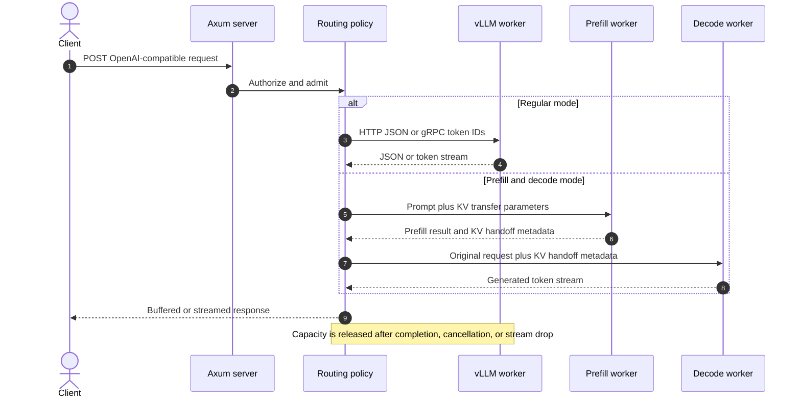

# vLLM Router: Repository Insight

**Repository:** [vllm-project/router](https://github.com/vllm-project/router)

**Inspected commit:**
`aaad26899d0052cb62c0998346380db80d54d24a`

**Verification boundary:** clean, commit-pinned static reading. The router,
vLLM workers, GPUs, KV-transfer fabric, Kubernetes discovery, and multi-node
runtime were not executed.

## The Short Version

vLLM Router is a request control plane in front of vLLM serving workers. It
accepts OpenAI-compatible or vLLM-native requests, chooses an available
worker, and forwards or translates the request over HTTP or gRPC.

The router owns admission, placement, worker health, retries, capacity
accounting, and response cleanup. The selected vLLM worker still owns model
execution, schedulers, paged KV state, and token generation. In prefill/decode
(P/D) mode, the router also coordinates the handoff between the worker that
computes prompt KV and the worker that produces the visible token stream.

## What This Repository Adds

| Concern | vLLM engine responsibility | vLLM Router responsibility |
|---|---|---|
| Request admission | Admit token work into one engine's scheduler | Limit concurrent requests and optionally queue at the service boundary |
| Worker choice | Not applicable inside one engine | Select a replica, data-parallel rank, or P/D pair |
| Prefix or KV reuse | Read and write the engine-local cache | Estimate which replica or stage has useful cache state |
| P/D transfer | Produce or consume KV through a connector | Supply request identity, select P and D, and carry transfer metadata |
| Worker failure | Fail or recover engine-side work | Retry eligible responses, open circuit breakers, and remove unhealthy targets |
| Discovery | Expose a worker | Reconcile static, Kubernetes, or vLLM-native worker registrations |
| Visible response | Generate model output | Preserve or assemble the HTTP/gRPC result and release accounting |

> **Important:** The router's route selection is not model execution. A worker
> choice decides where computation happens; the vLLM scheduler and model
> runner remain responsible for how the computation runs.

## Routing Modes

<a class="code-link" href="../../../../external-repos/router/src/routers/factory.rs#L15" data-code-repo="router-aaad26899d00" data-code-path="src/routers/factory.rs" data-code-line="15" data-code-end-line="42"><code>RouterFactory::create_router()</code></a>
builds one of three request routers:

- **Regular:** all prompts go to one selected worker. Worker URLs must be
  consistently HTTP or gRPC.
- **OpenAI:** the selected upstream is treated as one OpenAI-compatible base
  service.
- **vLLM P/D:** prefill and decode have independent pools and may use different
  placement policies.

Inference Gateway mode wraps regular and P/D routers with a
`RouterManager`. It uses worker model metadata and type to delegate one request
to the matching router implementation.

## Gateway and Discovery

`--enable-igw` and `--service-discovery` are independent:

- **IGW** creates a meta-router that chooses a regular or P/D child router.
- **Service discovery** continuously populates a router's worker topology
  from Kubernetes pods.

Read [vLLM Router: Service Discovery and IGW Code Path](service-discovery-and-igw.md)
for their startup order, ownership boundaries, worker-registration flows,
composition matrix, and current P/D limitations.

## Code-Reading Map

| Layer | Files | Responsibility |
|---|---|---|
| API boundary | `src/server.rs`, `src/middleware.rs` | Routes, validation, authentication, concurrency queue, request IDs, tracing |
| Router abstraction | `src/routers/mod.rs`, `src/routers/factory.rs` | Common request methods, worker-management interface, concrete implementation selection |
| Regular routing | `src/routers/http/router.rs` | Candidate filtering, policy input preparation, selection, retries, dispatch, stream cleanup |
| P/D routing | `src/routers/http/pd_router.rs`, `src/routers/http/vllm_pd_router.rs` | Atomic pair admission, P/D transfer, deferred decode commitment, response assembly |
| Policies | `src/policies/` | Random, round-robin, power-of-two, hashing, session stickiness, cache-aware, and KV-aware selection |
| Worker state | `src/core/worker*.rs` | Health, load, circuit-breaker state, worker type, endpoint and model metadata |
| Backends | `src/backend/` | HTTP proxying, gRPC token preparation, streaming, completion conversion |
| KV evidence | `src/kv_index/` | Event discovery, block-location indexing, tier matching, stale-event handling |
| Dynamic topology | `src/service_discovery.rs`, `src/routers/router_manager.rs` | Kubernetes reconciliation, model routing, worker registration and removal |
| Agent scheduling | `src/program_scheduling/` | Optional program identity, request pools, fairness, predictions, and warm-remote admission |

The public API is assembled in
<a class="code-link" href="../../../../external-repos/router/src/server.rs#L862" data-code-repo="router-aaad26899d00" data-code-path="src/server.rs" data-code-line="862" data-code-end-line="913"><code>build_app_with_wasm_middleware()</code></a>.
Inference endpoints receive concurrency admission and optional WASM request
middleware. Health and metadata endpoints stay on separate routes; worker
administration has explicit `/workers`, cache, load, and scheduling endpoints.

## One Request, End to End

The compact flow below answers where one request changes ownership. The
selected branch is a regular `POST /v1/chat/completions` request; the P/D
alternative is shown beside it.

*[Editable Mermaid source](assets/router-request-path.mmd). This diagram is an
orientation layer synthesized from the pinned code path.*

### Regular HTTP or gRPC round trip

1. **Ingress:** the Axum route parses the typed request and calls the common
   `RouterTrait::route_chat()` boundary. Worker admission is applied before the
   handler through the protected-route layer in the server entry above.
2. **Preparation:** <a class="code-link" href="../../../../external-repos/router/src/routers/http/router.rs#L1463" data-code-repo="router-aaad26899d00" data-code-path="src/routers/http/router.rs" data-code-line="1463" data-code-end-line="1788"><code>Router::route_prepared_request()</code></a>
   resolves the model, classifies the worker pool, prepares gRPC token IDs when
   needed, and obtains prefix or KV-routing inputs. This stage is also where a
   retry starts a fresh scheduling attempt.
3. **Placement:** <a class="code-link" href="../../../../external-repos/router/src/routers/http/router.rs#L1395" data-code-repo="router-aaad26899d00" data-code-path="src/routers/http/router.rs" data-code-line="1395" data-code-end-line="1443"><code>Router::select_worker_for_model()</code></a>
   narrows candidates to available workers and asks the selected
   `LoadBalancingPolicy` for an index. KV-aware policies can return a receipt
   containing a reservation, not only a worker number.
4. **gRPC preparation:** for gRPC chat, <a class="code-link" href="../../../../external-repos/router/src/backend/frontend.rs#L155" data-code-repo="router-aaad26899d00" data-code-path="src/backend/frontend.rs" data-code-line="155" data-code-end-line="178"><code>EngineFrontend::prepare()</code></a>
   resolves tokenizer assets, applies the chat template, tokenizes the prompt,
   and stores the resulting token IDs before policy selection. HTTP workers
   remain JSON-transparent unless a cache-aware policy needs derived inputs.
5. **Dispatch and return:** <a class="code-link" href="../../../../external-repos/router/src/routers/http/router.rs#L1937" data-code-repo="router-aaad26899d00" data-code-path="src/routers/http/router.rs" data-code-line="1937" data-code-end-line="2120"><code>Router::send_typed_request()</code></a>
   sends HTTP JSON or invokes the gRPC frontend. It preserves response status
   and headers, buffers non-streaming bodies, or forwards server-sent events.
6. **Capacity ownership:** <a class="code-link" href="../../../../external-repos/router/src/routers/http/router.rs#L116" data-code-repo="router-aaad26899d00" data-code-path="src/routers/http/router.rs" data-code-line="116" data-code-end-line="188"><code>RequestLoadGuard</code></a>
   remains attached to the response body. It releases worker load and any
   KV-policy slot exactly once at stream EOF, error, body drop, or task
   cancellation.
7. **Failure recovery:** retryable 408/429/5xx results use the retry executor.
   Worker outcomes feed the circuit breaker, and KV-aware retries exclude the
   failed target without rewriting a still-valid session binding.

## Prefill/Decode Round Trip

P/D has two separate stages but one admission identity. The selected P may
finish before D, and the router retains enough request and transfer state to
make D valid.

1. **Entry:** <a class="code-link" href="../../../../external-repos/router/src/routers/http/vllm_pd_router.rs#L3576" data-code-repo="router-aaad26899d00" data-code-path="src/routers/http/vllm_pd_router.rs" data-code-line="3576" data-code-end-line="3704"><code>VllmPDRouter::route_transparent()</code></a>
   obtains available P and D candidates from either the static registry or the
   discovery service.
2. **Atomic admission:** <a class="code-link" href="../../../../external-repos/router/src/routers/http/pd_router.rs#L682" data-code-repo="router-aaad26899d00" data-code-path="src/routers/http/pd_router.rs" data-code-line="682" data-code-end-line="756"><code>PdRouterBase::select_and_admit_with()</code></a>
   selects and reserves stage occupancy under one short admission critical
   section. Some policies permit D to be reselected after P finishes; others
   keep the admission-time commitment.
3. **Prefill:** <a class="code-link" href="../../../../external-repos/router/src/routers/http/vllm_pd_router.rs#L2124" data-code-repo="router-aaad26899d00" data-code-path="src/routers/http/vllm_pd_router.rs" data-code-line="2124" data-code-end-line="2528"><code>VllmPDRouter::process_vllm_two_stage_request()</code></a>
   rewrites P to one generated token, injects connector-specific
   `kv_transfer_params`, and sends the request with a shared request ID.
4. **KV handoff:** the router consumes P's response metadata, optionally
   recomputes the D decision against live load, then inserts the transfer
   parameters into D's request. P capacity is released when its body has been
   consumed; D capacity remains owned by the request.
5. **Decode and return:** D receives the original generation request plus the
   KV handoff. The router's
   <a class="code-link" href="../../../../external-repos/router/src/routers/http/vllm_pd_router.rs#L1869" data-code-repo="router-aaad26899d00" data-code-path="src/routers/http/vllm_pd_router.rs" data-code-line="1869" data-code-end-line="1925"><code>handle_decode_response()</code></a>
   chooses streaming passthrough, log-probability merging, or buffered body
   assembly and releases decode occupancy.

## Why the Policy Layer Is Central

The router exposes one common
<a class="code-link" href="../../../../external-repos/router/src/policies/mod.rs#L58" data-code-repo="router-aaad26899d00" data-code-path="src/policies/mod.rs" data-code-line="58" data-code-end-line="131"><code>LoadBalancingPolicy</code></a>
contract for both one-worker and two-stage selection. The policies answer
different questions:

| Policy family | Placement question | Main state |
|---|---|---|
| Random / round robin | Which healthy worker is next? | Stateless randomness or an atomic cursor |
| Power of two | Which of two sampled workers is less loaded? | Worker load observations |
| Consistent / rendezvous hash | Which worker should own this identity? | Session or user-derived hash |
| Sticky least-loaded | Where should this session continue, and where should a new one start? | Session binding plus replica load |
| Cache-aware | Which worker's approximate prefix tree matches most? | Per-worker, per-model prompt-prefix trees |
| KV-aware | Which target minimizes verified cache-transfer cost plus live P/D work? | Event-derived block placement, tier costs, occupancy, optional affinity |

KV-aware routing differs from an optimistic prefix tree. It discovers the
worker's event sources and registers subscribers in
<a class="code-link" href="../../../../external-repos/router/src/kv_index/discovery.rs#L216" data-code-repo="router-aaad26899d00" data-code-path="src/kv_index/discovery.rs" data-code-line="216" data-code-end-line="245"><code>KvIndexSupervisor::on_worker_added()</code></a>.
Events update an indexed representation of which DP rank and storage tier holds
which cache blocks. Placement evidence can therefore earn cache credit; missing
or stale discovery falls back toward load-only behavior rather than making the
worker ineligible.

## Dynamic Worker Topology

Workers are not just URLs. The registry tracks model, type, connection mode,
health, current load, and circuit-breaker state. This gives regular requests
model-filtered candidates and gateway requests enough information to choose
between a normal router and a P/D router.

For Kubernetes, `PodInfo` classifies pods as regular, prefill, or decode.
<a class="code-link" href="../../../../external-repos/router/src/service_discovery.rs#L407" data-code-repo="router-aaad26899d00" data-code-path="src/service_discovery.rs" data-code-line="407" data-code-end-line="520"><code>handle_pod_event()</code></a>
records the pod identity, URL, role, and UID at registration time. Replacement
pods with the same name are therefore removed by their old registration URL
before the new endpoint is added. This prevents an IP or role change from
leaving a stale worker routable.

## Resilience Is Attached to the Request Lifetime

The resilience mechanisms are intentionally distributed:

- **Before selection:** worker health and open circuits remove candidates.
- **During placement:** tracked reservations prevent concurrent load-aware
  decisions from observing the same stale occupancy.
- **During dispatch:** retryable transport or 5xx responses can select another
  worker.
- **After headers arrive:** streaming response ownership keeps accounting alive
  rather than releasing it at time-to-first-byte.
- **After cancellation:** dropping the stream aborts the producer and triggers
  idempotent cleanup.

This lifetime distinction is important. A response header proves that the
worker accepted the request, not that model output finished or that the router
may release the selected worker's capacity.

## Recommended Reading Order

1. Read `src/server.rs` to learn the external contract and middleware order.
2. Read `src/routers/factory.rs` and `src/routers/mod.rs` to choose the routing
   mode.
3. Follow `route_prepared_request()` for regular serving.
4. Follow `route_transparent()` and `process_vllm_two_stage_request()` for
   P/D serving.
5. Read the selected policy and the worker registry together; placement and
   availability use the same worker objects.
6. Read `backend/frontend.rs` for gRPC-only preprocessing and detokenization.
7. Read `kv_index/` only after the routing path: it is evidence input to
   `kv_aware`, not the primary request coordinator.

## Where It Breaks

| Failure boundary | Consequence | Limiting evidence |
|---|---|---|
| Mixed HTTP/gRPC worker pool | Initialization or later registration rejects the ambiguous transport | Rejected statically; no mixed-runtime test was run here |
| Router-to-worker network failure | Retry can mask transient faults; repeated faults open the worker circuit | Backoff is implemented, but deployment-level behavior was not measured |
| Stale KV events | Cache placement credit can become untrusted or fall back to load | Loss fencing exists; event recovery under packet loss was not exercised |
| P completes but D metadata is unusable | Request fails despite successful prefill computation | Connector-specific transfer correctness was not run |
| Decode stream disconnects | Accounting and producer task should clean up through body ownership | Covered by code/tests, not observed in this inspection |
| Kubernetes role or IP change | Old URL must be removed before the replacement is registered | Reconciliation is explicit, but cluster behavior was not exercised |
| gRPC non-chat route | The router returns a client error instead of attempting an unsupported backend call | The current route gate is narrower than the HTTP API |

## Relationship to vLLM

Use the existing [vLLM overview](../vllm/vllm-overview.md) to study engine
internals and the [vLLM P/D deployment path](../vllm/prefill-decode-disaggregated-deployment/index.md)
to study the worker-side KV connector. This page stops at the router-to-worker
boundary: it does not prove vLLM scheduler, GPU kernel, connector, or fabric
behavior.

**One thing to remember:** the router optimizes *where* and *when* a request
enters vLLM, while vLLM determines *how* its model work and KV state execute.
