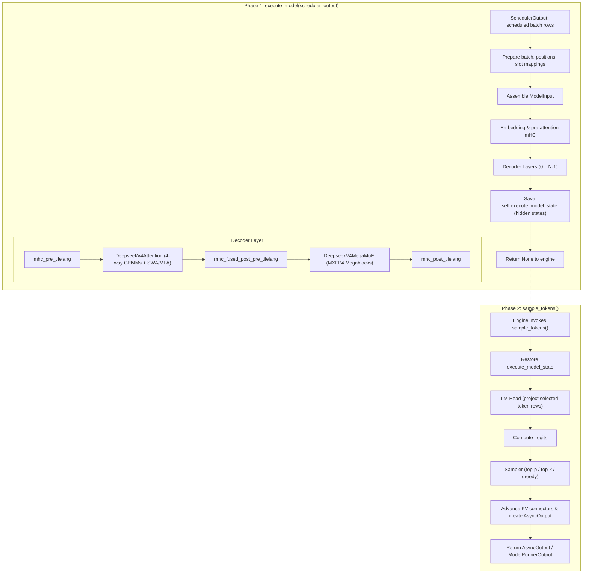

# DeepSeek-V4 on NVIDIA vLLM: GPU Inference Path and Attention Architecture

**Repositories:**

- [vllm-project/vllm](https://github.com/vllm-project/vllm) @ `d18ed2304a2703e3211fc384a58607e754f5b723` (main, clean)
- [vllm-project/vllm-ascend](https://github.com/vllm-project/vllm-ascend) @ `8645122088f5cad1701205310573c5ee05c809f5` (main, clean)

**Inspection:** 2026-10-19; static code reading only.  
**Scope:** The NVIDIA GPU worker path from receiving a `SchedulerOutput` in `GPUModelRunner.execute_model` through the V4 decoder forward pass, manifold-constrained hyper-connections ([mHC](../../../../terms/hyper-connections.md)), hybrid compressed attention (SWA/CSA/HCA), `DeepseekV4MegaMoE`, logits computation, and token sampling in `GPUModelRunner.sample_tokens`, returning `AsyncOutput` / `ModelRunnerOutput`. Cross-platform Ascend NPU and AMD ROCm specializations are mapped in dedicated backend sections.

**Related pages:** [DeepSeek-V4 Paper](../../../../training/model-families/deepseek/deepseek-v4/index.md), [DeepSeek-V4.1 GPU inference path](v4.1-gpu-inference-path/index.md), [DeepSeek-V2 MLA](../../../../algorithms/attention/variants/deepseek-v2-mla.md), [DeepSeek-V3.2 Sparse Attention](../../../../algorithms/model-architectures/deepseek-v3-2/index.md), [vLLM-Ascend Lightning Indexer C8 Quantization](../../vllm-ascend/deepseek-v4-lightning-indexer-c8.md), [DeepSeek-V4 Inference on Ascend: The DSA Serving Stack](../../vllm-ascend/deepseek-v4-inference.md).

## TL;DR

The DeepSeek-V4 serving implementation under vLLM V1 follows a strict **two-phase worker execution lifecycle**:

1. `GPUModelRunner.execute_model` sets up scheduled token rows, paged-cache slots, and attention metadata, then executes the model forward pass (mHC residual streams $\to$ parallel GEMM projections $\to$ hybrid compressed attention $\to$ grouped output projection $\to$ [mixture-of-experts (MoE)](../../../../terms/mixture-of-experts.md) via `DeepseekV4MegaMoE`), saving execution state.
2. `GPUModelRunner.sample_tokens` consumes the saved state, computes logits on selected token rows, samples next-token IDs, advances KV-connector state, and wraps the result in `AsyncOutput`.

DeepSeek-V4's central efficiency mechanism is **Hybrid Compressed Attention (HCA)** using a heterogeneous [KV cache](../../../../terms/kv-cache.md):

- **SWA-only layers** (`compress_ratio=1`, early layers): Local [sliding-window attention](../../../../terms/sliding-window-attention.md) (128 tokens) at full fidelity.
- **HCA layers** (`compress_ratio=128`, upper layers): 128× compression producing 1 compressed state per 128 tokens; dense attention across all compressed historical states plus local SWA.
- **CSA layers** (`compress_ratio=4`, middle layers): 4× compression with dual-series overlap ($coff=2$); the [Lightning Indexer](../../../../terms/lightning-indexer.md) scores compact indexer keys to select top-$k$ compressed blocks, combined with local SWA.

At the attention layer, vLLM coordinates **4-way input GEMM overlap** on CUDA streams, an eager-break boundary for CUDAGraph capture, and platform-specific sparse MLA kernels (FlashMLA on SM90/SM100, FlashInfer on SM100/SM120, and custom AscendDSA operators on Ascend NPU).

**Where to start:**

- Model entry: <a class="code-link" href="../../../../../external-repos/vllm-d18ed2304a27/vllm/models/deepseek_v4/nvidia/model.py#L82" data-code-repo="vllm-d18ed2304a27" data-code-path="vllm/models/deepseek_v4/nvidia/model.py" data-code-line="82"><code>vllm/models/deepseek_v4/nvidia/model.py</code></a> $\to$ `DeepseekV4ForCausalLM`
- Core attention orchestrator: <a class="code-link" href="../../../../../external-repos/vllm-d18ed2304a27/vllm/models/deepseek_v4/attention.py#L71" data-code-repo="vllm-d18ed2304a27" data-code-path="vllm/models/deepseek_v4/attention.py" data-code-line="71"><code>vllm/models/deepseek_v4/attention.py</code></a> $\to$ `DeepseekV4Attention`
- Fused compression kernel: <a class="code-link" href="../../../../../external-repos/vllm-d18ed2304a27/vllm/models/deepseek_v4/common/ops/fused_compress_quant_cache.py#L32" data-code-repo="vllm-d18ed2304a27" data-code-path="vllm/models/deepseek_v4/common/ops/fused_compress_quant_cache.py" data-code-line="32"><code>vllm/models/deepseek_v4/common/ops/fused_compress_quant_cache.py</code></a> $\to$ `compress_norm_rope_store_triton`

## Mental Model

In vLLM V1, a GPU decode step executes across two separate worker entry points:



### Precision hierarchy and coordinate spaces

Because sparse attention is only computationally advantageous when candidate selection costs strictly less than full attention, DeepSeek-V4 splits memory into distinct physical stores operating at different coordinate scales:

| Coordinate space | Unit | Granularity | Mapping formula | Target cache / buffer |
|---|---|---|---|---|
| **Token position ($t$)** | Sequence token | 1 token | $t \in [0, \text{sequence length})$ | Local SWA KV cache (<a class="code-link" href="../../../../../external-repos/vllm-d18ed2304a27/vllm/v1/attention/backends/mla/sparse_swa.py#L43" data-code-repo="vllm-d18ed2304a27" data-code-path="vllm/v1/attention/backends/mla/sparse_swa.py" data-code-line="43"><code>DeepseekV4SWACache</code></a>) |
| **Compressed state ($c$)** | Compressed slot | $r$ tokens | $c = \lfloor t / r \rfloor$ | Main compressed MLA cache (<a class="code-link" href="../../../../../external-repos/vllm-d18ed2304a27/vllm/v1/kv_cache_interface.py#L33" data-code-repo="vllm-d18ed2304a27" data-code-path="vllm/v1/kv_cache_interface.py" data-code-line="33"><code>MLAAttentionSpec</code></a>) |
| **Paged block slot** | Physical GPU slot | 1 state | `slot = block_table[c // B] * B + (c % B)` | Physical paged KV buffer (<a class="code-link" href="../../../../../external-repos/vllm-d18ed2304a27/vllm/v1/attention/backends/mla/compressor_utils.py#L9" data-code-repo="vllm-d18ed2304a27" data-code-path="vllm/v1/attention/backends/mla/compressor_utils.py" data-code-line="9"><code>get_compressed_slot_mapping</code></a>) |
| **Index-K position** | Scoring key | $r$ tokens | $c = \lfloor t / r \rfloor$ | Compact Indexer KV cache |
| **Top-K buffer** | Candidate index | $r$ tokens | Top-$k$ compressed block IDs | FlashMLA / FlashInfer candidate buffer |

Selection indices live in **compressed-state units**, not token positions. An index $i$ covers tokens $[i \cdot r, (i+1) \cdot r - 1]$. The backend loads the selected compressed entries, loads the last 128 uncompressed tokens from the SWA cache, and computes unified Multi-head Latent Attention (MLA).

## SM100 and SM120 GPU Branches

At model initialization, the NVIDIA platform dispatch selects between FlashMLA and FlashInfer backends based on GPU compute capability and tensor-parallel topology:

| GPU architecture | Automatic attention backend | Fallback behavior |
|---|---|---|
| **SM90 / SM100 family** | <a class="code-link" href="../../../../../external-repos/vllm-d18ed2304a27/vllm/models/deepseek_v4/sparse_mla.py#L35" data-code-repo="vllm-d18ed2304a27" data-code-path="vllm/models/deepseek_v4/sparse_mla.py" data-code-line="35"><code>DeepseekV4FlashMLABackend</code></a> (`DeepseekV4FlashMLAAttention`) | Falls back to FlashInfer sparse MLA if FlashMLA kernels are ineligible or head padding mismatches. |
| **SM120 (Blackwell Ultra)** | <a class="code-link" href="../../../../../external-repos/vllm-d18ed2304a27/vllm/models/deepseek_v4/nvidia/flashinfer_sparse.py#L36" data-code-repo="vllm-d18ed2304a27" data-code-path="vllm/models/deepseek_v4/nvidia/flashinfer_sparse.py" data-code-line="36"><code>DeepseekV4FlashInferMLASparseBackend</code></a> (`DeepseekV4FlashInferSM120Attention`) | Raises initialization error if V4 sparse-MLA specialization is missing; does not fall back to SM90 kernels. |

### KV cache layout by backend

DeepSeek-V4 provisions three distinct KV stores:

| Cache type | Scope | Storage format | Record width | Role |
|---|---|---|---|---|
| **Local SWA cache** | Last 128 tokens | BF16 / [FP8](../../../../terms/fp8.md) | 512 B or 584 B | Uncompressed full-fidelity KV for local context window |
| **Main MLA cache** | Context history ($r=4$ or $r=128$) | `fp8_ds_mla` (UE8M0 block-scaled) | 584 B (448 NoPE + 128 RoPE + 8 scale) | Global compressed KV states addressed by top-$k$ indexer |
| **Indexer KV cache** | Context history ($r=4$) | FP8 or [MXFP4](../../../../terms/microscaling.md) | 128 B (block size 32) | Down-projected compressed keys for fast top-$k$ block scoring |
| **`CompressorStateCache`** | Unfinalized blocks ($< r$ tokens) | Float32 | `2 * coff * head_dim` float32 | In-flight accumulator for partial compression states |

## Follow One Decode Token

Consider a single text decode token at position $p = 500{,}000$ in a CSA layer ($r=4$, $coff=2$) running on the last pipeline rank:

1. **Step 1: Batch scheduling and metadata preparation (`execute_model`)**  
   The worker receives `SchedulerOutput`. The position tensor `positions=[500000]` and paged cache slot mappings are prepared. The compressor computes its logical block coordinate $c = 500000 // 4 = 125000$.
2. **Step 2: Pre-attention residual mixing**  
   The token embedding passes through `mhc_pre_tilelang`, which mixes the 4-stream hyper-connection residual manifold into the attention input hidden state $H \in \mathbb{R}^{1 \times 7168}$.
3. **Step 3: 4-way parallel GEMM input projections**  
   `DeepseekV4Attention.attn_gemm_parallel_execute` dispatches 4 [GEMMs](../../../../terms/gemm.md) simultaneously across CUDA streams:
   - *Default stream:* `fused_wqa_wkv` $\to$ projects to $qr$ (1536 dim) + $kv$ (512 dim).
   - *Aux stream 0:* `compressor.fused_wkv_wgate` $\to$ computes `kv_score` $\in \mathbb{R}^{1 \times 2048}$ ($2 \cdot 2 \cdot 512$).
   - *Aux stream 1:* `indexer.weights_proj` $\to$ computes `indexer_weights` $\in \mathbb{R}^{1 \times 64}$.
   - *Aux stream 2:* `indexer.compressor.fused_wkv_wgate` $\to$ computes `indexer_kv_score` $\in \mathbb{R}^{1 \times 512}$ ($2 \cdot 2 \cdot 128$).
   - All streams synchronize at RMSNorm: $qr$ and $kv$ are normalized via `fused_q_kv_rmsnorm`.
4. **Step 4: 3-way eager-break overlap (`attention_impl`)**  
   Inside the CUDAGraph eager-break boundary:
   - *Default stream:* `wq_b(qr)` projects query heads; `_fused_qnorm_rope_kv_insert` applies head-wise RMSNorm, GPT-J RoPE, and **writes $kv$ directly into the SWA cache** at slot 500,000.
   - *Aux stream 0 (Indexer):* Projects $qr \to$ indexer $Q$ ($64 \times 128$), quantizes via <a class="code-link" href="../../../../../external-repos/vllm-d18ed2304a27/vllm/models/deepseek_v4/common/ops/fused_indexer_q.py#L15" data-code-repo="vllm-d18ed2304a27" data-code-path="vllm/models/deepseek_v4/common/ops/fused_indexer_q.py" data-code-line="15"><code>_fused_indexer_q_rope_quant_kernel</code></a>, updates indexer KV cache, scores historical blocks, and outputs top-1024 compressed block indices.
   - *Aux stream 1 (Compressor):* Adds `kv_score` to `CompressorStateCache` with Absolute Positional Encoding (APE). Because $(500000 + 1) \% 4 = 1 \ne 0$, this token is mid-block; its partial state is stored without triggering compression flush. (Every 4th token, <a class="code-link" href="../../../../../external-repos/vllm-d18ed2304a27/vllm/models/deepseek_v4/common/ops/fused_compress_quant_cache.py#L32" data-code-repo="vllm-d18ed2304a27" data-code-path="vllm/models/deepseek_v4/common/ops/fused_compress_quant_cache.py" data-code-line="32"><code>compress_norm_rope_store_triton</code></a> reads 8 tokens across overlapping windows, evaluates softmax gate scores, computes weighted sum, norms, RoPEs, FP8-quantizes, and stores 1 new entry to the main MLA cache).
5. **Step 5: Sparse MLA attention kernel (`forward_mqa`)**  
   The attention kernel reads:
   - The 128 most recent uncompressed tokens from the **SWA cache** (positions 499,873 to 500,000).
   - The top-1024 compressed MLA blocks (~1024 states covering ~4096 historical tokens) selected by the indexer.
   - Total attended keys: ~1152 states instead of 500,000 dense tokens (~435× bandwidth reduction).
   - Computes MQA attention and writes into output buffer `out`.
6. **Step 6: Output projection, mHC mixing, and MegaMoE**  
   - Output projection: Grouped $O$-projection runs via `deep_gemm_fp8_o_proj`.
   - Mid-layer mixing: `mhc_fused_post_pre_tilelang` mixes attention output into the residual manifold.
   - FFN: `DeepseekV4MegaMoE` routes the token to active experts using MXFP4 Megablocks GEMMs and `SiluAndMulWithClamp`.
   - Post-layer mixing: `mhc_post_tilelang` combines MoE output into the final layer residual.
7. **Step 7: Token sampling and worker return (`sample_tokens`)**  
   At the final decoder layer, `execute_model` caches hidden states in `self.execute_model_state`. `sample_tokens` projects the token row through the LM head, computes logits, applies greedy or top-$p$ sampling, advances KV connector sequences, and returns `AsyncOutput`.

## Request Round Trip

### 1. Resolve the checkpoint at load time

Model loading identifies the architecture from the Hugging Face model configuration and instantiates the top-level causal LM wrapper:

```python
# vllm/models/deepseek_v4/nvidia/model.py
class DeepseekV4ForCausalLM(nn.Module):
    def __init__(self, config: DeepseekV4Config, ...):
        super().__init__()
        self.model = DeepseekV4Model(config, ...)
        self.lm_head = ParallelLMHead(config.vocab_size, config.hidden_size, ...)
```

The model architecture configures layer heterogeneity: early layers are instantiated with `compress_ratio=1` (SWA only), intermediate layers with `compress_ratio=4` (CSA), and deep layers with `compress_ratio=128` (HCA).

Evidence: <a class="code-link" href="../../../../../external-repos/vllm-d18ed2304a27/vllm/models/deepseek_v4/nvidia/model.py#L82" data-code-repo="vllm-d18ed2304a27" data-code-path="vllm/models/deepseek_v4/nvidia/model.py" data-code-line="82"><code>vllm/models/deepseek_v4/nvidia/model.py:82</code></a> (`DeepseekV4ForCausalLM`).

### 2. The GPU runner builds the scheduled batch and model state

The vLLM V1 engine calls `GPUModelRunner.execute_model(scheduler_output)`. The runner resolves the heterogeneous KV cache interface:

```python
# vllm/v1/kv_cache_interface.py
@dataclass
class MLAAttentionSpec:
    block_size: int
    head_dim: int
    num_heads: int
    dtype: torch.dtype
    compress_ratio: int
```

The compressor manages compressed slot allocation via:

```python
# vllm/v1/attention/backends/mla/compressor_utils.py
def get_compressed_slot_mapping(expanded_slot_mapping, compress_ratio):
    return expanded_slot_mapping // compress_ratio
```

Evidence: <a class="code-link" href="../../../../../external-repos/vllm-d18ed2304a27/vllm/v1/kv_cache_interface.py#L33" data-code-repo="vllm-d18ed2304a27" data-code-path="vllm/v1/kv_cache_interface.py" data-code-line="33"><code>vllm/v1/kv_cache_interface.py:33</code></a> (`MLAAttentionSpec`), <a class="code-link" href="../../../../../external-repos/vllm-d18ed2304a27/vllm/v1/attention/backends/mla/compressor_utils.py#L9" data-code-repo="vllm-d18ed2304a27" data-code-path="vllm/v1/attention/backends/mla/compressor_utils.py" data-code-line="9"><code>vllm/v1/attention/backends/mla/compressor_utils.py:9</code></a> (`get_compressed_slot_mapping`).

### 3. The text model runs its decoder stack

`DeepseekV4Model.forward` iterates through the decoder layers. Each `DeepseekV4DecoderLayer` wraps attention and MoE within manifold-constrained hyper-connections:

```python
# vllm/models/deepseek_v4/nvidia/model.py
class DeepseekV4DecoderLayer(nn.Module):
    def forward(self, hidden_states, positions, residual, ...):
        # 1. Pre-attention mHC projection
        attn_input = mhc_pre_tilelang(hidden_states, residual, ...)
        
        # 2. Hybrid Compressed Attention
        attn_output = self.self_attn(positions, attn_input)
        
        # 3. Intermediate mHC projection and MoE
        moe_input = mhc_fused_post_pre_tilelang(attn_output, hidden_states, ...)
        moe_output = self.mlp(moe_input)  # DeepseekV4MegaMoE
        
        # 4. Post-MoE residual accumulation
        return mhc_post_tilelang(moe_output, hidden_states, ...)
```

The mHC kernels preserve a multidimensional residual stream across the network, preventing signal degradation in deep sparse-MoE configurations.

### 4. Attention layer: input projections, compression, and indexer selection

`DeepseekV4Attention` orchestrates input projections and multi-stream concurrency:

```python
# vllm/models/deepseek_v4/attention.py
def forward(self, positions, hidden_states, llama_4_scaling=None):
    o_padded = torch.empty(num_tokens, padded_heads, head_dim)
    qr_kv, kv_score, indexer_kv_score, indexer_weights =         self.attn_gemm_parallel_execute(hidden_states)
    qr, kv = qr_kv.split([q_lora_rank, head_dim], dim=-1)
    qr, kv = fused_q_kv_rmsnorm(qr, kv, ...)
    self.attention_impl(hidden_states, qr, kv, kv_score,
                         indexer_kv_score, indexer_weights,
                         positions, o_padded)
    o = o_padded[:, :n_local_heads, :]
    return self._o_proj(o, positions)
```

The compression mechanics are handled by <a class="code-link" href="../../../../../external-repos/vllm-d18ed2304a27/vllm/models/deepseek_v4/compressor.py#L39" data-code-repo="vllm-d18ed2304a27" data-code-path="vllm/models/deepseek_v4/compressor.py" data-code-line="39"><code>DeepseekCompressor</code></a>. The compressor splits `kv_score` into learned KV representations and learned scalar gate scores. Compression is a **softmax-weighted sum over $m$ tokens** driven by these gate scores:

```text
For each token at position p where (p+1) % COMPRESS_RATIO == 0:
  1. LOAD m tokens from CompressorStateCache:
     - For CSA (m=4, overlap): load 8 tokens (positions p-7 to p)
       * First 4: primary window (kv/tokens 0-3, head_offset=0)
       * Last 4: overlapping window (kv/tokens -3 to 0, head_offset=512)
     - For HCA (m=128, no overlap): load 128 tokens (positions p-127 to p)
  2. SOFTMAX the gate scores: score = softmax(loaded_scores, dim=0)
  3. WEIGHTED SUM: compressed_kv = sum(loaded_kv[i] * score[i] for i in range(m))
  4. RMSNorm the compressed KV
  5. Apply RoPE to the last 64 dims
  6. FP8 quantize non-RoPE dims (448 dims) with UE8M0 block scaling
  7. STORE to the main MLA KV cache
```

The Triton implementation executes via:

```python
# vllm/models/deepseek_v4/common/ops/fused_compress_quant_cache.py
def compress_norm_rope_store_triton(
    kv_state, score_state, mla_cache, slot_mapping, ...
):
    # Fused Triton kernel executing steps 1-7 in SRAM
    _fused_kv_compress_norm_rope_insert_sparse_attn[...]
```

Simultaneously, the sliding window cache is populated by <a class="code-link" href="../../../../../external-repos/vllm-d18ed2304a27/vllm/v1/attention/backends/mla/sparse_swa.py#L43" data-code-repo="vllm-d18ed2304a27" data-code-path="vllm/v1/attention/backends/mla/sparse_swa.py" data-code-line="43"><code>DeepseekV4SWACache</code></a>, preserving uncompressed states for the most recent 128 tokens.

For candidate block selection, <a class="code-link" href="../../../../../external-repos/vllm-d18ed2304a27/vllm/v1/attention/backends/mla/indexer.py#L46" data-code-repo="vllm-d18ed2304a27" data-code-path="vllm/v1/attention/backends/mla/indexer.py" data-code-line="46"><code>DeepseekV4IndexerBackend</code></a> projects queries and applies:

```python
# vllm/models/deepseek_v4/common/ops/fused_indexer_q.py
def _fused_indexer_q_rope_quant_kernel(
    q, q_quant, cos, sin, ...
):
    # Fused RoPE + FP8/MXFP4 quantization on indexer query heads
```

Evidence:

- `DeepseekV4Attention`: <a class="code-link" href="../../../../../external-repos/vllm-d18ed2304a27/vllm/models/deepseek_v4/attention.py#L71" data-code-repo="vllm-d18ed2304a27" data-code-path="vllm/models/deepseek_v4/attention.py" data-code-line="71"><code>attention.py:71</code></a>
- `DeepseekCompressor`: <a class="code-link" href="../../../../../external-repos/vllm-d18ed2304a27/vllm/models/deepseek_v4/compressor.py#L39" data-code-repo="vllm-d18ed2304a27" data-code-path="vllm/models/deepseek_v4/compressor.py" data-code-line="39"><code>compressor.py:39</code></a>
- `compress_norm_rope_store_triton`: <a class="code-link" href="../../../../../external-repos/vllm-d18ed2304a27/vllm/models/deepseek_v4/common/ops/fused_compress_quant_cache.py#L32" data-code-repo="vllm-d18ed2304a27" data-code-path="vllm/models/deepseek_v4/common/ops/fused_compress_quant_cache.py" data-code-line="32"><code>fused_compress_quant_cache.py:32</code></a>
- `DeepseekV4SWACache`: <a class="code-link" href="../../../../../external-repos/vllm-d18ed2304a27/vllm/v1/attention/backends/mla/sparse_swa.py#L43" data-code-repo="vllm-d18ed2304a27" data-code-path="vllm/v1/attention/backends/mla/sparse_swa.py" data-code-line="43"><code>sparse_swa.py:43</code></a>
- `_fused_indexer_q_rope_quant_kernel`: <a class="code-link" href="../../../../../external-repos/vllm-d18ed2304a27/vllm/models/deepseek_v4/common/ops/fused_indexer_q.py#L15" data-code-repo="vllm-d18ed2304a27" data-code-path="vllm/models/deepseek_v4/common/ops/fused_indexer_q.py" data-code-line="15"><code>fused_indexer_q.py:15</code></a>
- `DeepseekV4IndexerBackend`: <a class="code-link" href="../../../../../external-repos/vllm-d18ed2304a27/vllm/v1/attention/backends/mla/indexer.py#L46" data-code-repo="vllm-d18ed2304a27" data-code-path="vllm/v1/attention/backends/mla/indexer.py" data-code-line="46"><code>indexer.py:46</code></a>

### 5. The selected CUDA backend consumes global top-k plus SWA

The base class declares `forward_mqa` as abstract. On NVIDIA GPUs, dispatch selects:

- **FlashMLA backend** (<a class="code-link" href="../../../../../external-repos/vllm-d18ed2304a27/vllm/models/deepseek_v4/sparse_mla.py#L35" data-code-repo="vllm-d18ed2304a27" data-code-path="vllm/models/deepseek_v4/sparse_mla.py" data-code-line="35"><code>DeepseekV4FlashMLABackend</code></a>):
  Dispatches to FlashMLA's sparse MLA decode kernel. Allocates 584 B per compressed token in `fp8_ds_mla` layout and attends over SWA KVs + top-$k$ compressed MLA blocks.
- **FlashInfer backend** (<a class="code-link" href="../../../../../external-repos/vllm-d18ed2304a27/vllm/models/deepseek_v4/nvidia/flashinfer_sparse.py#L36" data-code-repo="vllm-d18ed2304a27" data-code-path="vllm/models/deepseek_v4/nvidia/flashinfer_sparse.py" data-code-line="36"><code>DeepseekV4FlashInferMLASparseBackend</code></a>):
  Dispatches via `flashinfer_trtllm_batch_decode_sparse_mla_dsv4`. SM100 uses per-tensor FP8/BF16; SM120 uses packed `fp8_ds_mla`.

Both backends return the computed attention output to `out_padded[:, :n_local_heads, :]`, which is then projected through `_o_proj`.

### 6. Feed-forward MoE, logits, and token sampling

Following attention, the hidden states pass through the feed-forward layer:

1. `DeepseekV4MegaMoE` routes each token to top-$k$ experts using MXFP4 quantized weights.
2. Experts execute SwiGLU activations with clamp bounds via `SiluAndMulWithClamp` to prevent FP8 overflow.
3. Post-MoE residual accumulation completes the layer forward pass.
4. On the final pipeline rank, `GPUModelRunner.execute_model` writes the resulting tensor to `self.execute_model_state` and returns `None`.
5. The engine invokes `GPUModelRunner.sample_tokens()`. The runner projects hidden states through `lm_head`, evaluates temperature / top-$p$ / top-$k$ criteria, samples the next token ID, updates KV connector metadata, and returns `AsyncOutput`.

## Cross-Platform Specializations: Ascend NPU and AMD ROCm

The DeepSeek-V4 attention architecture was engineered for cross-hardware deployment:

### Huawei Ascend NPU (`vllm-ascend`)

Ascend replaces CUDA kernels with the AscendDSA (Deepseek Sparse Attention) serving stack:

- **Model Entry:** <a class="code-link" href="../../../../../external-repos/vllm-ascend-8645122088f5/vllm_ascend/models/deepseek_v4.py#L95" data-code-repo="vllm-ascend-8645122088f5" data-code-path="vllm_ascend/models/deepseek_v4.py" data-code-line="95"><code>AscendDeepseekV4ForCausalLM</code></a> customizes cache specs (`AscendCompressorStateCache`, `AscendDeepseekV4SWACache`) for NPU HBM alignment.
- **Attention Layer:** <a class="code-link" href="../../../../../external-repos/vllm-ascend-8645122088f5/vllm_ascend/models/layer/attention/layer.py#L32" data-code-repo="vllm-ascend-8645122088f5" data-code-path="vllm_ascend/models/layer/attention/layer.py" data-code-line="32"><code>DSAAttention</code></a> binds query, key-value, and position embeddings.
- **Backend & Scheduling:** <a class="code-link" href="../../../../../external-repos/vllm-ascend-8645122088f5/vllm_ascend/attention/dsa_v1.py#L62" data-code-repo="vllm-ascend-8645122088f5" data-code-path="vllm_ascend/attention/dsa_v1.py" data-code-line="62"><code>AscendDSABackend</code></a> implements NPU stream overlap and Hadamard rotation (`rotate_activation`).
- **Context Parallelism:** <a class="code-link" href="../../../../../external-repos/vllm-ascend-8645122088f5/vllm_ascend/attention/context_parallel/dsa_cp.py#L40" data-code-repo="vllm-ascend-8645122088f5" data-code-path="vllm_ascend/attention/context_parallel/dsa_cp.py" data-code-line="40"><code>AscendDSAMetadata</code></a> supports distributed multi-node sequence parallelism.
- **NPU Operator:** <a class="code-link" href="../../../../../external-repos/vllm-ascend-8645122088f5/vllm_ascend/ops/dsa.py#L41" data-code-repo="vllm-ascend-8645122088f5" data-code-path="vllm_ascend/ops/dsa.py" data-code-line="41"><code>AscendDeepseekSparseAttention</code></a> is the fused Ascend C kernel executing sparse MLA.
- **Rotary Embeddings:** <a class="code-link" href="../../../../../external-repos/vllm-ascend-8645122088f5/vllm_ascend/ops/rope_dsv4.py#L12" data-code-repo="vllm-ascend-8645122088f5" data-code-path="vllm_ascend/ops/rope_dsv4.py" data-code-line="12"><code>ComplexExpRotaryEmbedding</code></a> calculates trigonometric rotations on NPU vector cores.

### AMD ROCm

On AMD Instinct accelerators (MI300X/MI325X), `vllm/models/deepseek_v4/amd/` uses `DeepseekV4ROCMAiterMLAAttention`, dispatching to `rocm_aiter_ops` with a two-stage deep-gather compressor.

## Where It Breaks

| Failure mode | When it happens | Impact |
|---|---|---|
| **Compressor state vs KV block mismatch** | `CompressorStateCache` block sizes (4/8) mismatch physical KV page sizes | Silent correctness bugs in prefix caching; physical tensor sharing requires matching alignment. |
| **Top-k padding alignment in FlashMLA** | `topk_length` is not aligned to `_C128A_TOPK_ALIGNMENT = 128` | FlashMLA decode kernel crash on SM90/SM100. |
| **fp8_ds_mla layout on unsupported SM arch** | Using `fp8_ds_mla` with FlashInfer on SM100 | Backend rejects initialization; SM100 FlashInfer requires plain per-tensor FP8; SM120 requires `fp8_ds_mla`. |
| **MXFP4 indexer recall degradation** | Quantizing indexer keys to MXFP4 | ~0.3% indexer recall miss compared to FP8, trading minor perplexity for 2× indexer throughput. |
| **Compressor state dtype mismatch** | Mixing FP8 into `CompressorStateCache` | Accumulation of quantization errors in partial states; must remain float32. |
| **CUDAGraph deadlocks across streams** | `attention_impl()` `@eager_break_during_capture` stream sync point omitted | GPU hang during multi-stream capture resume. |
| **Ascend A5 fp8 override** | Running on Ascend 910B5 (A5) | Overrides user KV cache dtype to `float8_e4m3fn` due to hardware ISA constraints. |

## Implementation Boundary: Report Versus vLLM

The [DeepSeek-V4 technical report](../../../../training/model-families/deepseek/deepseek-v4/index.md) presents the architecture with an abstract dual-stage formulation (causal encoder and decoder blocks). In the inspected vLLM repository (`d18ed2304a27`):

- **Single text model stack:** vLLM implements a single `DeepseekV4Model` decoder stack. There is no separate causal encoder stage in the text serving path.
- **Heterogeneous layer configuration:** The distinction between dense compression and sparse selection is handled by per-layer attributes (`compress_ratio=1`, `compress_ratio=4`, `compress_ratio=128`), not by distinct structural model classes.

## Verification Limits

- **Static analysis:** All paths and kernel bindings were inferred from static analysis of clean checkouts at `d18ed2304a2703e3211fc384a58607e754f5b723` (`vllm`) and `8645122088f5cad1701205310573c5ee05c809f5` (`vllm-ascend`).
- **No live execution:** No weights were loaded and no live GPU/NPU benchmark execution was performed.
