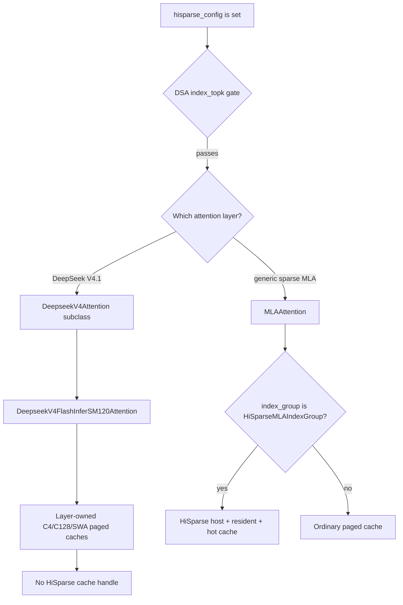

# DeepSeek-V4.1-Flash HiSparse on SM120: Compatibility Boundary

**Repositories:** `vllm-project/vllm` at commit
`02aa10539f15c8c73aa7fd4a5ee0f691cbf88dcb` (2026-10-10), the snapshot behind
the 2026-10-17 V4.1-Flash reading, and at commit
`9e8b3fb83ed4f3da1ed5376083027b14994939fc` (2026-11-25), the later HiSparse pin.  
**Inspection:** 2026-11-26; static code reading only.  
**Scope:** the decode-side coupling between DeepSeek-V4.1 attention and vLLM's
HiSparse host-resident cache on NVIDIA SM120 (compute-capability major 12).
Scheduler admission, host-pool accounting, kernel timing, and runtime
correctness are outside this page.

**Related pages:** [DeepSeek-V4.1-Flash on NVIDIA vLLM: GPU Inference Path](../v4.1-gpu-inference-path/index.md),
[DeepSeek-V4.1-Flash and HiSparse on vLLM-Ascend](../../../vllm-ascend/deepseek-v4.1-hisparse.md),
[HiSparse: Hierarchical KV Caching for Sparse-Attention Decoding](../../../hisparse/index.md),
[DeepSeek-V4.1-Flash report](../../../../../training/model-families/deepseek/deepseek-v4.1/index.md),
[vLLM hub](../../index.md).

## Bottom Line

**There is no DeepSeek-V4.1-Flash HiSparse path on SM120 in either pinned
revision.**

The reason is not the device generation. vLLM already had a HiSparse runtime at
the 1017 snapshot, and the generic SM120 sparse-MLA implementation contains
HiSparse branches. The boundary is the model layer: HiSparse is bound inside
the generic `MLAAttention` layer through a `HiSparseMLAIndexGroup`, while
DeepSeek V4.1 selects its own `DeepseekV4Attention` subclass and keeps its own
C4/C128/SWA paged caches. No V4.1 file references `hisparse` at either pin.

Enabling `hisparse_config` therefore passes the global DSA `index_topk` check but
does not change the V4.1 attention layer. At the later pin, the generic SM120
backend also explicitly reports `supports_hisparse() == False`, so even a
generic sparse-MLA DSA model is rejected on SM120 before attention runs.

> **Evidence boundary:** this is a static selector and constructor reading. No
> DeepSeek-V4.1 checkpoint, SM120 GPU, or HiSparse run was exercised.

## Mental Model: Two Different Cache Owners

HiSparse is not a kernel flag that a model inherits automatically. It is an
attention-layer contract: the layer must expose a sparse index group that can
map logical top-k positions to host, resident, and hot-cache rows. DeepSeek V4.1
does not implement that contract; it owns a different compressed-cache layout.

| Question | Generic sparse MLA | DeepSeek-V4.1 |
|---|---|---|
| Load-time attention object | `MLAAttention` plus a backend implementation | `DeepseekV4Attention` platform subclass |
| Selection state | `HiSparseMLAIndexGroup` when HiSparse is configured | DSA indexer and shared top-k buffer |
| Cache handle | `hisparse_cache` on the generic layer | Layer-owned C4/C128/SWA cache specs |
| SM120 decode class | `FlashInferMLASparseSM120Impl` | `DeepseekV4FlashInferSM120Attention` |
| HiSparse effect | host source, resident pool, and hot rows can be bound | no HiSparse binding in the V4.1 class |

The cache mechanism itself is described in the
[HiSparse paper insight](../../../hisparse/index.md): keep the complete history
in pinned host memory, keep a bounded hot working set on the device, and resolve
each sparse selection into physical device rows before attention. The V4.1 DSA
layer uses the same sparse-attention motivation, but not this cache owner.

## Revision Boundary

| Revision | Role in this question | HiSparse state |
|---|---|---|
| `02aa10539f15` (2026-10-10) | The 2026-10-17 V4.1-Flash snapshot | HiSparse runtime and SM120 generic branches exist; V4.1 never enters them |
| `9e8b3fb83ed4` (2026-11-25) | Later HiSparse pin used by the Ascend boundary page | HiSparse is described as DSA/QSA; the SM120 generic backend explicitly disables it |

Upstream vLLM already contained HiSparse at the 1017 pin. The missing piece is a
V4.1 adapter, not the offload implementation itself.

## Where the Paths Split

The editable diagram is
[hisparse-sm120-boundary.mmd](assets/hisparse-sm120-boundary.mmd).



*Synthesized explanation of the pinned selectors. The upper branch is the
DeepSeek V4.1 model layer; the lower branch is the generic sparse-MLA layer
where HiSparse is actually bound. The diagram shows ownership and branching, not
kernel launch order.*

### 1. The config gate accepts V4.1 but does not select HiSparse

At the 1017 pin, the validator only requires a DSA model with `index_topk`
<a class="code-link" href="../../../../../../external-repos/vllm-02aa10539f15/vllm/config/vllm.py#L1862" data-code-repo="vllm-02aa10539f15" data-code-path="vllm/config/vllm.py" data-code-line="1862" data-code-end-line="1867"><code>HiSparse DSA validation</code></a>:

```python
            if self.model_config is not None and not hasattr(
                self.model_config.hf_config, "index_topk"
            ):
                raise ValueError(
                    "HiSparse is only supported for DSA models with index_topk."
                )
```

DeepSeek V4.1 has `index_topk`, so this check passes
<a class="code-link" href="../../../../../../external-repos/vllm-02aa10539f15/vllm/models/deepseek_v41/attention.py#L1300" data-code-repo="vllm-02aa10539f15" data-code-path="vllm/models/deepseek_v41/attention.py" data-code-line="1300" data-code-end-line="1300"><code>V4.1 index_topk read</code></a>.
At the later pin the same shape remains, broadened to DSA and QSA
<a class="code-link" href="../../../../../../external-repos/vllm-9e8b3fb83ed4/vllm/config/vllm.py#L2031" data-code-repo="vllm-9e8b3fb83ed4" data-code-path="vllm/config/vllm.py" data-code-line="2031" data-code-end-line="2040"><code>DSA/QSA validation</code></a>,
and the config type itself documents the broader scope
<a class="code-link" href="../../../../../../external-repos/vllm-9e8b3fb83ed4/vllm/config/attention.py#L21" data-code-repo="vllm-9e8b3fb83ed4" data-code-path="vllm/config/attention.py" data-code-line="21" data-code-end-line="22"><code>HiSparseConfig</code></a>.
Passing this gate is necessary, not sufficient: it never checks that the model's
attention layer implements the HiSparse contract.

### 2. V4.1 selects a custom layer, not generic MLA

On the automatic path, the 1017 V4.1 selector maps compute-capability major 12
to `DeepseekV4FlashInferSM120Attention`
<a class="code-link" href="../../../../../../external-repos/vllm-02aa10539f15/vllm/models/deepseek_v41/nvidia/model.py#L197" data-code-repo="vllm-02aa10539f15" data-code-path="vllm/models/deepseek_v41/nvidia/model.py" data-code-line="197" data-code-end-line="243"><code>_select_dsv4_attn_cls</code></a>.
The later pin keeps the same automatic SM12 branch
<a class="code-link" href="../../../../../../external-repos/vllm-9e8b3fb83ed4/vllm/models/deepseek_v41/nvidia/model.py#L298" data-code-repo="vllm-9e8b3fb83ed4" data-code-path="vllm/models/deepseek_v41/nvidia/model.py" data-code-line="298" data-code-end-line="299"><code>SM12 selector</code></a>.
That class is a `DeepseekV4Attention` subclass
<a class="code-link" href="../../../../../../external-repos/vllm-9e8b3fb83ed4/vllm/models/deepseek_v41/nvidia/flashinfer_sparse.py#L575" data-code-repo="vllm-9e8b3fb83ed4" data-code-path="vllm/models/deepseek_v41/nvidia/flashinfer_sparse.py" data-code-line="575" data-code-end-line="580"><code>DeepseekV4FlashInferSM120Attention</code></a>,
and at the 1017 pin its backend binding is visible in the class definition
<a class="code-link" href="../../../../../../external-repos/vllm-02aa10539f15/vllm/models/deepseek_v41/nvidia/flashinfer_sparse.py#L590" data-code-repo="vllm-02aa10539f15" data-code-path="vllm/models/deepseek_v41/nvidia/flashinfer_sparse.py" data-code-line="590" data-code-end-line="595"><code>1017 SM120 attention</code></a>.

### 3. The V4.1 layer owns its own cache contract

`DeepseekV4Attention` is explicitly a separate layer that receives its
platform-specific sparse-MLA forward from a subclass; it is not the generic
`Attention`/`MLAAttention` object
<a class="code-link" href="../../../../../../external-repos/vllm-02aa10539f15/vllm/models/deepseek_v41/attention.py#L176" data-code-repo="vllm-02aa10539f15" data-code-path="vllm/models/deepseek_v41/attention.py" data-code-line="176" data-code-end-line="186"><code>V4.1 attention base</code></a>.
The later V4.1 backend base says the same thing directly: it runs through
`DeepseekV4Attention.forward`, not the generic layer, so the generic backend
implementation is never instantiated
<a class="code-link" href="../../../../../../external-repos/vllm-9e8b3fb83ed4/vllm/models/deepseek_v41/sparse_mla.py#L98" data-code-repo="vllm-9e8b3fb83ed4" data-code-path="vllm/models/deepseek_v41/sparse_mla.py" data-code-line="98" data-code-end-line="131"><code>DeepseekV4SparseMLABackend</code></a>.
This is the decisive boundary: the HiSparse cache is a field on the generic
layer, so a model that never constructs that layer never receives one.

### 4. HiSparse is attached inside generic `MLAAttention`

The generic constructor creates `hisparse_cache` only when the selected
implementation exposes a `HiSparseMLAIndexGroup`
<a class="code-link" href="../../../../../../external-repos/vllm-02aa10539f15/vllm/model_executor/layers/attention/mla_attention.py#L595" data-code-repo="vllm-02aa10539f15" data-code-path="vllm/model_executor/layers/attention/mla_attention.py" data-code-line="595" data-code-end-line="600"><code>HiSparse cache binding</code></a>.
CUDA advertises a HiSparse backend class at the platform level
<a class="code-link" href="../../../../../../external-repos/vllm-9e8b3fb83ed4/vllm/platforms/cuda.py#L274" data-code-repo="vllm-9e8b3fb83ed4" data-code-path="vllm/platforms/cuda.py" data-code-line="274" data-code-end-line="276"><code>CUDA HiSparse backend</code></a>,
but that only makes the runtime available; the model layer still has to consume
the handle.

The HiSparse kernel header names sparse MLA for GLM-5 / DeepSeek-V3.2, not the
V4.1 DSA layer
<a class="code-link" href="../../../../../../external-repos/vllm-9e8b3fb83ed4/csrc/hisparse_kernels.cu#L4" data-code-repo="vllm-9e8b3fb83ed4" data-code-path="csrc/hisparse_kernels.cu" data-code-line="4" data-code-end-line="4"><code>kernel scope</code></a>.

### 5. SM120 has the generic machinery, but it is not the V4.1 path

The 1017 generic SM120 sparse-MLA implementation does contain a
`HiSparseMLAIndexGroup` branch
<a class="code-link" href="../../../../../../external-repos/vllm-02aa10539f15/vllm/v1/attention/backends/mla/flashinfer_mla_sparse_sm120.py#L122" data-code-repo="vllm-02aa10539f15" data-code-path="vllm/v1/attention/backends/mla/flashinfer_mla_sparse_sm120.py" data-code-line="122" data-code-end-line="142"><code>1017 SM120 HiSparse branch</code></a>,
and the later implementation still carries one
<a class="code-link" href="../../../../../../external-repos/vllm-9e8b3fb83ed4/vllm/v1/attention/backends/mla/flashinfer_mla_sparse_sm120.py#L127" data-code-repo="vllm-9e8b3fb83ed4" data-code-path="vllm/v1/attention/backends/mla/flashinfer_mla_sparse_sm120.py" data-code-line="127" data-code-end-line="142"><code>current SM120 branch</code></a>.
That code is unreachable from the V4.1 selector, which uses a different class.

At the later pin the generic SM120 backend also opts out explicitly
<a class="code-link" href="../../../../../../external-repos/vllm-9e8b3fb83ed4/vllm/v1/attention/backends/mla/flashinfer_mla_sparse.py#L207" data-code-repo="vllm-9e8b3fb83ed4" data-code-path="vllm/v1/attention/backends/mla/flashinfer_mla_sparse.py" data-code-line="207" data-code-end-line="209"><code>SM120 supports_hisparse</code></a>:

```python
    @classmethod
    def supports_hisparse(cls) -> bool:
        return False
```

The default is also `False`
<a class="code-link" href="../../../../../../external-repos/vllm-9e8b3fb83ed4/vllm/v1/attention/backend.py#L229" data-code-repo="vllm-9e8b3fb83ed4" data-code-path="vllm/v1/attention/backend.py" data-code-line="229" data-code-end-line="231"><code>AttentionBackend default</code></a>,
so V4.1's backend base inherits the unsupported answer even without a direct
override.

## Compatibility Matrix

| Model and device path | 1017 snapshot | 2026-11-25 pin |
|---|---|---|
| DeepSeek-V4.1-Flash + SM120 + HiSparse | Not wired; config accepted, V4.1 layer unchanged | Not wired; same custom layer |
| DeepSeek-V4.1-Flash + SM100 + HiSparse | Not wired; the same custom-layer boundary applies | Not wired |
| Generic sparse MLA (GLM-5 / DeepSeek-V3.2) + SM120 + HiSparse | Generic branch present in the SM120 implementation | Rejected by `supports_hisparse() == False` |
| Generic sparse MLA + SM90/SM100 + HiSparse | Generic layer can bind the handle; backend eligibility still applies | Supported by the backends that opt in |
| DeepSeek-V4.1-Flash + Ascend + HiSparse | Not wired; separate SFA boundary | Not wired; see the Ascend page |

The SM120 entries are a hardware branch, not a separate HiSparse contract. Moving
the same V4.1 model to SM100 changes the kernel and record width, not the
missing V4.1 cache binding.

## Where This Insight Can Mislead

| Failure mode | Why it happens | Correct reading |
|---|---|---|
| “HiSparse supports DSA, so V4.1 DSA must use it” | The config validator and the HiSparse docstring use the DSA label, while the adapter lives in the generic MLA layer. | Follow the attention-layer constructor, not the algorithm label. |
| “The SM120 implementation contains HiSparse code, so SM120 supports it” | Latent branches remain in the implementation file even when the backend gate is false. | The backend capability method is the contract; the branch is not reachable by itself. |
| “The 1017 path predates HiSparse” | The Ascend adapter is newer than the 1017 snapshot. | Upstream vLLM already had HiSparse at the 1017 pin; V4.1 lacked the adapter. |
| “The config validator accepted the option, so HiSparse is active” | The global check only verifies `index_topk`, not the model's cache implementation. | Check that the model constructs `MLAAttention` or an equivalent HiSparse-aware layer. |

## One Thing to Remember

**HiSparse is an attention-layer integration, not an SM120 feature.** DeepSeek
V4.1's DSA layer bypasses the generic sparse-MLA cache owner at both pins, so
the SM120 path stays on its ordinary paged cache even when HiSparse is
configured.

## Reproduction Notes

The model-layer absence is a repository-wide search, not an inference from a
single selector:

```bash
git grep -n -i hisparse HEAD -- vllm/models/deepseek_v41
```

That command returns no matches at `02aa10539f15` or `9e8b3fb83ed4`. The generic
binding and the SM120 backend gate were checked with:

```bash
git grep -n 'HiSparseMLAIndexGroup' HEAD -- \
  vllm/model_executor/layers/attention \
  vllm/v1/attention/backends/mla
git grep -n 'supports_hisparse' HEAD -- vllm/v1/attention
```

## Go Deeper

- **Follow the 1017 V4.1 GPU path:** [DeepSeek-V4.1-Flash on NVIDIA vLLM: GPU Inference Path](../v4.1-gpu-inference-path/index.md).
- **Compare the Ascend boundary:** [DeepSeek-V4.1-Flash and HiSparse on vLLM-Ascend](../../../vllm-ascend/deepseek-v4.1-hisparse.md).
- **Understand the cache mechanism:** [HiSparse: Hierarchical KV Caching for Sparse-Attention Decoding](../../../hisparse/index.md).
- **Read the model report:** [DeepSeek-V4.1-Flash technical report](../../../../../training/model-families/deepseek/deepseek-v4.1/index.md).
