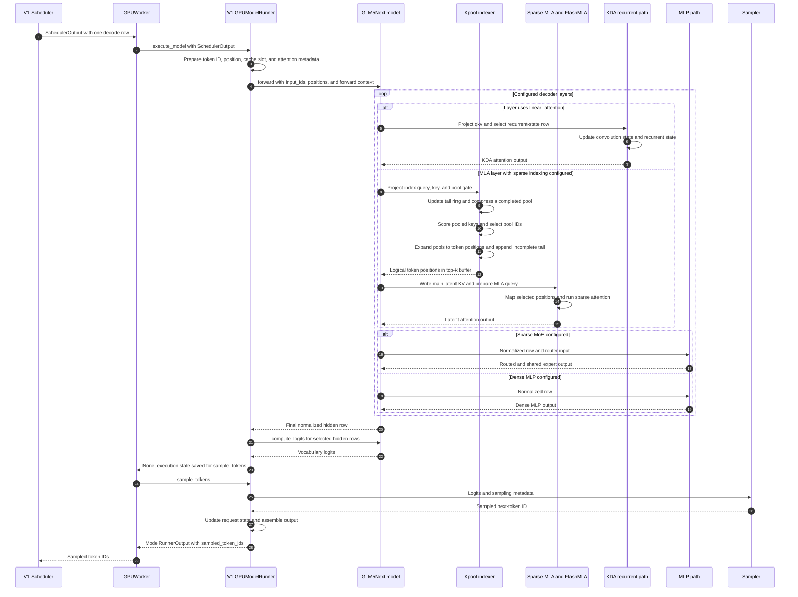

# GLM-5.3-Flash on NVIDIA vLLM: GPU Inference Path

**Model identity:** The pinned model registry maps `Glm5NextForCausalLM` to
`vllm.models.glm5next`
(<a class="code-link" href="../../../../../external-repos/vllm-02aa10539f15/vllm/model_executor/models/registry.py#L119" data-code-repo="vllm-02aa10539f15" data-code-path="vllm/model_executor/models/registry.py" data-code-line="119"><code>GLM5Next architecture route</code></a>).
It maps the separate `GlmMoeDsaForCausalLM` architecture to
`vllm.models.deepseek_v32`
(<a class="code-link" href="../../../../../external-repos/vllm-02aa10539f15/vllm/model_executor/models/registry.py#L118" data-code-repo="vllm-02aa10539f15" data-code-path="vllm/model_executor/models/registry.py" data-code-line="118"><code>GLM DSA architecture route</code></a>).
This page follows GLM5Next, whose KDA module identifies itself as the
GLM-5.3-Flash implementation
(<a class="code-link" href="../../../../../external-repos/vllm-02aa10539f15/vllm/models/glm5next/common/kda.py#L3" data-code-repo="vllm-02aa10539f15" data-code-path="vllm/models/glm5next/common/kda.py" data-code-line="3"><code>GLM-5.3-Flash KDA module</code></a>).
The exact deployed checkpoint configuration was not loaded, so the
architecture-to-checkpoint mapping and its configured layer arrays remain
unverified.

**Repository:** `vllm-project/vllm` at commit
`02aa10539f15c8c73aa7fd4a5ee0f691cbf88dcb` (GitHub origin, clean detached
checkout; source snapshot dated 2026-10-10).  
**Inspection:** 2026-10-21; static source reading only.  
**Workload and selected branch:** one text-only request whose prompt has already
been prefetched, followed by one ordinary decode row with context length greater
than `index_topk`. The example selects CUDA SM90, BF16 model activations and
main MLA cache, `attention_backend=FLASHMLA_SPARSE`, tensor parallelism 1,
pipeline parallelism 1, no context parallelism, no speculative decoding, no
async scheduling, and the V1 GPU runner. It assumes the sparse `index_topk` /
`index_kpool` configuration with tail selection enabled and the NoPE-512 MLA
layout required by this FlashMLA branch. These are branch conditions, not
claims about a checkpoint that was not loaded.  
**Boundary:** from `SchedulerOutput` entering the V1 GPU worker through the
separate `sample_tokens` call returning sampled token IDs to the engine.
Detokenization and the HTTP response are outside this worker-boundary trace.

> **Evidence boundary:** a scoped freshness check on 2026-10-21 found relevant
> upstream changes through `fc377f77714b42f706640d5857a0f2a5f233758d`, but the
> repository's 14-day promotion interval defers a new immutable revision until
> 2026-10-24. This page uses only the existing `02aa10539f15...` pin and does not
> inspect the newer candidate. No checkpoint, GPU kernel, or serving runtime
> was executed.

## TL;DR

**What:** GLM5Next is a hybrid decoder: configured `linear_attention` layers run
KDA with recurrent state, while other layers run MLA and may use the kpool
sparse indexer.

**How:** the indexer ranks compressed key pools, expands selected pool IDs back
to token positions, and lets sparse MLA read those positions from its separate,
full-resolution latent cache.

**Return:** the worker applies the LM head and sampler, then returns a sampled
token ID; the top-k positions and attention output are intermediate tensors,
not the caller-visible token.

## Mental Model

One decode row can update two kinds of durable history. A KDA layer advances a
per-request convolution and recurrent state. An MLA layer writes a per-token
latent KV record; when sparse indexing is configured, a separate, smaller
pooled-key history chooses which token records the MLA backend reads. **The
selector history chooses; the main MLA cache supplies attention state.**

> **Inference:** kpool reduces the number of index-key records that must be
> scored, but it does not remove the scoring pass over the compressed history
> or evict the full-resolution main MLA cache. No latency or throughput result
> is inferred from this implementation reading.

## Load-Time Choices and Runtime State

The architecture name resolves before model construction; the text config then
chooses the layer type, sparse-indexer presence, and feed-forward path. At
runtime, the scheduler supplies token rows and cache slots, the layer writes
its state, and the runner later samples from the final hidden row.

| Decision | Owner | Consequence |
|---|---|---|
| `Glm5NextForCausalLM` versus `GlmMoeDsaForCausalLM` | Model registry | Selects GLM5Next rather than the separate `deepseek_v32` implementation. |
| KDA versus MLA per decoder layer | `layer_types` in the text config | A `linear_attention` layer constructs `Glm5NextLinearAttention`; other layers construct `Glm5NextMLAAttention` (<a class="code-link" href="../../../../../external-repos/vllm-02aa10539f15/vllm/models/glm5next/common/model.py#L345" data-code-repo="vllm-02aa10539f15" data-code-path="vllm/models/glm5next/common/model.py" data-code-line="345"><code>decoder-layer construction</code></a>). |
| Sparse indexer present or absent | `index_topk` and `index_kpool` | Sparse mode allocates one model-level `int32` top-k buffer; a config without `index_topk` follows full MLA instead (<a class="code-link" href="../../../../../external-repos/vllm-02aa10539f15/vllm/models/glm5next/common/model.py#L701" data-code-repo="vllm-02aa10539f15" data-code-path="vllm/models/glm5next/common/model.py" data-code-line="701"><code>sparse-buffer branch</code></a>). |
| MoE versus dense MLP | `n_routed_experts` and `mlp_layer_types` | Sparse MLP layers construct `Glm5NextMoE`; otherwise the decoder uses `Glm5NextMLP` (<a class="code-link" href="../../../../../external-repos/vllm-02aa10539f15/vllm/models/glm5next/common/model.py#L317" data-code-repo="vllm-02aa10539f15" data-code-path="vllm/models/glm5next/common/model.py" data-code-line="317"><code>MoE forward</code></a>). |
| Whether the kpool tail is retained | Sparse config validation | Sparse indexing requires `index_kpool_always_select_tail=True`; unsupported configs raise during model construction rather than silently dropping the incomplete pool (<a class="code-link" href="../../../../../external-repos/vllm-02aa10539f15/vllm/models/glm5next/common/model.py#L144" data-code-repo="vllm-02aa10539f15" data-code-path="vllm/models/glm5next/common/model.py" data-code-line="144"><code>supported-config gate</code></a>). |

The selected example sets PP to 1. The pinned model code comments that its
multi-stage PP path is gated off because it lacks the required
`make_empty_intermediate_tensors` implementation. The layer arrays, `mHC`
setting, MoE expert count, `index_topk`, and `index_kpool` must be read from the
deployed checkpoint before treating any one branch as its actual configuration.

## State Stores and Coordinate Spaces

These stores have different owners and consumers. **Only the main MLA cache is
the token-addressable attention history; the indexer caches are search state.**

| Store | Owner and record | Writer and reader | Lifetime and accounting |
|---|---|---|---|
| Main MLA latent KV | `MLAAttentionSpec` stores one latent state per token, with `head_size = kv_lora_rank + qk_rope_head_dim` (<a class="code-link" href="../../../../../external-repos/vllm-02aa10539f15/vllm/model_executor/layers/attention/mla_attention.py#L1350" data-code-repo="vllm-02aa10539f15" data-code-path="vllm/model_executor/layers/attention/mla_attention.py" data-code-line="1350"><code>MLA cache spec</code></a>). MLA stores one latent vector, not independent K and V records. | `MLAAttention.update_kv_cache` writes `kv_c_normed` and `k_pe` at the scheduled slot; the sparse MLA backend reads selected rows (<a class="code-link" href="../../../../../external-repos/vllm-02aa10539f15/vllm/model_executor/layers/attention/mla_attention.py#L769" data-code-repo="vllm-02aa10539f15" data-code-path="vllm/model_executor/layers/attention/mla_attention.py" data-code-line="769"><code>main-cache update</code></a>). | Full per-token latent history. For the selected NoPE-512 BF16 example this is 512 BF16 values, or 1,024 payload bytes per token per MLA cache owner, before page padding. |
| Pooled index K | `Glm5NextIndexerCache` sets `tokens_per_state = index_kpool` (<a class="code-link" href="../../../../../external-repos/vllm-02aa10539f15/vllm/models/glm5next/common/attention.py#L112" data-code-repo="vllm-02aa10539f15" data-code-path="vllm/models/glm5next/common/attention.py" data-code-line="112"><code>pooled-key cache spec</code></a>). Its uint8 record is 128 FP8 values plus a 4-byte scale in this implementation, 132 bytes per pooled state (<a class="code-link" href="../../../../../external-repos/vllm-02aa10539f15/vllm/models/glm5next/common/attention.py#L261" data-code-repo="vllm-02aa10539f15" data-code-path="vllm/models/glm5next/common/attention.py" data-code-line="261"><code>index-cache record width</code></a>). | The indexer writes completed pools; paged MQA scoring reads them to rank history. | One index record per `P = index_kpool` model tokens. The `132/P` byte amortization applies only to this logical payload, before page padding and excluding all other stores. |
| Incomplete-pool tail ring | `Glm5NextTailCache` stores raw BF16 K and gate-score vectors in two 128-wide slots per ring position, or 512 payload bytes per slot (<a class="code-link" href="../../../../../external-repos/vllm-02aa10539f15/vllm/models/glm5next/common/attention.py#L156" data-code-repo="vllm-02aa10539f15" data-code-path="vllm/models/glm5next/common/attention.py" data-code-line="156"><code>tail-ring spec</code></a>). | Decode stashes each raw token here; the pool-compression kernel reads the ring when the group completes. | One circular block per request. Ring capacity depends on `index_kpool` and speculative lookahead; it is not a second attention-value cache. |
| KDA state | `MambaSpec` describes separate convolution and recurrent tensors; shape and dtype are derived from TP size, linear heads, head width, convolution width, model dtype, and Mamba cache dtype (<a class="code-link" href="../../../../../external-repos/vllm-02aa10539f15/vllm/models/glm5next/common/kda.py#L168" data-code-repo="vllm-02aa10539f15" data-code-path="vllm/models/glm5next/common/kda.py" data-code-line="168"><code>KDA cache spec</code></a>, <a class="code-link" href="../../../../../external-repos/vllm-02aa10539f15/vllm/models/glm5next/common/kda.py#L187" data-code-repo="vllm-02aa10539f15" data-code-path="vllm/models/glm5next/common/kda.py" data-code-line="187"><code>KDA state shape</code></a>). | The causal convolution and recurrent KDA operation read and update their request state. | Per KDA layer and request, not one K/V record per token. Exact bytes depend on the unloaded checkpoint and cache dtype. |
| Top-k scratch | A model-level `int32` buffer with one row per maximum batched token and width `round_up(index_topk + index_kpool - 1, 128)` (<a class="code-link" href="../../../../../external-repos/vllm-02aa10539f15/vllm/models/glm5next/common/model.py#L708" data-code-repo="vllm-02aa10539f15" data-code-path="vllm/models/glm5next/common/model.py" data-code-line="708"><code>top-k buffer allocation</code></a>). | Each sparse MLA indexer writes its current layer's logical token positions; that layer's MLA backend consumes them before the buffer is reused. | Per-batch scratch, not durable state, cache values, or sampled IDs. |

Let `P = index_kpool`, `K = index_topk`, `B = block_size` in token slots, and
`S = block_stride_rows` in the flat MLA cache view. A token position `p` belongs
to pooled-key group `g = floor(p / P)`. The indexer scores in group units,
selects `K / P` groups, expands each selected group to token positions
`gP ... gP + P - 1`, and appends the incomplete trailing group. The expansion
kernel computes those token IDs and the tail range
`[floor(L / P)P, L)` for token length `L`
(<a class="code-link" href="../../../../../external-repos/vllm-02aa10539f15/vllm/models/glm5next/nvidia/ops/kpool_compress.py#L882" data-code-repo="vllm-02aa10539f15" data-code-path="vllm/models/glm5next/nvidia/ops/kpool_compress.py" data-code-line="882"><code>pool-to-token expansion</code></a>).

Those results are **logical token positions**, not physical cache rows. The
FlashMLA decode path maps token `t` for request `r` through its block table:
`block_table[r, floor(t / B)] * S + (t mod B)`. The pinned conversion helper
documents this request-relative-to-global mapping
(<a class="code-link" href="../../../../../external-repos/vllm-02aa10539f15/vllm/v1/attention/backends/mla/sparse_utils.py#L462" data-code-repo="vllm-02aa10539f15" data-code-path="vllm/v1/attention/backends/mla/sparse_utils.py" data-code-line="462"><code>request-index to physical-row conversion</code></a>).
The selected indices therefore address the full-resolution MLA cache; they do
not address the pooled-key values as attention values.

## Backend Choices and Failure Conditions

The name “Flash” is not itself a kernel selector. In this example the main
sparse MLA backend is **explicitly** set to `FLASHMLA_SPARSE`; its construction
and eligibility checks are separate from the automatic backend selector
(<a class="code-link" href="../../../../../external-repos/vllm-02aa10539f15/vllm/model_executor/layers/attention/mla_attention.py#L513" data-code-repo="vllm-02aa10539f15" data-code-path="vllm/model_executor/layers/attention/mla_attention.py" data-code-line="513"><code>MLA backend selection</code></a>,
<a class="code-link" href="../../../../../external-repos/vllm-02aa10539f15/vllm/v1/attention/selector.py#L105" data-code-repo="vllm-02aa10539f15" data-code-path="vllm/v1/attention/selector.py" data-code-line="105"><code>automatic/platform selector</code></a>).

| Choice | Gate in this pin | What this page claims |
|---|---|---|
| Explicit `FLASHMLA_SPARSE` for the traced decode | The backend supports BF16 and sparse MLA. Its 512-wide head case is accepted only for the NoPE layout on SM90 with a compatible BF16 or `fp8_ds_mla` cache; block size must satisfy the backend's page constraint (<a class="code-link" href="../../../../../external-repos/vllm-02aa10539f15/vllm/v1/attention/backends/mla/flashmla_sparse.py#L147" data-code-repo="vllm-02aa10539f15" data-code-path="vllm/v1/attention/backends/mla/flashmla_sparse.py" data-code-line="147"><code>FlashMLA sparse backend</code></a>, <a class="code-link" href="../../../../../external-repos/vllm-02aa10539f15/vllm/v1/attention/backends/mla/flashmla_sparse.py#L207" data-code-repo="vllm-02aa10539f15" data-code-path="vllm/v1/attention/backends/mla/flashmla_sparse.py" data-code-line="207"><code>NoPE-512 support gate</code></a>). The co-located indexer cache also constrains block size to a supported multiple of `index_kpool`. | The selected code branch reaches the BF16 sparse FlashMLA kernel. This is an explicitly selected, eligible example, not a claim that all devices or model configs select it automatically. |
| `attention_backend=auto` | The selector receives head size, dtype, cache dtype, block size, sparse/MLA flags, and attention configuration before delegating to the platform. | The winner is configuration- and dependency-dependent. The code comment says the 512-wide NoPE FlashMLA path must give way to FlashInfer/Triton on non-SM90 devices; this page does not assert which alternative wins there. |
| `sparse_indexer_topk_backend=auto` | CUDA top-k resolves among cooperative, persistent, and per-row paths using top-k width, row count, and logits layout (<a class="code-link" href="../../../../../external-repos/vllm-02aa10539f15/vllm/model_executor/layers/indexer_topk.py#L239" data-code-repo="vllm-02aa10539f15" data-code-path="vllm/model_executor/layers/indexer_topk.py" data-code-line="239"><code>top-k auto priority</code></a>). | The selected top-k microkernel cannot be named without the runtime logits shape and device. It still returns pool IDs, not attention output. |
| KDA prefill `auto` | FlashKDA requires CUDA SM90/SM10x/SM12x, BF16, `head_dim=128`, and a bounded gate; otherwise the prefill path uses Triton. Explicit unsupported FlashKDA raises (<a class="code-link" href="../../../../../external-repos/vllm-02aa10539f15/vllm/models/glm5next/common/kda.py#L137" data-code-repo="vllm-02aa10539f15" data-code-path="vllm/models/glm5next/common/kda.py" data-code-line="137"><code>KDA prefill backend gate</code></a>). | This concerns prefill only. The selected ordinary decode uses the recurrent KDA path below. |
| Short decode or full-MLA config | If `index_topk` is absent, no sparse index buffer is allocated. When the causal context fits within `index_topk`, CUDA fills all causal positions instead of scoring the pool cache (<a class="code-link" href="../../../../../external-repos/vllm-02aa10539f15/vllm/models/glm5next/nvidia/sparse_indexer.py#L529" data-code-repo="vllm-02aa10539f15" data-code-path="vllm/models/glm5next/nvidia/sparse_indexer.py" data-code-line="529"><code>short-decode causal-index path</code></a>). | Neither case follows the long-context sparse-scoring branch used for the worked decode row. |
| Missing required setup | CUDA sparse-indexer construction requires DeepGEMM; sparse configs with `index_kpool_always_select_tail=False` are rejected. | These are initialization gates, not silent fallback paths (<a class="code-link" href="../../../../../external-repos/vllm-02aa10539f15/vllm/models/glm5next/nvidia/sparse_indexer.py#L661" data-code-repo="vllm-02aa10539f15" data-code-path="vllm/models/glm5next/nvidia/sparse_indexer.py" data-code-line="661"><code>CUDA indexer dependency gate</code></a>). |

## One Decode Row: Request Round Trip

The sequence diagram follows one already-prefetched request through the V1
worker boundary. It shows the configured KDA-versus-MLA layer branch and the
sampled-token return; **it does not claim the diagram was captured from a live
GPU run**.

[Editable Mermaid source](assets/request-round-trip.mmd)

Read left to right: the scheduler hands scheduled work to the V1 worker; the
runner builds positions, slots, and metadata; each decoder layer chooses its
configured attention path; the final hidden row becomes logits and then a
sampled token ID. In the MLA branch, the pool IDs are expanded and remapped
before the sparse kernel reads the main cache. In the KDA branch, the
convolution and recurrent state are updated instead. The worker returns token
IDs, not detokenized text.

1. **Schedule one decode row.** The scheduler emits a `SchedulerOutput` with
   per-request scheduled-token counts and block-management state
   (<a class="code-link" href="../../../../../external-repos/vllm-02aa10539f15/vllm/v1/core/sched/scheduler.py#L1500" data-code-repo="vllm-02aa10539f15" data-code-path="vllm/v1/core/sched/scheduler.py" data-code-line="1500"><code>SchedulerOutput construction</code></a>).
   The example starts after prompt prefill, so the KDA and paged-cache histories
   are already populated.

2. **Materialize the GPU row.** With `use_v2_model_runner=False`,
   `GPUWorker._make_model_runner` selects the V1 runner
   (<a class="code-link" href="../../../../../external-repos/vllm-02aa10539f15/vllm/v1/worker/gpu_worker.py#L542" data-code-repo="vllm-02aa10539f15" data-code-path="vllm/v1/worker/gpu_worker.py" data-code-line="542"><code>V1/V2 runner branch</code></a>).
   `_prepare_inputs` forms `positions = num_computed_tokens + query_pos` and
   gathers the scheduled token IDs
   (<a class="code-link" href="../../../../../external-repos/vllm-02aa10539f15/vllm/v1/worker/gpu_model_runner.py#L1943" data-code-repo="vllm-02aa10539f15" data-code-path="vllm/v1/worker/gpu_model_runner.py" data-code-line="1943"><code>scheduled input and position preparation</code></a>).
   `_get_slot_mappings` maps the row to a physical cache slot, while
   `_build_attention_metadata` supplies per-layer attention metadata and block
   tables
   (<a class="code-link" href="../../../../../external-repos/vllm-02aa10539f15/vllm/v1/worker/gpu_model_runner.py#L4024" data-code-repo="vllm-02aa10539f15" data-code-path="vllm/v1/worker/gpu_model_runner.py" data-code-line="4024"><code>cache slot mapping</code></a>,
   <a class="code-link" href="../../../../../external-repos/vllm-02aa10539f15/vllm/v1/worker/gpu_model_runner.py#L2272" data-code-repo="vllm-02aa10539f15" data-code-path="vllm/v1/worker/gpu_model_runner.py" data-code-line="2272"><code>attention metadata builder</code></a>).

3. **Resolve and enter GLM5Next.** `GPUModelRunner.execute_model` installs
   attention metadata and slot mappings in the forward context before invoking
   the model
   (<a class="code-link" href="../../../../../external-repos/vllm-02aa10539f15/vllm/v1/worker/gpu_model_runner.py#L4108" data-code-repo="vllm-02aa10539f15" data-code-path="vllm/v1/worker/gpu_model_runner.py" data-code-line="4108"><code>V1 GPUModelRunner.execute_model</code></a>).
   `Glm5NextModel.forward` embeds the row and iterates the configured decoder
   layers before applying the final norm
   (<a class="code-link" href="../../../../../external-repos/vllm-02aa10539f15/vllm/models/glm5next/common/model.py#L793" data-code-repo="vllm-02aa10539f15" data-code-path="vllm/models/glm5next/common/model.py" data-code-line="793"><code>GLM5Next model forward</code></a>).
   The code does not expose the checkpoint's layer indices here, so the next
   two steps describe conditional per-layer branches rather than inventing a
   layer pattern.

4. **KDA layer, when configured.** A `linear_attention` layer reads its
   request's convolution and recurrent state. The decode path updates the short
   convolution state, then calls the fused recurrent operation with the
   recurrent-state indices and
   <a class="code-link" href="../../../../../external-repos/vllm-02aa10539f15/vllm/models/glm5next/common/kda.py#L333" data-code-repo="vllm-02aa10539f15" data-code-path="vllm/models/glm5next/common/kda.py" data-code-line="333"><code>bounded sigmoid gate</code></a>;
   the NVIDIA wrapper launches its
   recurrent Triton kernel
   (<a class="code-link" href="../../../../../external-repos/vllm-02aa10539f15/vllm/models/glm5next/common/kda.py#L640" data-code-repo="vllm-02aa10539f15" data-code-path="vllm/models/glm5next/common/kda.py" data-code-line="640"><code>KDA convolution-state update</code></a>,
   <a class="code-link" href="../../../../../external-repos/vllm-02aa10539f15/vllm/models/glm5next/common/kda.py#L758" data-code-repo="vllm-02aa10539f15" data-code-path="vllm/models/glm5next/common/kda.py" data-code-line="758"><code>ordinary decode recurrent update</code></a>,
   <a class="code-link" href="../../../../../external-repos/vllm-02aa10539f15/vllm/models/glm5next/nvidia/ops/third_party/kda/kernels.py#L101" data-code-repo="vllm-02aa10539f15" data-code-path="vllm/models/glm5next/nvidia/ops/third_party/kda/kernels.py" data-code-line="101"><code>NVIDIA recurrent kernel launch</code></a>).
   The returned tensor is the layer's KDA output; the in-place state is retained
   for the request's next token.

5. **Sparse MLA indexer, when configured.** The MLA wrapper runs the indexer
   before attention
   (<a class="code-link" href="../../../../../external-repos/vllm-02aa10539f15/vllm/model_executor/layers/mla.py#L235" data-code-repo="vllm-02aa10539f15" data-code-path="vllm/model_executor/layers/mla.py" data-code-line="235"><code>indexer completion and logical-top-k ready event</code></a>).
   Its
   <a class="code-link" href="../../../../../external-repos/vllm-02aa10539f15/vllm/models/glm5next/common/attention.py#L297" data-code-repo="vllm-02aa10539f15" data-code-path="vllm/models/glm5next/common/attention.py" data-code-line="297"><code>Indexer.forward</code></a>
   forms the query, key, weights, and pool gate. On an ordinary decode row, the
   indexer updates the tail ring and writes a completed pooled key when the
   pool boundary is reached; the CUDA
   <a class="code-link" href="../../../../../external-repos/vllm-02aa10539f15/vllm/models/glm5next/nvidia/ops/kpool_compress.py#L457" data-code-repo="vllm-02aa10539f15" data-code-path="vllm/models/glm5next/nvidia/ops/kpool_compress.py" data-code-line="457"><code>batched tail-update kernel</code></a>
   then allows the indexer to score the paged
   pooled-key cache, dispatches top-k, and expands pool IDs into logical token
   positions
   (<a class="code-link" href="../../../../../external-repos/vllm-02aa10539f15/vllm/models/glm5next/nvidia/sparse_indexer.py#L516" data-code-repo="vllm-02aa10539f15" data-code-path="vllm/models/glm5next/nvidia/sparse_indexer.py" data-code-line="516"><code>decode tail update and pool write</code></a>,
   <a class="code-link" href="../../../../../external-repos/vllm-02aa10539f15/vllm/models/glm5next/nvidia/sparse_indexer.py#L582" data-code-repo="vllm-02aa10539f15" data-code-path="vllm/models/glm5next/nvidia/sparse_indexer.py" data-code-line="582"><code>paged pool-key scoring</code></a>,
   <a class="code-link" href="../../../../../external-repos/vllm-02aa10539f15/vllm/models/glm5next/nvidia/sparse_indexer.py#L609" data-code-repo="vllm-02aa10539f15" data-code-path="vllm/models/glm5next/nvidia/sparse_indexer.py" data-code-line="609"><code>top-k dispatch</code></a>,
   <a class="code-link" href="../../../../../external-repos/vllm-02aa10539f15/vllm/models/glm5next/nvidia/sparse_indexer.py#L646" data-code-repo="vllm-02aa10539f15" data-code-path="vllm/models/glm5next/nvidia/sparse_indexer.py" data-code-line="646"><code>expanded token positions</code></a>).
   This path requires DeepGEMM on CUDA
   (<a class="code-link" href="../../../../../external-repos/vllm-02aa10539f15/vllm/models/glm5next/nvidia/sparse_indexer.py#L661" data-code-repo="vllm-02aa10539f15" data-code-path="vllm/models/glm5next/nvidia/sparse_indexer.py" data-code-line="661"><code>sparse-indexer dependency gate</code></a>).

6. **Sparse MLA reads the main cache.** Before attention, `MLAAttention`
   writes the normalized latent K/V state and positional key (empty in the
   selected NoPE case) using the scheduler-provided slot mapping; the generic
   implementation calls `concat_and_cache_mla`
   (<a class="code-link" href="../../../../../external-repos/vllm-02aa10539f15/vllm/model_executor/layers/attention/mla_attention.py#L769" data-code-repo="vllm-02aa10539f15" data-code-path="vllm/model_executor/layers/attention/mla_attention.py" data-code-line="769"><code>MLA slot-mapped write</code></a>,
   <a class="code-link" href="../../../../../external-repos/vllm-02aa10539f15/vllm/v1/attention/backend.py#L1105" data-code-repo="vllm-02aa10539f15" data-code-path="vllm/v1/attention/backend.py" data-code-line="1105"><code>concat-and-cache implementation</code></a>).
   The decode path absorbs the NoPE query into latent-key space, then
   `FlashMLASparseImpl` remaps logical token positions to physical cache rows
   and calls `flash_mla_sparse_fwd`; the latent output is projected back through
   the value-up and output projections
   (<a class="code-link" href="../../../../../external-repos/vllm-02aa10539f15/vllm/model_executor/layers/attention/mla_attention.py#L1071" data-code-repo="vllm-02aa10539f15" data-code-path="vllm/model_executor/layers/attention/mla_attention.py" data-code-line="1071"><code>NoPE query absorption</code></a>,
   <a class="code-link" href="../../../../../external-repos/vllm-02aa10539f15/vllm/v1/attention/backends/mla/flashmla_sparse.py#L844" data-code-repo="vllm-02aa10539f15" data-code-path="vllm/v1/attention/backends/mla/flashmla_sparse.py" data-code-line="844"><code>BF16 sparse decode remap</code></a>,
   <a class="code-link" href="../../../../../external-repos/vllm-02aa10539f15/vllm/v1/attention/backends/mla/flashmla_sparse.py#L1388" data-code-repo="vllm-02aa10539f15" data-code-path="vllm/v1/attention/backends/mla/flashmla_sparse.py" data-code-line="1388"><code>FlashMLA sparse kernel call</code></a>,
   <a class="code-link" href="../../../../../external-repos/vllm-02aa10539f15/vllm/model_executor/layers/attention/mla_attention.py#L1381" data-code-repo="vllm-02aa10539f15" data-code-path="vllm/model_executor/layers/attention/mla_attention.py" data-code-line="1381"><code>latent value-up projection</code></a>).

   The logical-to-physical remap is staged on a side stream. The logical-ready
   event follows the indexer write; the physical-ready event is waited on before
   the attention consumer uses the remapped rows
   (<a class="code-link" href="../../../../../external-repos/vllm-02aa10539f15/vllm/v1/attention/backends/mla/index_group.py#L142" data-code-repo="vllm-02aa10539f15" data-code-path="vllm/v1/attention/backends/mla/index_group.py" data-code-line="142"><code>logical-ready wait and side-stream conversion</code></a>,
   <a class="code-link" href="../../../../../external-repos/vllm-02aa10539f15/vllm/v1/attention/backends/mla/index_group.py#L160" data-code-repo="vllm-02aa10539f15" data-code-path="vllm/v1/attention/backends/mla/index_group.py" data-code-line="160"><code>physical-ready consumer wait</code></a>).
   This ordering allows the conversion to overlap independent cache/query
   preparation; no runtime overlap or speedup was measured.

7. **Residual and feed-forward output.** The layer applies the config-selected
   plain residual or mHC path, then the configured dense MLP or routed/shared
   MoE, before the next layer. The final model layer applies its normalization
   and returns the hidden row
   (<a class="code-link" href="../../../../../external-repos/vllm-02aa10539f15/vllm/models/glm5next/common/model.py#L518" data-code-repo="vllm-02aa10539f15" data-code-path="vllm/models/glm5next/common/model.py" data-code-line="518"><code>decoder residual and MLP path</code></a>,
   <a class="code-link" href="../../../../../external-repos/vllm-02aa10539f15/vllm/models/glm5next/common/model.py#L317" data-code-repo="vllm-02aa10539f15" data-code-path="vllm/models/glm5next/common/model.py" data-code-line="317"><code>MoE execution wrapper</code></a>,
   <a class="code-link" href="../../../../../external-repos/vllm-02aa10539f15/vllm/models/glm5next/common/model.py#L793" data-code-repo="vllm-02aa10539f15" data-code-path="vllm/models/glm5next/common/model.py" data-code-line="793"><code>final model norm and return</code></a>).
   The exact expert kernel and residual branch depend on config, quantization,
   and parallel settings, so neither is named as a universal default here.

8. **Logits, sample, and return.** The runner selects the hidden row requested
   for sampling and calls `compute_logits`; the model applies its LM head and
   logits processor
   (<a class="code-link" href="../../../../../external-repos/vllm-02aa10539f15/vllm/v1/worker/gpu_model_runner.py#L4421" data-code-repo="vllm-02aa10539f15" data-code-path="vllm/v1/worker/gpu_model_runner.py" data-code-line="4421"><code>runner logits call</code></a>,
   <a class="code-link" href="../../../../../external-repos/vllm-02aa10539f15/vllm/models/glm5next/common/model.py#L1126" data-code-repo="vllm-02aa10539f15" data-code-path="vllm/models/glm5next/common/model.py" data-code-line="1126"><code>GLM5Next LM head</code></a>).
   `execute_model` stores this state and returns `None`; the separate
   `sample_tokens` call samples one ID, updates request bookkeeping, and wraps
   the IDs in `ModelRunnerOutput` for the worker caller
   (<a class="code-link" href="../../../../../external-repos/vllm-02aa10539f15/vllm/v1/worker/gpu_model_runner.py#L4446" data-code-repo="vllm-02aa10539f15" data-code-path="vllm/v1/worker/gpu_model_runner.py" data-code-line="4446"><code>saved execution state</code></a>,
   <a class="code-link" href="../../../../../external-repos/vllm-02aa10539f15/vllm/v1/worker/gpu_model_runner.py#L3617" data-code-repo="vllm-02aa10539f15" data-code-path="vllm/v1/worker/gpu_model_runner.py" data-code-line="3617"><code>ordinary sampler call</code></a>,
   <a class="code-link" href="../../../../../external-repos/vllm-02aa10539f15/vllm/v1/worker/gpu_model_runner.py#L4483" data-code-repo="vllm-02aa10539f15" data-code-path="vllm/v1/worker/gpu_model_runner.py" data-code-line="4483"><code>sample_tokens phase</code></a>,
   <a class="code-link" href="../../../../../external-repos/vllm-02aa10539f15/vllm/v1/worker/gpu_model_runner.py#L4698" data-code-repo="vllm-02aa10539f15" data-code-path="vllm/v1/worker/gpu_model_runner.py" data-code-line="4698"><code>ModelRunnerOutput assembly</code></a>,
   <a class="code-link" href="../../../../../external-repos/vllm-02aa10539f15/vllm/v1/worker/gpu_worker.py#L1260" data-code-repo="vllm-02aa10539f15" data-code-path="vllm/v1/worker/gpu_worker.py" data-code-line="1260"><code>worker sampled-token return</code></a>).
   If async scheduling is enabled, the worker may return an async output wrapper;
   this example disables it. Text detokenization is later in the serving stack.

## What Changes on Other Branches

| Condition | Path change or limit |
|---|---|
| `index_topk` is absent | The model allocates no sparse top-k buffer and constructs full MLA rather than the kpool selector path. |
| Decode context length is at most `index_topk` | CUDA fills all causal token positions and returns before paged pool scoring; the example deliberately uses a longer context. |
| Prefill rows are present | MLA separates prefill and decode. Sparse prefill may use dense MHA when the context fits the top-k budget, masked MHA when the backend/workspace permit it, or sparse MQA; do not project the one-token decode kernel onto prefill (<a class="code-link" href="../../../../../external-repos/vllm-02aa10539f15/vllm/model_executor/layers/attention/mla_attention.py#L884" data-code-repo="vllm-02aa10539f15" data-code-path="vllm/model_executor/layers/attention/mla_attention.py" data-code-line="884"><code>prefill/decode dispatch</code></a>). |
| SM100/SM120 uses the same NoPE-512 cache layout | The shared `FLASHMLA_SPARSE` 512-head combination is not eligible there; automatic selection must consider other installed backends, and explicitly forcing an ineligible backend is not a promise of fallback. |
| KDA layer is in prefill rather than decode | The `kda_prefill_backend` gate decides FlashKDA versus Triton; it does not choose the ordinary decode recurrent kernel. |
| MTP, DCP/PCP, PP, multimodal inputs, or expert quantization differs | Additional cache/state, metadata, and backend branches may run. They are outside the concrete one-row example and require the deployed config and launch flags. |

## Verification Boundary

The source checkout was clean and detached at the cited SHA. The model registry,
layer construction, cache specs, backend gates, cache writes/reads, and worker
return path above are **static code evidence**. No released checkpoint config
or weights were loaded, no GPU kernel was run, and no latency or memory
benchmark was measured. The example therefore does not establish the deployed
values of `index_topk`, `index_kpool`, `layer_types`, `mlp_layer_types`,
`mHC`, cache block size, cache dtype, or the backend selected under `auto`.

## One Thing to Remember

**Keep the histories separate:** KDA advances recurrent state, kpool keys rank
candidate tokens, and MLA's full latent cache supplies the selected attention
records. The top-k buffer only bridges those stores; the worker's sampled token
ID is a different object entirely.

## Go Deeper

- **Understand the neighboring GLM path:** [GLM-5.2 on vLLM](../glm-5.2-inference-path.md) follows its own architecture registration through the request/API boundary and sparse MLA.
- **Understand the MoE path:** [GLM-5.1 on vLLM](../glm-5.1-expert-parallel/index.md) focuses on expert-parallel routing and dispatch.
- **Compare sparse MLA implementations:** [DeepSeek-V4.1-Flash on NVIDIA vLLM](../deepseek/v4.1-gpu-inference-path/index.md) is a different model path; its cache roles and layer pattern are not GLM-5.3-Flash facts.
- **Navigate the serving code:** [vLLM hub](../index.md).
