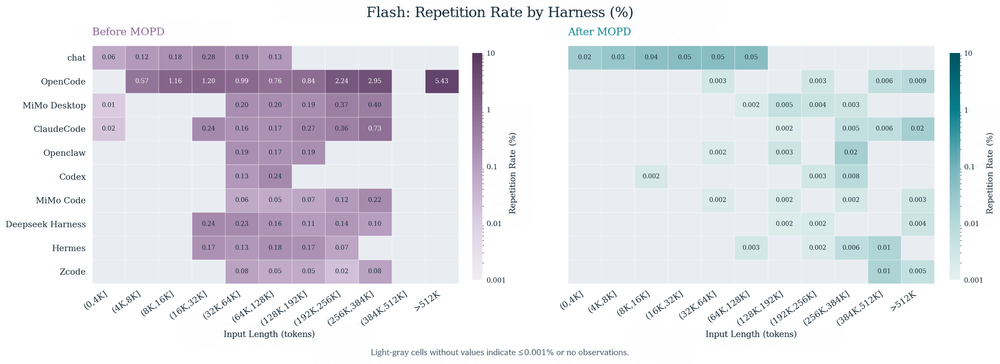
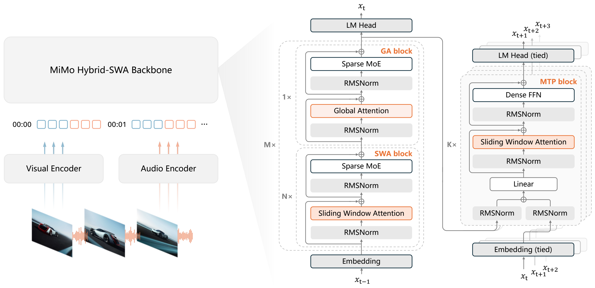

# MiMo-V2.6-Flash-MOPD: vLLM Inference and Deployment

**Model:** [XiaomiMiMo/MiMo-V2.6-Flash-MOPD](https://huggingface.co/XiaomiMiMo/MiMo-V2.6-Flash-MOPD)  
**vLLM recipe:** [MiMo-V2.6-Flash-RL on vLLM](https://recipes.vllm.ai/XiaomiMiMo/MiMo-V2.6-Flash-RL) — this family recipe selects MOPD by default and its launch command targets that checkpoint.  
**Related pages:** [MiMo-V2.6-Pro-MOPD deployment](mimo-v2-6-pro-mopd-deployment.md), [vLLM](index.md), [vLLM data-parallel deployment](data-parallel-deployment/index.md), [Mixture of Experts](../../../terms/mixture-of-experts.md), and [KV Cache](../../../terms/kv-cache.md).

The Xiaomi model card and vLLM recipe were captured on 2026-10-10; the recipe
reports an update on 2026-10-07. These are source-backed deployment profiles,
not a local GPU test. No checkpoint was loaded or benchmarked for this page.

## TL;DR

**What:** Flash-MOPD is the MOPD2-distilled 309B-total / 15B-active Flash
checkpoint, and Xiaomi targets it at reducing repeated tool calls.

**How:** The vLLM recipe uses vLLM 0.31.0+, an H200 TP4 reference launch, MiMo
reasoning/tool parsers, and the `vllm` generation config.

**The deployment constraint:** The recipe estimates 173 GB of MXFP4 checkpoint
weights and at least 208 GB of aggregate VRAM; the 1M-token context is a
maximum, not a promise of 1M-token concurrency.

## Why the MOPD Variant



*Source: [Xiaomi's Flash-MOPD model card](https://huggingface.co/XiaomiMiMo/MiMo-V2.6-Flash-MOPD/blob/main/assets/mimo-repetition-rate-flash-en.png). The chart compares the Flash RL-stage checkpoint with Flash-MOPD across agent harnesses and input lengths. Displayed values are lower after MOPD; light-gray cells mean “≤0.001% or no observations,” not confirmed zero repetition.*

The model card calls Flash-MOPD an upgrade to Flash-RL, and the vLLM recipe
recommends MOPD for new deployments. The recipe also notes that tool-call
repetition was more pronounced in the Flash line than in the Pro line. This
behavior motivates the checkpoint choice; it does not change the inference
flags.

## Model Shape and Memory



*Source: [Xiaomi's Flash-MOPD model card](https://huggingface.co/XiaomiMiMo/MiMo-V2.6-Flash-MOPD/blob/main/assets/architecture.png). ① Vision and audio encoders feed the multimodal backbone. ② The 48-layer backbone combines sliding-window and global attention with sparse experts. ③ The model includes an MTP drafter; enabling DFlash in vLLM requires a separate speculative config.*

| Serving property | Flash-MOPD configuration | Operational meaning |
|---|---|---|
| Sparse core | 309B total / 15B active parameters; 48 layers, 256 routed experts, top-8 | Active compute is not the amount of checkpoint weight memory that must be resident. |
| Layer recipe | 1 dense layer plus 47 MoE layers; 39 sliding-window and 9 global-attention layers; window 128 | The checkpoint is hybrid attention, not a dense-only Transformer. |
| Context and inputs | Up to 1,048,576 tokens; text, image, video, and audio | Keep the recipe's `--max-model-len auto` as the starting point and test each required modality. |
| Weight and compute format | MXFP4-stored weights; FP8 block-wise e4m3 compute (128 × 128); 173 GB checkpoint | Use a vLLM build with MiMo V2 MXFP4/BF16-router support. |
| Draft model | Five-layer DFlash-style MTP drafter; predicts up to seven tokens per pass | The checkpoint includes a drafter, but the explicit DFlash launch adds `--speculative-config`. |

There is a count discrepancy in the captured Hub page: its model summary and
the vLLM recipe say **309B**, while the generated Hub metadata widget says
**311B**. The sources do not reconcile the counts. For deployment sizing, use
the recipe's 173 GB checkpoint estimate and 208 GB aggregate-VRAM floor rather
than inferring memory from either parameter count.

The advertised context limit also increases [KV-cache](../../../terms/kv-cache.md)
pressure as prompts and generations grow. The reference command does not force
the full 1,048,576-token maximum.

## vLLM Version and Hardware

The vLLM recipe says **vLLM 0.31.0 is the first stable release that loads
MXFP4-stored weights**; earlier stable releases cannot. Its NVIDIA container
reference is:

```bash
docker pull vllm/vllm-openai:v0.31.0
```

The model card's generic `pip install vllm` snippet is not version-pinned and
points to the V2.5-era `vllm/vllm-openai:mimov25-cu129` image. The newer vLLM
recipe says that image predates MXFP4 support, so use v0.31.0 or a later
validated build instead.

| Platform | Recipe reference | Notes |
|---|---|---|
| NVIDIA H200 | 4 GPUs, TP4 | Stable vLLM 0.31.0; command below. |
| AMD MI355X (gfx950) | 4 GPUs, TP4; the recipe also says TP2 works | Use the ROCm settings below; the recipe's reference command selects TP4. |
| AMD MI300X / MI325X (gfx942) | The prerequisites list 4 GPUs, TP4; the dedicated optimized launch uses TP2 | Requires a nightly build after 2026-09-30 and the AITER Triton MXFP4 backend; the v0.31.0 stable path falls back to emulation. |
| Other hardware | At least 208 GB aggregate VRAM, per the recipe | Capacity alone does not guarantee supported kernels or equivalent performance. |

The recipe title also names GB300 NVL4, but this captured page's explicit
launch blocks cover H200 and AMD configurations. Do not infer a GB300
parallelism shape from the title alone.

## H200 TP4 Reference Launch

This is the vLLM recipe's single-node H200 configuration for Flash-MOPD:

```bash
vllm serve XiaomiMiMo/MiMo-V2.6-Flash-MOPD \
  --tensor-parallel-size 4 \
  --trust-remote-code \
  --gpu-memory-utilization 0.95 \
  --max-model-len auto \
  --reasoning-parser mimo \
  --tool-call-parser mimo \
  --enable-auto-tool-choice \
  --generation-config vllm
```

| Setting | Purpose |
|---|---|
| `--tensor-parallel-size 4` | Matches the recipe's single-node H200 baseline. Do not copy the Pro-MOPD TP8 setting into this Flash configuration. |
| `--trust-remote-code` | Enables the checkpoint's custom model code. Pin and review the model revision when reproducibility or code provenance matters. |
| `--gpu-memory-utilization 0.95` | Uses the recipe's 95% vLLM memory target; reduce it for shared GPUs and re-check load and KV-cache capacity. |
| `--max-model-len auto` | Preserves the reference setting rather than forcing the full advertised context. |
| `--reasoning-parser mimo` | Selects the MiMo reasoning parser. |
| `--tool-call-parser mimo --enable-auto-tool-choice` | Enables MiMo tool-call parsing and automatic tool selection for tool-using clients. |
| `--generation-config vllm` | Uses the generation-config mode selected by the model-specific recipe. |

The official H200 command does not add a generic `--dtype` or quantization
override. Keep MXFP4 loading tied to a supported vLLM build.

## OpenAI-Compatible Smoke Test

The recipe demonstrates the OpenAI chat-completions endpoint:

```bash
curl -X POST http://localhost:8000/v1/chat/completions \
  -H "Content-Type: application/json" \
  -d '{
    "model": "XiaomiMiMo/MiMo-V2.6-Flash-MOPD",
    "messages": [{"role": "user", "content": "Hello MiMo!"}],
    "temperature": 1.0,
    "top_p": 0.95,
    "chat_template_kwargs": {"enable_thinking": true}
  }'
```

The recipe recommends `temperature=1.0` and `top_p=0.95`. Set
`"enable_thinking": false` or omit the template keyword to disable thinking.
The example is text-only; it does not validate image, video, or audio requests.

## AMD MI355X TP4

The MI355X configuration from the vLLM recipe is:

```bash
VLLM_ROCM_USE_AITER=1 \
VLLM_ROCM_QUICK_REDUCE_QUANTIZATION=INT4 \
vllm serve XiaomiMiMo/MiMo-V2.6-Flash-MOPD \
  --tensor-parallel-size 4 \
  --trust-remote-code \
  --kv-cache-dtype fp8 \
  --max-model-len auto \
  --reasoning-parser mimo \
  --tool-call-parser mimo \
  --enable-auto-tool-choice \
  --generation-config vllm
```

This is a ROCm-specific command, not a variant of the NVIDIA container launch.
The recipe says MI355X can also run TP2; keep TP4 as the documented baseline
unless the available memory and workload have been checked.

## AMD MI300X / MI325X (gfx942)

For gfx942, the recipe gives a separate AITER path. Its launch command uses TP2:

```bash
VLLM_ROCM_USE_AITER=1 \
VLLM_ROCM_QUICK_REDUCE_QUANTIZATION=INT4 \
vllm serve XiaomiMiMo/MiMo-V2.6-Flash-MOPD \
  --tensor-parallel-size 2 \
  --trust-remote-code \
  --max-model-len auto \
  --reasoning-parser mimo \
  --tool-call-parser mimo \
  --enable-auto-tool-choice \
  --moe-backend aiter_triton_mxfp4_bf16 \
  --generation-config vllm
```

This backend flag requires a vLLM nightly built after 2026-09-30 and AITER
0.1.20 or newer; it is not in the v0.31.0 stable branch. The recipe says the
default gfx942 emulation path is correct but has about 6.5× lower output
throughput, and cites end-to-end verification on MI300X. Treat these as the
recipe's reported results, not measurements from this workspace.

## Optional DFlash Speculative Decoding

The checkpoint ships a DFlash drafter, but vLLM needs its **local `dflash/`
directory** as the speculative model path. Download the checkpoint first, then
set `DFLASH_DIR` to that directory in the resolved local snapshot:

```bash
DFLASH_DIR=/absolute/path/to/local-snapshot/dflash

vllm serve XiaomiMiMo/MiMo-V2.6-Flash-MOPD \
  --tensor-parallel-size 4 \
  --trust-remote-code \
  --gpu-memory-utilization 0.95 \
  --max-model-len auto \
  --speculative-config "{\"method\":\"dflash\",\"model\":\"${DFLASH_DIR}\",\"num_speculative_tokens\":7}" \
  --compilation-config '{"cudagraph_mode":"FULL_DECODE_ONLY"}' \
  --reasoning-parser mimo \
  --tool-call-parser mimo \
  --enable-auto-tool-choice \
  --generation-config vllm
```

Do not pass a Hub repository ID or a textual `<repo>/dflash` subfolder as the
draft model path; the recipe says it needs a concrete local path. The drafter
inherits the target TP size by default. Add `"draft_tensor_parallel_size": 4`
only when pinning or disambiguating that topology.

## Deployment Checks

| Failure condition | Why it matters | Response |
|---|---|---|
| Stable vLLM older than 0.31.0 or the `mimov25-cu129` image | These predate the recipe's MXFP4-stored-weight support. | Use vLLM 0.31.0 or a later build validated against MiMo-V2.6. |
| MI300X/MI325X gfx942 on the v0.31.0 stable path | The recipe reports a correct but much slower emulation fallback; the optimized backend needs a later nightly. | Use the documented nightly/AITER backend or benchmark the fallback knowingly. |
| Forcing the full 1M context without checking cache capacity | Long requests consume more [KV cache](../../../terms/kv-cache.md) and can reduce concurrency or fail to fit. | Start with `auto`; measure production prompt lengths and concurrency before setting an explicit cap. |
| DFlash points to a Hub ID instead of a local `dflash/` directory | vLLM does not resolve that Hub subfolder as the draft model. | Download the checkpoint and set the concrete local directory path. |
| Treating a text-only response as multimodal validation | The source lists image, video, and audio support, but the smoke test sends text only. | Exercise each required modality and the production chat template before rollout. |

**Remember:** Flash-MOPD is smaller than the Pro-MOPD sibling but still a
309B-total MXFP4 checkpoint. Use the Flash-specific TP4 baseline, pin a
compatible vLLM build, and treat DFlash and AMD gfx942 as explicit backend
choices rather than assuming the base launch enables them.

## Go Deeper

- **Model card:** [XiaomiMiMo/MiMo-V2.6-Flash-MOPD](https://huggingface.co/XiaomiMiMo/MiMo-V2.6-Flash-MOPD)
- **vLLM deployment recipe:** [MiMo-V2.6-Flash-RL on vLLM](https://recipes.vllm.ai/XiaomiMiMo/MiMo-V2.6-Flash-RL) — MOPD is the default variant in the captured recipe.
- **Compare the Pro checkpoint:** [MiMo-V2.6-Pro-MOPD deployment](mimo-v2-6-pro-mopd-deployment.md)
- **Scale-out:** [vLLM Data-Parallel Deployment](data-parallel-deployment/index.md)
- **Memory background:** [KV Cache](../../../terms/kv-cache.md) and [Mixture of Experts](../../../terms/mixture-of-experts.md)
