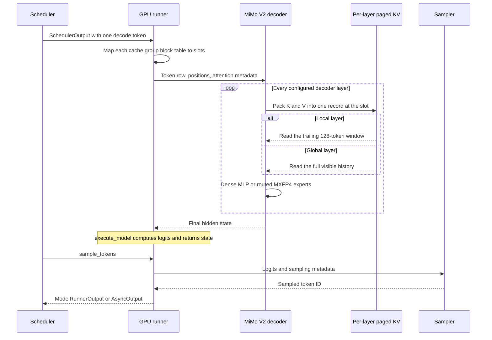

# MiMo-V2.6-MOPD on NVIDIA vLLM: GPU Inference Path

**Checkpoints:** [MiMo-V2.6-Flash-MOPD](https://huggingface.co/XiaomiMiMo/MiMo-V2.6-Flash-MOPD) (309B total / 15B active parameters) and [MiMo-V2.6-Pro-MOPD](https://huggingface.co/XiaomiMiMo/MiMo-V2.6-Pro-MOPD) (1.02T total / 42B active).  
**Repository:** `vllm-project/vllm` at commit `02aa10539f15c8c73aa7fd4a5ee0f691cbf88dcb` (GitHub origin, clean detached checkout; pin date 2026-10-10).  
**Inspection:** 2026-10-20; static code reading only.  
**Scope:** the NVIDIA GPU worker path from a `SchedulerOutput` handed to `GPUModelRunner.execute_model` through the MiMo V2 decoder forward pass, DiffKV attention, dense or MXFP4 routed feed-forward layers, logits computation, and sampling in `GPUModelRunner.sample_tokens`, returning `ModelRunnerOutput` / `AsyncOutput`. Request rendering, scheduling policy, detokenization, and HTTP response assembly are outside this map.

**Related pages:** [vLLM hub](../index.md), [DeepSeek-V4.1-Flash GPU inference path](../deepseek/v4.1-gpu-inference-path/index.md), [vLLM MHA code path](../vllm-mha-code-path.md), [KV cache](../../../../terms/kv-cache.md), [sliding-window attention](../../../../terms/sliding-window-attention.md), and [mixture-of-experts](../../../../terms/mixture-of-experts.md).

## TL;DR

**What:** Both MOPD checkpoints resolve to one vLLM implementation, `mimo_v2`, so a single pinned code path explains a Flash and a Pro decode step. The checkpoint config, not the model class, decides layer counts, which layers are local or global, which are dense or routed, and each layer's head widths.

**How:** A decode step crosses two phases. <a class="code-link" href="../../../../../external-repos/vllm-02aa10539f15/vllm/v1/worker/gpu_model_runner.py#L4367" data-code-repo="vllm-02aa10539f15" data-code-path="vllm/v1/worker/gpu_model_runner.py" data-code-line="4367" data-code-end-line="4392"><code>GPU runner forward call</code></a> builds per-group slot mappings, runs the decoder layer stack (per-layer K/V write, then a local-window or full-history read, then a dense MLP or routed experts), computes logits on the selected rows, and stashes execution state. <a class="code-link" href="../../../../../external-repos/vllm-02aa10539f15/vllm/v1/worker/gpu_model_runner.py#L4496" data-code-repo="vllm-02aa10539f15" data-code-path="vllm/v1/worker/gpu_model_runner.py" data-code-line="4496" data-code-end-line="4510"><code>consume forward state</code></a> consumes that state in `sample_tokens`, samples, and returns token IDs rather than text.

**Where the GPUs diverge:** attention and expert kernels are gated by unrelated rules. A 192-wide Q/K with 128-wide V forces a DiffKV backend, and DiffKV needs FlashAttention 3 or 4, so SM100 can auto-select FA4 while SM120 falls back to Triton DiffKV. Routed MXFP4 experts try FlashInfer TRTLLM on SM100 only, then DeepGEMM FP4 on SM100 or SM120. Neither decision can be inferred from the checkpoint's on-disk MXFP4 format.

> **Evidence boundary:** every path below is inferred from the pinned source. No checkpoint configuration was loaded, no kernel set was inspected, and no GPU execution was performed; no throughput, memory, or concurrency number is claimed.

## Mental Model

vLLM V1 splits a GPU decode step across two worker phases:

1. **Forward pass and cache updates (`execute_model`).** The scheduled rows decide
   which token advances and where its K/V lands. The runner turns each cache
   group's block table into slot mappings, installs attention metadata in the
   forward context, and calls the MiMo decoder. Each layer writes one packed
   K/V record at this step's slot and reads attention over either the trailing
   window or the full history. On the last pipeline rank the runner keeps
   logits and hidden states in `self.execute_model_state` and returns `None`.
2. **Sampling and worker return (`sample_tokens`).** The runner consumes and
   clears that state, samples the next token ID, updates sampled-token
   bookkeeping, and assembles the worker result.

Both checkpoints are hybrid-attention MoE models, which is what makes the first
phase interesting: the same class instantiates a 128-token sliding-window layer
or a global layer depending on one checkpoint array, and a dense MLP or routed
experts depending on a second one.

### The state hierarchy is a lifetime hierarchy

This model does **not** compress its KV cache. There is no compressed main KV,
no index-K cache, and no top-$k$ selection step, so the contrast with
[DeepSeek-V4.1](../deepseek/v4.1-gpu-inference-path/index.md) is useful: V4.1
buys cheap long-context attention by scoring compressed candidates, while MiMo
buys it by making most layers unable to see far back at all.

| Store | Scope | Lifetime | Precision | Who reads it |
|---|---|---|---|---|
| Local SWA KV (39 Flash / 60 Pro layers) | Trailing 128 tokens per request | Blocks leave the per-request set once the window passes | BF16 by default; FP8 only if the chosen backend accepts it | The selected DiffKV kernel |
| Global KV (9 Flash / 10 Pro layers) | Full attended history | Grows with sequence length | Same resolved cache dtype | The selected DiffKV kernel |
| Routed expert weights | All routed experts | Resident after load, repacked for the selected kernel | MXFP4 storage; the kernel may use MXFP8, FP8 blockwise, or BF16 activations | Fused MoE kernel |
| Sampler state | Selected rows of one step | One step | FP32 logits | Sampler |

The distinction that matters for correctness is the first two rows: both cache
the **same record layout**, but only the local record has a bounded lifetime.
A global layer's per-token read cost grows with the context; a local layer's
does not.

### Coordinate spaces

Four index spaces appear in the trace, and mixing them up is the most common
way to misread a paged-attention path:

| Name | Unit | Producer → consumer |
|---|---|---|
| `positions` | Logical token position in the sequence | Runner → rotary embedding and attention metadata. |
| `slot_mapping` | Physical KV slot, one per scheduled token row | <a class="code-link" href="../../../../../external-repos/vllm-02aa10539f15/vllm/v1/worker/gpu_model_runner.py#L4055" data-code-repo="vllm-02aa10539f15" data-code-path="vllm/v1/worker/gpu_model_runner.py" data-code-line="4055" data-code-end-line="4072"><code>group slot mapping</code></a> → cache-write kernel. Rows past the unpadded batch are filled with `-1` so the write is a no-op. |
| `block_table` | Physical page IDs in sequence order | Attention metadata → the DiffKV kernel when it reads history. |
| Sampled token ID | Vocabulary index | Sampler → `ModelRunnerOutput`. It is never a cache slot. |

## One Implementation, Two Checkpoints

*Source: the [Flash-MOPD](https://huggingface.co/XiaomiMiMo/MiMo-V2.6-Flash-MOPD/blob/main/assets/architecture.png) and [Pro-MOPD](https://huggingface.co/XiaomiMiMo/MiMo-V2.6-Pro-MOPD/blob/main/assets/architecture.png) model cards publish the same family figure. ① Vision and audio encoders feed the omni backbone. ② The backbone interleaves local SWA and global attention over sparse experts. ③ A five-layer MTP block is drawn separately; this page follows only the text decoder, and vLLM's loader skips `mtp` tensors.*

The cards publish real numbers for both widths, and the code reads them rather
than hard-coding them:

| Checkpoint property | Flash-MOPD | Pro-MOPD | Where the runtime value comes from |
|---|---|---|---|
| Depth and attention split | 48 layers: 39 local, 9 global | 70 layers: 60 local, 10 global | `hybrid_layer_pattern` per layer (<a class="code-link" href="../../../../../external-repos/vllm-02aa10539f15/vllm/model_executor/models/mimo_v2.py#L469" data-code-repo="vllm-02aa10539f15" data-code-path="vllm/model_executor/models/mimo_v2.py" data-code-line="469" data-code-end-line="470"><code>hybrid layer pattern</code></a>) |
| Dense/routed split | First block global **and** dense; 47 routed layers | Card gives no dense/routed breakdown | `moe_layer_freq` (<a class="code-link" href="../../../../../external-repos/vllm-02aa10539f15/vllm/model_executor/models/mimo_v2.py#L375" data-code-repo="vllm-02aa10539f15" data-code-path="vllm/model_executor/models/mimo_v2.py" data-code-line="375" data-code-end-line="421"><code>decoder-layer constructor</code></a>) |
| Q/K/V widths | Q/K 192, V 128 | Q/K 192, V 128 | Head-dimension arguments sent to <a class="code-link" href="../../../../../external-repos/vllm-02aa10539f15/vllm/model_executor/models/mimo_v2.py#L302" data-code-repo="vllm-02aa10539f15" data-code-path="vllm/model_executor/models/mimo_v2.py" data-code-line="302" data-code-end-line="335"><code>DiffKV backend selector</code></a> |
| Heads (Q / KV) | 64 / 8 local, 64 / 4 global | 128 / 8 local, 128 / 8 global | <a class="code-link" href="../../../../../external-repos/vllm-02aa10539f15/vllm/model_executor/models/mimo_v2.py#L241" data-code-repo="vllm-02aa10539f15" data-code-path="vllm/model_executor/models/mimo_v2.py" data-code-line="241" data-code-end-line="255"><code>attention head partition</code></a> |
| Hidden size | 4096 | 6144 | `hidden_size` |
| Window | 128 tokens | 128 tokens | `config.sliding_window_size` (<a class="code-link" href="../../../../../external-repos/vllm-02aa10539f15/vllm/model_executor/models/mimo_v2.py#L375" data-code-repo="vllm-02aa10539f15" data-code-path="vllm/model_executor/models/mimo_v2.py" data-code-line="375" data-code-end-line="378"><code>global-layer window reset</code></a>) |
| Routed experts | 256 total, top-8 | 384 total, top-8 | <a class="code-link" href="../../../../../external-repos/vllm-02aa10539f15/vllm/model_executor/models/mimo_v2.py#L158" data-code-repo="vllm-02aa10539f15" data-code-path="vllm/model_executor/models/mimo_v2.py" data-code-line="158" data-code-end-line="189"><code>router dtype and top-k setup</code></a> |
| Context | Up to 1,048,576 tokens | Up to 1,048,576 tokens | `max_position_embeddings` |

Because 192 ≠ 128, **every** attention layer in both checkpoints takes the
DiffKV branch; the local-versus-global difference is the window and the KV-head
count, not a different kernel family. The captured Flash card's summary and
table disagree on total parameters (311B versus 309B); nothing in the decode
path depends on that number.

The family recipes publish one reference topology each — TP4 for Flash and TP8
for Pro ([Flash recipe](https://recipes.vllm.ai/XiaomiMiMo/MiMo-V2.6-Flash-RL),
[Pro recipe](https://recipes.vllm.ai/XiaomiMiMo/MiMo-V2.6-Pro-RL)). The
per-rank arithmetic below uses those shapes to divide KV heads; it is a
property of this trace, not a tuning recommendation.

## SM100 and SM120 GPU Branches

Two selectors run in sequence during construction, and they answer different
questions. The attention selector asks whether a DiffKV kernel exists for this
shape on this device; the expert selector asks which MXFP4 GEMM is supported
for this quant configuration.

### Attention: a 192/128 shape forces DiffKV

<a class="code-link" href="../../../../../external-repos/vllm-02aa10539f15/vllm/model_executor/models/mimo_v2.py#L302" data-code-repo="vllm-02aa10539f15" data-code-path="vllm/model_executor/models/mimo_v2.py" data-code-line="302" data-code-end-line="335"><code>DiffKV backend selector</code></a> compares `v_head_dim` with `head_dim`. When they differ — exactly
the MiMo case — it keeps an explicitly requested `*_DIFFKV` backend, otherwise
asks <a class="code-link" href="../../../../../external-repos/vllm-02aa10539f15/vllm/v1/attention/backends/flash_attn_diffkv.py#L43" data-code-repo="vllm-02aa10539f15" data-code-path="vllm/v1/attention/backends/flash_attn_diffkv.py" data-code-line="43" data-code-end-line="65"><code>Flash DiffKV support probe</code></a> whether FlashAttention can run this head shape and sink setting,
and falls back to Triton DiffKV when the probe fails. The probe accepts only
FlashAttention versions 3 or 4, which it obtains from <a class="code-link" href="../../../../../external-repos/vllm-02aa10539f15/vllm/v1/attention/backends/fa_utils.py#L98" data-code-repo="vllm-02aa10539f15" data-code-path="vllm/v1/attention/backends/fa_utils.py" data-code-line="98" data-code-end-line="107"><code>FA version selector</code></a>: Hopper prefers
FA3, compute-capability major 10 prefers FA4 when the installed kernel is
supported, and everything else falls back to FA2. The
<a class="code-link" href="../../../../../external-repos/vllm-02aa10539f15/vllm/v1/attention/backends/fa_utils.py#L193" data-code-repo="vllm-02aa10539f15" data-code-path="vllm/v1/attention/backends/fa_utils.py" data-code-line="193" data-code-end-line="209"><code>FA4 192/128 shape exception</code></a> is what keeps this head shape eligible for FA4 at all, since FA4
otherwise refuses `head_size` above 128 on Blackwell for TMEM-capacity reasons.

| Subsystem | SM100 automatic path | SM120 automatic path | What to check when it differs |
|---|---|---|---|
| Local and global attention | FA4 DiffKV when the installed kernel accepts Q/K 192 with V 128 and the layer's sink setting; Triton DiffKV otherwise. | Triton DiffKV, because the pinned version selector does not choose FA4 for major 12, so the probe returns 2. | An explicit `*_DIFFKV` request bypasses the automatic choice and can fail initialization instead of falling back. |
| `--kv-cache-dtype fp8` | <a class="code-link" href="../../../../../external-repos/vllm-02aa10539f15/vllm/v1/attention/backends/fa_utils.py#L306" data-code-repo="vllm-02aa10539f15" data-code-path="vllm/v1/attention/backends/fa_utils.py" data-code-line="306" data-code-end-line="312"><code>FlashAttention FP8 KV gate</code></a> allows FA4 FP8 KV on family 100; Triton DiffKV also lists FP8. | The FlashAttention gate excludes family 120, while <a class="code-link" href="../../../../../external-repos/vllm-02aa10539f15/vllm/v1/attention/backends/triton_attn_diffkv.py#L69" data-code-repo="vllm-02aa10539f15" data-code-path="vllm/v1/attention/backends/triton_attn_diffkv.py" data-code-line="69" data-code-end-line="78"><code>Triton DiffKV dtype list</code></a> lists FP8 for the Triton path. | Verify the resolved cache dtype and the selected backend together, not separately. |
| Routed MXFP4 experts | <a class="code-link" href="../../../../../external-repos/vllm-02aa10539f15/vllm/model_executor/layers/fused_moe/oracle/mxfp4.py#L425" data-code-repo="vllm-02aa10539f15" data-code-path="vllm/model_executor/layers/fused_moe/oracle/mxfp4.py" data-code-line="425" data-code-end-line="449"><code>MXFP4 expert priority</code></a> tries FlashInfer TRTLLM MXFP8, then DeepGEMM FP4. | <a class="code-link" href="../../../../../external-repos/vllm-02aa10539f15/vllm/model_executor/layers/fused_moe/experts/trtllm_mxfp4_moe.py#L120" data-code-repo="vllm-02aa10539f15" data-code-path="vllm/model_executor/layers/fused_moe/experts/trtllm_mxfp4_moe.py" data-code-line="120" data-code-end-line="123"><code>TRTLLM MXFP4 device gate</code></a> requires family 100, so the TRTLLM candidate is filtered out and DeepGEMM FP4 is next. | A blocked kernel does not fail the launch; the selector silently moves to the next candidate. |

### KV record widths and the per-token cost

DiffKV packs K and V into a single tensor per layer,
`[num_blocks, block_size, num_kv_heads, head_size + head_size_v]`
(<a class="code-link" href="../../../../../external-repos/vllm-02aa10539f15/vllm/v1/attention/backends/flash_attn_diffkv.py#L92" data-code-repo="vllm-02aa10539f15" data-code-path="vllm/v1/attention/backends/flash_attn_diffkv.py" data-code-line="92" data-code-end-line="117"><code>Flash DiffKV cache write</code></a>), and the byte formula counts both halves for every (head slot,
stored state) cell (<a class="code-link" href="../../../../../external-repos/vllm-02aa10539f15/vllm/v1/kv_cache_interface.py#L545" data-code-repo="vllm-02aa10539f15" data-code-path="vllm/v1/kv_cache_interface.py" data-code-line="545" data-code-end-line="560"><code>KV record byte formula</code></a>). The per-layer cache **spec** — not the
kernel — decides the lifetime: <a class="code-link" href="../../../../../external-repos/vllm-02aa10539f15/vllm/model_executor/layers/attention/attention.py#L618" data-code-repo="vllm-02aa10539f15" data-code-path="vllm/model_executor/layers/attention/attention.py" data-code-line="618" data-code-end-line="677"><code>attention cache-spec builder</code></a> returns a `SlidingWindowSpec` when the
layer passes a window and a `FullAttentionSpec` otherwise. Global layers get
their window cleared explicitly before construction so they cannot inherit the
neighbouring local limit (<a class="code-link" href="../../../../../external-repos/vllm-02aa10539f15/vllm/model_executor/models/mimo_v2.py#L375" data-code-repo="vllm-02aa10539f15" data-code-path="vllm/model_executor/models/mimo_v2.py" data-code-line="375" data-code-end-line="378"><code>global-layer window reset</code></a>).

| Layer group | Checkpoint heads (Q / KV) | KV heads per rank | K+V elements per state | BF16 bytes | FP8 bytes |
|---|---|---|---:|---:|---:|
| Flash local (TP4) | 64 / 8 | 2 | 2 × (192 + 128) = 640 | 1,280 | 640 |
| Flash global (TP4) | 64 / 4 | 1 | 320 | 640 | 320 |
| Pro local (TP8) | 128 / 8 | 1 | 320 | 640 | 320 |
| Pro global (TP8) | 128 / 8 | 1 | 320 | 640 | 320 |

Reading the table by lifetime gives the cost a new token creates on each rank:

- **Global growth:** Flash adds 9 × 640 = 5,760 bytes of permanently retained
  payload per token per rank; Pro adds 10 × 640 = 6,400 bytes.
- **Local churn:** Flash writes 39 × 1,280 = 49,920 bytes for the same step and
  Pro writes 60 × 640 = 38,400, but those blocks become reclaimable as the
  window advances, so they bound steady-state footprint rather than grow it.

> **Important:** these are logical payloads derived from the cards' head counts
> and the pinned byte formula. They exclude page padding, block rounding,
> prefix sharing, in-flight batch tokens, and speculative draft tokens, and the
> MXFP4 weight format says nothing about KV dtype.

### Experts: the disk format does not pick the kernel

<a class="code-link" href="../../../../../external-repos/vllm-02aa10539f15/vllm/model_executor/layers/quantization/fp8.py#L177" data-code-repo="vllm-02aa10539f15" data-code-path="vllm/model_executor/layers/quantization/fp8.py" data-code-line="177" data-code-end-line="207"><code>FP8/MXFP4 method routing</code></a> routes a checkpoint whose FP8 config sets `store_dtype: mxfp4` to
`Mxfp4MoEMethod` for routed experts while attention and linear layers keep
their own methods. The router itself is built by <a class="code-link" href="../../../../../external-repos/vllm-02aa10539f15/vllm/model_executor/models/mimo_v2.py#L158" data-code-repo="vllm-02aa10539f15" data-code-path="vllm/model_executor/models/mimo_v2.py" data-code-line="158" data-code-end-line="189"><code>router dtype and top-k setup</code></a>: input cast to
`moe_router_dtype`, FP32 logits out, sigmoid scoring, grouped top-k. The kernel
choice then follows <a class="code-link" href="../../../../../external-repos/vllm-02aa10539f15/vllm/model_executor/layers/fused_moe/oracle/mxfp4.py#L785" data-code-repo="vllm-02aa10539f15" data-code-path="vllm/model_executor/layers/fused_moe/oracle/mxfp4.py" data-code-line="785" data-code-end-line="813"><code>MXFP4 backend selection</code></a>, which walks a priority list and accepts the
first backend whose `is_supported_config` passes for this quant configuration:

| Priority | Backend | Device gate in this pin | Activation path |
|---:|---|---|---|
| 1 | FlashInfer TRTLLM MXFP4/MXFP8 | <a class="code-link" href="../../../../../external-repos/vllm-02aa10539f15/vllm/model_executor/layers/fused_moe/experts/trtllm_mxfp4_moe.py#L120" data-code-repo="vllm-02aa10539f15" data-code-path="vllm/model_executor/layers/fused_moe/experts/trtllm_mxfp4_moe.py" data-code-line="120" data-code-end-line="123"><code>TRTLLM MXFP4 device gate</code></a> | MXFP8 activations |
| 2 | DeepGEMM FP4 | <a class="code-link" href="../../../../../external-repos/vllm-02aa10539f15/vllm/model_executor/layers/fused_moe/experts/deep_gemm_moe.py#L447" data-code-repo="vllm-02aa10539f15" data-code-path="vllm/model_executor/layers/fused_moe/experts/deep_gemm_moe.py" data-code-line="447" data-code-end-line="494"><code>DeepGEMM FP4 device gate</code></a> | FP8 blockwise activations (`kFp8Dynamic128Sym`), MXFP4 weights in 32-wide blocks |
| 3+ | Marlin, batched Marlin, Humming | Compiled-in fallbacks | BF16-style activations |

Two consequences follow. First, a SM120 host and a SM100 host can run the same
checkpoint through different expert kernels with different activation
precision, so an accuracy or speed comparison across them is not a comparison
of the checkpoint alone. Second, "the weights are MXFP4" is not evidence about
the KV cache, the router, or the attention projection; each has its own
selection.

## Follow One Decode Token

Consider a text-only, non-speculative decode step on the last pipeline rank at
the reference TP shape, with default attention and expert selection, a context
longer than the window, and no KV connector. One local layer and one global
layer exercise both cache lifetimes; all other layers repeat one of those two
patterns. The checkpoint's actual `hybrid_layer_pattern` array was not fetched,
so the trace does not name which layer index is which.

The diagram answers one question before the code does: where does this step's
state change, and which actor reads it back?

[Editable Mermaid source](assets/request-round-trip.mmd).

Read it top-down: the runner owns both phases; the decoder owns the layer loop;
the cache lane splits once, on the window; and the sampler never touches KV
state. The table below is the same path with pinned evidence for each handoff.

| Step | Input → state change → output | Where to read |
|---:|---|---|
| 1 | `SchedulerOutput` → per-group slot mappings from block tables, padded rows set to `-1` → slot tensors | <a class="code-link" href="../../../../../external-repos/vllm-02aa10539f15/vllm/v1/worker/gpu_model_runner.py#L4055" data-code-repo="vllm-02aa10539f15" data-code-path="vllm/v1/worker/gpu_model_runner.py" data-code-line="4055" data-code-end-line="4072"><code>group slot mapping</code></a> |
| 2 | Slot tensors and cache groups → forward context plus model inputs → decoder call | <a class="code-link" href="../../../../../external-repos/vllm-02aa10539f15/vllm/v1/worker/gpu_model_runner.py#L4367" data-code-repo="vllm-02aa10539f15" data-code-path="vllm/v1/worker/gpu_model_runner.py" data-code-line="4367" data-code-end-line="4392"><code>GPU runner forward call</code></a> |
| 3 | Token ID and position → norm, QKV projection, RoPE, optional V scaling → `q`, `k`, `v` | <a class="code-link" href="../../../../../external-repos/vllm-02aa10539f15/vllm/model_executor/models/mimo_v2.py#L341" data-code-repo="vllm-02aa10539f15" data-code-path="vllm/model_executor/models/mimo_v2.py" data-code-line="341" data-code-end-line="356"><code>QKV, RoPE, and output projection</code></a> |
| 4 | `q`, `k`, `v` → K/V packed into one record at the slot, then attention over window or history → attention output | <a class="code-link" href="../../../../../external-repos/vllm-02aa10539f15/vllm/model_executor/layers/attention/attention.py#L540" data-code-repo="vllm-02aa10539f15" data-code-path="vllm/model_executor/layers/attention/attention.py" data-code-line="540" data-code-end-line="579"><code>cache update before attention</code></a>, <a class="code-link" href="../../../../../external-repos/vllm-02aa10539f15/vllm/v1/attention/backends/flash_attn_diffkv.py#L92" data-code-repo="vllm-02aa10539f15" data-code-path="vllm/v1/attention/backends/flash_attn_diffkv.py" data-code-line="92" data-code-end-line="117"><code>Flash DiffKV cache write</code></a>, <a class="code-link" href="../../../../../external-repos/vllm-02aa10539f15/vllm/v1/attention/backends/flash_attn_diffkv.py#L218" data-code-repo="vllm-02aa10539f15" data-code-path="vllm/v1/attention/backends/flash_attn_diffkv.py" data-code-line="218" data-code-end-line="271"><code>Flash DiffKV paged read</code></a> |
| 5 | Attention output → row-parallel projection → residual stream | <a class="code-link" href="../../../../../external-repos/vllm-02aa10539f15/vllm/model_executor/models/mimo_v2.py#L440" data-code-repo="vllm-02aa10539f15" data-code-path="vllm/model_executor/models/mimo_v2.py" data-code-line="440" data-code-end-line="459"><code>decoder layer forward</code></a> |
| 6 | Hidden state → dense MLP or router plus fused experts → next hidden state | <a class="code-link" href="../../../../../external-repos/vllm-02aa10539f15/vllm/model_executor/models/mimo_v2.py#L191" data-code-repo="vllm-02aa10539f15" data-code-path="vllm/model_executor/models/mimo_v2.py" data-code-line="191" data-code-end-line="215"><code>routed-expert forward</code></a> |
| 7 | Selected hidden rows → logits → sampled IDs → `ModelRunnerOutput` or `AsyncOutput` | <a class="code-link" href="../../../../../external-repos/vllm-02aa10539f15/vllm/v1/worker/gpu_model_runner.py#L4420" data-code-repo="vllm-02aa10539f15" data-code-path="vllm/v1/worker/gpu_model_runner.py" data-code-line="4420" data-code-end-line="4421"><code>selected-row logits</code></a>, <a class="code-link" href="../../../../../external-repos/vllm-02aa10539f15/vllm/v1/worker/gpu_model_runner.py#L4446" data-code-repo="vllm-02aa10539f15" data-code-path="vllm/v1/worker/gpu_model_runner.py" data-code-line="4446" data-code-end-line="4465"><code>saved forward state</code></a>, <a class="code-link" href="../../../../../external-repos/vllm-02aa10539f15/vllm/v1/worker/gpu_model_runner.py#L4496" data-code-repo="vllm-02aa10539f15" data-code-path="vllm/v1/worker/gpu_model_runner.py" data-code-line="4496" data-code-end-line="4510"><code>consume forward state</code></a>, <a class="code-link" href="../../../../../external-repos/vllm-02aa10539f15/vllm/v1/worker/gpu_model_runner.py#L3606" data-code-repo="vllm-02aa10539f15" data-code-path="vllm/v1/worker/gpu_model_runner.py" data-code-line="3606" data-code-end-line="3620"><code>ordinary sampler</code></a>, <a class="code-link" href="../../../../../external-repos/vllm-02aa10539f15/vllm/v1/worker/gpu_model_runner.py#L4697" data-code-repo="vllm-02aa10539f15" data-code-path="vllm/v1/worker/gpu_model_runner.py" data-code-line="4697" data-code-end-line="4738"><code>worker output assembly</code></a> |

## Request Round Trip

The sections below expand the table in order. Each one names the state that
enters, the operation, and the state that leaves.

### 1. The checkpoint resolves to one text-model path

The registry maps the MiMo V2 architecture names to the `mimo_v2` module
(<a class="code-link" href="../../../../../external-repos/vllm-02aa10539f15/vllm/model_executor/models/registry.py#L175" data-code-repo="vllm-02aa10539f15" data-code-path="vllm/model_executor/models/registry.py" data-code-line="175"><code>MiMo model registry</code></a>); the captured cards do not publish which architecture string
their checkpoint config declares, so this page treats that mapping as the entry
condition rather than a verified fact. <a class="code-link" href="../../../../../external-repos/vllm-02aa10539f15/vllm/model_executor/models/mimo_v2.py#L733" data-code-repo="vllm-02aa10539f15" data-code-path="vllm/model_executor/models/mimo_v2.py" data-code-line="733" data-code-end-line="864"><code>MiMo weight loader</code></a> then reconciles checkpoint naming with
runtime parameters: it merges per-expert tensors, folds `q_proj`/`k_proj`/`v_proj`
into one fused projection, and shards `attention_sink_bias` by head. It also
carries a separate path for the **Pro checkpoint format**, where a fused FP8 QKV
projection arrives as separate weight and scale tensors that must be sharded
together. Names containing `mtp` are skipped, so the checkpoint's own MTP
tensors do not join the tracked target weights.

The layer constructor (<a class="code-link" href="../../../../../external-repos/vllm-02aa10539f15/vllm/model_executor/models/mimo_v2.py#L375" data-code-repo="vllm-02aa10539f15" data-code-path="vllm/model_executor/models/mimo_v2.py" data-code-line="375" data-code-end-line="421"><code>decoder-layer constructor</code></a>) then reads the two checkpoint arrays that
shape the whole path: `hybrid_layer_pattern` picks local versus global
attention (<a class="code-link" href="../../../../../external-repos/vllm-02aa10539f15/vllm/model_executor/models/mimo_v2.py#L469" data-code-repo="vllm-02aa10539f15" data-code-path="vllm/model_executor/models/mimo_v2.py" data-code-line="469" data-code-end-line="470"><code>hybrid layer pattern</code></a>) and `moe_layer_freq` picks dense versus routed
feed-forward. The captured Flash card says the first block is global and dense,
which is consistent with the code but does not prove the array contents. The
runner's <a class="code-link" href="../../../../../external-repos/vllm-02aa10539f15/vllm/v1/worker/gpu_model_runner.py#L7394" data-code-repo="vllm-02aa10539f15" data-code-path="vllm/v1/worker/gpu_model_runner.py" data-code-line="7394" data-code-end-line="7429"><code>runner cache-spec enumeration</code></a> then discovers one cache spec per attention layer, which
is what allows local and global layers to become separate cache groups with
different managers.

### 2. The runner builds slots and enters the forward context

For each cache group, <a class="code-link" href="../../../../../external-repos/vllm-02aa10539f15/vllm/v1/worker/gpu_model_runner.py#L4055" data-code-repo="vllm-02aa10539f15" data-code-path="vllm/v1/worker/gpu_model_runner.py" data-code-line="4055" data-code-end-line="4072"><code>group slot mapping</code></a> copies the group's `slot_mapping` view for the
padded token count and fills the padded tail with `-1`; the full-graph replay
path depends on that value being a no-op. <a class="code-link" href="../../../../../external-repos/vllm-02aa10539f15/vllm/v1/worker/gpu_model_runner.py#L4367" data-code-repo="vllm-02aa10539f15" data-code-path="vllm/v1/worker/gpu_model_runner.py" data-code-line="4367" data-code-end-line="4392"><code>GPU runner forward call</code></a> then installs the
attention metadata, slot mappings, and CUDA-graph mode in the forward context
and calls the model with token IDs and logical positions.

### 3. The decoder stack walks local and global layers

<a class="code-link" href="../../../../../external-repos/vllm-02aa10539f15/vllm/model_executor/models/mimo_v2.py#L688" data-code-repo="vllm-02aa10539f15" data-code-path="vllm/model_executor/models/mimo_v2.py" data-code-line="688" data-code-end-line="719"><code>MiMo decoder forward</code></a> embeds the token on the first pipeline rank, iterates the
`start_layer`–`end_layer` slice, and normalizes on the last rank. Each layer
(<a class="code-link" href="../../../../../external-repos/vllm-02aa10539f15/vllm/model_executor/models/mimo_v2.py#L440" data-code-repo="vllm-02aa10539f15" data-code-path="vllm/model_executor/models/mimo_v2.py" data-code-line="440" data-code-end-line="459"><code>decoder layer forward</code></a>) runs pre-norm → attention → post-norm → feed-forward with a
carried residual, so the residual stream never materializes a full copy.
Inside attention, <a class="code-link" href="../../../../../external-repos/vllm-02aa10539f15/vllm/model_executor/models/mimo_v2.py#L341" data-code-repo="vllm-02aa10539f15" data-code-path="vllm/model_executor/models/mimo_v2.py" data-code-line="341" data-code-end-line="356"><code>QKV, RoPE, and output projection</code></a> splits the fused projection, applies RoPE to Q and K,
optionally scales V, and hands the three tensors to the attention wrapper.

### 4. Attention writes the record, then reads the visible history

Ordering matters for correctness: <a class="code-link" href="../../../../../external-repos/vllm-02aa10539f15/vllm/model_executor/layers/attention/attention.py#L540" data-code-repo="vllm-02aa10539f15" data-code-path="vllm/model_executor/layers/attention/attention.py" data-code-line="540" data-code-end-line="579"><code>cache update before attention</code></a> issues the cache update before the
attention op and passes the resulting dependency into the output kernel, so a
layer can never read a slot it has not written this step.

| Branch | Write | Read | Consequence |
|---|---|---|---|
| SM100 Flash Attention DiffKV | <a class="code-link" href="../../../../../external-repos/vllm-02aa10539f15/vllm/v1/attention/backends/flash_attn_diffkv.py#L92" data-code-repo="vllm-02aa10539f15" data-code-path="vllm/v1/attention/backends/flash_attn_diffkv.py" data-code-line="92" data-code-end-line="117"><code>Flash DiffKV cache write</code></a> packs K and V into one record and stores it through `triton_reshape_and_cache_flash_diffkv` at `slot_mapping`. | <a class="code-link" href="../../../../../external-repos/vllm-02aa10539f15/vllm/v1/attention/backends/flash_attn_diffkv.py#L218" data-code-repo="vllm-02aa10539f15" data-code-path="vllm/v1/attention/backends/flash_attn_diffkv.py" data-code-line="218" data-code-end-line="271"><code>Flash DiffKV paged read</code></a> splits that record back into K and V views, then calls `flash_attn_varlen_func` with the block table and sequence lengths, adding a 128-token window only for local layers. | One record layout, one kernel family; the window is metadata, not a separate cache. |
| SM120 or probe-failed Triton DiffKV | <a class="code-link" href="../../../../../external-repos/vllm-02aa10539f15/vllm/v1/attention/backends/triton_attn_diffkv.py#L129" data-code-repo="vllm-02aa10539f15" data-code-path="vllm/v1/attention/backends/triton_attn_diffkv.py" data-code-line="129" data-code-end-line="220"><code>Triton DiffKV write and read</code></a> writes the same logical record. | The same impl calls `unified_attention_diffkv` over the paged cache. | The record format is shared even though the kernel is not, so a backend switch does not change KV memory geometry. |

The attention output has V width 128 per query head; the layer's row-parallel
`o_proj` returns it to the hidden size.

### 5. Dense and routed feed-forward layers

The first Flash block uses a plain gated MLP. The other 47 use <a class="code-link" href="../../../../../external-repos/vllm-02aa10539f15/vllm/model_executor/models/mimo_v2.py#L191" data-code-repo="vllm-02aa10539f15" data-code-path="vllm/model_executor/models/mimo_v2.py" data-code-line="191" data-code-end-line="215"><code>routed-expert forward</code></a>, which
casts the input to the router dtype, computes FP32 router logits, and lets the
fused expert layer select and combine experts. Expert **placement** (which
device holds which expert) is a separate axis from expert **kernel** choice:
`MiMoV2MoE` sizes its local physical experts from the expert-parallel size and
tracks redundant experts for EPLB, while the kernel comes from the MXFP4
priority list above.

### 6. Logits, sampling, and the worker return

<a class="code-link" href="../../../../../external-repos/vllm-02aa10539f15/vllm/v1/worker/gpu_model_runner.py#L4420" data-code-repo="vllm-02aa10539f15" data-code-path="vllm/v1/worker/gpu_model_runner.py" data-code-line="4420" data-code-end-line="4421"><code>selected-row logits</code></a> gathers the rows named by `logits_indices` and computes logits on
them only, which is why a decode step does not pay a full-vocabulary GEMM for
every token in the batch. <a class="code-link" href="../../../../../external-repos/vllm-02aa10539f15/vllm/v1/worker/gpu_model_runner.py#L4446" data-code-repo="vllm-02aa10539f15" data-code-path="vllm/v1/worker/gpu_model_runner.py" data-code-line="4446" data-code-end-line="4465"><code>saved forward state</code></a> then stores logits, hidden states, and slot
mappings in `ExecuteModelState` and returns `None` on the last pipeline rank.

Phase two begins when the engine calls `sample_tokens`:

1. <a class="code-link" href="../../../../../external-repos/vllm-02aa10539f15/vllm/v1/worker/gpu_model_runner.py#L4496" data-code-repo="vllm-02aa10539f15" data-code-path="vllm/v1/worker/gpu_model_runner.py" data-code-line="4496" data-code-end-line="4510"><code>consume forward state</code></a> unpacks the saved state and clears it so a retry cannot sample
   twice.
2. <a class="code-link" href="../../../../../external-repos/vllm-02aa10539f15/vllm/v1/worker/gpu_model_runner.py#L3606" data-code-repo="vllm-02aa10539f15" data-code-path="vllm/v1/worker/gpu_model_runner.py" data-code-line="3606" data-code-end-line="3620"><code>ordinary sampler</code></a> runs the ordinary sampler when there is no speculative metadata.
3. <a class="code-link" href="../../../../../external-repos/vllm-02aa10539f15/vllm/v1/worker/gpu_model_runner.py#L4518" data-code-repo="vllm-02aa10539f15" data-code-path="vllm/v1/worker/gpu_model_runner.py" data-code-line="4518" data-code-end-line="4523"><code>sampled-ID state update</code></a> folds the sampled IDs back into runner state.
4. <a class="code-link" href="../../../../../external-repos/vllm-02aa10539f15/vllm/v1/worker/gpu_model_runner.py#L4697" data-code-repo="vllm-02aa10539f15" data-code-path="vllm/v1/worker/gpu_model_runner.py" data-code-line="4697" data-code-end-line="4738"><code>worker output assembly</code></a> assembles request IDs, sampled IDs, logprobs, connector output,
   and NaN counts, then wraps the result in `AsyncGPUModelRunnerOutput` when
   async scheduling is enabled.

The detokenizer and the HTTP response are downstream of this boundary: the
worker returns token IDs.

## Optional DFlash Speculative Decoding

Both checkpoints advertise a five-layer MTP drafter, but this path does not
consume the checkpoint's own `mtp` tensors. Speculative decoding is opt-in
through a speculative config: with `method: dflash`, <a class="code-link" href="../../../../../external-repos/vllm-02aa10539f15/vllm/v1/worker/gpu_model_runner.py#L649" data-code-repo="vllm-02aa10539f15" data-code-path="vllm/v1/worker/gpu_model_runner.py" data-code-line="649" data-code-end-line="655"><code>runner drafter setup</code></a> constructs a
`DFlashProposer` and keeps auxiliary hidden states available, and after sampling
<a class="code-link" href="../../../../../external-repos/vllm-02aa10539f15/vllm/v1/worker/gpu_model_runner.py#L4541" data-code-repo="vllm-02aa10539f15" data-code-path="vllm/v1/worker/gpu_model_runner.py" data-code-line="4541" data-code-end-line="4555"><code>draft proposal handoff</code></a> hands the proposer the sampled IDs, target hidden states, and slot
mappings. When no speculative config is present, those draft tensors stay unset
and the ordinary sampler path runs unchanged.

## Bounded Local-KV Retention

A local layer that never freed anything would turn a 128-token window into an
unbounded allocation. Two mechanisms keep it bounded:

- **Eviction.** <a class="code-link" href="../../../../../external-repos/vllm-02aa10539f15/vllm/v1/core/single_type_kv_cache_manager.py#L687" data-code-repo="vllm-02aa10539f15" data-code-path="vllm/v1/core/single_type_kv_cache_manager.py" data-code-line="687"><code>SWA block eviction</code></a> frees blocks whose tokens have fallen outside the
  window and replaces them with a null block, driven from `allocate_slots`
  before each chunk asks for new blocks.
- **An admission bound.** <a class="code-link" href="../../../../../external-repos/vllm-02aa10539f15/vllm/v1/kv_cache_interface.py#L850" data-code-repo="vllm-02aa10539f15" data-code-path="vllm/v1/kv_cache_interface.py" data-code-line="850" data-code-end-line="896"><code>SWA block-retention bound</code></a> computes
  `ceil(min(window − 1 + extra_retained_tokens + max_in_flight_tokens,
  max_model_len) / block_size) + 1` blocks per request. The same expression
  sizes the startup pool, so a per-request reservation can never exceed the
  pool it is drawn from.

Prefix reuse interacts with this: <a class="code-link" href="../../../../../external-repos/vllm-02aa10539f15/vllm/v1/core/single_type_kv_cache_manager.py#L967" data-code-repo="vllm-02aa10539f15" data-code-path="vllm/v1/core/single_type_kv_cache_manager.py" data-code-line="967" data-code-end-line="978"><code>SWA prefix-hit window</code></a> counts a sliding-window hit as at
most `ceil((window − 1) / block_size)` contiguous blocks, so a repeated prefix
can only reuse the local cache that is still resident. MiMo keeps the plain
`SlidingWindowSpec` defaults — prefix caching stays enabled and
`prefix_replay_tokens` stays 0 (<a class="code-link" href="../../../../../external-repos/vllm-02aa10539f15/vllm/v1/kv_cache_interface.py#L196" data-code-repo="vllm-02aa10539f15" data-code-path="vllm/v1/kv_cache_interface.py" data-code-line="196" data-code-end-line="203"><code>prefix-cacheability defaults</code></a>) — so it does not use the explicit
bounded-replay mechanism that [V4.1's SWA
spec](../deepseek/v4.1-gpu-inference-path/index.md#prefix-reuse-and-bounded-swa-replay)
adds. How the coordinator reconciles a local-group hit with a longer
global-group hit is outside this page's scope.

## Implementation Boundary: Model Card Versus vLLM

- **Multimodal encoders are not in this path.** The architecture figure shows
  vision and audio encoders; the traced code is the text decoder. A request
  that carries an image, video, or audio payload enters a wrapper this page did
  not follow.
- **MOPD is a checkpoint variant, not a code branch.** The cards describe MOPD
  as a distillation pass over the RL checkpoints; nothing in `mimo_v2` keys off
  the variant name, and the identical flags serve both releases. Model-quality
  claims from the cards are not verified here.
- **No compression, no sparse selection.** Unlike V4.1, there is no indexer, no
  compressed KV, and no top-k buffer to misread; every attention layer reads
  full K/V records.
- **Which layers are local is a checkpoint fact.** `hybrid_layer_pattern` and
  `moe_layer_freq` were not fetched, so this page explains the contract but does
  not label individual layer indices.

## Verification Limits

- Code links resolve to the registered commit
  `02aa10539f15c8c73aa7fd4a5ee0f691cbf88dcb`; they do not describe current
  upstream main.
- The scoped refresh deferred a new immutable revision until 2026-10-24 because
  the latest evidence snapshot was less than 14 days old. Changed candidate code
  was not read.
- No checkpoint config, GPU, FlashAttention or DeepGEMM build, logits, or
  performance result was executed. Every SM100/SM120 statement is a static
  branch in the pinned implementation.
- DFlash is documented as an optional branch; its draft model was not loaded and
  its accept rate is not claimed.

## Go Deeper

- **Model cards:** [MiMo-V2.6-Flash-MOPD](https://huggingface.co/XiaomiMiMo/MiMo-V2.6-Flash-MOPD) and [MiMo-V2.6-Pro-MOPD](https://huggingface.co/XiaomiMiMo/MiMo-V2.6-Pro-MOPD)
- **Family recipes:** [MiMo-V2.6-Flash-RL on vLLM](https://recipes.vllm.ai/XiaomiMiMo/MiMo-V2.6-Flash-RL) and [MiMo-V2.6-Pro-RL on vLLM](https://recipes.vllm.ai/XiaomiMiMo/MiMo-V2.6-Pro-RL) — both select the MOPD checkpoint and publish the reference TP shape used above.
- **Related readings:** [vLLM MHA code path](../vllm-mha-code-path.md) for the generic paged-attention machinery, [vLLM block table management](../vllm-block-management/index.md) for the allocator this page assumes, and [Mixture of Experts](../../../../terms/mixture-of-experts.md).
