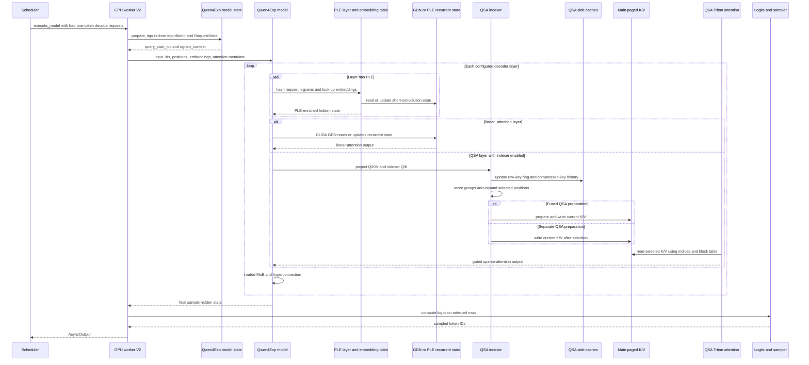

# Qwen3.8-Flash-Next on NVIDIA vLLM: GPU Inference Path

**Model identity:** The public [Qwen3.8-Flash-Next config](https://huggingface.co/Qwen/Qwen3.8-Flash-Next/blob/main/config.json) currently advertises `Qwen4ExpForConditionalGeneration` and `model_type: qwen4_exp`. In this vLLM pin, the registry maps that architecture to `vllm.models.qwen4_exp` (<a class="code-link" href="../../../../../external-repos/vllm-fce64bc5c2c9/vllm/model_executor/models/registry.py#L609" data-code-repo="vllm-fce64bc5c2c9" data-code-path="vllm/model_executor/models/registry.py" data-code-line="609" data-code-end-line="612"><code>Qwen4Exp architecture registration</code></a>). The linked Hub config is mutable and was not copied into `raw/`.

**Repository:** `vllm-project/vllm` at commit `fce64bc5c2c939a4521bfb9b462c8c74c1c13893` (GitHub origin, clean detached checkout; inspected 2026-10-20). The selected CUDA package branch imports the NVIDIA model implementation, while ROCm imports its AMD implementation; XPU and TPU raise `NotImplementedError` (<a class="code-link" href="../../../../../external-repos/vllm-fce64bc5c2c9/vllm/models/qwen4_exp/__init__.py#L28" data-code-repo="vllm-fce64bc5c2c9" data-code-path="vllm/models/qwen4_exp/__init__.py" data-code-line="28" data-code-end-line="48"><code>Qwen4Exp platform dispatch</code></a>).

**Workload and selected branch:** four text-only requests, one ordinary decode token per request, on an NVIDIA SM100 worker using the V2 runner. Assume BF16 model activations, `kv_cache_dtype=auto`, the default BF16 QSA indexer cache, no speculative decoding, `PP=1`, no context parallelism, no DBO or microbatching, and a device-resident PLE table. The page follows the eager `cg_mode=NONE` call into the model; V2's PIECEWISE and FULL graph branches are noted as wrappers, not traced. The four-row batch is chosen to explain QSA's CUDA top-k gate; the actual gate also checks logits row stride.

**Boundary:** `GPUModelRunner.execute_model(SchedulerOutput)` through `sample_tokens()` returning `AsyncOutput`. Request admission, scheduler policy, detokenization, and HTTP response assembly are outside this map.

> **Evidence boundary:** This is static reading of the pinned source. No checkpoint config was loaded, no model weights were loaded, and no CUDA kernel or GPU runtime was exercised. Layer indices, `ple_layer_ids`, layer pattern, compression ratio, indexer budget, TP size, and memory footprint are therefore not asserted. The public model config is used only to identify the architecture.

## Mental Model

Qwen4Exp keeps several histories that must not be conflated. The GDN layers carry recurrent state. PLE layers carry short-convolution state and use a small request-local token context to address an n-gram embedding table. QSA carries both a compact key history for choosing useful context and the ordinary paged K/V that contains the values used by attention. A temporary list of selected token positions points from the compressed selector back into that full K/V history; it is neither attention output nor the sampled token.

Every configured decoder layer also runs a routed MoE block and carries a gated multi-stream residual state. The final hyperconnection mixer reduces the multi-stream hidden state to the sample hidden row used by the language-model head.

## Load-Time Choices and Runtime State

The model config verifies that `hc_count > 1`. If PLE or QSA is enabled, it rejects DBO and `ubatch_size > 1`; PLE requires `pipeline_parallel_size=1`. Qwen4Exp speculative decoding accepts its native MTP and linear n-gram methods only (<a class="code-link" href="../../../../../external-repos/vllm-fce64bc5c2c9/vllm/model_executor/models/config.py#L981" data-code-repo="vllm-fce64bc5c2c9" data-code-path="vllm/model_executor/models/config.py" data-code-line="981" data-code-end-line="1032"><code>Qwen4Exp config gates</code></a>).

The GPU worker can construct either the V2 runner or the older V1 runner. This trace explicitly selects V2: when `use_v2_model_runner` is true, `GPUWorker._make_model_runner` constructs `vllm.v1.worker.gpu.model_runner.GPUModelRunner`; otherwise it constructs `vllm.v1.worker.gpu_model_runner.GPUModelRunner` (<a class="code-link" href="../../../../../external-repos/vllm-fce64bc5c2c9/vllm/v1/worker/gpu_worker.py#L567" data-code-repo="vllm-fce64bc5c2c9" data-code-path="vllm/v1/worker/gpu_worker.py" data-code-line="567" data-code-end-line="583"><code>V1/V2 runner branch</code></a>). The selected model-state hook is part of the V2 path; this page does not claim that the V1 route supplies the same Qwen4Exp PLE inputs.

After loading the model, the V2 runner calls `init_model_state` (<a class="code-link" href="../../../../../external-repos/vllm-fce64bc5c2c9/vllm/v1/worker/gpu/model_runner.py#L438" data-code-repo="vllm-fce64bc5c2c9" data-code-path="vllm/v1/worker/gpu/model_runner.py" data-code-line="438" data-code-end-line="440"><code>V2 model-state creation</code></a>). The state resolver checks `get_model_state_cls` and returns the model-specific class (<a class="code-link" href="../../../../../external-repos/vllm-fce64bc5c2c9/vllm/v1/worker/gpu/model_states/__init__.py#L28" data-code-repo="vllm-fce64bc5c2c9" data-code-path="vllm/v1/worker/gpu/model_states/__init__.py" data-code-line="28" data-code-end-line="34"><code>state-class resolution</code></a>); Qwen4Exp returns `Qwen4ExpModelState` (<a class="code-link" href="../../../../../external-repos/vllm-fce64bc5c2c9/vllm/models/qwen4_exp/nvidia/model.py#L958" data-code-repo="vllm-fce64bc5c2c9" data-code-path="vllm/models/qwen4_exp/nvidia/model.py" data-code-line="958" data-code-end-line="961"><code>Qwen4Exp state hook</code></a>).

## State Stores and Coordinate Spaces

| Store | Record and writer | Reader | Lifetime |
|---|---|---|---|
| Main paged K/V | `FullAttentionSpec` with the QSA layer's KV-head count, head width, and resolved dtype (<a class="code-link" href="../../../../../external-repos/vllm-fce64bc5c2c9/vllm/models/qwen4_exp/nvidia/qsa.py#L552" data-code-repo="vllm-fce64bc5c2c9" data-code-path="vllm/models/qwen4_exp/nvidia/qsa.py" data-code-line="552" data-code-end-line="560"><code>QSA main-cache spec</code></a>); the QSA owner writes scheduled K/V at the physical slot | Sparse QSA attention reads the selected positions from this cache | Full attended history until the request/cache is released |
| Raw QSA key ring | `CircularBufferSpec`; one BF16 index key per raw token in the open compression group, plus optional MRoPE positions | Group compressor | Ring retains the open group and any configured speculative rows (<a class="code-link" href="../../../../../external-repos/vllm-fce64bc5c2c9/vllm/models/qwen4_exp/common/qsa_cache.py#L842" data-code-repo="vllm-fce64bc5c2c9" data-code-path="vllm/models/qwen4_exp/common/qsa_cache.py" data-code-line="842" data-code-end-line="860"><code>raw-key ring spec</code></a>) |
| Compressed QSA key history | `MLAAttentionSpec` with `tokens_per_state=compress_ratio`; BF16 by default, FP8 if selected | Paged QSA top-k scorer | One normed/RoPE key per complete group; used to score context, not as attention values (<a class="code-link" href="../../../../../external-repos/vllm-fce64bc5c2c9/vllm/models/qwen4_exp/common/qsa_cache.py#L863" data-code-repo="vllm-fce64bc5c2c9" data-code-path="vllm/models/qwen4_exp/common/qsa_cache.py" data-code-line="863" data-code-end-line="875"><code>compressed-key spec</code></a>, <a class="code-link" href="../../../../../external-repos/vllm-fce64bc5c2c9/vllm/models/qwen4_exp/nvidia/indexer_qsa.py#L141" data-code-repo="vllm-fce64bc5c2c9" data-code-path="vllm/models/qwen4_exp/nvidia/indexer_qsa.py" data-code-line="141" data-code-end-line="164"><code>indexer dtype resolution</code></a>) |
| GDN state | Config-derived GDN `MambaSpec` shapes and dtypes | CUDA GDN core | Per request and GDN layer |
| PLE state | Config-derived short-convolution `MambaSpec`, marked `tp_replicated=True` | PLE short-convolution operation | Per request and configured PLE layer |
| PLE n-gram context | `int32` previous-token context of length `ngram_size - 1`; n-gram IDs index model embedding weights | PLE layer | Context is rebuilt for each step; table weights are device-resident in the selected branch |
| QSA selection buffer | `int32` positions plus a trailing valid-entry count | Sparse QSA kernel | Per forward step; not a cache and not a token result |

The V2 runner forms `query_start_loc` from scheduled token counts and builds
logical positions from each request's computed-token count (<a class="code-link" href="../../../../../external-repos/vllm-fce64bc5c2c9/vllm/v1/worker/gpu/model_runner.py#L1446" data-code-repo="vllm-fce64bc5c2c9" data-code-path="vllm/v1/worker/gpu/model_runner.py" data-code-line="1446" data-code-end-line="1488"><code>scheduled row and position preparation</code></a>). It then gathers block tables and computes one physical slot per scheduled row (<a class="code-link" href="../../../../../external-repos/vllm-fce64bc5c2c9/vllm/v1/worker/gpu/model_runner.py#L1577" data-code-repo="vllm-fce64bc5c2c9" data-code-path="vllm/v1/worker/gpu/model_runner.py" data-code-line="1577" data-code-end-line="1597"><code>block-table and slot-map preparation</code></a>). For the non-context-parallel branch used here, the slot kernel translates `position` to `block_table[request, position // block_size] * block_size + position % block_size` (<a class="code-link" href="../../../../../external-repos/vllm-fce64bc5c2c9/vllm/v1/worker/gpu/block_table.py#L381" data-code-repo="vllm-fce64bc5c2c9" data-code-path="vllm/v1/worker/gpu/block_table.py" data-code-line="381" data-code-end-line="413"><code>logical-position to physical-slot conversion</code></a>).

QSA uses a second coordinate conversion. For a logical position `t`, the
compressed-key row is `floor(t / compress_ratio)` and is written only when the
group closes, `(t + 1) % compress_ratio == 0` (<a class="code-link" href="../../../../../external-repos/vllm-fce64bc5c2c9/vllm/models/qwen4_exp/common/qsa_cache.py#L161" data-code-repo="vllm-fce64bc5c2c9" data-code-path="vllm/models/qwen4_exp/common/qsa_cache.py" data-code-line="161" data-code-end-line="190"><code>compressed-group slot mapping</code></a>). Raw keys instead use a per-request circular slot map (<a class="code-link" href="../../../../../external-repos/vllm-fce64bc5c2c9/vllm/models/qwen4_exp/common/qsa_cache.py#L108" data-code-repo="vllm-fce64bc5c2c9" data-code-path="vllm/models/qwen4_exp/common/qsa_cache.py" data-code-line="108" data-code-end-line="159"><code>raw-key ring slot mapping</code></a>). The QSA indexer expands selected compressed blocks back into request-relative token positions and appends a valid-entry count; the count column is not an index (<a class="code-link" href="../../../../../external-repos/vllm-fce64bc5c2c9/vllm/models/qwen4_exp/nvidia/indexer_qsa.py#L234" data-code-repo="vllm-fce64bc5c2c9" data-code-path="vllm/models/qwen4_exp/nvidia/indexer_qsa.py" data-code-line="234" data-code-end-line="254"><code>packed selection-buffer contract</code></a>).
QSA uses a second coordinate conversion. For a logical position `t`, the
compressed-key row is `floor(t / compress_ratio)` and is written only when the
group closes, `(t + 1) % compress_ratio == 0` (<a class="code-link" href="../../../../../external-repos/vllm-fce64bc5c2c9/vllm/models/qwen4_exp/common/qsa_cache.py#L161" data-code-repo="vllm-fce64bc5c2c9" data-code-path="vllm/models/qwen4_exp/common/qsa_cache.py" data-code-line="161" data-code-end-line="190"><code>compressed-group slot mapping</code></a>). Raw keys instead use a per-request circular slot map (<a class="code-link" href="../../../../../external-repos/vllm-fce64bc5c2c9/vllm/models/qwen4_exp/common/qsa_cache.py#L108" data-code-repo="vllm-fce64bc5c2c9" data-code-path="vllm/models/qwen4_exp/common/qsa_cache.py" data-code-line="108" data-code-end-line="159"><code>raw-key ring slot mapping</code></a>). The QSA indexer expands selected compressed blocks back into request-relative token positions and appends a valid-entry count; the count column is not an index (<a class="code-link" href="../../../../../external-repos/vllm-fce64bc5c2c9/vllm/models/qwen4_exp/nvidia/indexer_qsa.py#L234" data-code-repo="vllm-fce64bc5c2c9" data-code-path="vllm/models/qwen4_exp/nvidia/indexer_qsa.py" data-code-line="234" data-code-end-line="254"><code>packed selection-buffer contract</code></a>).

## Follow One Decode Batch

The diagram answers one question: where do the recurrent state, QSA index state,
main K/V cache, and sampler result diverge and rejoin for the same decode rows?
It is a synthesized explanation of the pinned code branch, not a measured trace.

[Editable Mermaid source](assets/request-round-trip.mmd).

Read top-down. The state hook fills the PLE inputs before the model call. A
configured PLE layer may update its own short-convolution state. A decoder layer
then takes either the GDN recurrent-state branch or the QSA branch; QSA has two
side caches plus a separate main K/V store. The final `AsyncOutput` wraps sampled
token IDs and output metadata; it is not decoded text.

1. **Resolve and initialize the model.** The V2 runner is selected at worker
   construction, then initializes the model-specific state after loading the
   model. The state resolver calls Qwen4Exp's hook and constructs
   `Qwen4ExpModelState`: <a class="code-link" href="../../../../../external-repos/vllm-fce64bc5c2c9/vllm/v1/worker/gpu_worker.py#L567" data-code-repo="vllm-fce64bc5c2c9" data-code-path="vllm/v1/worker/gpu_worker.py" data-code-line="567" data-code-end-line="583"><code>V2 runner selection</code></a>, <a class="code-link" href="../../../../../external-repos/vllm-fce64bc5c2c9/vllm/v1/worker/gpu/model_runner.py#L438" data-code-repo="vllm-fce64bc5c2c9" data-code-path="vllm/v1/worker/gpu/model_runner.py" data-code-line="438" data-code-end-line="440"><code>state initialization</code></a>, <a class="code-link" href="../../../../../external-repos/vllm-fce64bc5c2c9/vllm/v1/worker/gpu/model_states/__init__.py#L28" data-code-repo="vllm-fce64bc5c2c9" data-code-path="vllm/v1/worker/gpu/model_states/__init__.py" data-code-line="28" data-code-end-line="34"><code>state resolution</code></a>, <a class="code-link" href="../../../../../external-repos/vllm-fce64bc5c2c9/vllm/models/qwen4_exp/nvidia/model.py#L958" data-code-repo="vllm-fce64bc5c2c9" data-code-path="vllm/models/qwen4_exp/nvidia/model.py" data-code-line="958" data-code-end-line="961"><code>Qwen4Exp model-state hook</code></a>.

2. **Turn scheduled work into model rows.** V2 constructs cumulative
   `query_start_loc`, logical positions, per-request sequence lengths, and the
   logits-row selection from scheduled token counts (<a class="code-link" href="../../../../../external-repos/vllm-fce64bc5c2c9/vllm/v1/worker/gpu/model_runner.py#L1446" data-code-repo="vllm-fce64bc5c2c9" data-code-path="vllm/v1/worker/gpu/model_runner.py" data-code-line="1446" data-code-end-line="1488"><code>scheduled input rows</code></a>). For the selected non-context-parallel path, the block-table kernel converts each logical position to a physical slot (<a class="code-link" href="../../../../../external-repos/vllm-fce64bc5c2c9/vllm/v1/worker/gpu/block_table.py#L381" data-code-repo="vllm-fce64bc5c2c9" data-code-path="vllm/v1/worker/gpu/block_table.py" data-code-line="381" data-code-end-line="413"><code>physical KV slot</code></a>).

3. **Prepare PLE history.** `Qwen4ExpModelState` reads the last
   `ngram_size - 1` committed token IDs per active request, pads unavailable
   history with EOS, and returns `query_start_loc` plus `ngram_context`
   (<a class="code-link" href="../../../../../external-repos/vllm-fce64bc5c2c9/vllm/models/qwen4_exp/nvidia/model_state.py#L67" data-code-repo="vllm-fce64bc5c2c9" data-code-path="vllm/models/qwen4_exp/nvidia/model_state.py" data-code-line="67" data-code-end-line="113"><code>per-request n-gram context</code></a>). The V2 runner merges those values into the model input map alongside token IDs, positions, embeddings, and intermediate tensors (<a class="code-link" href="../../../../../external-repos/vllm-fce64bc5c2c9/vllm/v1/worker/gpu/model_runner.py#L1984" data-code-repo="vllm-fce64bc5c2c9" data-code-path="vllm/v1/worker/gpu/model_runner.py" data-code-line="1984" data-code-end-line="1992"><code>model-input handoff</code></a>). Qwen4Exp declares that raw input tokens are required, so they remain available to PLE even when the wrapper also prepares text embeddings (<a class="code-link" href="../../../../../external-repos/vllm-fce64bc5c2c9/vllm/models/qwen4_exp/nvidia/model.py#L937" data-code-repo="vllm-fce64bc5c2c9" data-code-path="vllm/models/qwen4_exp/nvidia/model.py" data-code-line="937" data-code-end-line="945"><code>raw-token requirement</code></a>).

4. **Enter the Qwen4Exp layer stack.** The conditional-generation wrapper
   forwards `input_ids`, `positions`, `inputs_embeds`, `query_start_loc`, and
   `ngram_context` to its language model (<a class="code-link" href="../../../../../external-repos/vllm-fce64bc5c2c9/vllm/models/qwen4_exp/nvidia/model.py#L1089" data-code-repo="vllm-fce64bc5c2c9" data-code-path="vllm/models/qwen4_exp/nvidia/model.py" data-code-line="1089" data-code-end-line="1110"><code>Qwen4Exp wrapper forward</code></a>). `Qwen4ExpDecoderLayer` instantiates PLE only for configured `ple_layer_ids`; `layer_types` select linear GDN or full attention, and `indexer_n_heads` selects QSA instead of the Qwen3Next attention fallback. Every layer also builds a routed MoE block and two gated hyperconnection modules (<a class="code-link" href="../../../../../external-repos/vllm-fce64bc5c2c9/vllm/models/qwen4_exp/nvidia/model.py#L191" data-code-repo="vllm-fce64bc5c2c9" data-code-path="vllm/models/qwen4_exp/nvidia/model.py" data-code-line="191" data-code-end-line="279"><code>layer construction</code></a>, <a class="code-link" href="../../../../../external-repos/vllm-fce64bc5c2c9/vllm/models/qwen4_exp/nvidia/model.py#L281" data-code-repo="vllm-fce64bc5c2c9" data-code-path="vllm/models/qwen4_exp/nvidia/model.py" data-code-line="281" data-code-end-line="354"><code>layer forward and branch rejoin</code></a>).
   The wrapper retains `input_ids` for PLE even if it also provides text
   embeddings (<a class="code-link" href="../../../../../external-repos/vllm-fce64bc5c2c9/vllm/models/qwen4_exp/nvidia/model.py#L937" data-code-repo="vllm-fce64bc5c2c9" data-code-path="vllm/models/qwen4_exp/nvidia/model.py" data-code-line="937" data-code-end-line="945"><code>raw-token requirement</code></a>).    every layer also builds a routed MoE block and two gated hyperconnection modules (<a class="code-link" href="../../../../../external-repos/vllm-fce64bc5c2c9/vllm/models/qwen4_exp/nvidia/model.py#L191" data-code-repo="vllm-fce64bc5c2c9" data-code-path="vllm/models/qwen4_exp/nvidia/model.py" data-code-line="191" data-code-end-line="279"><code>layer construction</code></a>, <a class="code-link" href="../../../../../external-repos/vllm-fce64bc5c2c9/vllm/models/qwen4_exp/nvidia/model.py#L281" data-code-repo="vllm-fce64bc5c2c9" data-code-path="vllm/models/qwen4_exp/nvidia/model.py" data-code-line="281" data-code-end-line="354"><code>layer forward and branch rejoin</code></a>, <a class="code-link" href="../../../../../external-repos/vllm-fce64bc5c2c9/vllm/models/qwen4_exp/nvidia/hyperconnection.py#L177" data-code-repo="vllm-fce64bc5c2c9" data-code-path="vllm/models/qwen4_exp/nvidia/hyperconnection.py" data-code-line="177" data-code-end-line="212"><code>gated hyperconnection mix</code></a>). The configured layer sequence and final mixer produce the single-stream sample hidden state (<a class="code-link" href="../../../../../external-repos/vllm-fce64bc5c2c9/vllm/models/qwen4_exp/nvidia/model.py#L554" data-code-repo="vllm-fce64bc5c2c9" data-code-path="vllm/models/qwen4_exp/nvidia/model.py" data-code-line="554" data-code-end-line="640"><code>layer loop and final mixer</code></a>).

5. **Apply PLE when configured.** The CUDA n-gram path hashes the current token
   rows using the request offsets and prepared context (<a class="code-link" href="../../../../../external-repos/vllm-fce64bc5c2c9/vllm/models/qwen4_exp/nvidia/ngram_embedding.py#L293" data-code-repo="vllm-fce64bc5c2c9" data-code-path="vllm/models/qwen4_exp/nvidia/ngram_embedding.py" data-code-line="293" data-code-end-line="366"><code>n-gram ID generation</code></a>). The PLE layer looks up and dequantizes embeddings, projects key/value features, gates them with the hidden state, then runs short convolution using its own Mamba state (<a class="code-link" href="../../../../../external-repos/vllm-fce64bc5c2c9/vllm/models/qwen4_exp/nvidia/ple_layer.py#L189" data-code-repo="vllm-fce64bc5c2c9" data-code-path="vllm/models/qwen4_exp/nvidia/ple_layer.py" data-code-line="189" data-code-end-line="220"><code>PLE state contract</code></a>, <a class="code-link" href="../../../../../external-repos/vllm-fce64bc5c2c9/vllm/models/qwen4_exp/nvidia/ple_layer.py#L438" data-code-repo="vllm-fce64bc5c2c9" data-code-path="vllm/models/qwen4_exp/nvidia/ple_layer.py" data-code-line="438" data-code-end-line="484"><code>PLE forward</code></a>). With the selected device-resident table, prefetch is a no-op. If `engram_config.cpu_offload` is enabled, vLLM instead selects the pinned-host/UVA embedding and starts lookup on a side stream before the PLE layer consumes it (<a class="code-link" href="../../../../../external-repos/vllm-fce64bc5c2c9/vllm/models/qwen4_exp/nvidia/ngram_embedding.py#L216" data-code-repo="vllm-fce64bc5c2c9" data-code-path="vllm/models/qwen4_exp/nvidia/ngram_embedding.py" data-code-line="216" data-code-end-line="226"><code>PLE storage selection</code></a>, <a class="code-link" href="../../../../../external-repos/vllm-fce64bc5c2c9/vllm/models/qwen4_exp/common/ngram_embedding.py#L739" data-code-repo="vllm-fce64bc5c2c9" data-code-path="vllm/models/qwen4_exp/common/ngram_embedding.py" data-code-line="739" data-code-end-line="817"><code>pinned-host prefetch and finalize</code></a>).

6. **Run the configured attention branch.** Linear-attention layers call
   `QwenGatedDeltaNetAttention`; the model advertises a separate GDN `MambaSpec`
   and its CUDA path invokes a layer-named GDN core operation
   (<a class="code-link" href="../../../../../external-repos/vllm-fce64bc5c2c9/vllm/models/qwen4_exp/nvidia/model.py#L880" data-code-repo="vllm-fce64bc5c2c9" data-code-path="vllm/models/qwen4_exp/nvidia/model.py" data-code-line="880" data-code-end-line="898"><code>GDN and PLE state specs</code></a>, <a class="code-link" href="../../../../../external-repos/vllm-fce64bc5c2c9/vllm/model_executor/layers/mamba/gdn/qwen_gdn_linear_attn.py#L1117" data-code-repo="vllm-fce64bc5c2c9" data-code-path="vllm/model_executor/layers/mamba/gdn/qwen_gdn_linear_attn.py" data-code-line="1117" data-code-end-line="1193"><code>CUDA GDN core path</code></a>). The QSA branch binds `QWEN4_EXP_QSA_TRITON`, requires a causal BF16 model and BF16 or FP8-e4m3 main cache, and rejects DCP/PCP (<a class="code-link" href="../../../../../external-repos/vllm-fce64bc5c2c9/vllm/models/qwen4_exp/nvidia/qsa.py#L146" data-code-repo="vllm-fce64bc5c2c9" data-code-path="vllm/models/qwen4_exp/nvidia/qsa.py" data-code-line="146" data-code-end-line="203"><code>QSA backend contract</code></a>, <a class="code-link" href="../../../../../external-repos/vllm-fce64bc5c2c9/vllm/models/qwen4_exp/nvidia/qsa.py#L342" data-code-repo="vllm-fce64bc5c2c9" data-code-path="vllm/models/qwen4_exp/nvidia/qsa.py" data-code-line="342" data-code-end-line="385"><code>QSA initialization gates</code></a>).

7. **Select context, then attend over main K/V.** The QSA indexer writes raw
   keys to its circular side cache and compressed keys to the grouped side
   cache, scores compressed blocks for decode, and expands the winners into
   request-relative token positions (<a class="code-link" href="../../../../../external-repos/vllm-fce64bc5c2c9/vllm/models/qwen4_exp/common/qsa_cache.py#L842" data-code-repo="vllm-fce64bc5c2c9" data-code-path="vllm/models/qwen4_exp/common/qsa_cache.py" data-code-line="842" data-code-end-line="875"><code>QSA side-cache record specs</code></a>, <a class="code-link" href="../../../../../external-repos/vllm-fce64bc5c2c9/vllm/models/qwen4_exp/nvidia/indexer_qsa.py#L392" data-code-repo="vllm-fce64bc5c2c9" data-code-path="vllm/models/qwen4_exp/nvidia/indexer_qsa.py" data-code-line="392" data-code-end-line="407"><code>side-cache writes</code></a>, <a class="code-link" href="../../../../../external-repos/vllm-fce64bc5c2c9/vllm/models/qwen4_exp/nvidia/indexer_qsa.py#L424" data-code-repo="vllm-fce64bc5c2c9" data-code-path="vllm/models/qwen4_exp/nvidia/indexer_qsa.py" data-code-line="424" data-code-end-line="474"><code>decode selection and expansion</code></a>). On CUDA SM100, the top-k helper uses `cooperative_topk` when its row-count and stride checks pass; capability family 12.0 is explicitly excluded and uses `persistent_topk` instead (<a class="code-link" href="../../../../../external-repos/vllm-fce64bc5c2c9/vllm/models/qwen4_exp/nvidia/ops/qsa_indexer.py#L477" data-code-repo="vllm-fce64bc5c2c9" data-code-path="vllm/models/qwen4_exp/nvidia/ops/qsa_indexer.py" data-code-line="477" data-code-end-line="505"><code>hardware-sensitive top-k dispatch</code></a>).    The per-row selection buffer is `int32`; it holds `token_topk + compress_ratio - 1` positions plus a final count column (<a class="code-link" href="../../../../../external-repos/vllm-fce64bc5c2c9/vllm/models/qwen4_exp/nvidia/indexer_qsa.py#L184" data-code-repo="vllm-fce64bc5c2c9" data-code-path="vllm/models/qwen4_exp/nvidia/indexer_qsa.py" data-code-line="184" data-code-end-line="197"><code>selection-buffer width</code></a>, <a class="code-link" href="../../../../../external-repos/vllm-fce64bc5c2c9/vllm/models/qwen4_exp/nvidia/qsa.py#L519" data-code-repo="vllm-fce64bc5c2c9" data-code-path="vllm/models/qwen4_exp/nvidia/qsa.py" data-code-line="519" data-code-end-line="531"><code>temporary selection buffer</code></a>).

   If the QSA fusion gates pass, `qsa_prepare` writes the main K/V cache with
   the side-cache update (<a class="code-link" href="../../../../../external-repos/vllm-fce64bc5c2c9/vllm/models/qwen4_exp/nvidia/qsa.py#L475" data-code-repo="vllm-fce64bc5c2c9" data-code-path="vllm/models/qwen4_exp/nvidia/qsa.py" data-code-line="475" data-code-end-line="513"><code>fused QSA preparation gate</code></a>). Otherwise, QSA performs the side-cache stores
   separately and the attention implementation calls `do_kv_cache_update`
   before reading attention (<a class="code-link" href="../../../../../external-repos/vllm-fce64bc5c2c9/vllm/models/qwen4_exp/nvidia/indexer_qsa.py#L310" data-code-repo="vllm-fce64bc5c2c9" data-code-path="vllm/models/qwen4_exp/nvidia/indexer_qsa.py" data-code-line="310" data-code-end-line="350"><code>fused QSA prepare</code></a>, <a class="code-link" href="../../../../../external-repos/vllm-fce64bc5c2c9/vllm/models/qwen4_exp/nvidia/qsa.py#L563" data-code-repo="vllm-fce64bc5c2c9" data-code-path="vllm/models/qwen4_exp/nvidia/qsa.py" data-code-line="563" data-code-end-line="627"><code>main K/V update and QSA handoff</code></a>). The implementation passes the selected positions, `block_table`, and `token_to_req` to `qsa_sparse_paged_attention`; the Triton kernel gathers the full K/V values, applies the output gate, and returns the attention result (<a class="code-link" href="../../../../../external-repos/vllm-fce64bc5c2c9/vllm/models/qwen4_exp/nvidia/qsa.py#L264" data-code-repo="vllm-fce64bc5c2c9" data-code-path="vllm/models/qwen4_exp/nvidia/qsa.py" data-code-line="264" data-code-end-line="334"><code>QSA sparse-attention call</code></a>, <a class="code-link" href="../../../../../external-repos/vllm-fce64bc5c2c9/vllm/models/qwen4_exp/nvidia/ops/qsa.py#L637" data-code-repo="vllm-fce64bc5c2c9" data-code-path="vllm/models/qwen4_exp/nvidia/ops/qsa.py" data-code-line="637" data-code-end-line="735"><code>QSA Triton kernel</code></a>). The attention result then returns through the layer's output projection and rejoins the MoE/hyperconnection path.

8. **Return sampled IDs to the worker.** The final mixer emits the sample hidden state (<a class="code-link" href="../../../../../external-repos/vllm-fce64bc5c2c9/vllm/models/qwen4_exp/nvidia/model.py#L611" data-code-repo="vllm-fce64bc5c2c9" data-code-path="vllm/models/qwen4_exp/nvidia/model.py" data-code-line="611" data-code-end-line="640"><code>final hyperconnection mixer</code></a>). The conditional wrapper delegates logits to its language model (<a class="code-link" href="../../../../../external-repos/vllm-fce64bc5c2c9/vllm/model_executor/models/qwen3_vl.py#L3221" data-code-repo="vllm-fce64bc5c2c9" data-code-path="vllm/model_executor/models/qwen3_vl.py" data-code-line="3221" data-code-end-line="3225"><code>conditional logits delegation</code></a>), whose Qwen4Exp LM head applies the logits processor (<a class="code-link" href="../../../../../external-repos/vllm-fce64bc5c2c9/vllm/models/qwen4_exp/nvidia/model.py#L902" data-code-repo="vllm-fce64bc5c2c9" data-code-path="vllm/models/qwen4_exp/nvidia/model.py" data-code-line="902" data-code-end-line="904"><code>Qwen4Exp logits</code></a>). V2 samples the selected logits rows, then creates and returns `AsyncOutput` with the sampler output and copy stream (<a class="code-link" href="../../../../../external-repos/vllm-fce64bc5c2c9/vllm/v1/worker/gpu/model_runner.py#L1615" data-code-repo="vllm-fce64bc5c2c9" data-code-path="vllm/v1/worker/gpu/model_runner.py" data-code-line="1615" data-code-end-line="1665"><code>logits and sampler</code></a>, <a class="code-link" href="../../../../../external-repos/vllm-fce64bc5c2c9/vllm/v1/worker/gpu/model_runner.py#L2210" data-code-repo="vllm-fce64bc5c2c9" data-code-path="vllm/v1/worker/gpu/model_runner.py" data-code-line="2210" data-code-end-line="2218"><code>async output construction</code></a>, <a class="code-link" href="../../../../../external-repos/vllm-fce64bc5c2c9/vllm/v1/worker/gpu/model_runner.py#L2311" data-code-repo="vllm-fce64bc5c2c9" data-code-path="vllm/v1/worker/gpu/model_runner.py" data-code-line="2311"><code>sample_tokens return</code></a>). The token IDs remain in the asynchronous sampler output; detokenization and HTTP response assembly are outside this boundary.

## Backend Alternatives and Failure Surfaces

| Decision | Selected path | Alternative or rejection |
|---|---|---|
| Model runner | V2, explicitly selected by `use_v2_model_runner` | V1 remains a separate worker branch and is not traced here |
| Qwen4Exp platform module | NVIDIA implementation on CUDA | AMD implementation on ROCm; XPU and TPU raise |
| Attention layer | QSA when the configured layer type is full attention and `indexer_n_heads` is present | `Qwen3NextAttention` is built when indexer heads are absent; linear layers use GDN |
| QSA backend | Fixed `QWEN4_EXP_QSA_TRITON` backend and custom sparse Triton read | Not a generic FlashAttention paged-attention fallback; unsupported QSA configuration fails initialization |
| Main K/V dtype | `auto` resolves to BF16 for the assumed BF16 model | FP8-e4m3 is supported with per-tensor scales and capability-dependent storage views |
| Indexer cache dtype | BF16 default | FP8 can be selected; only BF16 and FP8 are accepted by this QSA indexer |
| PLE table storage | Device-resident table | `engram_config.cpu_offload` selects pinned-host/UVA storage and side-stream prefetch |
| Decode selection | `qsa_select_paged_decode` for one-token decode rows | Prefill uses paged prefill scoring; CUDA top-k dispatch still checks row count, stride, and capability family |

> **Do not conflate:** [Qwen3.8-27B-FP8 on Ascend 950](../../vllm-ascend/qwen3.8-fp8-mxfp8-950.md) is a different checkpoint and an Ascend load-time quantization path. This page is specifically the Qwen3.8-Flash-Next Qwen4Exp path in NVIDIA vLLM.

## Verification Limits

- The repository evidence is pinned to vLLM commit `fce64bc5c2c939a4521bfb9b462c8c74c1c13893`; it does not imply every later upstream version has the same implementation.
- The public Hub config is linked but not archived in `raw/`; checkpoint-specific fields and layer indices were not loaded. Claims that depend on `layer_types`, `ple_layer_ids`, `indexer_n_heads`, `compress_ratio`, or `indexer_budget` are stated as config-selected.
- No GPU execution, checkpoint load, tokenizer request, kernel dispatch, performance test, cache-fit calculation, or output comparison was performed.
- The selected SM100 cooperative-top-k path is conditional on the explicit row-count and stride gates. The page does not claim a measured device dispatch.
