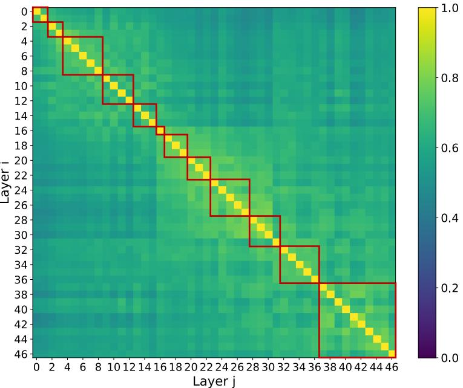
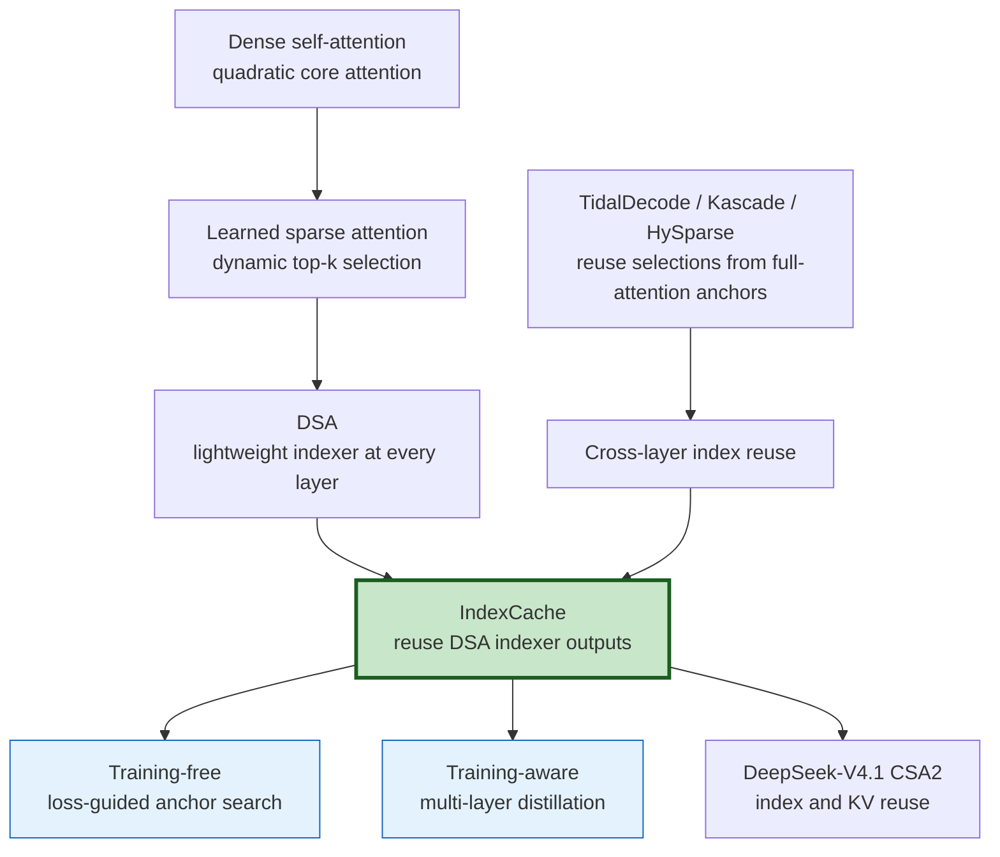
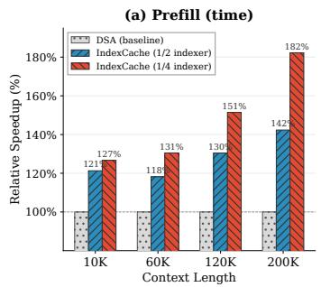
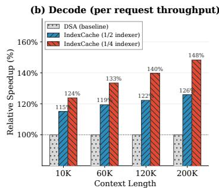
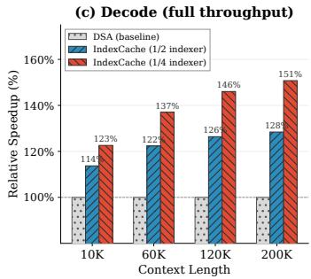

# IndexCache: Cross-Layer Index Reuse for Sparse Attention

**Paper:** IndexCache: Accelerating Sparse Attention via Cross-Layer Index Reuse  
**Authors:** Yushi Bai, Qian Dong, Ting Jiang, Xin Lv, Zhengxiao Du, Aohan Zeng, Jie Tang, Juanzi Li  
**arXiv:** [2603.12201v1](https://arxiv.org/abs/2603.12201v1), March 2026  

**Related pages:** [DeepSeek-V3.2 DSA](../../../algorithms/deepseek-v3.2/index.md), [DeepSeek-V4.1 CSA2](../../deepseek/deepseek-v4.1/index.md), [MiniMax Sparse Attention](../minimax-sparse-attention/index.md), [Lightning Indexer](../../../terms/lightning-indexer.md)

> **Evidence:** Results are author-reported from a 30B DSA model and preliminary experiments on GLM-5. The paper does not provide a public reproduction package, so mechanism claims are high-confidence source facts but performance generalization remains medium confidence.

## TL;DR

**What:** IndexCache applies [cross-layer index reuse](../../../terms/cross-layer-index-reuse.md) to learned sparse attention, retaining indexers in a minority of layers and letting the others reuse the most recent top-k token indices.

**How:** An off-the-shelf model can choose retained layers with calibration-loss-guided greedy search, while a trained-for-sharing model distills each retained indexer against the average attention distribution of every layer it serves.

**The number:** On a 47-layer, 30B-A3B DSA model at 200K context, retaining one quarter of indexers reduced prefill from 19.5 s to 10.7 s and raised single-request decode from 58 to 86 tokens/s—reported 1.82× and 1.48× speedups.

## The Big Picture

*Source: [Figure 4 of the IndexCache paper](../../../../raw/training/indexcache-accelerating-sparse-attention-cross-layer-index-reuse--arxiv-2603.12201v1.pdf). ① Bright cells near the diagonal show that adjacent layers select many of the same 2,048 tokens. ② Larger bright blocks reveal regions where one retained indexer can serve several layers. ③ Darker early-to-late regions show that one global selection cannot serve the whole network. ④ Red boxes mark the loss-searched one-quarter-retention groups, whose boundaries do not simply follow visual overlap.*

**The important pattern is local redundancy, not global sameness.** Adjacent layers overlap by roughly 70–100%, but early and late layers may overlap by 40% or less. IndexCache therefore caches only the current top-k index tensor and refreshes it at selected boundaries rather than freezing one mask across the model.

## Why This Exists

Imagine a long-context coding agent with a 200K-token repository and tool history. DSA avoids running expensive main attention over all 200K positions: at every layer, a lightweight [Lightning Indexer](../../../terms/lightning-indexer.md) scans the prefix, selects 2,048 tokens, and lets core attention operate only on them.

That still leaves a hidden quadratic bill. On the paper's 30B model, the indexer's share of prefill time rises from 27% at 10K tokens to 81% at 200K because all 47 layers independently rescan the same prefix. If four neighboring layers mostly choose the same tokens, paying four full scans buys little new information.

The obvious fix—keep every fourth indexer—also fails. Some early and transition layers are unusually sensitive to losing their own selection. At one-quarter retention, uniform spacing dropped the long-context average from 50.2 to 43.0, whereas choosing layers by end-to-end language-model loss recovered it to 49.9.

## The Landscape

The editable Mermaid source is [indexcache-landscape.mmd](assets/indexcache-landscape.mmd).

Earlier reuse methods obtain sparse indices from occasional full-attention anchor layers. IndexCache's distinction is that **the oracle is itself a lightweight sparse-attention indexer**: it removes redundant selection work without reintroducing full attention. DeepSeek-V4.1's CSA2 is a close system-level sibling that also reuses indices, but combines that decision with cross-layer KV sharing and hierarchical candidate restriction.

## The Core Idea

**Do not ask every layer the same expensive routing question.** Let a retained layer decide which past tokens matter, reuse that answer while nearby layers still agree, and refresh it where the model's loss says the answer has become stale. If the model can be trained for this structure, teach each retained selector to produce a compromise that works for its entire layer group.

## Symbol Map

`F` and `S` describe layer roles, not attention types. Superscript $(\ell)$ identifies a Transformer layer; subscript $t$ identifies the current query position.

| Symbol | Human name | Shape or scope | Plain meaning |
|---|---|---|---|
| $N$ | model depth | 47 layers in the 30B experiment | Number of sparse-attention layers. |
| $L$ | sequence length | up to 200K in the main speed test | Number of visible tokens. |
| $k$ | selection budget | 2,048 tokens per query | Past positions sent to core sparse attention. |
| $c_\ell$ | layer role | $F$ or $S$ | Whether layer $\ell$ computes or reuses indices. |
| $\mathbf I_t^{(\ell)}$ | indexer scores | one score per visible position | Learned relevance scores before top-k. |
| $\mathcal T_t^{(\ell)}$ | selected index set | $k$ token positions | Positions used by layer $\ell$'s core attention. |
| $\mathbf p_t^{(\ell)}$ | teacher distribution | attention distribution | Aggregated main-attention target for layer $\ell$. |
| $\mathbf q_t^{(\ell)}$ | indexer distribution | softmax over indexer scores | Distribution trained to approximate the teacher. |

| Role | Runs an indexer? | Top-k source | Cache action | Main sparse attention |
|---|---|---|---|---|
| Full (`F`) | Yes | Current layer | Overwrite temporary index tensor | Uses fresh indices |
| Shared (`S`) | No | Nearest preceding `F` layer | Read temporary index tensor | Uses inherited indices |

## Deep Dive

### Full and Shared layers turn selection into a reusable state

**What it does:** IndexCache partitions the network into `F` layers that compute fresh top-k indices and `S` layers that reuse the latest result.

**Why it matters:** This removes repeated $O(L^2)$ indexer scans while leaving every layer's $O(Lk)$ core sparse attention and FFN intact.

**How it works:** The first layer is always `F`. It computes $\mathbf I_t^{(1)}$, takes top-k to obtain $\mathcal T_t^{(1)}$, and places that index tensor in a temporary buffer. Every following `S` layer skips its indexer and gives the cached indices to its own sparse-attention computation. The next `F` layer overwrites the buffer. Because standard DSA already materializes a current index tensor, the paper reports no extra GPU-memory requirement.

**The intuition:** One layer writes a route map; nearby layers follow it until another layer redraws the map.

**A concrete example:** For the 200K-token coding context, an `F` layer scans all visible positions and selects 2,048 repository tokens. Three `S` layers reuse those positions but still apply their own query, attention weights, values, output projection, and FFN.

**Remember:** IndexCache shares **indices**, not attention outputs or whole layer computations.

### Training-free search finds where a frozen model needs refreshes

**What it does:** A greedy search converts indexer layers from `F` to `S` one at a time, committing the candidate pattern with the lowest calibration language-model loss.

**Why it matters:** Uniform spacing ignores layer sensitivity; raw overlap also misses whether the differing tokens are causally important.

**How it works:** Start with all layers `F`, keep layer 1 fixed, and test removing each remaining indexer on the same cached calibration batches. Commit the lowest-loss removal and repeat until reaching the target retention ratio. The full procedure requires $N(N-1)/2$ forward passes; pipeline-stage blocks can reduce the search cost by placing several removals per step. The paper calibrates on 768 SFT samples of length 200K.

**The intuition:** Judge a routing shortcut by the model's final prediction loss, not by how similar two intermediate masks look.

**A concrete example:** At one-quarter retention, a simple `FSSS` pattern harms the coding agent's long-context score, but greedy search protects sensitive early or transition indexers and removes redundant ones inside stable regions.

**Remember:** For a frozen model, **which indexers remain matters more than how many remain**.

### Multi-layer distillation trains one indexer for a group

**What it does:** Training-aware IndexCache teaches each retained indexer to serve its own layer and the following `S` layers.

**Why it matters:** A standard DSA indexer is distilled only toward its own layer, so inherited indices create a distribution shift for the layers that borrow them.

**How it works:** If retained layer $\ell$ serves itself plus $m$ shared layers, its loss averages their KL-divergence targets:

$$
\mathcal L_{\text{multi}}^{I}
= \frac{1}{m+1}\sum_{j=0}^{m}\sum_t
D_{\mathrm{KL}}\!\left(\mathbf p_t^{(\ell+j)}\,\|\,\mathbf q_t^{(\ell)}\right).
$$

The paper proves this has the same gradient as distilling toward the averaged teacher distribution $\bar{\mathbf p}_t$. In practice it uses the sum-of-KLs form because an `S` layer need only receive the retained indexer's prediction rather than both prediction and teacher tensors. Warm-up trains the retained indexers with the backbone frozen; sparse training then combines multi-layer distillation with language-model loss.

**The intuition:** Train one selector to propose a consensus reading list for every layer in its group.

**A concrete example:** Instead of layer 12 selecting only what layer 12 prefers, its indexer learns a top-2,048 distribution that also covers the important evidence needed by layers 13–15.

**Remember:** Training removes most pattern sensitivity because both the retained indexer and its consumer layers adapt to sharing.

## Putting It Together

Follow one decode query from the 200K-token coding session through an `FSSSF` group:

| Step | Actor | Input state | Action | Output state |
|---:|---|---|---|---|
| 1 | Layer 12 (`F`) | Query plus 200K visible tokens; stale index buffer | Score all positions and select top 2,048 | Buffer holds $\mathcal T_t^{(12)}$ |
| 2 | Layer 12 core attention | Layer-12 query, KV state, fresh indices | Attend only to selected positions | Updated hidden state |
| 3 | Layers 13–15 (`S`) | Each layer's own hidden state plus $\mathcal T_t^{(12)}$ | Skip indexers; run their own sparse attention and FFNs | Three distinct hidden states, no rescans |
| 4 | Layer 16 (`F`) | Layer-15 output plus inherited indices | Rescore 200K positions and overwrite the buffer | Buffer holds $\mathcal T_t^{(16)}$ |
| 5 | Remaining groups | Latest hidden state and current index buffer | Repeat `F` refreshes and `S` reuse | Final next-token logits |

**Only the routing state crosses layer boundaries.** Each layer still transforms the hidden state independently, which is why quality depends on refreshing indices before the borrowed selection becomes stale.

## What This Buys You

### The headline claim

**At long context, removing three quarters of indexer calls turns the newly dominant DSA overhead back into a minority cost.** The benefit grows with sequence length because the skipped scan is quadratic in $L$.

*Source: Figure 3a of the [IndexCache paper](../../../../raw/training/indexcache-accelerating-sparse-attention-cross-layer-index-reuse--arxiv-2603.12201v1.pdf). Prefill speedup is relative to the DSA baseline on the 30B model; one-quarter retention reaches 182% at 200K.*

*Source: Figure 3b of the [IndexCache paper](../../../../raw/training/indexcache-accelerating-sparse-attention-cross-layer-index-reuse--arxiv-2603.12201v1.pdf). Single-request decode throughput reaches 148% of DSA at 200K with one-quarter retention.*

*Source: Figure 3c of the [IndexCache paper](../../../../raw/training/indexcache-accelerating-sparse-attention-cross-layer-index-reuse--arxiv-2603.12201v1.pdf). With roughly 800K cached tokens per GPU, total decode throughput reaches 151% of DSA at 200K.*

### How we know: 30B end-to-end serving at 200K

| Metric | DSA | IndexCache, 1/2 retained | IndexCache, 1/4 retained |
|---|---:|---:|---:|
| Prefill time (s) ↓ | 19.5 | 13.7 | **10.7** |
| Decode, one request (tokens/s) ↑ | 58 | 73 | **86** |
| Decode, full KV cache (tokens/s/GPU) ↑ | 197 | 253 | **297** |

The test uses SGLang with attention data parallelism of 8 on one NVIDIA H100 node. At 200K, the baseline indexer accounts for 81% of prefill time and 41% of decode time, so removing indexers affects total latency much more than it does at 10K.

### How we know: quality under aggressive reuse

| Setting | Pattern | Retained indexers | Long-context average | General/reasoning average |
|---|---|---:|---:|---:|
| Training-free DSA baseline | All `F` | 100% | 50.2 | 74.6 |
| Training-free | Uniform | 25% | 43.0 | 73.8 |
| Training-free | Greedy searched | 25% | **49.9** | **74.9** |
| Training-aware DSA baseline | All `F` | 100% | 51.0 | 74.2 |
| Training-aware | Uniform plus multi-layer loss | 25% | **50.6** | **74.1** |

The key ablation is not a tiny benchmark win: it is the seven-point recovery from replacing uniform placement with loss-guided placement in the frozen model. Training-aware one-quarter retention then makes the simple uniform pattern viable.

### ⚠️ How to read these numbers

The 30B model was derived from GLM-4.7-Flash and trained/evaluated by the authors, not independently reproduced. GLM-5 results are explicitly preliminary: loss-searched one-quarter retention reports a long-context average of 78.0 versus 78.4 for DSA, while the paper reports at least 1.3× prefill and decode speedup beyond 100K. Claims beyond these models, selection budgets, hardware, and workloads are inference rather than measured evidence.

## Where It Breaks

| Failure mode | When it happens | Impact |
|---|---|---|
| Uniform placement skips a critical indexer | A frozen model has sensitive early or transition layers | One-quarter uniform retention drops the reported long-context average by 7.2 points. |
| Reuse becomes too aggressive | Only one eighth of frozen-model indexers remain | Even greedy search falls from 50.2 to 46.1 long-context average. |
| Similarity chooses the wrong boundaries | A pattern is selected from aggregate top-k overlap or attention-output cosine similarity | Locally similar masks can differ on a few critical tokens; similarity-optimized patterns perform roughly like uniform spacing. |
| Calibration does not represent deployment | The loss-search corpus, context length, or task mix differs materially from served traffic | The static pattern may protect the wrong layers; this is an inferred deployment risk not tested by the paper. |
| Savings are small at short context | Indexer scans are not yet a large fraction of end-to-end work | At 10K, one-quarter retention reports 1.27× prefill rather than 1.82×. |
| Sparse selector is absent or structurally incompatible | Attention uses fixed sparsity or per-layer selections whose shapes/semantics cannot be shared | IndexCache's temporary top-k tensor cannot be reused directly. |
| Scale result is treated as mature evidence | GLM-5 training-aware adaptation or public reproduction is required | The 744B evidence remains preliminary and does not establish broad production reliability. |

## One Thing to Remember

**IndexCache turns sparse attention's routing decision into a short-lived cross-layer cache.** The speedup comes from skipping repeated full-prefix index scans; quality comes from deciding where that cache must be refreshed—by end-to-end loss for frozen models or by training each retained indexer toward the consensus needs of its layer group.

## Go Deeper

- **Read:** [IndexCache paper](https://arxiv.org/abs/2603.12201v1) and the local [source PDF](../../../../raw/training/indexcache-accelerating-sparse-attention-cross-layer-index-reuse--arxiv-2603.12201v1.pdf).
- **Build on:** [DeepSeek-V3.2](../../../algorithms/deepseek-v3.2/index.md), whose DSA indexer is the mechanism IndexCache accelerates.
- **Compare:** [DeepSeek-V4.1 CSA2](../../deepseek/deepseek-v4.1/index.md), which jointly reuses sparse indices and global KV state, and [MiniMax Sparse Attention](../minimax-sparse-attention/index.md), another learned selector architecture.
- **Understand the mechanism:** [Cross-Layer Index Reuse](../../../terms/cross-layer-index-reuse.md) and [Lightning Indexer](../../../terms/lightning-indexer.md).
- **Reproduce:** No public code or checkpoint is identified in the paper; the reported 30B serving setup uses SGLang on an eight-H100 node.
